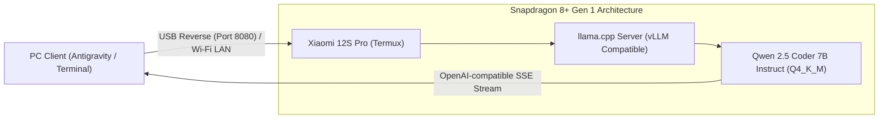

# Local AI Inference Node - Snapdragon 8+ Gen 1 (Xiaomi 12S Pro -> PC)

Hệ thống kiến trúc điện toán biên (Edge Computing) biến điện thoại di động Xiaomi 12S Pro (Snapdragon 8+ Gen 1, 12GB RAM) thành **Trạm suy luận AI cục bộ (Local AI Node)** phục vụ máy tính cá nhân hoàn toàn bảo mật, ngoại tuyến và không tốn chi phí API.

---

## ⚡ Kiến Trúc Hoạt Động



### 1. Thành phần chính
- **Mô hình suy luận**: `Qwen2.5-Coder-7B-Instruct` được tối ưu hóa lượng tử hóa `Q4_K_M` trên kiến trúc ARM64 NEON.
- **Máy chủ AI**: `llama-server` chạy trong môi trường Termux trên Android, mở cổng `8080` với endpoint chuẩn OpenAI (`/v1/chat/completions`, `/v1/models`).
- **Giao thức kết nối song song**:
  - **USB Cable**: Kết nối cáp siêu tốc độ trễ thấp thông qua `adb reverse tcp:8080 tcp:8080` (hoặc `adb forward`).
  - **Wi-Fi Local**: Kết nối không dây nội bộ (ví dụ: `http://192.168.1.104:8080`).

---

## 🛠️ Danh Mục Tập Lệnh Điều Hành

| Tên Tập Lệnh | Nền Tảng | Chức Năng Chính |
| :--- | :---: | :--- |
| **`connect_ai_node.bat`** | Windows CMD | Khởi tạo kết nối ADB Reverse cổng 8080 chỉ bằng 1-click từ máy tính |
| **`chat.py`** | Python 3.12+ | Ứng dụng chat CLI tương tác thông minh, tự động nhận diện USB / Wi-Fi |
| **`test_ai_stream.py`** | Python 3.12+ | Kiểm định tốc độ suy luận dạng dòng (Token Streaming & TPS Benchmark) |
| **`test_ai_node.py`** | Python 3.12+ | Kiểm tra tính khả dụng và danh sách model của AI Node |
| **`launch_termux_ai.py`** | Python | Kịch bản tự động hóa gửi lệnh khởi động Termux AI qua ADB |
| **`setup_ai.sh`** | Bash / Termux | Thiết lập môi trường Termux, cài đặt dependency và cấu hình llama.cpp |
| **`start_ai.sh`** | Bash / Termux | Khởi chạy máy chủ suy luận với tham số tối ưu hóa nhiệt độ và nhân CPU |
| **`check_llama_assets.py`** | Python | Kiểm tra các bản build llama.cpp nhị phân tối ưu cho Snapdragon NPU/CPU |

---

## 🚀 Hướng Dẫn Sử Dụng Nhanh

1. **Khởi động AI Node trên điện thoại**:
   Chạy ứng dụng Termux trên Xiaomi 12S Pro và thực thi lệnh:
   ```bash
   bash start_ai.sh
   ```

2. **Kết nối từ máy tính**:
   Cắm cáp USB vào máy tính và kích đúp vào tệp `connect_ai_node.bat`.

3. **Bắt đầu trò chuyện**:
   Mở terminal trên máy tính và chạy:
   ```powershell
   python chat.py
   ```
