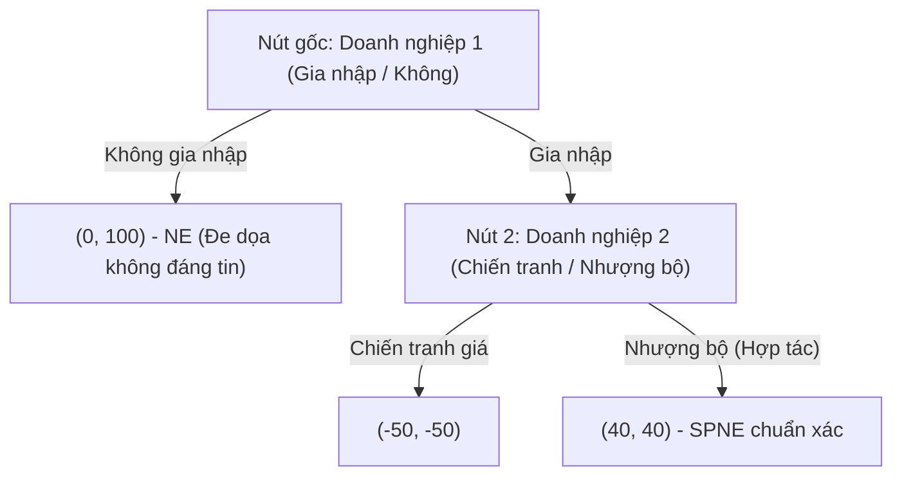

# HỆ THỐNG KIẾN THỨC KINH TẾ HỌC TOÀN DIỆN (LÝ THUYẾT & ỨNG DỤNG)
**Biên soạn theo tiêu chuẩn Tiến sĩ Kinh tế học (PhD Level)**
*Phần A: Nền tảng và Ứng dụng  ·  Phần B: Chuyên đề Nâng cao & Hình thức hóa Toán học*

***

# PHẦN A — NỀN TẢNG KINH TẾ HỌC

***

# 1. Thị trường & Giá

Nhóm nền tảng nhất: giải thích giá cả hình thành thế nào và vì sao thị trường tự do thường phân bổ nguồn lực hiệu quả. Đây là bộ công cụ để đọc mọi biến động giá trong đời sống — từ giá xăng, giá nhà đến lương nhân sự.

***

## Cung – Cầu (Supply & Demand)

**Cốt lõi:** Giá và sản lượng cân bằng của một thị trường được xác định tại giao điểm giữa đường cung (lượng người bán sẵn sàng bán ở mỗi mức giá) và đường cầu (lượng người mua sẵn sàng mua ở mỗi mức giá). Khi một trong hai đường dịch chuyển do các yếu tố ngoài giá (thu nhập, thị hiếu, chi phí đầu vào, kỳ vọng...), điểm cân bằng mới sẽ hình thành. Cơ chế điều chỉnh: nếu giá tạm thời cao hơn mức cân bằng, dư cung xuất hiện, người bán buộc phải hạ giá để bán hết hàng tồn; nếu giá thấp hơn, thiếu hụt xuất hiện, người mua sẵn sàng trả cao hơn để giành hàng — cả hai lực đều đẩy giá VỀ điểm cân bằng.

**Điểm mù thường gặp:** Khi đọc một tin biến động giá (xăng tăng, nhà đất sốt...), phản xạ đầu tiên thường là kết luận cảm tính ngay ("chắc do nhu cầu tăng") mà quên dừng lại đặt đúng câu hỏi phân tích: yếu tố nào đang dịch chuyển — đường cung hay đường cầu — trước khi suy ra nguyên nhân thực sự. Một điểm mù khác: khi CẢ hai đường cùng dịch chuyển đồng thời (ví dụ vừa tăng thu nhập vừa tăng chi phí sản xuất), chiều thay đổi của GIÁ có thể dự đoán chắc chắn nhưng chiều thay đổi của LƯỢNG lại không xác định được nếu không biết mức độ dịch chuyển tương đối của mỗi đường — kết luận vội "lượng chắc cũng tăng" là sai lầm phổ biến.

**Ứng dụng thực tế:** Khi giá xăng thế giới tăng đột biến, chi phí vận chuyển (một đầu vào) tăng khiến đường cung nhiều loại hàng hóa dịch trái — giá bán lẻ tăng dù nhu cầu tiêu dùng không đổi. Phân biệt đúng nguyên nhân giúp doanh nghiệp chọn đúng biện pháp ứng phó: đàm phán lại nhà cung cấp thay vì cắt giảm marketing.

**Ví dụ minh hoạ:** Giả sử mô hình cân bằng cục bộ cho một hàng hóa với hàm cầu dạng Cobb-Douglas $Q_d(P, I) = A I^{\alpha} P^{-\epsilon}$ và hàm cung dạng đẳng co giãn $Q_s(P) = B P^{\gamma}$, trong đó $I$ là thu nhập, $\alpha > 0$ là độ co giãn thu nhập, $\epsilon > 0$ là độ co giãn của cầu theo giá, và $\gamma > 0$ là độ co giãn của cung. Cân bằng thị trường đòi hỏi $A I^{\alpha} P^{-\epsilon} = B P^{\gamma}$. 
Lấy logarit tự nhiên hai vế và giải $P^*$, ta có:
$$\ln P^* = \frac{\ln(A/B) + \alpha \ln I}{\epsilon + \gamma}$$
Từ phương trình này, ta có thể dùng phép tính vi phân toàn phần (total differentiation) để phân tích statics so sánh (comparative statics). Khi thu nhập $I$ tăng 1%, giá cân bằng sẽ thay đổi một tỷ lệ xấp xỉ $\frac{\partial \ln P^*}{\partial \ln I} = \frac{\alpha}{\epsilon + \gamma} > 0$. Lượng cân bằng $Q^*$ thay đổi tương ứng $\frac{\partial \ln Q^*}{\partial \ln I} = \gamma \frac{\alpha}{\epsilon + \gamma}$. Điều này chứng minh chặt chẽ bằng giải tích rằng một cú sốc thu nhập dương đối với hàng hóa thông thường ($\alpha > 0$) luôn làm tăng cả giá và lượng cân bằng.

***

## Độ co giãn (Elasticity)

**Cốt lõi:** Đo mức độ nhạy cảm của lượng cầu (hoặc cung) khi giá thay đổi 1%, tính bằng công thức $E = (\%\Delta Q) / (\%\Delta P)$. Cầu co giãn nhiều ($|E| > 1$) nghĩa là người mua dễ dàng chuyển sang lựa chọn khác khi giá tăng; cầu co giãn ít ($|E| < 1$) nghĩa là người mua vẫn mua gần như cũ dù giá đổi — thường gặp ở hàng thiết yếu, ít hàng thay thế. Độ co giãn quyết định trực tiếp doanh thu phản ứng thế nào khi đổi giá: nếu $|E| > 1$, tăng giá làm TỔNG DOANH THU giảm (vì lượng bán giảm mạnh hơn phần trăm giá tăng); nếu $|E| < 1$, tăng giá làm tổng doanh thu tăng.

**Điểm mù thường gặp:** Khi chi phí đầu vào tăng và cần điều chỉnh giá bán, phản xạ thường là tăng giá đồng loạt mọi sản phẩm mà quên dừng lại hỏi: sản phẩm nào khách hàng dễ tìm được lựa chọn thay thế? Bỏ qua câu hỏi này khiến chiến lược giá phản tác dụng đúng ở những sản phẩm co giãn nhiều nhất. Một điểm mù khác: độ co giãn không phải hằng số cố định của một sản phẩm — nó thay đổi dọc theo đường cầu (thường co giãn nhiều hơn ở vùng giá cao, ít hơn ở vùng giá thấp) và thay đổi theo khung thời gian (co giãn theo giá xăng gần như bằng 0 trong vài ngày nhưng lớn hơn nhiều sau vài năm khi người tiêu dùng đổi sang xe tiết kiệm nhiên liệu).

**Ứng dụng thực tế:** Một quán cà phê có thể tăng giá cà phê đặc sản (cầu co giãn ít, khách trung thành, ít nơi thay thế) nhưng nên giữ nguyên giá nước lọc/trà đá (cầu co giãn nhiều, dễ bị so sánh) để tối ưu tổng doanh thu thay vì tăng đều mọi món.

**Ví dụ minh hoạ:** Một cửa hàng tăng giá một mặt hàng từ 20.000đ lên 22.000đ (tăng 10%), lượng bán giảm từ 1.000 xuống 850 sản phẩm/tháng (giảm 15%) $\Rightarrow E = -15\% / 10\% = -1{,}5$ (cầu co giãn nhiều). Doanh thu trước: $20.000 \times 1.000 = 20$ triệu đồng; doanh thu sau: $22.000 \times 850 = 18{,}7$ triệu đồng — doanh thu GIẢM dù giá tăng, đúng dự đoán khi $|E| > 1$. Nếu cửa hàng biết trước độ co giãn này, quyết định đúng đắn hơn là KHÔNG tăng giá mặt hàng đó.

***

## Thặng dư tiêu dùng / sản xuất (Consumer & Producer Surplus)

**Cốt lõi:** Thặng dư tiêu dùng (CS) là thặng dư đo lường lợi ích của người tiêu dùng, được định nghĩa toán học là tích phân của hiệu số giữa hàm cầu ngược (inverse demand function) và mức giá thị trường. Thặng dư sản xuất (PS) là tích phân của hiệu số giữa mức giá thị trường và hàm cung ngược (chi phí biên). Tổng thặng dư (Total Surplus - TS) là thước đo phúc lợi xã hội:
$$CS = \int_{0}^{Q^*} (D^{-1}(Q) - P^*) dQ \quad \text{và} \quad PS = \int_{0}^{Q^*} (P^* - S^{-1}(Q)) dQ$$
Đạo hàm bậc nhất của $TS$ theo $Q$ tại điểm tối đa cho ta $D^{-1}(Q^*) = S^{-1}(Q^*) \iff P_d = P_s = P^*$, điều kiện tiên quyết của cân bằng thị trường cạnh tranh hoàn hảo.

**Điểm mù thường gặp:** Sinh viên thường giới hạn tư duy trong các đường cầu/cung tuyến tính (tạo ra các "tam giác" thặng dư). Trên thực tế, đối với các hàm cầu phi tuyến (ví dụ hàm cầu đẳng co giãn $Q = AP^{-\epsilon}$), việc xác định thặng dư yêu cầu khả năng hội tụ của tích phân suy rộng. Ví dụ, nếu $\epsilon \le 1$, thặng dư tiêu dùng sẽ tiến tới vô cực khi $Q \to 0$, điều này ngụ ý các hàm cầu đẳng co giãn thuần túy không thể mô tả hành vi tiêu dùng ở những mức giá tiệm cận vô cực trong thế giới thực.

**Ứng dụng thực tế:** Phân tích phúc lợi trong kinh tế công cộng yêu cầu đo lường độ co giãn cục bộ (local elasticity) để xấp xỉ DWL thông qua phân tích chuỗi Taylor (Taylor expansion) của hàm chi tiêu (expenditure function) thay vì các tam giác thô sơ. Áp trần giá thuê nhà có thể được mô hình hóa như một sự bóp méo cận biên (marginal distortion), làm giảm CS và PS phi tuyến tính theo thời gian.

**Ví dụ minh hoạ:** Giả sử hàm cầu vé xem phim là một hàm phi tuyến $P_d(Q) = \frac{100}{Q+1}$ và hàm cung ngược (chi phí biên) là $P_s(Q) = 4Q$. Trạng thái cân bằng cạnh tranh xảy ra khi $P_d(Q) = P_s(Q) \implies \frac{100}{Q+1} = 4Q \implies 4Q^2 + 4Q - 100 = 0$. Giải phương trình bậc hai, ta có $Q^* \approx 4.52$ và $P^* \approx 18.1$.
Tính Thặng dư tiêu dùng (CS) bằng tích phân:
$$CS = \int_{0}^{4.52} \left( \frac{100}{Q+1} - 18.1 \right) dQ = \left[ 100 \ln(Q+1) - 18.1Q \right]_0^{4.52} \approx 100 \ln(5.52) - 81.81 \approx 89.04$$
Tính Thặng dư sản xuất (PS):
$$PS = \int_{0}^{4.52} (18.1 - 4Q) dQ = \left[ 18.1Q - 2Q^2 \right]_0^{4.52} \approx 81.81 - 40.86 \approx 40.95$$
Tổng phúc lợi xã hội tối đa đạt được là $CS + PS = 129.99$. Nếu chính phủ áp đặt một quota sản lượng $Q = 3$, tích phân sẽ bị chặn sớm, dẫn tới tổn thất vô ích ròng (Deadweight Loss) có thể tính chính xác qua giải tích.

***

## Giá trần & giá sàn (Price ceiling & Price floor)

**Cốt lõi:** Giá trần là mức giá tối đa hợp pháp, đặt DƯỚI giá cân bằng để bảo vệ người mua (ví dụ giá thuê nhà, giá xăng thời khủng hoảng) — gây ra THIẾU HỤT vì tại mức giá thấp đó người mua muốn mua nhiều hơn người bán muốn bán. Giá sàn là mức giá tối thiểu hợp pháp, đặt TRÊN giá cân bằng để bảo vệ người bán (ví dụ lương tối thiểu, giá thu mua nông sản) — gây ra DƯ THỪA vì lượng cung vượt lượng cầu ở mức giá đó. Cả hai chỉ có hiệu lực (ràng buộc thị trường) khi đặt LỆCH khỏi giá cân bằng tự nhiên — một giá trần cao hơn giá cân bằng hoặc giá sàn thấp hơn giá cân bằng hoàn toàn không có tác dụng gì.

**Điểm mù thường gặp:** Trực giác thường nghĩ "áp giá trần thấp hơn = người mua luôn có lợi", nhưng bỏ qua rằng thiếu hụt buộc phải phân bổ hàng hoá bằng cơ chế KHÁC ngoài giá — xếp hàng, quen biết, hoặc "chợ đen" — người thực sự nhận được hàng ở giá thấp không nhất thiết là người cần nhất, mà là người đến sớm nhất hoặc quen biết nhất. Tương tự, giá sàn (như lương tối thiểu) không tự động có lợi cho TOÀN BỘ người lao động — những người vẫn giữ được việc làm có lợi, nhưng phần dư thừa lao động (thất nghiệp tăng thêm) lại là chi phí của chính sách, một đánh đổi hay bị bỏ qua trong tranh luận đơn giản hoá.

**Ứng dụng thực tế:** Kiểm soát giá thuê nhà (rent control) tại nhiều thành phố lớn — trong ngắn hạn người thuê hiện tại có lợi, nhưng dài hạn chủ nhà giảm đầu tư bảo trì/xây mới, làm trầm trọng thêm khan hiếm nhà cho người thuê MỚI, đây là lý do nhiều nhà kinh tế (không phân biệt khuynh hướng chính trị) đồng thuận phản đối kiểm soát giá thuê nhà cứng nhắc kéo dài.

**Ví dụ minh hoạ:** Với $Q_d = 100 - 2P$, $Q_s = -20 + 3P$ (cân bằng $P = 24$, $Q = 52$), nếu chính phủ áp giá trần $P = 18$: $Q_d = 100 - 36 = 64$, $Q_s = -20 + 54 = 34 \Rightarrow$ thiếu hụt $= 64 - 34 = 30$ (nghìn vé) — chỉ 34 nghìn người mua được vé dù 64 nghìn người muốn mua ở mức giá đó, 30 nghìn người còn lại phải xếp hàng, tìm quan hệ, hoặc mua chợ đen với giá cao hơn nhiều mức trần.

***

## Ai thực sự chịu thuế? (Tax incidence)

**Cốt lõi:** Khi chính phủ đánh thuế một hàng hoá, gánh nặng thuế thực tế (ai trả bao nhiêu) KHÔNG phụ thuộc việc luật quy định người bán hay người mua phải nộp thuế, mà phụ thuộc ĐỘ CO GIÃN TƯƠNG ĐỐI của cung và cầu: bên nào co giãn ÍT hơn (khó thay đổi hành vi hơn khi giá đổi) sẽ gánh phần thuế LỚN hơn, bất kể ai là người trực tiếp nộp tiền cho cơ quan thuế. Đây là hệ quả trực tiếp của mô hình cung-cầu: thuế chèn một "khoảng cách" giữa giá người mua trả và giá người bán nhận, và thị trường tự phân bổ khoảng cách đó theo độ co giãn.

**Điểm mù thường gặp:** Tranh luận chính sách thường tập trung vào "đánh thuế vào ai" (thuế VAT người bán nộp hay thuế thu nhập người lao động nộp) như thể điều đó quyết định ai chịu thiệt — bỏ qua rằng về mặt kinh tế, việc luật quy định ai nộp thuế trên giấy tờ hầu như không ảnh hưởng đến người thực sự chịu gánh nặng, chỉ ảnh hưởng ai phải làm thủ tục hành chính nộp thuế. Đánh thuế người bán hay người mua, xét về mặt toán học, cho ra CÙNG một kết quả cân bằng cuối cùng.

**Ứng dụng thực tế:** Thuế thuốc lá thường được thiết kế đánh vào nhà sản xuất, nhưng vì cầu thuốc lá co giãn RẤT ÍT (người nghiện khó bỏ dù giá tăng), gần như toàn bộ thuế được chuyển sang người tiêu dùng qua giá bán cao hơn — ngược lại, thuế đánh vào hàng xa xỉ dễ thay thế (cầu co giãn nhiều) sẽ do người bán/nhà sản xuất gánh phần lớn vì tăng giá sẽ mất khách nhanh chóng.

**Ví dụ minh hoạ:** Với $Q_d = 100 - 2P$, $Q_s = -20 + 3P$ (cân bằng gốc $P = 24$), giả sử chính phủ đánh thuế 5 (nghìn đồng)/vé thu từ người bán. Người bán chỉ còn giữ lại $(P - 5)$ mỗi vé nên cung mới: $Q_s = -20 + 3(P-5) = -35 + 3P$. Cân bằng mới: $100 - 2P = -35 + 3P \Rightarrow 135 = 5P \Rightarrow P = 27$ (giá người mua trả); người bán thực nhận $27 - 5 = 22$. So với giá gốc 24: người mua trả THÊM 3, người bán nhận ÍT HƠN 2 (tổng $3+2=5$ đúng bằng mức thuế). Dù thuế thu từ người bán trên giấy tờ, người MUA lại chịu phần lớn hơn (3 so với 2) — vì tại vùng giá này, cầu co giãn ít hơn cung một chút (độ co giãn cầu $\approx -0{,}92$ so với cung $\approx 1{,}38$ tại điểm cân bằng gốc).

***

## Di chuyển trên đường vs dịch chuyển đường (Movement along vs Shift)

**Cốt lõi:** Phân biệt hai loại thay đổi thường bị gộp làm một. "Di chuyển DỌC đường cầu/cung" (movement along the curve) xảy ra CHỈ khi giá của chính hàng hoá đó thay đổi — đường cầu/cung giữ nguyên, chỉ điểm trên đường thay đổi. "Dịch chuyển CẢ đường cầu/cung" (shift of the curve) xảy ra khi một yếu tố NGOÀI giá thay đổi (thu nhập, giá hàng liên quan, thị hiếu, kỳ vọng, công nghệ, số người mua/bán trên thị trường) — toàn bộ đường di chuyển sang vị trí mới, nghĩa là ở CÙNG một mức giá, lượng mua/bán mong muốn đã khác trước.

**Điểm mù thường gặp:** Cụm từ hàng ngày "cầu tăng" bị dùng lẫn lộn cho hai trường hợp hoàn toàn khác nhau: giá giảm khiến lượng cầu tăng (di chuyển dọc đường cầu CŨ, đường cầu không đổi) và thu nhập tăng khiến toàn bộ đường cầu dịch phải (ở MỌI mức giá, người ta mua nhiều hơn). Nhầm lẫn hai loại "tăng" này khiến phân tích nguyên nhân-kết quả sai ngay từ bước đầu, vì mỗi loại đòi hỏi một cách diễn giải và một hành động đáp trả hoàn toàn khác nhau.

**Ứng dụng thực tế:** Khi phân tích vì sao doanh số một sản phẩm tăng, cần hỏi trước tiên: có phải do CHÍNH doanh nghiệp giảm giá (di chuyển dọc đường cầu, doanh thu có thể tăng hoặc giảm tuỳ độ co giãn) hay do yếu tố bên ngoài như xu hướng thị trường/thu nhập tăng (dịch chuyển đường cầu, doanh số tăng ở MỌI mức giá kể cả khi không đổi giá) — hai nguyên nhân đòi hỏi chiến lược hoàn toàn khác: một bên là quyết định giá của chính mình, bên kia là tín hiệu thị trường ngoài tầm kiểm soát giá.

**Ví dụ minh hoạ:** Doanh nghiệp X giảm giá sản phẩm từ 100.000đ xuống 90.000đ, doanh số tăng từ 500 lên 600 sản phẩm/tháng — đây là DI CHUYỂN dọc đường cầu (do chính X thay đổi giá, đường cầu không đổi). Tháng sau, dù X giữ nguyên giá 90.000đ, doanh số vẫn tiếp tục tăng lên 750 vì đối thủ cạnh tranh chính đóng cửa — đây là DỊCH CHUYỂN đường cầu (nguyên nhân đến từ bên ngoài quyết định giá của X, đường cầu dịch phải hoàn toàn).

***

## Sản lượng tối ưu & quyết định có nên sản xuất (Optimal Output & Shutdown Decision)

**Cốt lõi:** Doanh nghiệp tối đa hoá lợi nhuận bằng cách sản xuất đến mức sản lượng nơi DOANH THU BIÊN ($MR$ — doanh thu tăng thêm từ một đơn vị bán thêm; trong thị trường cạnh tranh $MR = \text{giá bán } P$) bằng CHI PHÍ BIÊN ($MC$ — chi phí tăng thêm để sản xuất một đơn vị nữa): nếu $MR > MC$, sản xuất thêm vẫn có lợi; nếu $MR < MC$, đơn vị đó đang lỗ — quy tắc $MR = MC$ luôn xác định đúng điểm dừng tối ưu. Câu hỏi thứ hai, độc lập với câu hỏi trên: có nên sản xuất chút nào không? Trong ngắn hạn, so giá bán $P$ với CHI PHÍ BIẾN ĐỔI BÌNH QUÂN ($AVC$) — nếu $P \ge AVC$, vẫn nên tiếp tục sản xuất dù đang lỗ (vì phần chênh giúp bù bớt chi phí cố định); nếu $P < AVC$, nên đóng cửa ngay lập tức. Trong dài hạn, ngưỡng chuyển thành so $P$ với TỔNG CHI PHÍ BÌNH QUÂN ($ATC$) — $P < ATC$ kéo dài là tín hiệu nên rút khỏi ngành.

**Điểm mù thường gặp:** Nhầm lẫn phổ biến nhất: coi "đang lỗ" đồng nghĩa với "nên đóng cửa ngay". Một doanh nghiệp có thể đang lỗ ($P < ATC$) nhưng vẫn nên TIẾP TỤC sản xuất trong ngắn hạn nếu $P$ vẫn lớn hơn $AVC$ — vì đóng cửa hoàn toàn sẽ mất luôn phần bù đắp chi phí cố định (khoản phải trả dù có sản xuất hay không, xem Chương 3 — chi phí chìm). Chỉ khi $P$ tụt xuống dưới $AVC$, tiếp tục sản xuất mới thực sự tệ hơn đóng cửa. Điểm mù thứ hai: nhầm mục tiêu "tối đa hoá lợi nhuận" với "tối thiểu hoá chi phí bình quân trên một đơn vị" — sản xuất đến mức $ATC$ thấp nhất thường đã VƯỢT QUA điểm $MR = MC$ từ lâu, tức đang sản xuất NHIỀU HƠN mức tối ưu.

**Ứng dụng thực tế:** Nhiều hãng hàng không trong giai đoạn khủng hoảng vẫn duy trì một số chuyến bay dù bán vé dưới giá hoà vốn — vì giá vé vẫn đủ bù chi phí nhiên liệu/phi hành đoàn biến đổi ($AVC$) và góp thêm một phần bù chi phí thuê máy bay cố định, tốt hơn để máy bay nằm không hoàn toàn không sinh doanh thu. Một xưởng may cân nhắc nhận thêm đơn hàng nên hỏi đơn hàng TIẾP THEO (chi phí biên để may thêm) có đem lại doanh thu biên cao hơn chi phí biên hay không — chứ không hỏi giá trung bình các đơn trước đang lời bao nhiêu.

**Ví dụ minh hoạ:** Với chi phí biên $MC = 3 + 0{,}8Q$ và giá thị trường $P = 12$: giải $3 + 0{,}8Q = 12 \Rightarrow Q^* \approx 11{,}25$ đơn vị — sản lượng tối đa hoá lợi nhuận. Riêng câu hỏi có nên sản xuất: giả sử chi phí cố định $= 20$; tại $Q = 10$, $AVC = 3 + 0{,}4 \times 10 = 7$ và $ATC = 20/10 + 3 + 0{,}4 \times 10 = 9$. Nếu giá thị trường tụt còn $P = 5$: vì $AVC (7) > 5$, giá không đủ bù cả chi phí biến đổi $\Rightarrow$ nên đóng cửa ngay dù đã lỡ chi 20 cho chi phí cố định. Nếu giá là $P = 8$: $AVC (7) < 8 < ATC (9) \Rightarrow$ vẫn lỗ trên tổng thể nhưng NÊN tiếp tục sản xuất ngắn hạn vì đang bù được một phần chi phí cố định.

***

# 2. Thất bại thị trường

Thị trường tự do không phải lúc nào cũng hiệu quả. Nhóm này hệ thống 5 lý do kinh điển khiến thị trường "thất bại" — và cũng là lý do chính đáng cho sự can thiệp của nhà nước hoặc thiết kế hợp đồng/thể chế.

***

## Ngoại tác (Externalities)

**Cốt lõi:** Xảy ra khi hành động của một bên tạo ra chi phí hoặc lợi ích cho bên thứ ba không tham gia giao dịch, mà không được phản ánh vào giá. Ngoại tác tiêu cực (ô nhiễm) khiến chi phí biên xã hội ($MSC = \text{MPC} + \text{MEC}$) cao hơn chi phí biên tư nhân — thị trường tự do sản xuất tại điểm $D = MPC$, NHIỀU hơn mức tối ưu xã hội (nơi $D = MSC$). Ngoại tác tích cực (giáo dục, tiêm chủng) khiến lợi ích biên xã hội cao hơn lợi ích biên tư nhân, khiến thị trường cung cấp ÍT hơn mức tối ưu xã hội.

**Điểm mù thường gặp:** Chỉ nghĩ ngay đến ngoại tác môi trường mà quên nhận ra ngoại tác cũng xảy ra trong công việc hằng ngày — một nhân viên trễ deadline tạo ngoại tác tiêu cực lên cả nhóm, nhưng vì không mang tên "ô nhiễm" nên hiếm khi được nhận diện và tính chi phí đúng như bản chất của nó. Điểm mù thứ hai: thuế Pigou đúng bằng $MEC$ chỉ khôi phục hiệu quả nếu $MEC$ không đổi theo $Q$ hoặc theo NGƯỜI gây ra — trong thực tế các nguồn ô nhiễm khác nhau (nhà máy cũ/mới) có $MEC$ khác nhau, nên một mức thuế đồng nhất cho cả ngành chỉ là gần đúng, không tối ưu tuyệt đối cho từng doanh nghiệp.

**Ứng dụng thực tế:** Thuế carbon là công cụ kinh điển để "nội hoá" ngoại tác tiêu cực — buộc người gây ô nhiễm trả đúng chi phí xã hội họ tạo ra, thay vì đẩy chi phí đó cho cộng đồng gánh chịu miễn phí. Cơ chế "cap-and-trade" (mua bán hạn ngạch phát thải) là cách khác đạt cùng mục tiêu: thay vì ấn định GIÁ (thuế), nhà nước ấn định LƯỢNG phát thải tối đa rồi để thị trường tự tìm ra giá.

**Ví dụ minh hoạ:** Giả sử một nhà máy có chi phí biên tư nhân $MPC = 2 + 0{,}5Q$ và gây ô nhiễm với chi phí ngoại tác biên không đổi $MEC = 6$ (nghìn đồng/đơn vị) $\Rightarrow MSC = MPC + MEC = 8 + 0{,}5Q$. Cầu thị trường $P = 30 - 0{,}5Q$. Thị trường tự do sản xuất tại $D = MPC$: $2+0{,}5Q = 30-0{,}5Q \Rightarrow Q_{\text{thị trường}} = 28$. Mức tối ưu xã hội tại $D = MSC$: $8+0{,}5Q = 30-0{,}5Q \Rightarrow Q^* = 22$. Sản xuất thừa 6 đơn vị so với tối ưu — thuế Pigou đúng bằng $MEC = 6$/đơn vị sẽ đẩy chi phí tư nhân lên ngang chi phí xã hội, buộc thị trường tự điều chỉnh đúng về $Q^* = 22$.

***

## Thông tin bất cân xứng (Asymmetric Information)

**Cốt lõi:** Một bên trong giao dịch có nhiều thông tin hơn bên kia. Akerlof (1970) hình thức hoá qua mô hình "thị trường chanh" (market for lemons): nếu người mua chỉ biết chất lượng TRUNG BÌNH của thị trường, họ chỉ sẵn sàng trả mức giá tương ứng chất lượng trung bình — đẩy người bán hàng TỐT (đòi giá cao hơn mức trung bình) rời thị trường trước, kéo chất lượng trung bình còn lại xuống thấp hơn nữa. Lặp lại vòng xoáy này (adverse selection death spiral) có thể khiến cả thị trường sụp đổ dù đôi bên đều có thể có lợi nếu thông tin đầy đủ. Phân biệt hai thời điểm: lựa chọn ngược (adverse selection) xảy ra TRƯỚC giao dịch do thông tin ẩn giấu; rủi ro đạo đức (moral hazard) xảy ra SAU giao dịch do hành động ẩn giấu.

**Điểm mù thường gặp:** Trong đàm phán M&A hoặc mua nhà đất, người mua thường tin lời người bán mà quên nhận ra một sự thật cấu trúc: bên bán LUÔN có động cơ và thông tin để che giấu nhược điểm — đây chính là lý do due diligence, bảo hành (warranty), và tài khoản ký quỹ (escrow) tồn tại như công cụ bắt buộc chứ không phải thủ tục hình thức. Điểm mù thứ hai: nhầm lẫn hai loại thường xảy ra — cho rằng mọi vấn đề thông tin đều giải quyết được bằng cách "minh bạch hoá" (chỉ đúng với lựa chọn ngược, vì vấn đề là thông tin ẩn), trong khi rủi ro đạo đức là vấn đề HÀNH VI xảy ra sau, minh bạch hoá thông tin ban đầu không giải quyết được — cần giám sát hoặc thiết kế khuyến khích (như mức khấu trừ bảo hiểm) thay vì chỉ công khai thông tin.

**Ứng dụng thực tế:** Bảo hiểm y tế tự nguyện dễ gặp lựa chọn ngược: người biết mình có nguy cơ sức khỏe cao có xu hướng mua bảo hiểm nhiều hơn người khỏe mạnh, đẩy chi phí trung bình của quỹ bảo hiểm lên cao — buộc công ty bảo hiểm phải sàng lọc hoặc tăng phí. Rủi ro đạo đức xuất hiện riêng biệt: một khi đã mua bảo hiểm ô tô toàn diện, người lái có xu hướng cẩn trọng kém hơn (vì hậu quả tai nạn phần lớn do bên bảo hiểm gánh) — đây là lý do hợp đồng bảo hiểm luôn có mức khấu trừ (deductible) bắt người được bảo hiểm chịu một phần chi phí.

**Ví dụ minh hoạ:** Thị trường xe cũ có 2 loại: xe tốt (50% thị trường, người bán sẵn lòng bán từ 200 triệu, người mua sẵn lòng trả đến 240 triệu) và xe kém (50%, người bán sẵn lòng bán từ 80 triệu, người mua sẵn lòng trả đến 100 triệu). Nếu người mua KHÔNG phân biệt được, họ chỉ trả mức kỳ vọng trung bình: $0{,}5 \times 240 + 0{,}5 \times 100 = 170$ triệu. Nhưng 170 triệu THẤP hơn mức 200 triệu người bán xe tốt đòi $\Rightarrow$ người bán xe tốt RÚT khỏi thị trường. Người mua nhận ra chỉ còn xe kém, hạ kỳ vọng xuống 100 triệu — thị trường xe tốt biến mất hoàn toàn dù cả người mua lẫn người bán xe tốt đều có thể có lợi nếu giao dịch với đầy đủ thông tin.

***

## Hàng hóa công (Public goods)

**Cốt lõi:** Hàng hóa có hai đặc tính độc lập nhau: cạnh tranh trong tiêu dùng hay không (người này dùng có làm giảm phần người khác không), và loại trừ được hay không (có thể ngăn người không trả tiền vẫn hưởng lợi không). Kết hợp hai trục này cho ra bốn loại hàng hoá kinh điển: hàng hoá tư nhân (cạnh tranh + loại trừ được), hàng hoá câu lạc bộ (không cạnh tranh + loại trừ được), tài nguyên chung (cạnh tranh + không loại trừ được — xem khái niệm tiếp theo), và hàng hoá công thuần tuý (không cạnh tranh + không loại trừ được). Với hàng hoá công thuần tuý, thị trường tư nhân có xu hướng cung cấp dưới mức cần thiết — vấn đề "kẻ ăn theo" (free-rider): mỗi người có động cơ chờ người khác trả tiền trong khi mình vẫn hưởng lợi.

**Điểm mù thường gặp:** Trước một vấn đề tập thể (ô nhiễm không khí, an ninh khu phố, nghiên cứu cơ bản), phản xạ "để thị trường/tư nhân tự lo" thường xuất hiện trước khi kịp nhận ra bản chất hàng hoá công của vấn đề — không cạnh tranh và không loại trừ được — khiến cơ chế giá tự nó không thể hoạt động. Điểm mù thứ hai: gộp chung "hàng hoá công" (public goods, khái niệm kinh tế học chính xác) với "hàng hoá do nhà nước cung cấp" (khái niệm hành chính) — nhiều thứ nhà nước cung cấp thực chất là hàng hoá tư nhân hoặc câu lạc bộ (giáo dục, y tế có thể loại trừ được bằng học phí/viện phí) được nhà nước trợ giá vì lý do công bằng, không phải vì đặc tính kinh tế học của chúng đòi hỏi vậy.

**Ứng dụng thực tế:** Nghiên cứu khoa học cơ bản (không tạo sản phẩm bán được ngay) thường do nhà nước hoặc quỹ phi lợi nhuận tài trợ, vì doanh nghiệp tư nhân không thể thu phí từ tất cả những ai hưởng lợi từ tri thức đó sau này. Radio/truyền hình phát sóng miễn phí (không loại trừ được về mặt kỹ thuật truyền thống) thường được tài trợ gián tiếp qua quảng cáo thay vì thu phí trực tiếp — một cách né vấn đề free-rider mà không cần chính phủ can thiệp.

**Ví dụ minh hoạ:** Pháo hoa lễ hội: chi phí tổ chức 500 triệu đồng, thành phố có 20.000 người thực sự sẵn lòng trả trung bình 30.000đ để xem (nhưng không thể thu phí vì không loại trừ được ai xem từ xa) $\Rightarrow$ tổng lợi ích xã hội $= 20.000 \times 30.000 = 600$ triệu $> 500$ triệu chi phí — về mặt xã hội ĐÁNG tổ chức. Nhưng vì không thể thu phí trực tiếp từng người xem, không doanh nghiệp tư nhân nào tự nguyện đứng ra tổ chức dù có lợi cho xã hội — cần ngân sách công hoặc nhà tài trợ (được bù lại bằng gắn thương hiệu) đứng ra chi trả thay cơ chế giá thông thường.

***

## Sức mạnh độc quyền (Market power)

**Cốt lõi:** Khi một doanh nghiệp (độc quyền) hoặc một nhóm nhỏ doanh nghiệp (độc quyền nhóm) có khả năng định giá cao hơn chi phí biên mà không mất hết khách hàng, sản lượng thị trường sẽ thấp hơn và giá cao hơn mức cạnh tranh — tạo tổn thất vô ích. Khác biệt cốt lõi so với cạnh tranh hoàn hảo: doanh nghiệp độc quyền đối diện TOÀN BỘ đường cầu thị trường (dốc xuống) thay vì đường cầu nằm ngang tại giá thị trường, nên để bán thêm phải HẠ giá cho TẤT CẢ đơn vị đã bán trước — khiến doanh thu biên ($MR$) luôn THẤP HƠN giá bán ($MR < P$), khác cạnh tranh hoàn hảo nơi $MR = P$. Độc quyền vẫn áp dụng quy tắc $MR = MC$ để tìm sản lượng tối ưu (xem Chương 1), nhưng vì $MR < P$, mức giá bán cuối cùng cao hơn chi phí biên — khoảng cách này là nguồn gốc tổn thất vô ích.

**Điểm mù thường gặp:** Khi đánh giá một ngành hay một thương vụ M&A, dễ chỉ nhìn vào QUY MÔ doanh nghiệp mà quên kiểm tra đúng hai yếu tố quyết định sức mạnh định giá thực sự: rào cản gia nhập ngành và mức độ thay thế của sản phẩm — một công ty nhỏ trong thị trường ngách không đối thủ vẫn có thể có sức mạnh định giá cao. Điểm mù thứ hai: nhầm "độc quyền có lợi nhuận cao" với "độc quyền luôn xấu cho xã hội" — lợi nhuận độc quyền TỰ THÂN chỉ là chuyển giao từ người tiêu dùng sang doanh nghiệp (không mất mát ròng); phần thực sự gây hại là TỔN THẤT VÔ ÍCH từ sản lượng bị cắt giảm, một phân biệt quan trọng khi thiết kế chính sách (đánh thuế lợi nhuận độc quyền khác về bản chất với buộc tăng sản lượng).

**Ứng dụng thực tế:** Cơ quan quản lý cạnh tranh thường chặn các thương vụ M&A giữa hai đối thủ trực tiếp lớn trong cùng ngành hẹp (ví dụ hai hãng viễn thông) vì lo ngại giảm số người chơi sẽ làm tăng sức mạnh định giá chung của ngành, dù mỗi công ty trước sáp nhập không hẳn đã "độc quyền" theo nghĩa tuyệt đối.

**Ví dụ minh hoạ:** Xét một nhà độc quyền đối mặt với hàm cầu có độ co giãn không đổi (CES) $Q(P) = A P^{-\epsilon}$ với $\epsilon > 1$ (cầu co giãn), và hàm chi phí tuyến tính $C(Q) = cQ$. Bài toán tối ưu hóa lợi nhuận của nhà độc quyền:
$$\max_{P} \Pi(P) = P \cdot A P^{-\epsilon} - c \cdot A P^{-\epsilon}$$
Điều kiện bậc nhất (First-Order Condition - FOC) theo $P$:
$$\frac{\partial \Pi}{\partial P} = A (1-\epsilon) P^{-\epsilon} + A \epsilon c P^{-\epsilon-1} = 0$$
Chia hai vế cho $A P^{-\epsilon-1}$, ta thu được quy tắc định giá cộng gộp (markup pricing rule):
$$P(1-\epsilon) + \epsilon c = 0 \implies P^* = \frac{\epsilon}{\epsilon - 1} c = \left( 1 + \frac{1}{\epsilon - 1} \right) c$$
Biến đổi tương đương, ta có Hệ số Lerner (Lerner Index) kinh điển biểu diễn sức mạnh thị trường độc quyền:
$$L = \frac{P^* - MC}{P^*} = \frac{1}{\epsilon}$$
Kết quả giải tích này khẳng định sức mạnh định giá của nhà độc quyền (tỷ lệ chênh lệch giữa giá và chi phí biên) tỷ lệ nghịch tuyệt đối với độ co giãn của cầu. Một sự phân bổ kém hiệu quả (DWL) được tạo ra vì $P^* > c$, phá vỡ điều kiện Pareto tối ưu.

***

## Bi kịch của cái chung (Tragedy of the Commons)

**Cốt lõi:** Khi một tài nguyên có tính CẠNH TRANH trong tiêu dùng (một người khai thác làm giảm phần còn lại cho người khác) nhưng KHÔNG LOẠI TRỪ ĐƯỢC (không thể ngăn ai khai thác) — góc phần tư "tài nguyên chung" trong ma trận ở khái niệm trước — mỗi cá nhân chỉ tính chi phí/lợi ích RIÊNG của mình khi quyết định khai thác, bỏ qua chi phí họ áp lên người khác (về bản chất là một dạng ngoại tác tiêu cực, xem khái niệm đầu chương). Hardin (1968) đặt tên hiện tượng khai thác vượt mức bền vững này là "bi kịch của cái chung": mỗi cá nhân hành động hoàn toàn duy lý theo lợi ích riêng, nhưng tổng hợp lại gây hại cho tất cả.

**Điểm mù thường gặp:** Thường bị nhầm là vấn đề "lòng tham" hay "thiếu đạo đức" của người khai thác — nhưng về bản chất đây là vấn đề CẤU TRÚC KHUYẾN KHÍCH: ngay cả người có đạo đức cao nhất cũng đối diện cùng động cơ khai thác thêm, vì phần họ TỪ CHỐI khai thác không tự động được giữ lại mà thường bị người khác khai thác thay — "nhường nhịn đơn phương" không giải quyết được vấn đề nếu không đi kèm cơ chế ràng buộc TẤT CẢ mọi người tham gia.

**Ứng dụng thực tế:** Đánh bắt cá quá mức tại các ngư trường quốc tế (không thuộc chủ quyền riêng ai) là ví dụ kinh điển — mỗi tàu cá đánh bắt tối đa có lợi cho riêng họ, nhưng tổng hợp hành vi này làm suy giảm quần thể cá cho TẤT CẢ trong tương lai. Hai hướng giải pháp chính: (1) hạn ngạch đánh bắt kết hợp giấy phép có thể chuyển nhượng (ITQ — biến tài nguyên chung thành gần giống hàng hoá tư nhân có thể sở hữu/giao dịch), hoặc (2) Ostrom (giải Nobel 2009) chỉ ra cộng đồng địa phương tự quản lý qua quy tắc tự thiết lập (không cần nhà nước hay tư nhân hoá hoàn toàn) cũng có thể thành công trong nhiều trường hợp thực tế được nghiên cứu.

**Ví dụ minh hoạ:** Một hồ đánh cá chung có lợi ích ròng biên KHÔNG đổi cho mỗi ngư dân khi tự đánh bắt thêm là 10 (họ chỉ tính riêng phần mình), nhưng mỗi đơn vị đánh bắt thêm cũng làm giảm sản lượng chung tương lai, gây tổng chi phí ngoại tác biên quy đổi $= 4$/đơn vị mà người đánh bắt không tính đến (lợi ích biên xã hội thực $= 10 - 4 = 6$). Với chi phí khai thác biên $MC = 2 + 0{,}3Q$: mức khai thác cá nhân tự phát (bỏ qua ngoại tác): $10 = 2 + 0{,}3Q \Rightarrow Q \approx 26{,}7$/người. Mức khai thác bền vững xã hội phải trừ ngoại tác: $6 = 2 + 0{,}3Q \Rightarrow Q^* \approx 13{,}3$/người — chỉ bằng MỘT NỬA mức khai thác tự phát, minh hoạ mức độ khai thác quá mức khi không có cơ chế điều phối.

***

# 3. Ra quyết định

Nhóm công cụ tư duy cá nhân — cách một nhà kinh tế "lý tính" cân nhắc lựa chọn. Đây là nhóm dễ nhớ về mặt lý thuyết nhưng khó áp dụng nhất trong thực tế, vì nó đi ngược lại nhiều bản năng tâm lý tự nhiên.

***

## Chi phí cơ hội (Opportunity cost)

**Cốt lõi:** Giá trị của lựa chọn tốt nhất bị bỏ qua khi ta chọn một phương án — đây là chi phí thực sự cần cân nhắc khi ra quyết định, không chỉ là tiền bỏ ra mà cả thời gian, công sức, và những gì lẽ ra có thể đạt được nếu chọn hướng khác. Về mặt hình thức, nếu nguồn lực khan hiếm (thời gian, vốn, lao động) có thể tạo ra hai kết quả A hoặc B, đường giới hạn khả năng sản xuất (PPF — production possibility frontier) mô tả mọi tổ hợp (A, B) tối đa có thể đạt được; độ dốc của PPF tại một điểm chính là chi phí cơ hội biên của A tính theo B. PPF thường lõm (bowed outward) vì nguồn lực không đồng nhất — khi chuyển ngày càng nhiều nguồn lực từ B sang A, những nguồn lực kém phù hợp nhất với A (nhưng từng rất hiệu quả cho B) mới bị chuyển sau cùng, khiến chi phí cơ hội của mỗi đơn vị A tăng dần (quy luật chi phí cơ hội tăng dần). Cần phân biệt chi phí kế toán (accounting cost — chỉ tính chi tiêu bằng tiền thực trả) với chi phí kinh tế (economic cost = chi phí kế toán + chi phí cơ hội của các nguồn lực tự có, như vốn tự bỏ hay thời gian chủ sở hữu); lợi nhuận kinh tế do đó luôn nhỏ hơn lợi nhuận kế toán, và một doanh nghiệp có lãi kế toán vẫn có thể đang lỗ về kinh tế nếu vốn và công sức đó sinh lời cao hơn ở phương án khác. Đây cũng chính là nền tảng của lợi thế so sánh (comparative advantage — xem Chương 4): một quốc gia hay cá nhân nên chuyên môn hoá vào hoạt động có chi phí cơ hội thấp nhất, không nhất thiết là hoạt động mình giỏi nhất tuyệt đối.

**Điểm mù thường gặp:** Chỉ tính chi phí bằng tiền mặt bỏ ra mà quên tính thời gian hoặc nguồn lực đã dùng vào việc khác — ví dụ tự làm một việc "để tiết kiệm tiền thuê ngoài" trong khi thời gian đó lẽ ra tạo ra giá trị lớn hơn nếu dùng vào chuyên môn chính. Một điểm mù khác: nhầm chi phí cơ hội với tổng giá trị của MỌI phương án bị từ chối — đúng ra chỉ tính phương án tốt nhất trong số bị bỏ qua (nếu có ba lựa chọn thay thế, chi phí cơ hội bằng giá trị của lựa chọn tốt nhất trong ba, không phải tổng cả ba). Điều này áp dụng cả cho lựa chọn "không làm gì": giữ tiền mặt nhàn rỗi hoặc trì hoãn quyết định vẫn có chi phí cơ hội — đúng bằng lợi nhuận kỳ vọng của phương án đầu tư tốt nhất bị bỏ lỡ trong thời gian đó, dù không có dòng tiền nào thực sự "mất đi".

**Ứng dụng thực tế:** Một nhà sáng lập tự làm kế toán để "tiết kiệm chi phí" — nhưng nếu 5 giờ mỗi tuần đó dùng để gặp khách hàng có thể mang lại doanh thu lớn hơn nhiều lần phí thuê kế toán, thì việc tự làm đang tốn chi phí cơ hội cao hơn lợi ích tưởng tượng. Tương tự, một chủ tiệm báo cáo lãi kế toán 200 triệu đồng/năm nhưng nếu số vốn 2 tỷ đồng bỏ vào tiệm có thể sinh lời 15%/năm (300 triệu đồng) nếu gửi tiết kiệm hoặc đầu tư nơi khác với mức rủi ro tương đương, thì về bản chất kinh tế, tiệm đang lỗ cơ hội 100 triệu đồng mỗi năm dù sổ sách vẫn ghi nhận lãi.

**Ví dụ minh hoạ:** Một xưởng may có 120 giờ công/tuần. May một áo sơ mi tốn 2 giờ công; may một quần jean tốn 4 giờ công. Nếu dồn toàn bộ giờ công cho áo sơ mi: $120 \div 2 = 60$ áo/tuần (0 quần); nếu dồn toàn bộ cho quần jean: $120 \div 4 = 30$ quần/tuần (0 áo) — đây là hai điểm đầu mút của PPF. Vì công nghệ đơn giản (một loại lao động, năng suất không đổi), PPF ở đây là đoạn thẳng chứ không lõm — chi phí cơ hội không đổi dọc đường: mỗi 1 quần jean sản xuất thêm luôn "tốn" đúng 2 áo sơ mi bị bỏ qua (vì 4 giờ dùng cho 1 quần đúng bằng giờ có thể may 2 áo), bất kể đang sản xuất bao nhiêu quần. Nếu xưởng hiện sản xuất tại điểm (40 áo, 10 quần) — dùng đúng $40 \times 2 + 10 \times 4 = 80 + 40 = 120$ giờ, đúng năng lực — và cân nhắc nhận thêm một đơn hàng 5 quần jean nữa, họ phải hiểu ngay: chấp nhận đơn này đồng nghĩa từ bỏ $5 \times 2 = 10$ áo sơ mi, bất kể giá bán quần jean trông "hấp dẫn" thế nào trên hoá đơn — quyết định đúng chỉ nên nhận đơn nếu lợi nhuận từ 5 quần jean vượt lợi nhuận có thể có từ 10 áo sơ mi bị bỏ lỡ.

***

## Chi phí chìm (Sunk cost)

**Cốt lõi:** Chi phí đã bỏ ra và không thể thu hồi, dù có tiếp tục hay dừng lại. Nguyên tắc ra quyết định hợp lý (chiết khấu dòng tiền, relevant costing) là chỉ dòng tiền và lợi ích trong tương lai mới nên ảnh hưởng đến quyết định — chi phí chìm không nên xuất hiện trong phép tính. Về mặt hình thức, nếu bài toán tối ưu là chọn $x$ để tối đa hoá lợi ích ròng tương lai $V(x) - K(x)$, trong đó $K(x)$ là chi phí phải chi THÊM tuỳ theo lựa chọn $x$, thì một khoản chi phí $C$ đã trả trong quá khứ — không phụ thuộc $x$ — chỉ làm dịch toàn bộ hàm mục tiêu xuống một hằng số không đổi ($V(x) - K(x) - C$), không hề làm thay đổi giá trị $x$ tối ưu. Đây là lý do các chuẩn mực kế toán quản trị (relevant costing) và các mô hình tối ưu hoá động (dynamic programming, nguyên lý Bellman) đều loại chi phí chìm khỏi hàm mục tiêu ngay từ đầu — quyết định chỉ nên là hàm số của trạng thái hiện tại và các dòng tiền còn lại phía trước, không phải hàm số của lịch sử đã qua. Về mặt hành vi, xu hướng vẫn tiếp tục đầu tư vào một phương án chỉ vì đã đầu tư nhiều — dù bằng chứng mới cho thấy nên dừng — được gọi là ngụy biện chi phí chìm (sunk cost fallacy), một trong những thiên lệch được ghi nhận thực nghiệm rõ ràng nhất trong kinh tế học hành vi (Arkes & Blumer, 1985; xem thêm Nhóm 6).

**Điểm mù thường gặp:** Ngay tại thời điểm cân nhắc có nên tiếp tục một dự án đang lỗ, ta hiếm khi dừng lại để nhận ra đây chính là một tình huống "chi phí chìm" — cảm giác "đã đầu tư quá nhiều để bỏ giữa chừng" xuất hiện trước, và phép tính lý tính chỉ được gọi ra (nếu có) sau khi quyết định cảm tính đã hình thành. Một điểm mù khác: đánh đồng "chi phí chìm" với "chi phí cố định" (fixed cost) — hai khái niệm nằm trên hai trục phân loại khác nhau. Chi phí cố định là chi phí không đổi theo sản lượng trong ngắn hạn (ví dụ tiền thuê mặt bằng theo hợp đồng); chi phí chìm là chi phí không thể thu hồi bất kể quyết định nào được chọn. Một khoản chi phí có thể vừa cố định vừa chìm (tiền thuê nhà xưởng đã trả trước, không hoàn lại), nhưng cũng có thể cố định mà không chìm — một máy móc đã mua nhưng còn giá trị thanh lý đáng kể; nếu dừng dự án, phần giá trị thu hồi được từ việc bán máy KHÔNG phải chi phí chìm và cần đưa vào phép so sánh (xem thêm Chương 1 — sản lượng tối ưu và quyết định có nên sản xuất).

**Ứng dụng thực tế:** Một công ty đã chi 2 tỷ đồng phát triển một sản phẩm nhưng nghiên cứu thị trường mới cho thấy sản phẩm sẽ không bán được — quyết định đúng là dừng lại ngay, đánh giá dựa trên chi phí hoàn thiện còn lại so với doanh thu kỳ vọng, không phải dựa trên 2 tỷ đã mất — trừ phần nào trong 2 tỷ đó còn có thể thu hồi được (ví dụ bán lại bản quyền công nghệ hoặc nguyên vật liệu dở dang cho đối tác khác); phần thu hồi này cần đưa vào bài toán vì nó là một dòng tiền tương lai thực sự, không phải chi phí chìm.

**Ví dụ minh hoạ:** Mở rộng ví dụ trên bằng số liệu cụ thể: công ty đã chi 2.000 triệu đồng phát triển sản phẩm (chi phí chìm — không đưa vào phép tính tiếp theo). Hai phương án còn lại: (1) Tiếp tục hoàn thiện — cần chi thêm 500 triệu đồng, dự kiến thu về 700 triệu đồng $\Rightarrow$ lợi ích ròng tương lai $= 700 - 500 = +200$ triệu đồng. (2) Dừng lại và thanh lý tài sản dở dang (bản quyền, nguyên vật liệu) — thu về 150 triệu đồng $\Rightarrow$ lợi ích ròng tương lai $= +150$ triệu đồng. So sánh đúng chỉ dựa trên hai con số tương lai này (200 so với 150): nên chọn TIẾP TỤC vì $200 > 150$ — kết luận này hoàn toàn không phụ thuộc việc 2.000 triệu đã chi là 1.000 hay 5.000 triệu, vì con số đó không xuất hiện trong phép so sánh. Lối tư duy sai (thường gặp) sẽ so sánh "đã đầu tư 2.000 triệu, nếu dừng coi như mất trắng, còn tiếp tục ít ra cũng thu về gần đủ" — cách nghĩ này lẫn chi phí chìm vào bài toán và dễ dẫn đến việc tiếp tục rót vốn dù phương án dừng lại thực ra tốt hơn. Phép thử: nếu chi phí hoàn thiện là 600 triệu đồng thay vì 500 (mọi thứ khác giữ nguyên), lợi ích ròng của phương án tiếp tục giảm còn $700 - 600 = 100 < 150$ — quyết định đúng khi đó ĐẢO CHIỀU thành DỪNG LẠI, điều mà lối tư duy "tiếc của đã bỏ ra" thường bỏ lỡ vì vẫn neo vào con số 2.000 triệu đã chi.

***

## Tư duy biên (Marginal thinking)

**Cốt lõi:** So sánh lợi ích tăng thêm (marginal benefit — $MB$) với chi phí tăng thêm (marginal cost — $MC$) của MỘT đơn vị quyết định tiếp theo, thay vì so sánh tổng lợi ích với tổng chi phí. Quyết định tối ưu là tiếp tục cho đến khi lợi ích biên bằng chi phí biên. Về mặt toán học, nếu lợi ích ròng là $NB(Q) = TB(Q) - TC(Q)$ (tổng lợi ích trừ tổng chi phí theo biến quyết định $Q$), điều kiện cần bậc một để $Q$ tối đa hoá $NB$ là đạo hàm $NB'(Q) = TB'(Q) - TC'(Q) = MB(Q) - MC(Q) = 0$, tức $MB = MC$ — "tư duy biên" vì vậy không phải một mẹo kinh nghiệm mà là hệ quả trực tiếp của phép tính vi phân tối ưu hoá, áp dụng cho mọi bài toán ra quyết định có biến liên tục. Đây chính là nguyên lý nền đứng sau lựa chọn tối ưu của người tiêu dùng, quyết định sản lượng của doanh nghiệp ($MR = MC$, xem Chương 1 — sản lượng tối ưu), và phần lớn các bài toán tối ưu hoá có ràng buộc trong kinh tế học. Điều kiện bậc một $MB = MC$ chỉ đảm bảo một điểm dừng (stationary point); điều kiện bậc hai đòi hỏi $MC$ phải tăng nhanh hơn $MB$ (hay $MB$ giảm nhanh hơn $MC$) tại điểm đó để đảm bảo đây thực sự là điểm tối đa chứ không phải tối thiểu — về trực giác, đây là lý do quy tắc "tiếp tục miễn $MB$ lớn hơn $MC$, dừng khi $MB$ nhỏ hơn $MC$" luôn đúng: nó tự động thoả điều kiện bậc hai đó.

**Điểm mù thường gặp:** Khi cân nhắc có nên nhận thêm một đơn hàng, khách hàng, hay ca làm việc, phản xạ thường là nhìn vào chi phí hoặc lợi nhuận TRUNG BÌNH đã biết, mà quên dừng lại tính đúng chi phí và lợi ích BIÊN của riêng quyết định tiếp theo đó. Một điểm mù khác: ngộ nhận chi phí biên ($MC$) và chi phí bình quân ($AC$) luôn di chuyển cùng chiều. Về mặt toán học, $MC$ cắt $AC$ đúng tại điểm $AC$ nhỏ nhất: khi $MC$ nhỏ hơn $AC$, mỗi đơn vị thêm kéo bình quân giảm xuống ($AC$ đang giảm); khi $MC$ lớn hơn $AC$, mỗi đơn vị thêm kéo bình quân tăng lên ($AC$ đang tăng). Điều này nghĩa là một doanh nghiệp hoàn toàn có thể đang ở vùng chi phí bình quân giảm dần (trông có vẻ "ngày càng hiệu quả") nhưng chi phí biên đã bắt đầu tăng — quyết định sản lượng tối ưu ($MR = MC$) không hề chờ đến khi $AC$ ngừng giảm mới cần quan tâm.

**Ứng dụng thực tế:** Một hãng hàng không sẵn sàng bán vé giờ chót với giá rất thấp — vì chi phí biên của một hành khách thêm trên chuyến bay đã lên lịch gần như bằng 0 (ghế trống vẫn bay), nên bất kỳ giá nào cao hơn chi phí biên đó đều có lợi, dù thấp hơn nhiều giá vé trung bình. Đây cũng là minh hoạ trực tiếp cho điểm mù thứ hai ở trên: chi phí BÌNH QUÂN mỗi ghế (đã gánh cả chi phí nhiên liệu, phi hành đoàn, khấu hao máy bay) có thể là 2 triệu đồng, nhưng chi phí BIÊN của ghế trống cuối cùng gần bằng 0 — bán vé 500 nghìn đồng cho ghế đó vẫn có lợi dù thấp hơn nhiều lần mức bình quân.

**Ví dụ minh hoạ:** Một quán cà phê cân nhắc thuê thêm nhân viên theo giờ vào cuối tuần. Lợi ích biên (doanh thu tăng thêm nhờ phục vụ nhanh hơn, ít khách bỏ đi) của giờ nhân viên thứ $Q$ ước tính $MB = 200 - 8Q$ (nghìn đồng/giờ, $Q$ tính bằng số giờ nhân viên thêm). Chi phí biên (lương giờ và phụ cấp) không đổi $MC = 40$ (nghìn đồng/giờ). Điểm tối ưu: $MB = MC \Rightarrow 200 - 8Q = 40 \Rightarrow Q^* = 20$ giờ nhân viên thêm mỗi cuối tuần. Nếu quán chỉ nhìn vào lợi nhuận trung bình mỗi giờ nhân viên đã thuê trước đó (giả sử đang dương, ví dụ 60 nghìn đồng/giờ) mà quyết định thuê thêm ồ ạt đến 30 giờ, thực tế tại $Q = 30$: $MB = 200 - 240 = -40$, nhỏ hơn $MC = 40$ rất nhiều — giờ nhân viên thứ 30 đang lỗ biên nặng (lợi ích biên thực ra đã ÂM, có thể do quá đông nhân viên gây vướng víu, chi phí phối hợp tăng) dù con số "trung bình" nhìn vẫn có vẻ ổn. Đây là ví dụ cụ thể cho thấy bình quân và biên có thể lệch pha hoàn toàn.

***

## Lợi ích biên giảm dần (Diminishing Marginal Utility)

**Cốt lõi:** Mỗi đơn vị tiêu dùng thêm của cùng một hàng hóa mang lại lợi ích (thỏa dụng) tăng thêm ít hơn đơn vị trước đó. Đây là lý do đường cầu dốc xuống, và cũng lý giải vì sao đa dạng hóa thường tốt hơn dồn hết vào một thứ. Về mặt hình thức, nếu hàm thỏa dụng theo số lượng tiêu dùng là $U(Q)$, lợi ích biên $MU(Q) = U'(Q)$; "lợi ích biên giảm dần" tương đương $U''(Q) < 0$ — hàm thỏa dụng lõm (concave) theo $Q$. Đây cũng là lý do đường cầu cá nhân dốc xuống: người tiêu dùng chỉ sẵn sàng trả thêm tiền cho một đơn vị hàng hoá đúng bằng lợi ích biên nó mang lại, và vì lợi ích biên giảm dần theo số lượng đã có, mức giá sẵn trả cho đơn vị tiếp theo cũng giảm dần. Khái niệm này còn là nền tảng của lý thuyết e ngại rủi ro (risk aversion): nếu thỏa dụng đối với TIỀN cũng lõm, một người sẽ luôn thích một khoản tiền chắc chắn hơn một canh bạc có cùng giá trị kỳ vọng, vì phần thỏa dụng mất đi khi thua lớn hơn phần thỏa dụng có thêm khi thắng cùng số tiền. Cần phân biệt "lợi ích biên giảm dần" ($MU$ giảm nhưng vẫn DƯƠNG — tổng lợi ích $TU$ vẫn tăng, chỉ tăng chậm lại) với trường hợp cực đoan hơn là lợi ích biên ÂM (tiêu dùng thêm khiến tổng lợi ích giảm thực sự, ví dụ ăn quá no) — phần lớn phân tích kinh tế chỉ cần giả định $MU$ dương và giảm dần, không cần đến vùng $MU$ âm.

**Điểm mù thường gặp:** Khi có thêm ngân sách hoặc nguồn lực, phản xạ "nhiều hơn luôn tốt hơn" thường xuất hiện trước khi kịp nhận ra lợi ích biên đang giảm dần rất nhanh — ví dụ tăng gấp đôi ngân sách quảng cáo không có nghĩa doanh thu tăng gấp đôi, vì các kênh và đối tượng hiệu quả nhất đã được khai thác ở lượt chi tiêu đầu. Một điểm mù khác: nhầm "lợi ích biên giảm dần" với "tổng lợi ích giảm dần" — hai điều hoàn toàn khác nhau. Lợi ích biên giảm dần chỉ có nghĩa TỔNG lợi ích vẫn tăng nhưng tăng chậm lại, không phải tổng lợi ích đang đi xuống. Nhầm lẫn này khiến nhiều người kết luận sai rằng nên ngừng tiêu dùng hoặc đầu tư ngay khi lợi ích biên bắt đầu giảm — trong khi quyết định đúng (xem mục Tư duy biên ở trên) là tiếp tục miễn lợi ích biên còn lớn hơn chi phí biên, bất kể lợi ích biên đã giảm bao nhiêu so với đơn vị đầu tiên.

**Ứng dụng thực tế:** Trong đầu tư tài chính, lợi ích biên giảm dần của tài sản là nền tảng lý thuyết cho việc đa dạng hóa danh mục thay vì dồn toàn bộ vốn vào một cổ phiếu, dù cổ phiếu đó có kỳ vọng sinh lời cao nhất — về bản chất, đây là ứng dụng trực tiếp của thỏa dụng biên giảm dần đối với của cải: mất một khoản tiền X gây đau đớn (giảm thỏa dụng) nhiều hơn mức vui sướng (tăng thỏa dụng) khi được thêm đúng khoản X đó, nên dàn trải rủi ro luôn tốt hơn về mặt thỏa dụng kỳ vọng dù không thay đổi giá trị kỳ vọng bằng tiền.

**Ví dụ minh hoạ:** Một người tiêu dùng ly trà sữa với thỏa dụng (tính bằng đơn vị thỏa dụng quy ước) như sau: ly 1 mang lại 50 đơn vị; ly 2 mang thêm 34 đơn vị (tổng 84); ly 3 mang thêm 20 đơn vị (tổng 104); ly 4 mang thêm 8 đơn vị (tổng 112); ly 5 mang thêm 2 đơn vị (tổng 114) — lợi ích BIÊN (50, 34, 20, 8, 2) giảm dần liên tục dù tổng lợi ích (50, 84, 104, 112, 114) vẫn tăng ở mọi ly, chỉ tăng chậm dần. Giả sử 1 đơn vị thỏa dụng quy đổi tương đương 2.000 đồng và giá một ly trà sữa là 30.000 đồng (tương đương 15 đơn vị thỏa dụng), áp dụng nguyên tắc tư duy biên ($MB = MC$) ở mục trên: nên mua đến ly mà lợi ích biên còn LỚN HƠN 15 đơn vị — ly 3 mang thêm 20 đơn vị (còn lời 5 đơn vị, nên mua), ly 4 chỉ thêm 8 đơn vị (lỗ 7 đơn vị so với giá, không nên mua) $\Rightarrow$ lựa chọn tối ưu là dừng lại ở 3 ly, đúng tại điểm lợi ích biên vừa vượt qua rồi sắp rơi xuống dưới chi phí biên quy đổi.

***

# 4. Thương mại & Vĩ mô quốc tế

Nhóm giải thích vì sao các quốc gia giao thương với nhau, điều gì xảy ra khi dòng hàng hóa, vốn và tiền tệ di chuyển qua biên giới — và tại sao cùng một chính sách có thể là "tốt" cho bên này nhưng "xấu" cho bên kia trong cùng một nền kinh tế. (Xem thêm Phần B, Chương 12 để có bản hình thức hóa đầy đủ với mô hình Heckscher–Ohlin, Mundell–Fleming và Melitz.)

***

## Lợi thế so sánh (Comparative advantage)

**Cốt lõi:** Một quốc gia (hoặc cá nhân, doanh nghiệp) nên chuyên môn hóa vào sản xuất và xuất khẩu hàng hóa mà mình có **chi phí cơ hội tương đối thấp hơn** so với đối tác — ngay cả khi kém hiệu quả hơn đối tác ở *mọi* mặt về năng suất tuyệt đối. Ricardo (1817) hình thức hóa ý tưởng này: với 2 quốc gia và 2 hàng hóa, quốc gia H có lợi thế so sánh về hàng hóa X nếu chi phí cơ hội sản xuất X tính theo Y thấp hơn ở quốc gia F: $a_{XL}/a_{YL} < a^*_{XL}/a^*_{YL}$, trong đó $a_{iL}$ là số giờ công cần để sản xuất một đơn vị hàng $i$. Khi điều kiện đó đúng và tỷ giá thương mại quốc tế $P_X/P_Y$ nằm giữa hai mức chi phí cơ hội nội địa, cả hai quốc gia đều tiêu dùng được điểm **nằm ngoài** đường giới hạn khả năng sản xuất (PPF) của mình — tức đạt tổ hợp hàng hóa không thể có trong trường hợp tự cấp tự túc. Lưu ý quan trọng: lý thuyết cổ điển giả định công nghệ cố định và lao động là yếu tố duy nhất; mô hình Heckscher–Ohlin (Phần B) mở rộng thêm vốn và đất đai, dẫn đến kết quả sâu hơn về phân phối thu nhập theo yếu tố sản xuất.

**Điểm mù thường gặp:** Trong tranh luận về mở cửa thương mại, lập luận phổ biến nhất thường là so sánh năng suất **tuyệt đối** — "nước đó sản xuất gì cũng nhanh và rẻ hơn, mở cửa thì ngành của mình chết hết" — mà quên rằng giao thương là bài toán phân bổ nguồn lực **khan hiếm** vào nơi chi phí cơ hội **tương đối** thấp nhất, không phải cuộc thi tuyệt đối. Ngay cả khi một bên thua kém tuyệt đối ở mọi thứ, họ vẫn có lợi khi chuyên môn hóa vào điểm yếu kém **ít nhất** của mình.

**Điểm mù thứ hai:** Lý thuyết cổ điển giả định **công nghệ tĩnh** và yếu tố sản xuất không di chuyển xuyên biên giới — hai điều hiếm khi đúng dài hạn. Nếu một quốc gia đang phát triển chuyên môn hóa vào khâu giá trị thấp (gia công, lắp ráp) dựa theo lợi thế so sánh tĩnh, có nguy cơ bị **"khóa chặt năng lực"** (capability lock-in): theo thời gian, khi tiền lương tăng, lợi thế chi phí thấp biến mất nhưng năng lực công nghệ nội địa không được tích lũy đủ để chuyển sang khâu giá trị cao hơn — đây là phản biện học thuật có cơ sở (không phải lập luận bảo hộ đơn thuần) cần được xem xét nghiêm túc trong thiết kế chính sách công nghiệp.

**Ứng dụng thực tế:** Trong tranh luận về CPTPP/EVFTA, câu hỏi không chỉ là "Việt Nam có lợi thế so sánh ở đâu hiện tại" (thường là gia công, chi phí lao động thấp) mà còn là liệu chuyên môn hóa dài hạn vào các khâu giá trị thấp có làm chậm quá trình nâng cấp công nghệ và năng lực nội địa hay không — và liệu chính sách công nghiệp đủ mạnh để chủ động dịch chuyển lợi thế so sánh sang các khâu cao hơn theo thời gian hay không.

**Ví dụ minh hoạ:** Giả sử nước Home (H) và Foreign (F) sản xuất Áo (A) và Máy tính (M). Giờ công cần thiết:

| Quốc gia | Áo ($a_{AL}$) | Máy tính ($a_{ML}$) | Chi phí cơ hội của 1 Áo | Chi phí cơ hội của 1 Máy tính |
|:--|:--|:--|:--|:--|
| **Home (H)** | 2 giờ | 8 giờ | **0,25 Máy tính** | 4 Áo |
| **Foreign (F)** | 1 giờ | 2 giờ | **0,50 Máy tính** | 2 Áo |

- F giỏi hơn H ở *cả hai* sản phẩm (lợi thế tuyệt đối thuộc về F).
- Nhưng chi phí cơ hội sản xuất 1 Áo ở H là $2/8 = 0{,}25$ Máy tính, nhỏ hơn ở F ($1/2 = 0{,}50$ Máy tính) $\Rightarrow$ **H có lợi thế so sánh về Áo**.
- Chi phí cơ hội sản xuất 1 Máy tính ở F là $2/1 = 2$ Áo, nhỏ hơn ở H ($8/2 = 4$ Áo) $\Rightarrow$ **F có lợi thế so sánh về Máy tính**.
- Tỷ giá thương mại cân bằng thỏa mãn: $0{,}25 < P_A/P_M < 0{,}50$. Giả sử $P_A/P_M = 0{,}33$ (1 Máy tính = 3 Áo): H xuất 3 Áo đổi 1 Máy tính (tốn 6 giờ công, thay vì tự làm tốn 8 giờ — tiết kiệm 2 giờ); F xuất 1 Máy tính đổi 3 Áo (tốn 2 giờ công, thay vì tự làm tốn 3 giờ — tiết kiệm 1 giờ). **Cả hai cùng lợi.**

***

## Bộ ba bất khả thi (Impossible Trinity / Trilemma)

**Cốt lõi:** Mundell (1963) và Fleming (1962) chứng minh rằng một nền kinh tế mở **không thể đồng thời đạt được cả ba mục tiêu** sau: **(1)** Tỷ giá hối đoái cố định (Fixed exchange rate); **(2)** Tự do di chuyển dòng vốn (Free capital mobility); **(3)** Chính sách tiền tệ độc lập (Independent monetary policy). Một quốc gia bắt buộc phải chọn tối đa **hai trong ba** mục tiêu, và chấp nhận từ bỏ mục tiêu thứ ba.

Cơ sở cơ chế: Nếu vốn di chuyển tự do và tỷ giá cố định, mọi chênh lệch lãi suất nội địa so với quốc tế sẽ gây ra dòng vốn chảy ra/vào khổng lồ, ép Ngân hàng Trung ương (NHTW) phải can thiệp bằng dự trữ ngoại hối để giữ giá đồng tiền — nghĩa là cung tiền nội địa bị bịt chặt bởi hành vi can thiệp tỷ giá, NHTW **mất hoàn toàn khả năng đặt lãi suất độc lập**.

Ba góc của Tam giác Mundell:
- **Góc A (Mỹ, EU):** Tự do dòng vốn + Tiền tệ độc lập $\Rightarrow$ **Chấp nhận tỷ giá thả nổi**.
- **Góc B (Hồng Kông, Đan Mạch):** Tự do dòng vốn + Tỷ giá cố định $\Rightarrow$ **Từ bỏ chính sách tiền tệ độc lập** (lãi suất Hồng Kông tự động chạy theo Fed Mỹ).
- **Góc C (Trung Quốc trước 2015, Việt Nam giai đoạn trước):** Tỷ giá cố định/quản lý + Tiền tệ độc lập $\Rightarrow$ **Phải kiểm soát dòng vốn** (Capital controls).

**Điểm mù thường gặp:** Trực giác chính trị thường muốn "tất cả": vừa muốn giữ tỷ giá ổn định (để tránh lạm phát nhập khẩu), vừa muốn hạ lãi suất nội địa để kích thích kinh tế, lại vừa muốn thu hút dòng vốn đầu tư nước ngoài tự do. Bỏ qua Bộ ba bất khả thi khiến chính sách tiền tệ rơi vào tình trạng **mâu thuẫn cấu trúc** — can thiệp tỷ giá đốt sạch dự trữ ngoại hối khi dòng vốn đảo chiều vội vã.

**Điểm mù thứ hai:** Nhầm lẫn giữa "kiểm soát dòng vốn trên giấy tờ" và "kiểm soát dòng vốn thực tế". Khi quy mô thương mại và tài chính mở rộng, các doanh nghiệp và nhà đầu tư có vô số kênh lách kiểm soát vốn (chuyển giá, kết hối chậm, tiền mã hóa) — làm cho góc C thực tế trượt dần về góc A hoặc B mà chính phủ không chủ động kiểm soát được.

**Ứng dụng thực tế:** Cuộc khủng hoảng tài chính châu Á (1997): Thái Lan, Indonesia, Hàn Quốc cố gắng duy trì tỷ giá cố định neo vào USD + mở cửa dòng vốn, nhưng đồng thời muốn giữ lãi suất nội địa cao để kiềm chế lạm phát. Khi Fed tăng lãi suất và USD tăng giá, dòng vốn nóng tháo chạy; các NHTW đốt hết dự trữ ngoại hối để bảo vệ tỷ giá và thất bại sụp đổ hoàn toàn trong vài tuần — minh chứng lịch sử kinh điển về cái giá phải trả khi vi phạm Bộ ba bất khả thi.

**Ví dụ minh hoạ:** Giả sử lãi suất Mỹ là $i^* = 5\%$. NHTW nước X muốn cố định tỷ giá $E = 25.000\text{ VND/USD}$ và cho phép dòng vốn tự do lưu thông. Theo Điều kiện Ngang giá Lãi suất Chưa Bù đắp (UIP): $i = i^* + \frac{\Delta E^e}{E}$. Vì tỷ giá cố định kỳ vọng $\Delta E^e = 0$, bắt buộc lãi suất nội địa $i = i^* = 5\%$. Nếu NHTW X cố tình hạ lãi suất xuống $i = 3\%$ để kích thích kinh tế:
- Nhà đầu tư rút tiền khỏi X (chuyển VND sang USD) để gửi sang Mỹ hưởng 5% $\Rightarrow$ Cầu USD tăng vọt.
- Để giữ tỷ giá 25.000, NHTW X phải bán USD ra từ dự trữ ngoại hối.
- Nếu dự trữ ngoại hối là 30 tỷ USD và dòng vốn tháo chạy là 5 tỷ USD/tuần, dự trữ sẽ **cạn sạch trong 6 tuần** — buộc phải phá giá đồng tiền rầm rộ hoặc nâng lãi suất trở lại 5%.

***

## Cán cân thanh toán (Balance of Payments - BoP)

**Cốt lõi:** Báo cáo thống kê tổng hợp mọi giao dịch kinh tế giữa người cư trú (residents) và người không cư trú (non-residents) trong một thời kỳ. Cấu trúc cơ bản:
$$\text{Cán cân vãng lai (CA)} + \text{Cán cân Tài chính/Vốn (FA)} + \text{Lỗi và Sơ sót (EO)} = \Delta \text{Dự trữ ngoại hối chính thức (RAM)}$$
Trong đó: **CA** (Current Account) bao gồm Cán cân thương mại (Xuất - Nhập khẩu hàng hóa & dịch vụ), Thu nhập sơ cấp (tiền lương, lợi nhuận đầu tư chuyển về), và Thu nhập thứ cấp (kiều hối, viện trợ). **FA** (Financial Account) bao gồm FDI, FII (vốn đầu tư gián tiếp/chứng khoán), và các dòng vay nợ.

Đồng nhất thức vĩ mô cốt lõi: $CA = S - I = (S_{p} - I) + (T - G)$, trong đó $S$ là tổng tiết kiệm quốc gia, $I$ là tổng đầu tư. Thâm hụt cán cân vãng lai ($CA < 0$) tương đương với việc **tiết kiệm quốc gia không đủ tài trợ cho đầu tư nội địa** ($S < I$), buộc quốc gia đó phải vay nợ hoặc bán tài sản cho nước ngoài (thặng dư cán cân tài chính $FA > 0$).

**Điểm mù thường gặp:** Nhìn thấy "thâm hụt thương mại" hay "thâm hụt vãng lai" là kết luận ngay nền kinh tế "yếu kém" hay "mất sức cạnh tranh" — mà không phân tích vế $S - I$. Với một nền kinh tế đang phát triển có nhiều cơ hội đầu tư sinh lời cao ($I$ lớn), thâm hụt CA để nhập khẩu máy móc, công nghệ (được tài trợ bằng dòng vốn FDI dài hạn) là hoàn toàn lành mạnh và cần thiết cho tăng trưởng.

**Điểm mù thứ hai:** Đánh đồng "thặng dư thương mại" với "phúc lợi quốc gia cao". Một quốc gia thặng dư CA liên tục lớn có thể là biểu hiện của **tiết kiệm quá mức / tiêu dùng nội địa yếu kém** (như Đức hoặc Nhật Bản trong nhiều giai đoạn), dẫn đến việc phải tích lũy tài sản nước ngoài với lợi suất thấp thay vì cải thiện đời sống người dân trong nước.

**Ứng dụng thực tế:** Phân tích mô hình tăng trưởng của Việt Nam: Việt Nam thường xuyên thâm hụt thương mại trong giai đoạn 2000–2011 do nhập khẩu tư liệu sản xuất mạnh phục vụ công nghiệp hóa; từ 2012 đến nay chuyển sang thặng dư thương mại nhờ khối FDI (Samsung, LG...) xuất khẩu điện tử. Tuy nhiên, vế Thu nhập Sơ cấp (Primary Income) thâm hụt ngày càng lớn do doanh nghiệp FDI chuyển lợi nhuận về nước — cho thấy sự chênh lệch giữa GDP (tạo ra trên lãnh thổ) và GNI (thu nhập thực tế của người dân Việt Nam).

**Ví dụ minh hoạ:** Xét nền kinh tế A năm 2025:
- Xuất khẩu hàng hóa & dịch vụ: 300 tỷ USD; Nhập khẩu: 310 tỷ USD $\Rightarrow \text{Cán cân thương mại} = -10$ tỷ USD.
- Chi trả lợi nhuận FDI ra nước ngoài: −12 tỷ USD; Kiều hối nhận về: +8 tỷ USD.
- $\Rightarrow CA = -10 - 12 + 8 = -14$ tỷ USD.
- Dòng vốn FDI ròng giải ngân: +18 tỷ USD; Dòng vốn đầu tư gián tiếp (FII) ròng: +2 tỷ USD.
- $\Rightarrow FA = +20$ tỷ USD.
- Giả sử $EO = -1$ tỷ USD.
- Thay vào công thức: $\Delta RAM = CA + FA + EO = -14 + 20 - 1 = +5$ tỷ USD.
- Kết luận: Mặc dù thâm hụt vãng lai 14 tỷ USD, nền kinh tế vẫn **tăng dự trữ ngoại hối 5 tỷ USD** nhờ thu hút dòng vốn FDI và FII vượt trội.

***

## Tỷ giá hối đoái & Điều kiện Marshall–Lerner (Exchange Rate & Marshall–Lerner)

**Cốt lõi:** Tỷ giá hối đoái danh nghĩa ($E$) là giá của một đơn vị ngoại tệ tính bằng nội tệ (ví dụ 25.000 VND/USD; $E$ tăng = nội tệ mất giá). Tỷ giá hối đoái thực ($e$ hoặc $REER$) đo lường giá cả tương đối của hàng hóa nước ngoài so với hàng hóa nội địa:
$$e = \frac{E \cdot P^*}{P}$$
trong đó $P^*$ là mức giá nước ngoài, $P$ là mức giá nội địa. Khi nội tệ mất giá thực ($e$ tăng), hàng nội địa trở nên rẻ hơn tương đối so với hàng ngoại, kích thích xuất khẩu ($X$) và giảm nhập khẩu ($M$).

Tuy nhiên, phá giá/mất giá nội tệ **chỉ cải thiện cán cân thương mại ($CA$) nếu Điều kiện Marshall–Lerner thỏa mãn**:
$$|\epsilon_x| + |\epsilon_m| > 1$$
trong đó $\epsilon_x$ là độ co giãn của cầu xuất khẩu theo giá, $\epsilon_m$ là độ co giãn của cầu nhập khẩu theo giá. Nếu tổng độ co giãn nhỏ hơn 1, việc phá giá sẽ làm **tồi tệ thêm** cán cân thương mại vì khối lượng hàng hóa chưa kịp thay đổi nhưng giá trị tiền tệ nhập khẩu đã tăng ngay lập tức.

**Hiệu ứng Đường cong J (J-Curve Effect):** Trong ngắn hạn (vài tháng đầu sau khi phá giá), các hợp đồng thương mại đã ký kết cố định số lượng, độ co giãn rất thấp ($|\epsilon_x| + |\epsilon_m| < 1$), nên cán cân thương mại **xấu đi trước**; chỉ trong trung và dài hạn khi các doanh nghiệp điều chỉnh được hợp đồng và chuỗi cung ứng, khối lượng hàng hóa mới phản ứng ($|\epsilon_x| + |\epsilon_m| > 1$), đưa cán cân thương mại **cải thiện trở lại** — tạo thành hình đường cong chữ J.

**Điểm mù thường gặp:** Phản xạ đơn giản cho rằng "muốn tăng xuất khẩu chỉ cần phá giá đồng tiền". Bỏ qua hai nguy cơ: **(1)** Nếu nền kinh tế phụ thuộc nặng nề vào nguyên liệu nhập khẩu để sản xuất hàng xuất khẩu, phá giá làm chi phí sản xuất tăng tương ứng, triệt tiêu lợi thế giá; **(2)** Phá giá gây ra nhập khẩu lạm phát ($P$ tăng), đẩy tỷ giá thực $e = E P^* / P$ trở lại vị trí cũ.

**Điểm mù thứ hai:** Bỏ qua cấu trúc đồng tiền thanh toán (Invoicing Currency). Nếu toàn bộ xuất nhập khẩu đều định danh bằng USD (Dominant Currency Pricing — Gopinath 2015), việc phá giá đồng nội tệ so với USD không làm giảm giá hàng xuất khẩu trên thị trường quốc tế ngay lập tức, làm yếu đi kênh truyền dẫn giá truyền thống.

**Ứng dụng thực tế:** Khi Việt Nam điều chỉnh tăng tỷ giá USD/VND: các ngành nông sản, thủy sản, dệt may (dùng nhiều nguyên liệu nội địa) hưởng lợi rõ rệt. Nhưng ngành sản xuất linh kiện điện tử, thép (nhập khẩu nguyên liệu đầu vào lớn bằng USD) chịu chi phí tăng vọt. Tổng thể, việc giữ tỷ giá VND ổn định tương đối giúp kiểm soát lạm phát và tạo môi trường vĩ mô dự đoán được cho dòng vốn FDI.

**Ví dụ minh hoạ:** Giả sử Việt Nam đang thâm hụt thương mại: $X = 100$ tỷ USD, $M = 110$ tỷ USD. Ngân hàng Nhà nước phá giá VND 10% so với USD.
- **Trường hợp 1 — Ngắn hạn (Độ co giãn thấp):** $\epsilon_x = 0{,}2$, $\epsilon_m = 0{,}3$. Tổng $= 0{,}5 < 1$.
  - Lượng xuất khẩu chỉ tăng $10\% \times 0{,}2 = +2\% \Rightarrow X_{\text{mới}} = 102$ tỷ USD.
  - Lượng nhập khẩu giảm $10\% \times 0{,}3 = -3\%$, nhưng giá tính bằng nội tệ/USD tăng 10% $\Rightarrow$ giá trị nhập khẩu thực tế tính theo đồng tiền quy đổi tăng $\Rightarrow M_{\text{mới}} = 110 \times (1 - 0{,}03) \times 1{,}10 / 1{,}10 = \dots$ Cán cân thương mại tính theo nội tệ bị **thâm hụt sâu hơn**.
- **Trường hợp 2 — Dài hạn (Độ co giãn cao):** $\epsilon_x = 0{,}8$, $\epsilon_m = 0{,}7$. Tổng $= 1{,}5 > 1$.
  - Lượng xuất khẩu tăng $10\% \times 0{,}8 = +8\% \Rightarrow X_{\text{mới}} = 108$ tỷ USD.
  - Lượng nhập khẩu giảm $10\% \times 0{,}7 = -7\% \Rightarrow M_{\text{mới}} = 110 \times 0{,}93 = 102{,}3$ tỷ USD.
  - Cán cân thương mại chuyển từ **thâm hụt −10 tỷ sang thặng dư +5,7 tỷ USD** — Marshall–Lerner nghiệm đúng.

***

## Định lý Stolper–Samuelson & Phân phối thu nhập (Stolper–Samuelson Theorem)

**Cốt lõi:** Nằm trong khung mô hình Heckscher–Ohlin (2x2x2), Định lý Stolper–Samuelson (1941) phát biểu về tác động của thương mại tự do lên phân phối thu nhập nội địa: **Khi mở cửa thương mại tự do, thu nhập thực tế của chủ sở hữu yếu tố sản xuất dồi dào tương đối trong quốc gia sẽ TĂNG LÊN, trong khi thu nhập thực tế của chủ sở hữu yếu tố sản xuất khan hiếm tương đối sẽ GIẢM ĐI — bất kể họ làm việc trong ngành nào.**

**Cơ chế Magnification Effect** (Jones 1965): Sự tăng giá của hàng hóa xuất khẩu đẩy giá yếu tố được sử dụng thâm dụng trong ngành đó tăng với **tỷ lệ lớn hơn** tỷ lệ tăng giá hàng hóa:
$$\hat{w} > \hat{P}_X > \hat{P}_Y > \hat{r} \quad (\text{khi ngành } X \text{ thâm dụng lao động } L)$$
Hệ quả trực tiếp: Thương mại tự do tạo ra **người thắng và người thua tuyệt đối** trong nội bộ một quốc gia, dù tổng phúc lợi toàn quốc gia đó tăng lên (Pareto gains potentially, không phải Pareto improvement tự động).

**Điểm mù thường gặp:** Giả định rằng "thương mại tự do tốt cho tất cả mọi người" và coi những nhóm phản đối mở cửa thương mại (như công đoàn công nhân nhà máy tại các nước phát triển) là "thiếu hiểu biết". Lý thuyết Stolper–Samuelson chứng minh tổn thất của họ là **thực tế và có cơ sở lý thuyết chuẩn xác** — lao động phổ thông ở Mỹ thực sự chịu giảm thu nhập thực tế khi thương mại mở rộng với các nước dồi dào lao động giá rẻ.

**Điểm mù thứ hai:** Cho rằng sự phản đối thương mại đến từ "mâu thuẫn giữa các ngành" (ví dụ ngành dệt may vs ngành công nghệ). Stolper–Samuelson chỉ ra mâu thuẫn thực sự nằm ở **giai cấp/yếu tố sản xuất** (Lao động vs Tư bản/Kỹ năng), vì lao động và vốn có thể di chuyển giữa các ngành trong dài hạn.

**Ứng dụng thực tế:** Hiệu ứng "China Shock" (Autor, Dorn & Hanson 2013): Việc Trung Quốc gia nhập WTO (2001) làm tăng tổng phúc lợi kinh tế Mỹ (hàng hóa rẻ hơn cho người tiêu dùng), nhưng gây tổn thất nặng nề cho công nhân sản xuất tại các vùng công nghiệp truyền thống (Rust Belt) của Mỹ. Việc thiếu các chính sách tái phân phối hoặc đào tạo lại hiệu quả đã dẫn đến sự gia tăng của chủ nghĩa bảo hộ và biến động chính trị tại Mỹ sau đó.

**Ví dụ minh hoạ:** Xét nước phát triển H dồi dào Vốn ($K$), khan hiếm Lao động ($L$). Nước đang phát triển F dồi dào Lao động ($L$), khan hiếm Vốn ($K$).
- Ngành X sản xuất Máy tính (thâm dụng Vốn $K$).
- Ngành Y sản xuất Giày da (thâm dụng Lao động $L$).

Khi H và F ký hiệp định thương mại tự do:
- H chuyên môn hóa vào Máy tính (giá Máy tính $P_X$ tăng tương đối).
- Theo Stolper–Samuelson, tại nước H:
  - Lợi tức của Vốn ($r$) tăng **nhiều hơn** mức tăng của $P_X$ $\Rightarrow$ Chủ sở hữu tư bản ở H **giàu lên thực tế**.
  - Tiền lương của Lao động ($w$) **giảm thực tế** (mua được ít cả Máy tính lẫn Giày da hơn trước).
- Tác động ngược lại xảy ra tại nước F: Tiền lương lao động phổ thông tăng thực tế, lợi tức vốn giảm tương đối.

***

## FDI & Năng lực hấp thụ (FDI & Absorptive Capacity)

**Cốt lõi:** Đầu tư trực tiếp nước ngoài (FDI) không chỉ mang theo nguồn vốn tài chính mà quan trọng hơn là mang theo **công nghệ, kỹ năng quản trị, và quyền truy cập thị trường toàn cầu**. Tuy nhiên, sự tồn tại của FDI **không tự động đảm bảo** sự lan tỏa công nghệ (technology spillovers) cho nền kinh tế nhận đầu tư.

Hàm lan tỏa công nghệ (Spillover Function):
$$\Delta A_{\text{dom}} = f\left(\text{FDI}, \text{Absorptive Capacity}\right) = f\left(\text{FDI}, H, \text{R\&D}_{\text{dom}}, \text{TechGap}\right)$$
Trong đó **Năng lực hấp thụ** (Absorptive Capacity — Cohen & Levinthal 1990) phụ thuộc vào: **(1)** Vốn con người ($H$); **(2)** Đầu tư R&D nội địa; **(3)** Khoảng cách công nghệ (Tech Gap). Nếu khoảng cách công nghệ quá lớn hoặc năng lực hấp thụ nội địa quá yếu, FDI sẽ hoạt động dưới dạng **"ốc đảo công nghệ"** (enclave economics) — nhập khẩu toàn bộ linh kiện, lắp ráp bằng lao động giá rẻ, rồi xuất khẩu, không tạo liên kết ngược/xuôi (backward/forward linkages) với doanh nghiệp nội địa.

**Điểm mù thường gặp:** Đánh giá thành công của chính sách thu hút FDI thuần túy qua **tổng số vốn đăng ký/giải ngân** hoặc tổng kim ngạch xuất khẩu của khối FDI — mà bỏ qua tỷ lệ giá trị gia tăng nội địa (Domestic Value Added - DVA) và số lượng doanh nghiệp nội địa tham gia được vào chuỗi cung ứng Tier-1, Tier-2.

**Điểm mù thứ hai:** Nhầm lẫn giữa "chuyển giao công nghệ tự động" và "tích lũy năng lực công nghệ chủ động". Doanh nghiệp FDI không có động cơ kinh tế để chuyển giao bí quyết công nghệ cốt lõi cho đối thủ nội địa trừ khi bị buộc bởi áp lực cạnh tranh hoặc được thu hút bởi năng lực đối ứng của đối tác nội địa.

**Ứng dụng thực tế:** Bài học đối lập giữa Hàn Quốc (thập niên 1960–1980) và một số nước Đông Nam Á: Hàn Quốc hạn chế FDI thuần túy, ưu tiên mua bản quyền công nghệ (licensing) và vay nợ nước ngoài để các Chaebol tự đầu tư R&D tích lũy năng lực nội địa. Ngược lại, nhiều nước phụ thuộc hoàn toàn vào FDI mà không có chính sách nâng cao năng lực hấp thụ nội địa, dẫn đến nguy cơ bẫy thu nhập trung bình khi chi phí lao động tăng.

**Ví dụ minh hoạ:** Xét 2 kịch bản của một ngành công nghiệp tại quốc gia N nhận 10 tỷ USD FDI từ tập đoàn công nghệ X:

| Chỉ số | Kịch bản A (Năng lực hấp thụ yếu) | Kịch bản B (Năng lực hấp thụ mạnh) |
|:--|:--|:--|
| **Vốn con người nội địa ($H$)** | Thấp (chỉ đáp ứng lao động phổ thông) | Cao (kỹ sư đào tạo bài bản, chuẩn quốc tế) |
| **R&D nội địa (% GDP)** | 0,2% | 1,5% |
| **Tỷ lệ cung ứng nội địa (Localization)** | **5%** (chỉ có bao bì, suất ăn, bảo vệ) | **45%** (linh kiện cơ khí chính xác, phần mềm) |
| **Spillover công nghệ** | Gần bằng 0 (ốc đảo) | Rất cao (kỹ sư tách ra lập công ty riêng) |
| **Giá trị giữ lại nội địa (DVA)** | **10 USD** trên 100 USD xuất khẩu | **50 USD** trên 100 USD xuất khẩu |

Kịch bản B cho thấy cùng một lượng vốn FDI nhưng tạo ra giá trị gia tăng nội địa gấp 5 lần nhờ năng lực hấp thụ cao.

***

## Rào cản thương mại & Lý thuyết hành động tập thể (Trade Barriers & Collective Action)

**Cốt lõi:** Thuế quan (Tariff), hạn ngạch (Quota), và rào cản phi thuế quan (Non-Tariff Barriers - NTBs) gây ra **tổn thất vô ích (Deadweight Loss - DWL)** cho tổng phúc lợi xã hội của một nền kinh tế mở.
Phân tích tổn thất phúc lợi từ thuế quan tại nước nhập khẩu nhỏ (Small Open Economy):
- Thặng dư tiêu dùng giảm: $-(A + B + C + D)$
- Thặng dư sản xuất tăng: $+A$
- Thu ngân sách nhà nước tăng: $+C$
- **Tổn thất vô ích ròng (DWL):** $-(B + D)$, trong đó $B$ là tổn thất do sản xuất không hiệu quả (production distortion), $D$ là tổn thất do tiêu dùng bị thu hẹp (consumption distortion).

Vậy tại sao chính phủ vẫn áp đặt rào cản thương mại? Lý thuyết Hành động Tập thể (Olson 1965, Grossman & Helpman 1994 — "Protection for Sale") giải thích:
- **Quy mô nhóm & Sự tập trung (Group size & Concentration):** Nhóm ngành sản xuất nội địa được hưởng lợi từ bảo hộ có **số lượng nhỏ, lợi ích tập trung cao** $\Rightarrow$ động cơ mạnh và chi phí phối hợp thấp để vận động hành lang (lobby). Trong khi đó, người tiêu dùng gánh chịu chi phí bảo hộ có **số lượng rất đông, lợi ích bị phân tán nhỏ lẻ** $\Rightarrow$ không có động cơ và chi phí tổ chức quá cao để tập hợp lực lượng chống lại bảo hộ.

**Điểm mù thường gặp:** Lập luận "Bảo hộ ngành công nghiệp non trẻ" (Infant Industry Argument — List 1841) thường được dùng để biện minh cho thuế quan. Tuy nhiên, điểm mù là: một khi thuế quan được ban hành, ngành được bảo hộ sẽ dùng nguồn lực lobby để **vĩnh cửu hóa** rào cản đó thay vì chịu áp lực nâng cao năng lực cạnh tranh để tháo bỏ rào cản — "ngành công nghiệp non trẻ không bao giờ chịu lớn".

**Điểm mù thứ hai:** Nhầm lẫn giữa "bảo vệ việc làm trong một ngành" và "tổng việc làm của nền kinh tế". Thuế quan bảo vệ việc làm trong ngành được bảo hộ, nhưng làm tăng chi phí đầu vào của các ngành hạ nguồn và gây tăng giá cho người tiêu dùng, triệt tiêu số lượng việc làm lớn hơn ở các ngành khác.

**Ứng dụng thực tế:** Thuế quan thép và nhôm của Mỹ (Section 232): Áp thuế 25% lên thép nhập khẩu giúp bảo vệ khoảng 1.000 việc làm trong ngành sản xuất thép Mỹ, nhưng làm tăng chi phí đầu vào của các ngành tiêu thụ thép (ô tô, xây dựng, máy móc) làm mất đi ước tính khoảng 75.000 việc làm trong các ngành này (Schrecker et al. 2019) — đúng theo dự đoán tổn thất ròng của lý thuyết kinh tế.

**Ví dụ minh hoạ:** Xét một nền kinh tế nhỏ mở cửa với hàm cầu nhập khẩu $M_d(P) = D(P) - S(P)$. Giả sử giá thế giới là $P_w$ và chính phủ áp đặt mức thuế quan cụ thể $t$, đẩy giá nội địa lên $P = P_w + t$. 
Tổn thất phúc lợi vô ích (DWL) phát sinh do sự bóp méo cận biên đối với cả người tiêu dùng và người sản xuất nội địa. Về mặt giải tích, mức thay đổi phúc lợi xã hội $\Delta W$ là tích phân của hàm cầu nhập khẩu từ $P_w$ đến $P_w + t$, cộng với khoản thu thuế $t \cdot M_d(P_w + t)$:
$$\Delta W = \int_{P_w}^{P_w+t} M_d(P) dP + t \cdot M_d(P_w+t)$$
Áp dụng xấp xỉ chuỗi Taylor bậc hai cho hàm phúc lợi quanh $t=0$, ta có công thức Harberger kinh điển để ước lượng DWL:
$$DWL \approx -\frac{1}{2} M_d'(P_w) t^2 = -\frac{1}{2} \left[ D'(P_w) - S'(P_w) \right] t^2$$
Biểu diễn thông qua hệ số co giãn của cầu $\epsilon_D < 0$ và cung $\epsilon_S > 0$:
$$DWL \approx \frac{1}{2} \left( |\epsilon_D| Q_D + \epsilon_S Q_S \right) \frac{t^2}{P_w}$$
Kết quả này cho thấy tổn thất vô ích tăng theo bình phương của mức thuế $t^2$. Do đó, trong thiết kế chính sách thương mại tối ưu, việc áp dụng nhiều mức thuế quan nhỏ giàn trải sẽ gây ra ít tổn thất hơn so với việc tập trung một mức thuế rất cao vào một nhóm ngành hẹp, vì sự bóp méo tăng cấp số nhân (quadratic) theo thuế suất.

***

## REER & Cạnh tranh (Real Effective Exchange Rate)

**Cốt lõi:** Tỷ giá hối đoái thực hiệu dụng (REER — Real Effective Exchange Rate) là chỉ số đo lường sức cạnh tranh giá cả tổng hợp của một quốc gia so với rổ các đối tác thương mại chính, đã điều chỉnh theo lạm phát:
$$\text{REER} = \sum_{i=1}^{k} w_i \cdot \left( \frac{E_i \cdot P^*_i}{P} \right)$$
trong đó $w_i$ là trọng số thương mại của đối tác $i$, $E_i$ là tỷ giá song phương, $P^*_i$ là chỉ số giá của đối tác $i$, và $P$ là chỉ số giá nội địa.
- **REER tăng (Real Appreciation):** Hàng hóa nội địa trở nên **đắt hơn tương đối** so với đối tác $\Rightarrow$ **Sức cạnh tranh giá giảm**.
- **REER giảm (Real Depreciation):** Hàng hóa nội địa trở nên **rẻ hơn tương đối** $\Rightarrow$ **Sức cạnh tranh giá tăng**.

Khái niệm **Phá giá nội địa (Internal Devaluation)**: Khi một nước nằm trong liên minh tiền tệ (như Hy Lạp trong Eurozone) không thể tự phá giá đồng tiền danh nghĩa ($E$ cố định), cách duy nhất để giảm REER nhằm khôi phục sức cạnh tranh là **nội giảm giá ($P$ giảm)** qua việc cắt giảm tiền lương danh nghĩa và chi tiêu công — một quá trình vô cùng đau đớn và gây suy thoái kinh tế nghiêm trọng.

**Điểm mù thường gặp:** Nhìn vào sự ổn định của tỷ giá danh nghĩa song phương (ví dụ USD/VND) và kết luận rằng "sức cạnh tranh tỷ giá đang ổn định" — bỏ qua biến động lạm phát tương đối và biến động của các đồng tiền khác trong rổ thương mại (EUR, JPY, CNY). Nếu các đối thủ cạnh tranh (như Nhân dân tệ hay Taka Bangladesh) mất giá mạnh so với USD trong khi VND giữ nguyên giá so với USD, **REER của VND thực chất đã tăng** $\Rightarrow$ Việt Nam bị mất sức cạnh tranh giá.

**Điểm mù thứ hai:** Coi REER giảm là mục tiêu duy nhất. REER thấp dựa trên tiền lương rẻ không phải là chiến lược cạnh tranh bền vững; cải thiện năng suất lao động (TFP) để nâng cao sức cạnh tranh phi giá cả (chất lượng, thương hiệu) mới là mục tiêu dài hạn.

**Ứng dụng thực tế:** Cuộc khủng hoảng nợ công Hy Lạp (2010–2015): Hy Lạp bị tăng REER mạnh trong thập niên 2000 do lạm phát nội địa cao hơn mức trung bình Eurozone. Vì không thể phá giá đồng Euro, Hy Lạp phải thực hiện "internal devaluation" theo yêu cầu của Troika — cắt giảm 20–30% lương danh nghĩa, dẫn đến thất nghiệp vọt lên 27% và GDP sụt giảm 25%.

**Ví dụ minh hoạ:** So sánh sức cạnh tranh xuất khẩu dệt may giữa Việt Nam và Bangladesh sang thị trường Mỹ năm $t$ và $t+1$:
- Năm $t$: Tỷ giá USD/VND = 24.000; Tỷ giá USD/BDT = 100. Chỉ số giá cả ba nước = 100.
- Năm $t+1$:
  - Lạm phát Mỹ: 2%; Lạm phát Việt Nam: 4%; Lạm phát Bangladesh: 6%.
  - Tỷ giá USD/VND giữ nguyên 24.000 (VND cố định).
  - Bangladesh cho đồng BDT mất giá 10% so với USD $\Rightarrow$ USD/BDT = 110.

**Tính biến động REER tương đối so với Mỹ:**
- Đối với Việt Nam: $REER_{\text{VN}} = \frac{E_{\text{mới}}}{E_{\text{gốc}}} \times \frac{P_{\text{Mỹ}}}{P_{\text{VN}}} = 1 \times \frac{102}{104} = 0{,}9807$ (REER giảm nhẹ 1,93% nhờ lạm phát Mỹ, tăng sức cạnh tranh nhẹ so với Mỹ).
- Đối với Bangladesh: $REER_{\text{BDT}} = \frac{110}{100} \times \frac{102}{106} = 1{,}10 \times 0{,}9622 = 1{,}0584$ $\Rightarrow$ BDT mất giá thực **5,84%** so với USD.
- **Kết quả so sánh trực tiếp VN vs Bangladesh:** Hàng dệt may Bangladesh trở nên **rẻ hơn tương đối khoảng 7,7%** so với hàng Việt Nam tại Mỹ. Mặc dù lạm phát Bangladesh cao hơn, việc chủ động phá giá đồng BDT đã giúp Bangladesh giành thế mạnh cạnh tranh giá so với Việt Nam.

***

# 5. Tương tác chiến lược

Khi kết quả của một quyết định phụ thuộc vào việc **người khác** quyết định gì — đây là địa hạt của lý thuyết trò chơi. Không giống các bài toán tối ưu đơn giản ở Chương 3 (tối đa hóa lợi ích trong môi trường thụ động), tương tác chiến lược đòi hỏi ta mô hình hóa *tư duy của đối thủ* để tìm ra hành động tốt nhất của mình — và hành động tốt nhất của mình lại phụ thuộc vào dự đoán của ta về đối thủ, vòng lặp đó có thể tiếp tục vô tận. Nhóm này cung cấp công cụ để cắt vòng lặp đó và tìm ra điểm ổn định — cân bằng — cũng như thiết kế các cơ chế thay đổi điểm ổn định đó theo hướng có lợi hơn. (Xem thêm Phần B, Chương 11 để có bản hình thức hóa đầy đủ: Cân bằng Bayes–Nash, thiết kế cơ chế, đấu giá và định lý doanh thu tương đương.)

***

## Cân bằng Nash (Nash Equilibrium)

**Cốt lõi:** Trạng thái mà không bên nào có thể đơn phương cải thiện kết quả của mình bằng cách thay đổi chiến lược, **trong khi chiến lược của mọi bên khác giữ nguyên**. Nash (1950) chứng minh sự tồn tại của cân bằng này trong mọi trò chơi hữu hạn (số người chơi và chiến lược đều hữu hạn) thông qua định lý điểm bất động Kakutani: vì tập hàm phản ứng tốt nhất (best-response correspondences) là liên tục và giá trị lồi, chúng phải có ít nhất một điểm cắt nhau.

Về mặt hình thức, trong một trò chơi $n$ người chơi, cân bằng Nash là bộ chiến lược $(s_1^*, s_2^*, \ldots, s_n^*)$ sao cho với mọi $i$:
$$u_i(s_i^*, s_{-i}^*) \ge u_i(s_i, s_{-i}^*) \quad \forall s_i \in S_i$$
tức $s_i^*$ là **phản ứng tốt nhất** (best response) của người chơi $i$ trước chiến lược $s_{-i}^*$ của tất cả người khác. Điều này đúng cho cả **chiến lược thuần túy** (pure strategy — chọn một hành động xác định) và **chiến lược hỗn hợp** (mixed strategy — xác suất hóa trên tập chiến lược thuần túy). Định lý Nash đảm bảo cân bằng hỗn hợp luôn tồn tại khi cân bằng thuần túy không tồn tại.

Phân biệt hai khái niệm hay bị gộp làm một: **trạng thái ổn định** (không ai muốn lệch đơn phương — định nghĩa Nash) và **kết quả tốt nhất cho tất cả** (tối ưu Pareto). Cân bằng Nash không đảm bảo hiệu quả Pareto — thực tế, nhiều cân bằng Nash nổi tiếng nhất lại **kém hơn** tất cả đối với mọi bên so với kết quả hợp tác có thể đạt được. Đây là điểm cốt lõi của Thế lưỡng nan người tù ngay bên dưới.

**Điểm mù thường gặp:** Khi phân tích một tình huống cạnh tranh (đàm phán, định giá, thị trường), dễ dừng lại ở "ai đang làm gì tốt nhất cho họ" và kết luận đó là cân bằng — mà không kiểm tra đủ điều kiện: mỗi người có đang *phản ứng tốt nhất* trước chiến lược cụ thể của **mọi bên khác** không? Một thị trường "đang ổn định" có thể không phải cân bằng Nash nếu một bên vẫn còn động cơ lệch đơn phương mà chưa khai thác. Ngược lại, một tình huống trông có vẻ "bất ổn" (hai bên đang gây tổn thất lẫn nhau) vẫn có thể là cân bằng Nash nếu không ai có thể cải thiện đơn phương.

**Điểm mù thứ hai:** Nhầm lẫn sự tồn tại với tính duy nhất và ổn định. Nhiều trò chơi có **nhiều cân bằng Nash** và lý thuyết thuần túy không chỉ ra bên nào sẽ được chọn — cần thêm nguyên lý tinh chế (refinement): cân bằng con hoàn hảo (subgame perfect equilibrium), cân bằng Bayesian hoàn hảo, hoặc heuristics hợp tác như "điểm hội tụ Schelling" (focal point). Nếu một trò chơi có nhiều cân bằng Nash, thực tế mà không có cơ chế phối hợp, các bên có thể mắc kẹt ở một cân bằng **kém** hơn — thất bại phối hợp (coordination failure) là vấn đề thực tế quan trọng không kém thế lưỡng nan người tù.

**Ứng dụng thực tế:** Trong đàm phán lương nhân sự, cả nhà tuyển dụng lẫn ứng viên đều có một "điểm đi bộ" (walk-away point) — mức lương thấp nhất ứng viên chấp nhận và cao nhất nhà tuyển dụng sẵn sàng trả. Tập hợp các mức lương nằm trong khoảng đó đều là cân bằng Nash (không ai đơn phương thay đổi khi thỏa thuận đã đạt), nhưng điểm cụ thể nào đạt được phụ thuộc vào **quyền mặc cả** (bargaining power), thông tin, và khả năng cam kết — không phải lý thuyết cân bằng Nash đơn thuần.

**Ví dụ minh hoạ:** Trò chơi "Chiến tranh giá" giữa hai hãng A và B, mỗi hãng chọn Giá Cao (C) hoặc Giá Thấp (T):

|  | **B chọn C** | **B chọn T** |
|:--|:--|:--|
| **A chọn C** | A=10, B=10 | A=2, B=14 |
| **A chọn T** | A=14, B=2 | A=5, B=5 |

**Tìm cân bằng Nash bằng phương pháp phản ứng tốt nhất:**
- Nếu B chọn C: A so sánh 10 (chọn C) với 14 (chọn T) $\Rightarrow$ A chọn T.
- Nếu B chọn T: A so sánh 2 (chọn C) với 5 (chọn T) $\Rightarrow$ A chọn T.
- $\Rightarrow$ Chiến lược trội của A là **luôn chọn T** (không phụ thuộc vào B).
- Tương tự, chiến lược trội của B cũng là **luôn chọn T**.

**Cân bằng Nash duy nhất: (T, T) với lợi nhuận (5, 5).** Nhưng cả hai đều thích (C, C) hơn vì đem lại (10, 10) — đây chính là cấu trúc thế lưỡng nan người tù: cân bằng Nash không phải kết quả tốt nhất cho mọi người.

***

## Thế lưỡng nan Người tù & Trò chơi lặp lại (Prisoner's Dilemma & Repeated Games)

**Cốt lõi:** Cấu trúc trò chơi trong đó mỗi bên có một **chiến lược trội** (dominant strategy — tốt hơn bất kể đối phương làm gì) là *không hợp tác*, nhưng nếu cả hai chọn chiến lược trội đó, kết quả tệ hơn cho cả hai so với nếu cùng hợp tác. Đặt: $T > R > P > S$ (Temptation > Reward > Punishment > Sucker's payoff), và $2R > T + S$ (hợp tác bền vững tốt hơn luân phiên phản bội). Mọi trò chơi thỏa bốn điều kiện này đều có cấu trúc thế lưỡng nan người tù.

Nhưng điều gì xảy ra khi trò chơi **lặp lại vô hạn** (hay số lần chưa biết trước)? **Định lý Dân gian (Folk Theorem — Aumann & Shapley, 1976; Fudenberg & Maskin, 1986)** trả lời: bất kỳ lợi ích trung bình chiết khấu nào nằm trong tập hợp *cá nhân hợp lý* (individually rational payoffs — ít nhất bằng lợi ích minimax của mỗi bên) đều có thể được duy trì như một cân bằng Nash trong trò chơi lặp lại vô hạn, với hệ số chiết khấu $\delta$ đủ cao. Về trực giác: khi bóng tối của tương lai đủ dài và đủ nặng, đe dọa "nếu anh phản bội hôm nay, tôi sẽ không bao giờ hợp tác lại" trở nên đáng tin — **chiến lược ăn miếng trả miếng** (tit-for-tat — hợp tác ở vòng đầu, sau đó sao chép hành động của đối phương ở vòng trước) được Axelrod (1984) chứng minh rất hiệu quả trong thực nghiệm.

Điều kiện hợp tác bền vững trong trò chơi lặp lại: lợi ích từ hợp tác dài hạn phải vượt cám dỗ phản bội một lần rồi chịu trừng phạt. Bất đẳng thức điều kiện: $\frac{R}{1-\delta} \ge T + \frac{P}{1-\delta}$, suy ra $\delta \ge \frac{T-R}{T-P}$. Tức hệ số chiết khấu (coi trọng tương lai) phải đủ cao — khi $\delta$ thấp (tương lai ít quan trọng, hoặc quan hệ dự kiến ngắn hạn), lý thuyết dự đoán hợp tác sụp đổ, ngay cả khi các bên đều muốn hợp tác.

**Điểm mù thường gặp:** Coi thế lưỡng nan người tù chỉ là bài toán lý thuyết trừu tượng, không nhận ra cấu trúc đó xuất hiện thường xuyên trong kinh doanh thực tế: hai đối thủ cùng tăng chi phí quảng cáo triệt tiêu lẫn nhau (cả hai cùng thiệt), nhưng nếu ai ngừng trước thì mất thị phần ngay. Hai nhà sản xuất đều biết việc đầu tư đào tạo nhân lực sẽ bị đối thủ cướp nhân viên đã đào tạo — kết quả: cả ngành đầu tư quá ít vào đào tạo. Mỗi ví dụ đó đều có giải pháp: kéo dài tầm nhìn (tăng $\delta$), tạo cơ chế liên kết ngành, hoặc can thiệp của bên thứ ba.

**Điểm mù thứ hai:** Nhầm tưởng Định lý Dân gian là "lời khẳng định hợp tác luôn xảy ra trong dài hạn" — thực ra nó chỉ nói hợp tác *có thể* là cân bằng, không nói nó *sẽ* xảy ra. Định lý Dân gian đồng thời cho phép vô số cân bằng khác (kể cả không hợp tác), và không cung cấp lý thuyết chọn lựa giữa chúng — đây là "điểm mờ" lớn nhất của lý thuyết trò chơi lặp lại và là lý do tại sao hành vi thực tế trong các thí nghiệm kinh tế thường không hội tụ hoàn hảo về hợp tác dù điều kiện đủ được thỏa mãn.

**Ứng dụng thực tế:** Các-ten OPEC là ví dụ điển hình về trò chơi lặp lại — mỗi thành viên có động cơ "gian lận" (sản xuất vượt hạn ngạch để bán nhiều hơn ở giá cao của toàn khối). OPEC tồn tại vì $\delta$ đủ cao (quan hệ lâu dài, dầu mỏ là nguồn thu chủ yếu nhiều thập kỷ) và cơ chế giám sát sản lượng khiến gian lận bị phát hiện tương đối nhanh. Nhưng trong giai đoạn giá dầu sụt mạnh (2014–2016), nhiều nước gian lận vì chi phí ngắn hạn của việc tuân thủ hạn ngạch quá cao — minh họa cho điều kiện $\delta$ thay đổi theo hoàn cảnh kinh tế.

**Ví dụ minh hoạ:** Hai hãng A và B cùng quảng cáo. Ma trận lợi nhuận (triệu USD/quý):

|  | **B: Không QC** | **B: Quảng cáo** |
|:--|:--|:--|
| **A: Không QC** | A=20, B=20 | A=8, B=25 |
| **A: Quảng cáo** | A=25, B=8 | A=12, B=12 |

Cân bằng Nash một lần: (Quảng cáo, Quảng cáo) = (12, 12). Kết quả tốt hơn: (Không QC, Không QC) = (20, 20). $T=25, R=20, P=12, S=8$. Điều kiện hợp tác: $\delta \ge \frac{T-R}{T-P} = \frac{25-20}{25-12} = \frac{5}{13} \approx 0{,}385$. Nếu hệ số chiết khấu theo quý của mỗi hãng là $\delta = 0{,}9$ (tương đương lãi suất kỳ vọng ~11%/năm, quan hệ dài hạn), thì $0{,}9 > 0{,}385$ — điều kiện hợp tác thỏa mãn. Chiến lược tit-for-tat dưới dạng "không quảng cáo ở quý đầu; nếu đối phương quảng cáo quý trước thì quảng cáo quý này" tạo ra cân bằng hợp tác bền vững với lợi nhuận kỳ vọng mỗi bên: $20/(1-0{,}9) = 200$ triệu (theo giá trị hiện tại tổng các quý tương lai), so với $12/(1-0{,}9) = 120$ triệu nếu cùng quảng cáo — hợp tác mang lại thêm **80 triệu** giá trị hiện tại, đủ động lực để duy trì.

***

## Trò chơi tuần tự & Cam kết không thể đảo ngược (Sequential games & Commitment)

**Cốt lõi:** Trong trò chơi tuần tự (sequential game), người chơi ra quyết định theo thứ tự, và người đi sau quan sát được hành động của người đi trước. Khái niệm giải trung tâm là **cân bằng con hoàn hảo** (subgame perfect equilibrium — SPE, Selten 1965): một bộ chiến lược là SPE nếu nó cấu thành cân bằng Nash không chỉ trong toàn bộ trò chơi mà còn trong **mọi trò chơi con** (subgame), tức mọi đoạn của cây trò chơi kể từ bất kỳ nút thông tin nào. Phương pháp tìm SPE: **quy nạp ngược** (backward induction) — bắt đầu từ nút cuối cùng, xác định hành động tối ưu, rồi lùi dần về đầu.

Tại sao trò chơi tuần tự tạo ra kết quả khác trò chơi đồng thời? Người đi **trước** có **lợi thế cam kết**: bằng cách hành động trước, họ thay đổi ràng buộc và cấu trúc khuyến khích của toàn bộ trò chơi. Lợi thế này đặc biệt mạnh khi hành động đó là **không thể đảo ngược** — đầu tư vào nhà máy lớn, ký hợp đồng dài hạn, công bố công khai mức giá — vì tính không thể đảo ngược biến cam kết thành **đáng tin cậy** (credible). Ngược lại, một đe dọa hoặc cam kết **có thể đảo ngược** dễ dàng không đáng tin theo SPE, vì người đe dọa biết rằng khi đến thời điểm thực hiện, họ có thể tốt hơn khi không làm vậy — đây là "đe dọa rỗng" (empty threat).

Mô hình Stackelberg (1934) là ứng dụng kinh điển nhất: trong cạnh tranh sản lượng, người đi trước (Stackelberg leader) công bố sản lượng của mình, buộc người đi sau phản ứng. Leader chọn sản lượng cao hơn Cournot để cam kết không co lại, kéo follower về điểm sản lượng thấp hơn theo hàm phản ứng. Kết quả: leader có lợi nhuận cao hơn follower và cao hơn mức Cournot — **lợi thế đi trước** (first-mover advantage) thực sự tồn tại trong cạnh tranh sản lượng.

**Điểm mù thường gặp:** Trong đàm phán và cạnh tranh kinh doanh, câu hỏi "nên đi trước hay chờ" thường được trả lời bằng trực giác mà không phân tích cụ thể cơ cấu trò chơi đang chơi. Đi trước có lợi trong **trò chơi chiến lược sản lượng** (như Stackelberg), nhưng có thể **bất lợi** trong trò chơi thương lượng (người đề xuất trước lộ thông tin về điểm đi bộ của mình) hay trong trò chơi tín hiệu (người hành động trước để lộ loại của mình). Không có quy tắc chung "đi trước luôn tốt hơn" — phải phân tích cấu trúc cụ thể.

**Điểm mù thứ hai:** Nhầm lẫn giữa *cam kết đáng tin* và *đe dọa rỗng*. Một công ty tuyên bố "nếu đối thủ gia nhập thị trường, chúng tôi sẽ giảm giá tới mức thua lỗ để đánh bật họ" — đây có phải đe dọa đáng tin không? Chỉ đáng tin nếu **sau khi** đối thủ đã vào, công ty này vẫn thực sự muốn giảm giá tới lỗ — và điều đó chỉ đúng nếu họ đã cam kết trước bằng hành động không thể đảo ngược (xây nhà máy thừa công suất, ký hợp đồng cố định với nhà phân phối ở mức giá thấp). Nếu không, SPE dự đoán đối thủ sẽ vào thị trường vì biết đe dọa là rỗng — công ty đã thua lỗ thì không lý nào lại cố tình thua lỗ thêm.

**Ứng dụng thực tế:** Apple khi ra mắt iPhone (2007) đã đầu tư hàng tỷ USD vào hệ sinh thái App Store, hợp đồng độc quyền với AT&T, thiết kế phần cứng không tương thích — tất cả đều là cam kết không thể đảo ngược tốn kém, biến thông điệp "chúng tôi sẽ ở trong thị trường smartphone dài hạn" thành đáng tin cậy và khiến đối thủ phải điều chỉnh chiến lược theo. Đây là ví dụ của cam kết chiến lược thay đổi kết quả cân bằng bằng cách làm thay đổi kỳ vọng của thị trường.

**Ví dụ minh hoạ — Mô hình Stackelberg:** Xét hàm cầu tổng quát ngược $P(Q)$ với $P'(Q) < 0$ và $P''(Q) \le 0$ (log-concave), hai hãng có chi phí biên $c$. 
**Bước 1 (Cournot Benchmark):** Nếu hai hãng quyết định đồng thời, hãng $i$ tối đa hóa $\pi_i = P(q_i + q_j)q_i - c q_i$. FOC là $P(Q) + P'(Q)q_i - c = 0$. Cân bằng đối xứng $q_A = q_B = q^C$.
**Bước 2 (Stackelberg Follower):** Hãng B quan sát $q_A$, tối ưu hóa $\pi_B = P(q_A + q_B)q_B - c q_B$. Hàm phản ứng tốt nhất của B là $q_B = R_B(q_A)$ định nghĩa ẩn qua FOC: $P(q_A + R_B(q_A)) + P'(q_A + R_B(q_A))R_B(q_A) - c = 0$.
Áp dụng định lý hàm ẩn (Implicit Function Theorem):
$$R_B'(q_A) = -\frac{P' + P'' q_B}{2P' + P'' q_B} < 0$$
(các biến là thay thế chiến lược - strategic substitutes).
**Bước 3 (Stackelberg Leader):** Hãng A biết $R_B(q_A)$, tối đa hóa $\pi_A = P(q_A + R_B(q_A))q_A - c q_A$. FOC của A:
$$P(Q) + P'(Q)q_A \left[1 + R_B'(q_A)\right] - c = 0$$
Vì $R_B'(q_A) < 0$, số hạng trong ngoặc vuông $< 1$. So với điều kiện Cournot, hãng A sẽ chọn $q_A^S > q^C$ để ép hãng B giảm sản lượng ($q_B^S < q^C$), từ đó chiếm thị phần lớn hơn. Kết quả giải tích này khẳng định Lợi thế đi trước (First-mover advantage) tồn tại khi các hãng cạnh tranh bằng số lượng, dẫn đến $Q^S > 2q^C$ và $P^S < P^C$, gia tăng phúc lợi xã hội (CS) so với Cournot.

***

## Cạnh tranh Cournot vs Bertrand — Nghịch lý giá (Cournot vs Bertrand — The Paradox)

**Cốt lõi:** Hai mô hình cạnh tranh độc quyền nhóm (oligopoly) cổ điển dẫn đến kết quả **hoàn toàn khác nhau** chỉ vì *biến chiến lược* khác nhau — đây là một trong những kết quả đáng ngạc nhiên nhất của kinh tế học vi mô. Khi doanh nghiệp cạnh tranh bằng **sản lượng** (mô hình Cournot, 1838): với 2 hãng đối xứng, cân bằng Nash cho giá trên chi phí biên, lợi nhuận dương, và kết quả nằm giữa độc quyền và cạnh tranh hoàn hảo. Khi doanh nghiệp cạnh tranh bằng **giá** (mô hình Bertrand, 1883): với 2 hãng có sản phẩm đồng nhất và chi phí biên như nhau, **cân bằng Nash duy nhất là $P = MC$** — tức chỉ cần 2 hãng đã đủ tái tạo kết quả cạnh tranh hoàn hảo, lợi nhuận bằng không.

Đây là **Nghịch lý Bertrand (Bertrand Paradox)**: trực giác thông thường nói "nhiều hãng hơn = cạnh tranh hơn", nhưng Bertrand chứng minh chỉ cần **2 hãng** là đủ tạo ra kết quả như thể có vô số hãng — miễn là họ cạnh tranh bằng giá với sản phẩm đồng nhất. Tại sao? Vì nếu cả hai đang đặt $P > MC$, mỗi bên có thể cắt giá xuống $P - \varepsilon$ để giành toàn bộ thị trường, quá trình này chỉ dừng khi $P = MC$.

Các giải pháp thoát khỏi Nghịch lý Bertrand — tại sao các ngành thực tế với ít hãng vẫn duy trì lợi nhuận: **(a) Năng lực sản xuất có hạn** (Edgeworth, 1897): nếu mỗi hãng không thể phục vụ toàn bộ thị trường, chiến lược cắt giá mạnh không còn hấp dẫn vì bị giới hạn sản lượng; **(b) Dị biệt hóa sản phẩm**: khi sản phẩm không đồng nhất, mất giá không còn mất toàn bộ thị trường ngay lập tức — cầu co giãn theo giá hữu hạn, tạo không gian cho $P > MC$; **(c) Chi phí chuyển đổi** (switching costs): khách hàng hiện tại không phản ứng hoàn hảo với giá vì có chi phí chuyển sang đối thủ.

**Điểm mù thường gặp:** Phân tích ngành "chỉ có 2–3 công ty lớn" và kết luận ngay rằng "chắc chắn có sức mạnh định giá đáng kể" — mà bỏ qua câu hỏi then chốt: họ đang cạnh tranh bằng *gì*? Nếu sản phẩm gần như đồng nhất và khách hàng dễ dàng so sánh giá (như thép cuộn, xi măng, nhiên liệu hàng không), cạnh tranh Bertrand có thể xảy ra ngay cả với rất ít hãng, đẩy giá về gần chi phí biên. Tập trung ngành (số lượng hãng) và sức mạnh định giá thực tế là hai thứ khác nhau — biến chiến lược và đặc điểm sản phẩm mới quyết định.

**Điểm mù thứ hai:** Coi mô hình Cournot và Bertrand như hai lý thuyết đối lập, cần chọn một — mà thực ra chúng mô hình hóa hai **giai đoạn** khác nhau của cùng một trò chơi thực tế. Mô hình Kreps–Scheinkman (1983) chứng minh: nếu các hãng **trước tiên** cạnh tranh bằng đầu tư năng lực sản xuất (tương tự Cournot), rồi sau đó cạnh tranh bằng giá (tương tự Bertrand), kết quả tổng thể lại bằng đúng cân bằng Cournot — vì năng lực sản xuất giới hạn phá vỡ Nghịch lý Bertrand. Đây là lý do tại sao Cournot thường "đúng hơn" về mặt thực nghiệm dù Bertrand đúng hơn về mặt lý thuyết vi mô thuần túy.

**Ứng dụng thực tế:** Thị trường hàng không nội địa Việt Nam với 2–3 hãng. Ghế máy bay là "sản phẩm đồng nhất" theo một nghĩa nhất định (A đến B, cùng giờ bay), nhưng hãng hàng không đã tạo ra dị biệt hóa bằng hành lý ký gửi, bữa ăn, điểm tích lũy, giờ bay cụ thể — đủ để thoát khỏi cạnh tranh Bertrand thuần túy và duy trì biên lợi nhuận. Tuy nhiên, khi hai hãng có chuyến bay gần giờ nhau trên cùng chặng phổ thông và thị trường đủ trong suốt (khách dễ dàng so sánh giá qua app), áp lực cạnh tranh giá tăng mạnh — đặc biệt ở phân khúc giá vé thấp gần ngày bay, nơi sản phẩm trở nên gần như đồng nhất trong mắt khách hàng.

**Ví dụ minh hoạ (Mô hình Bertrand):** Khác với Cournot, biến chiến lược ở đây là giá. Hai hãng đối xứng có chi phí biên $c$ sản xuất hàng hóa thay thế hoàn hảo. Hàm cầu của hãng $i$ là:
$$D_i(p_i, p_j) = \begin{cases} D(p_i) & \text{nếu } p_i < p_j \\ \frac{1}{2} D(p_i) & \text{nếu } p_i = p_j \\ 0 & \text{nếu } p_i > p_j \end{cases}$$
Hàm lợi nhuận $\pi_i(p_i, p_j) = (p_i - c) D_i(p_i, p_j)$ có sự gián đoạn (discontinuity) tại $p_i = p_j$.
Bằng lập luận phản chứng (proof by contradiction):
1. Không thể có cân bằng ở $p_A = p_B > c$, vì một hãng có thể giảm giá $\epsilon$ cực nhỏ để chiếm toàn bộ thị trường, làm lợi nhuận tăng gần gấp đôi.
2. Không thể có $p_i > p_j > c$, vì hãng $i$ bán $0$, hãng $j$ có thể tăng giá nhẹ để tăng lợi nhuận.
Do đó, cân bằng Nash duy nhất (Unique Nash Equilibrium) phải là $p_A^* = p_B^* = c$.
Đây là Nghịch lý Bertrand: chỉ cần 2 hãng (Duopoly), sức mạnh thị trường bị triệt tiêu hoàn toàn, giá rơi thẳng xuống chi phí biên, mô phỏng chính xác kết quả của thị trường cạnh tranh hoàn hảo với vô số hãng. Toán học chỉ ra nguyên nhân là độ co giãn chéo của cầu (cross-price elasticity) tiến tới vô cực khi sản phẩm là thay thế hoàn hảo.

**Cân bằng Cournot:** Hàm phản ứng tốt nhất mỗi hãng: $q_i^* = (80 - q_j)/2$. Giải hệ: $q_1^* = q_2^* = 80/3 \approx 26{,}7$; $Q = 160/3 \approx 53{,}3$; $P = 100 - 160/3 \approx 46{,}7$. Lợi nhuận mỗi hãng: $\pi = (46{,}7-20) \times 26{,}7 \approx 712$.

**Cân bằng Bertrand (sản phẩm đồng nhất, không giới hạn năng lực):** $P^* = MC = 20$; $Q = 80$; lợi nhuận mỗi hãng = **0**.

**Độc quyền (so sánh):** $MR = 100 - 2Q = 20 \Rightarrow Q_{mono} = 40$; $P_{mono} = 60$; $\pi_{mono} = (60-20) \times 40 = 1.600$.

| Cấu trúc | Giá | Sản lượng tổng | Lợi nhuận/hãng |
|:--|:--|:--|:--|
| Độc quyền | 60 | 40 | 1.600 (cho 1 hãng) |
| Cournot (2 hãng) | ≈46,7 | ≈53,3 | ≈712 |
| Bertrand (2 hãng) | 20 (= MC) | 80 | **0** |
| Cạnh tranh hoàn hảo | 20 | 80 | 0 |

Nghịch lý Bertrand rõ ràng: thêm từ 1 lên 2 hãng dưới cạnh tranh Bertrand tạo ra kết quả y hệt như cạnh tranh hoàn hảo với vô số hãng. Nhưng thêm từ 1 lên 2 hãng dưới cạnh tranh Cournot chỉ giảm giá từ 60 xuống ~46,7, không về đến mức cạnh tranh hoàn hảo.

***

## Rào cản gia nhập chiến lược (Strategic entry deterrence)

**Cốt lõi:** Các doanh nghiệp hiện hữu (incumbent) có thể thực hiện hành động chiến lược **trước khi** đối thủ tiềm năng (entrant) quyết định có gia nhập không, nhằm thay đổi cấu trúc khuyến khích khiến gia nhập trở nên **không hấp dẫn hoặc không khả thi**. Đây là sự kết hợp giữa mô hình Stackelberg (đi trước để cam kết) và mô hình gia nhập — incumbent "di chuyển trước" bằng cách đầu tư vào các biến không thể đảo ngược.

Ba chiến lược ngăn chặn gia nhập chính:

**(a) Dư thừa năng lực (excess capacity):** Đầu tư xây nhà máy lớn hơn cần thiết ở trạng thái độc quyền. Điều này làm đáng tin đe dọa "nếu anh vào, tôi sẽ mở hết công suất và giá sụt mạnh" — vì incumbent đã chi phí chìm cho năng lực đó, chi phí biên thực của việc mở rộng sản lượng rất thấp. Dixit (1980) hình thức hóa: incumbent chọn năng lực $k$ trước khi entrant quyết định. Nếu $k$ đủ lớn, lợi nhuận kỳ vọng của entrant (sau khi tính phản ứng mở rộng sản lượng của incumbent) trở thành âm.

**(b) Định giá giới hạn (limit pricing):** Đặt giá **thấp hơn** mức độc quyền tối ưu ngắn hạn để hai mục tiêu: tạo tín hiệu về chi phí thấp (thông tin bất cân xứng) và/hoặc thu hẹp không gian lợi nhuận cho entrant tiềm năng. Bain (1956) đề xuất nguyên tắc; Milgrom–Roberts (1982) hình thức hóa trong khuôn khổ lý thuyết tín hiệu — giá thấp như tín hiệu về chi phí biên thấp, làm entrant tin rằng thị trường không đủ hấp dẫn.

**(c) Chi phí chìm chiến lược (strategic sunk costs):** Đầu tư vào thương hiệu, R&D, quan hệ khách hàng, hoặc hợp đồng dài hạn — tất cả đều tạo ra **chi phí chìm cho người muốn gia nhập** để cạnh tranh hiệu quả. Đây là cơ sở lý thuyết của khái niệm "rào cản gia nhập tự nhiên" theo Bain (1956) được định nghĩa lại bởi Stigler (1968) và hình thức hóa hiện đại hơn bởi Sutton (1991).

**Điểm mù thường gặp:** Khi đánh giá cạnh tranh trên một thị trường, nhiều phân tích chỉ nhìn vào **rào cản gia nhập tự nhiên** (quy mô tối thiểu hiệu quả, vốn cần thiết, quy định pháp lý) mà quên nhận diện và định lượng **rào cản gia nhập chiến lược** — những rào cản do các hãng hiện hữu *chủ động tạo ra*. Một ngành có thể có rào cản tự nhiên thấp nhưng incumbent đã đầu tư đủ để làm cho gia nhập thực tế trở nên không hấp dẫn: mạng lưới phân phối độc quyền, hợp đồng khách hàng dài hạn kèm phạt phá vỡ, hay tích lũy danh tiếng (reputation) hàng thập kỷ. Đây là lý do nhiều ngành có lợi nhuận cao bền vững dù không có quy định pháp lý bảo hộ rõ ràng.

**Điểm mù thứ hai:** Suy luận ngược từ "có rào cản = có sức mạnh thị trường = có lợi nhuận độc quyền" mà không kiểm tra xem rào cản đó có **đáng tin** về mặt SPE không. Theo lý thuyết gia nhập (Chicago School — Posner, Easterbrook), nhiều "đe dọa ngăn chặn gia nhập" có thể là **đe dọa rỗng** vì không tối ưu về mặt SPE — incumbent sẽ không thực sự triển khai khi entrant đã vào vì làm vậy gây thiệt cho chính mình. Chỉ khi incumbent đã cam kết trước bằng hành động không thể đảo ngược thì đe dọa mới thực sự đáng tin và rào cản chiến lược mới có hiệu lực thực.

**Ứng dụng thực tế:** Amazon Web Services (AWS) trong giai đoạn 2010–2018 liên tục giảm giá dịch vụ cloud (hơn 70 lần trong 10 năm) dù đang có lợi nhuận tốt — đây là chiến lược kết hợp limit pricing và đầu tư năng lực khổng lồ vào trung tâm dữ liệu (chi phí chìm chiến lược). Mỗi lần giảm giá thu hẹp không gian lợi nhuận của entrant tiềm năng và đồng thời tạo tín hiệu "AWS sẽ tiếp tục giảm giá" — làm nản lòng các đối thủ mới. Kết quả: dù Microsoft Azure và Google Cloud đã gia nhập thành công nhờ có nguồn lực ngang ngửa, hàng trăm startup cloud khác không thể cạnh tranh với "mức giá sàn" mà AWS đặt ra.

**Ví dụ minh hoạ — Ngăn chặn gia nhập bằng dư thừa năng lực:** Không có gia nhập: Incumbent (I) độc quyền sản xuất $Q_I^* = 40$, $P = 60$, $\pi_I = 1.600$. Chi phí gia nhập cố định của entrant (E): $F = 400$. Nếu I không đầu tư thêm năng lực, sau khi E gia nhập, hai bên cạnh tranh Cournot: $q_I = q_E = 26{,}7$, $P = 46{,}7$, $\pi_E \approx 712 - 400 = 312 > 0$ — **E sẽ gia nhập**.

Chiến lược ngăn chặn: I đầu tư trước vào năng lực $K = 60$ (lớn hơn mức Cournot), chi phí đầu tư năng lực $= 300$. Với năng lực đó, nếu E gia nhập, I mở hết công suất, sản lượng thị trường tăng mạnh, giá sụt về $P' \approx 30$. Lợi nhuận E sau gia nhập: $\pi_E' \approx (30-20) \times 20 - 400 = 200 - 400 = -200 < 0$ — E không gia nhập. I giữ độc quyền với chi phí đầu tư năng lực $300$ nhưng duy trì $\pi_I = 1.600$ $\Rightarrow$ **lợi nhuận ròng = 1.300 > 712** (lợi nhuận Cournot nếu không đầu tư). Đầu tư dư thừa năng lực 300 đơn vị tạo ra **890 đơn vị lợi nhuận tăng thêm** — sinh lời rõ ràng.

***

## Phát tín hiệu & Sàng lọc (Signaling & Screening)

**Cốt lõi:** Trong thị trường có thông tin bất cân xứng trước giao dịch (adverse selection — xem Chương 2), bên có thông tin riêng có thể tự nguyện tiết lộ thông tin đó qua **hành động tốn kém và khó bắt chước** — gọi là **tín hiệu** (Spence, 1973). Điều kiện để một tín hiệu có giá trị phân tách: **điều kiện đơn điệu chéo** (single-crossing condition, còn gọi là Spence-Mirrlees) — chi phí phát tín hiệu phải giảm dần theo chất lượng thực của người phát, tức người chất lượng cao phải tốn kém *ít hơn* để phát cùng một mức tín hiệu so với người chất lượng thấp. Nếu điều kiện này thỏa, tồn tại một **cân bằng phân tách** (separating equilibrium): người chất lượng cao chọn mức tín hiệu đủ cao để người chất lượng thấp không muốn bắt chước (vì quá tốn kém với họ), còn người chất lượng thấp chọn không phát hoặc phát mức thấp hơn.

Phân biệt **phát tín hiệu** (signaling — bên có thông tin chủ động) với **sàng lọc** (screening — bên không có thông tin thiết kế cơ chế để bên kia tự tiết lộ). Ví dụ: ứng viên tốt chủ động nộp bằng cấp (phát tín hiệu); nhà tuyển dụng đưa ra hai gói hợp đồng với mức lương và yêu cầu khác nhau để ứng viên tự phân loại mình (sàng lọc). Về mặt kết quả phúc lợi: sàng lọc thường kém hiệu quả hơn thông tin đầy đủ (dẫn đến bóp méo/distortion để phân biệt các loại), nhưng vẫn tốt hơn thị trường sụp đổ hoàn toàn do adverse selection.

Một cân bằng phân tách không phải luôn là kết quả duy nhất — **cân bằng gộp** (pooling equilibrium) cũng có thể tồn tại: khi chi phí phát tín hiệu cao đến mức người chất lượng cao cũng không muốn phát, cả hai loại gộp chung tại cùng một hành động. Lý thuyết tinh chế (Cho–Kreps Intuitive Criterion, 1987) thường được dùng để loại bỏ các cân bằng gộp "không hợp lý" và giữ lại cân bằng phân tách.

**Điểm mù thường gặp:** Khi nghe một tuyên bố cam kết hoặc nhìn thấy một hành động tốn kém, phản xạ đầu tiên thường là đánh giá **nội dung** ("liệu điều họ nói có đúng không") — mà bỏ qua câu hỏi thiết yếu hơn về **cấu trúc**: chi phí phát tín hiệu này có đủ lớn và đủ *chênh lệch* giữa người chất lượng cao và thấp không? Nếu không, tín hiệu không có giá trị phân tách — bất kỳ ai cũng có thể bắt chước với chi phí tương đương, và nó chỉ là tiếng ồn.

**Điểm mù thứ hai:** Coi phát tín hiệu là *hiệu quả* vì nó giải quyết vấn đề thông tin bất cân xứng — nhưng từ góc độ phúc lợi xã hội, cân bằng phân tách **không** phải lúc nào cũng hiệu quả. Spence (1973) chỉ ra rằng nếu bằng cấp đại học **chỉ** là tín hiệu (không tạo ra năng suất thực sự), tổng nguồn lực đầu tư vào giáo dục để phát tín hiệu là **lãng phí xã hội thuần túy** — đúng bằng chi phí phát tín hiệu không ai gặt hái được. Đây là "giả thuyết tín hiệu" (signaling hypothesis) — phản biện sâu sắc với quan điểm giáo dục chỉ là đầu tư vốn con người, và hiện vẫn là chủ đề nghiên cứu thực nghiệm quan trọng (Caplan 2018 ủng hộ mạnh; Card 1999 phản biện bằng bằng chứng tăng thu nhập thực từ giáo dục).

**Ứng dụng thực tế:** Trong tuyển dụng nhân sự cấp cao, các công ty không chỉ xem xét bằng cấp (tín hiệu truyền thống) mà còn ngày càng chú trọng **các tín hiệu tốn kém và khó làm giả**: tham gia cộng đồng chuyên nghiệp có chọn lọc cao, từng xây dựng và bán startup thành công, hoặc có bài viết/đóng góp kỹ thuật được peer-review. Những tín hiệu này tốn kém hơn nhiều so với bằng cấp để bắt chước, và độ chênh lệch chi phí giữa người thực sự năng lực cao và người không có đủ năng lực lớn hơn — nên có giá trị phân tách cao hơn trong thị trường nhân sự kinh nghiệm.

**Ví dụ minh hoạ:** Thị trường lao động có 2 loại ứng viên: Loại H (năng suất cao, giá trị = 200) và Loại L (năng suất thấp, giá trị = 100), tỷ lệ 50/50. Chi phí học đại học: $c_H(e) = e/2$ (loại H); $c_L(e) = e$ (loại L) — điều kiện đơn điệu chéo thỏa: cùng mức học $e$, loại L tốn gấp đôi loại H.

**Tìm cân bằng phân tách:** Giả sử nhà tuyển dụng trả $w(e \ge e^*) = 200$ và $w(e < e^*) = 100$. Để loại L không muốn bắt chước: $200 - e^* < 100 \Rightarrow e^* > 100$. Để loại H muốn phát tín hiệu: $200 - e^*/2 > 100 \Rightarrow e^* < 200$. Phạm vi $e^*$ hợp lệ: $100 < e^* < 200$. Chọn $e^* = 120$:
- Loại H: Thu nhập ròng = $200 - 60 = 140$ (phát tín hiệu) vs $100 - 0 = 100$ (không phát) $\Rightarrow$ **Phát tín hiệu (140 > 100)**.
- Loại L: Thu nhập ròng = $200 - 120 = 80$ (bắt chước) vs $100 - 0 = 100$ (không bắt chước) $\Rightarrow$ **Không bắt chước (100 > 80)**.

Cân bằng phân tách tồn tại. **Chi phí xã hội**: chi phí giáo dục của loại H là 60 — nếu giáo dục không tạo năng suất thêm, đây là **60 đơn vị lãng phí xã hội thuần túy** cho mỗi ứng viên loại H, chỉ để phân biệt với loại L.

***

## Bài toán Người ủy quyền–Đại diện (Principal–Agent Problem)

**Cốt lõi:** Xảy ra khi một bên (principal) thuê bên khác (agent) thực hiện một nhiệm vụ, nhưng **(a)** agent có thông tin riêng mà principal không quan sát được (thông tin bất cân xứng sau giao dịch — moral hazard), và **(b)** lợi ích của hai bên không hoàn toàn trùng khớp. Vấn đề cốt lõi: principal muốn agent nỗ lực tối đa, nhưng nỗ lực tốn kém với agent, và principal không quan sát được nỗ lực — chỉ quan sát được **kết quả** (vừa phụ thuộc nỗ lực vừa phụ thuộc yếu tố ngẫu nhiên).

Về mặt hình thức: kết quả $y = e + \varepsilon$, trong đó $e$ là nỗ lực không quan sát được và $\varepsilon \sim \mathcal{N}(0, \sigma^2)$ là nhiễu ngẫu nhiên. Principal thiết kế hợp đồng lương $w(y) = \alpha + \beta y$ ($\alpha$ là lương cơ bản, $\beta$ là hệ số chia sẻ rủi ro). **Đánh đổi cốt lõi giữa khuyến khích và chia sẻ rủi ro:**
- $\beta$ cao $\rightarrow$ agent có khuyến khích mạnh hơn (lương phụ thuộc nhiều vào kết quả), nhưng agent gánh nhiều rủi ro hơn (ngay cả khi nỗ lực cao, kết quả xấu do $\varepsilon$ âm cũng làm giảm lương) — agent không thích rủi ro nên đòi **phần bù rủi ro** (risk premium) cao hơn, tốn kém cho principal.
- $\beta$ thấp $\rightarrow$ agent chịu ít rủi ro, không cần phần bù rủi ro, nhưng nỗ lực thấp vì lương gần như cố định.

Điều kiện tối ưu: $\beta^* = \frac{1}{1 + r\sigma^2 c''}$, trong đó $r$ là mức ngại rủi ro của agent, $\sigma^2$ là phương sai kết quả, và $c''$ đo độ tốn kém biên của nỗ lực. Khi rủi ro lớn ($\sigma^2$ cao), agent ngại rủi ro nhiều ($r$ cao), hoặc nỗ lực thêm rất tốn kém ($c''$ lớn) — hệ số khuyến khích tối ưu $\beta^*$ thấp hơn.

**Điểm mù thường gặp:** Thiết kế hệ thống lương thưởng trong doanh nghiệp thường rơi vào một trong hai cực — lương cố định hoàn toàn (không khuyến khích, agent không chịu rủi ro) hoặc hoa hồng thuần túy (khuyến khích mạnh nhưng agent gánh toàn bộ rủi ro thị trường, dẫn đến hành vi ngắn hạn và có thể sa thải sớm vì "kết quả xấu" do yếu tố ngẫu nhiên). Điểm tối ưu nằm ở giữa — nhưng vị trí chính xác phụ thuộc vào đặc điểm công việc cụ thể: mức độ đo lường được kết quả, phương sai của yếu tố ngẫu nhiên, và mức ngại rủi ro của agent. Thiếu phân tích những yếu tố này, thiết kế lương thưởng trở thành phỏng đoán.

**Điểm mù thứ hai:** Vấn đề principal-agent **nhiều chiều** (multi-tasking — Holmström & Milgrom 1991): khi agent phải thực hiện nhiều nhiệm vụ cùng lúc nhưng chỉ một số nhiệm vụ đo lường được, hệ thống thưởng mạnh dựa trên kết quả đo được sẽ khiến agent dồn nỗ lực vào nhiệm vụ đo được và bỏ bê nhiệm vụ không đo được — ngay cả khi nhiệm vụ không đo được quan trọng hơn. Ví dụ: giáo viên được thưởng theo điểm thi chuẩn hóa sẽ "dạy theo đề" (teaching to the test) và bỏ bê kỹ năng tư duy phê phán không đo được. Đây là lý do Holmström–Milgrom kết luận: khi đa nhiệm, đôi khi hợp đồng lương cố định (không thưởng theo kết quả đo được) lại tốt hơn vì tránh bóp méo phân bổ nỗ lực.

**Ứng dụng thực tế:** Quản lý quỹ đầu tư là ví dụ đặc biệt phức tạp của principal-agent. Nếu thưởng hoàn toàn theo lợi nhuận (như phí hiệu suất 20% lãi), fund manager có thể chấp nhận rủi ro quá mức vì lợi ích là asymmetric: thắng lớn $\rightarrow$ thưởng lớn, thua lớn $\rightarrow$ chỉ mất việc (không phải tự bỏ tiền túi bù). Đây là cấu trúc option call trên tài sản của người khác — dẫn đến "gamble for resurrection" khi quỹ đang lỗ. Giải pháp thực tế: kết hợp phí quản lý cố định (chia sẻ rủi ro, tránh cực đoan) với phí hiệu suất có "high watermark" (chỉ thưởng khi vượt mức lợi nhuận cao nhất trước đó — tránh khuyến khích rủi ro sau khi thua lỗ).

**Ví dụ minh hoạ:** Công ty thuê agent bán hàng. Kết quả: $y = e + \varepsilon$, $\varepsilon \sim \mathcal{N}(0, 4)$ (phương sai $\sigma^2 = 4$). Agent ngại rủi ro $r = 0{,}5$; chi phí nỗ lực $c(e) = e^2/2$ (suy ra $c'' = 1$). Hợp đồng tuyến tính: $w = \alpha + \beta y$.

**Bước 1 — Nỗ lực tối ưu của agent:** Agent tối đa hóa $\mathbb{E}[w] - c(e) = \alpha + \beta e - e^2/2$. Điều kiện bậc nhất: $\beta - e = 0 \Rightarrow e^*(\beta) = \beta$ — nỗ lực agent chọn bằng đúng hệ số khuyến khích.

**Bước 2 — Chi phí rủi ro agent gánh:** Agent nhận lương kỳ vọng $\mu_w = \alpha + \beta^2$ nhưng chịu rủi ro lương. Chi phí rủi ro $= \frac{1}{2} r \beta^2 \sigma^2 = \frac{1}{2}(0{,}5)\beta^2(4) = \beta^2$. Để agent chấp nhận hợp đồng: $\alpha + \beta^2 - \beta^2/2 - \beta^2 \ge \bar{u} = 0$ (mức thỏa dụng để lại) $\Rightarrow \alpha = \beta^2/2$.

**Bước 3 — Principal tối ưu $\beta$:** Lợi nhuận principal $= \mathbb{E}[y] - \mathbb{E}[w] = \beta - (\alpha + \beta^2) = \beta - \beta^2/2 - \beta^2 = \beta - 3\beta^2/2$. Tối đa hóa: $1 - 3\beta = 0 \Rightarrow \beta^* = 1/3$.

**Kết quả:** Hệ số khuyến khích tối ưu $\beta^* = 1/3$; nỗ lực agent $e^* = 1/3$; lương cơ bản $\alpha = 1/18$; lương kỳ vọng $\mathbb{E}[w] = 1/18 + (1/3)^2 = 1/18 + 1/9 = 1/6$. So sánh với hợp đồng lý tưởng (thông tin đầy đủ, không nhiễu): $e_{FB} = 1$ — nỗ lực thực tế chỉ bằng 1/3 nỗ lực tối ưu xã hội vì $\sigma^2$ cao và agent ngại rủi ro, buộc principal phải nhượng bộ về mức khuyến khích để tiết kiệm phần bù rủi ro. **Chi phí thông tin bất cân xứng** (deadweight loss do moral hazard) = lợi nhuận tối ưu xã hội trừ lợi nhuận đạt được với $\beta^*$: một phần giá trị bị mất chuyển thành phần bù rủi ro và nỗ lực dưới mức.

***

# 6. Kinh tế học hành vi

Con người thực tế không luôn ra quyết định "duy lý" như mô hình kinh tế cổ điển giả định. Nhưng kinh tế học hành vi không chỉ đơn giản là "liệt kê những sai lầm của con người" — mục tiêu sâu hơn là xây dựng mô hình *dự đoán được* và *có cơ sở tâm lý học* về cách con người thực tế hành xử, để từ đó thiết kế chính sách và cơ chế tốt hơn. Nhóm này hệ thống các sai lệch hành vi có hệ thống và có thể dự đoán — không phải ngẫu nhiên, mà là những thiên kiến nhất quán xuất hiện ở phần lớn người trong những tình huống nhất định. (Xem thêm Phần B, Chương 16 để có bản hình thức hóa đầy đủ của lý thuyết triển vọng, mô hình β-δ và kinh tế học thần kinh.)

***

## Lý thuyết triển vọng & Ác cảm mất mát (Prospect Theory & Loss Aversion)

**Cốt lõi:** Kahneman & Tversky (1979) xây dựng **Lý thuyết triển vọng** (Prospect Theory) như một mô hình thay thế cho Lý thuyết Kỳ vọng thỏa dụng (von Neumann–Morgenstern) để mô tả hành vi thực tế khi đối mặt rủi ro. Hai thành phần cốt lõi:

**(1) Hàm giá trị** $v(\cdot)$: thay vì đánh giá tài sản theo mức tuyệt đối, con người đánh giá theo **thay đổi so với điểm tham chiếu** $r$ (reference point — thường là hiện trạng hoặc kỳ vọng). Hàm giá trị có ba đặc điểm:
- Lõm ở vùng lãi ($x > 0$, tương tự ngại rủi ro khi được lợi): $v''(x) < 0$ với $x > 0$
- Lồi ở vùng lỗ ($x < 0$, tương tự ưa thích rủi ro khi thua lỗ): $v''(x) > 0$ với $x < 0$
- Dốc hơn ở vùng lỗ: $|v'(-x)| > |v'(x)|$ — **ác cảm mất mát** (loss aversion), với hệ số $\lambda \approx 2{,}25$ (Tversky & Kahneman 1992)

**(2) Hàm trọng số xác suất** $\pi(p)$: thay vì dùng xác suất khách quan, con người dùng trọng số quyết định biến dạng xác suất — **phóng đại** các xác suất nhỏ ($\pi(p) > p$ với $p$ nhỏ, giải thích tại sao người ta mua vé số và bảo hiểm thảm họa) và **thu nhỏ** các xác suất trung bình đến lớn ($\pi(p) < p$).

Hàm giá trị trong lý thuyết triển vọng thường được đặc tả dạng lũy thừa:
$$v(x) = \begin{cases} x^\alpha & \text{nếu } x \ge 0 \\ -\lambda(-x)^\alpha & \text{nếu } x < 0 \end{cases}$$
với $\alpha \approx 0{,}88$ và $\lambda \approx 2{,}25$. Giá trị kỳ vọng dưới lý thuyết triển vọng: $V = \sum_i \pi(p_i) v(x_i - r)$.

**Mẫu bộ tứ thái độ rủi ro** (fourfold pattern): lý thuyết triển vọng dự đoán bốn thái độ rủi ro khác nhau tùy vùng lãi/lỗ và xác suất cao/thấp — ví dụ trong vùng lãi + xác suất cao: ngại rủi ro (chốt lời sớm); trong vùng lỗ + xác suất cao: ưa thích rủi ro (giữ tài sản thua lỗ chờ phục hồi). Cả bốn ô này đều quan sát được nhất quán trong thực nghiệm.

**Điểm mù thường gặp:** Ngay tại thời điểm quyết định bán một tài sản đang lỗ, ta hiếm khi nhận ra chính cảm giác "chưa bán thì chưa lỗ thật" (điểm tham chiếu neo vào giá mua) đang chi phối — trong khi quyết định đúng (tư duy biên, Chương 3) là đánh giá tài sản đó từ hiện tại có còn đáng giữ không, bất kể giá mua ban đầu. Đặc biệt nguy hiểm khi điểm tham chiếu dịch chuyển: sau một thời gian thua lỗ, nhiều nhà đầu tư "điều chỉnh" điểm tham chiếu xuống và coi đó là "bình thường mới" — bỗng nhiên cảm thấy yên tâm giữ một tài sản vẫn đang mất giá so với ban đầu.

**Điểm mù thứ hai:** Ác cảm mất mát thường được hiểu đúng về *hướng* nhưng sai về *độ lớn* trong ứng dụng thực tế. Hệ số $\lambda \approx 2{,}25$ là ước lượng trung bình từ thực nghiệm trong phòng — trong bối cảnh tài chính thực, giá trị này có thể biến động lớn tùy theo tình trạng tâm lý, quy mô cổ phần, và ngữ cảnh. Đặc biệt, các quyết định nhỏ nhặt hàng ngày có thể có $\lambda$ khác xa so với quyết định lớn, hiếm gặp. Dùng $\lambda = 2$ như hằng số phổ quát cho mọi tình huống là đơn giản hóa quá mức.

**Ứng dụng thực tế:** Nhà đầu tư thường mắc **Disposition Effect** (Shefrin & Statman 1985): bán sớm cổ phiếu đang lời (để "khóa" lợi nhuận trong vùng lõm của hàm giá trị, chốt lời = ngại rủi ro) và giữ lâu cổ phiếu đang lỗ (trú ẩn trong vùng lồi, chờ phục hồi = ưa thích rủi ro khi thua lỗ). Kết quả thực nghiệm (Odean 1998): nhà đầu tư bán cổ phiếu lời nhiều hơn cổ phiếu lỗ 1,5 lần — hành vi ngược với chiến lược tối ưu "cắt lỗ sớm, để lợi nhuận chạy dài".

**Ví dụ minh hoạ:** Chọn giữa hai phương án, với điểm tham chiếu là tài sản hiện tại = 0 (không lãi không lỗ). Dùng $\alpha = 0{,}88$, $\lambda = 2{,}25$:

**Tình huống A (Vùng lãi):** Phương án 1: nhận chắc 500 (lợi nhuận). Phương án 2: 50% được 1.000, 50% được 0.

$V_1 = v(500) = 500^{0,88} \approx 261{,}6$. $V_2 = \pi(0{,}5) \cdot v(1.000) + \pi(0{,}5) \cdot v(0)$. Dùng $\pi(0{,}5) \approx 0{,}42$ (trọng số xác suất): $V_2 \approx 0{,}42 \times 1000^{0,88} + 0{,}42 \times 0 = 0{,}42 \times 527{,}5 \approx 221{,}6$. Vì $261{,}6 > 221{,}6$, chọn **chắc 500** — **ngại rủi ro trong vùng lãi** (dù kỳ vọng toán học bằng nhau = 500).

**Tình huống B (Vùng lỗ):** Phương án 1: mất chắc −500. Phương án 2: 50% mất −1.000, 50% mất 0.

$V_1 = -\lambda \cdot 500^{0,88} = -2{,}25 \times 261{,}6 = -588{,}6$. $V_2 \approx 0{,}42 \times (-2{,}25 \times 527{,}5) + 0{,}42 \times 0 = 0{,}42 \times (-1.186{,}9) \approx -498{,}5$. Vì $-498{,}5 > -588{,}6$, chọn **đánh cược** — **ưa thích rủi ro trong vùng lỗ** (dù kỳ vọng toán học bằng nhau = −500). Đây chính là "Mẫu bộ tứ": cùng một cấu trúc xác suất nhưng đổi dấu (lãi ↔ lỗ) tạo ra thái độ rủi ro hoàn toàn ngược chiều.

***

## Chiết khấu hyperbolic & Tự kiểm soát (Hyperbolic discounting & Self-control)

**Cốt lõi:** Mô hình chiết khấu kinh tế cổ điển giả định **chiết khấu hàm mũ** (exponential discounting): thỏa dụng nhận được sau $t$ giai đoạn được chiết khấu với nhân tử $\delta^t$, trong đó $0 < \delta < 1$ là hằng số không phụ thuộc vào thời điểm quyết định. Hệ quả quan trọng: tỷ lệ thay thế giữa hai giai đoạn *bất kỳ* luôn là $\delta$ — **nhất quán theo thời gian** (time-consistent).

Thực nghiệm (Thaler 1981; Loewenstein & Prelec 1992) cho thấy con người thực tế dùng tỷ lệ chiết khấu **rất cao cho tương lai gần** và thấp hơn nhiều cho tương lai xa — hành vi này được mô hình hóa tốt hơn bởi **chiết khấu hyperbolic**: $D(t) = 1/(1 + \alpha t)$, tỷ lệ chiết khấu tức thời giảm dần theo thời gian. Hệ quả: **thiên kiến hiện tại** (present bias) và **hành vi không nhất quán theo thời gian** (time-inconsistent behavior) — kế hoạch ngày hôm nay cho ngày mai không được thực hiện khi ngày mai đến.

Laibson (1997) đề xuất mô hình β-δ đơn giản hóa chiết khấu quasi-hyperbolic:
$$U_t = u(c_t) + \beta \sum_{\tau=1}^{T} \delta^\tau u(c_{t+\tau})$$
trong đó $0 < \beta < 1$ là **hệ số thiên kiến hiện tại** (present bias factor) và $\delta$ là hệ số chiết khấu dài hạn bình thường. Khi $\beta = 1$: chiết khấu hàm mũ chuẩn. Khi $\beta < 1$: hiện tại được đánh giá cao hơn tất cả tương lai bằng nhân tử $1/\beta$, nhưng bên trong tương lai thì vẫn chiết khấu theo $\delta$ bình thường. Phân biệt hai loại tác nhân: **"Sophisticates"** — biết mình bị thiên kiến hiện tại trong tương lai, nên chủ động ràng buộc trước (commitment devices); **"Naifs"** — mỗi kỳ đều nghĩ "lần sau mình sẽ kỷ luật hơn" nhưng không bao giờ thực hiện.

**Điểm mù thường gặp:** Khi lập kế hoạch dài hạn (tiết kiệm, giảm cân, học hành, dứt thói quen xấu), ta thường thiết kế kế hoạch dựa trên giả định ngầm "bản thân trong tương lai sẽ có ý chí như khi lập kế hoạch" — trong khi mô hình β-δ dự đoán chắc chắn rằng "bản thân ngày mai" sẽ cũng có thiên kiến hiện tại y hệt, và do đó sẽ trì hoãn đúng theo cách mình đang trì hoãn hôm nay. Kết quả: hết lần này đến lần khác lập kế hoạch tốt nhưng không thực hiện. Giải pháp đúng không phải "lần này tôi sẽ cố gắng hơn" mà là thiết kế **ràng buộc bên ngoài** triệt tiêu lựa chọn trì hoãn trong tương lai.

**Điểm mù thứ hai:** Nhầm lẫn thiên kiến hiện tại với "không có ý chí" hay "thiếu kỷ luật cá nhân" — quy kết đặc điểm tính cách thay vì nhận ra đây là cơ cấu khuyến khích. Ngay cả người có "ý chí mạnh" cũng có $\beta < 1$ trong các nghiên cứu thực nghiệm — sự khác biệt giữa người "kỷ luật" và "không kỷ luật" thường không phải $\beta$ khác nhau mà là người kỷ luật đã **thiết kế môi trường** để ràng buộc lựa chọn tương lai của mình (trả tiền gym trọn năm, để tiết kiệm ở tài khoản khó rút, không mua đồ ăn vặt để ở nhà). Hiểu đúng cho thấy giải pháp không phải "rèn luyện ý chí" mà là "thiết kế kiến trúc lựa chọn".

**Ứng dụng thực tế:** Chương trình **Save More Tomorrow (SMarT)** của Thaler & Benartzi (2004) là ứng dụng kinh điển: thay vì yêu cầu nhân viên tăng tiết kiệm ngay hôm nay (đau đớn vì thiên kiến hiện tại), chương trình cho phép họ cam kết *hôm nay* rằng *lần tăng lương tiếp theo* sẽ tự động tăng tỷ lệ trích tiết kiệm. Vì cam kết áp dụng cho lương tương lai (chưa có nên chưa "đau"), nhưng tỷ lệ tiết kiệm thực tế tăng lên ngay khi lương tăng mà không cần quyết định lại. Kết quả thực nghiệm: tỷ lệ tiết kiệm tăng gần gấp 4 lần sau 40 tháng — mà không cần thay đổi sở thích hay rèn luyện ý chí của bất kỳ ai.

**Ví dụ minh hoạ:** Một cá nhân có $\beta = 0{,}7$, $\delta = 0{,}95$. Đang phân vân: **tập thể dục hôm nay** (chi phí ngay hôm nay = −5, lợi ích sức khỏe tương lai tại t=1: +8) hay **trì hoãn sang ngày mai** (không mất gì hôm nay).

**Đánh giá hôm nay (t=0):** Tập hôm nay: $V_0^{today} = -5 + \beta\delta \cdot 8 = -5 + 0{,}7 \times 0{,}95 \times 8 = -5 + 5{,}32 = +0{,}32 > 0$ $\Rightarrow$ Đáng tập. Trì hoãn (tập ngày mai nhìn từ hôm nay): $V_0^{tomorrow} = 0 + \beta\delta^2(-5) + \beta\delta^2 \cdot \delta \cdot 8 = 0 + 0{,}7\times0{,}9025\times(-5) + 0{,}7\times0{,}9025\times0{,}95\times8$. So sánh cho thấy tập hôm nay có lợi hơn.

**Đánh giá ngày mai (t=1, khi "ngày mai" đến):** "Tập hôm nay" (vẫn là ngày mai so với hôm qua): $V_1 = -5 + \beta\delta \cdot 8 = -5 + 5{,}32 = +0{,}32$. Nhưng bây giờ "trì hoãn sang ngày kia" trở thành: $V_1^{delay} = 0 + \beta\delta^2 \cdot (-5) + \beta\delta^3 \cdot 8 \approx 0 + 0{,}7\times0{,}9025\times(-5) + 0{,}7\times0{,}857\times8 = -3{,}16 + 4{,}8 = +1{,}64$. **Trì hoãn sang ngày kia nhìn từ ngày mai có giá trị +1,64 > +0,32 (tập hôm nay)** $\Rightarrow$ người này lại chọn trì hoãn — và vòng lặp này lặp lại mỗi ngày. Đây chính là cơ chế trì hoãn mãn tính (chronic procrastination) được mô hình β-δ dự đoán: **mỗi ngày nhìn tới ngày mai đều có vẻ hợp lý để trì hoãn**.

***

## Sở thích xã hội: Công bằng, Tương hỗ & Vị tha (Social Preferences)

**Cốt lõi:** Kinh tế học cổ điển giả định con người chỉ quan tâm đến lợi ích vật chất của bản thân (homo economicus). Nhưng thực nghiệm nhất quán — từ Ultimatum Game, Dictator Game đến Public Goods Game — cho thấy con người thực tế có **sở thích xã hội**: quan tâm đến phân phối lợi ích, sẵn sàng bỏ chi phí để trừng phạt hành vi bất công (ngay cả khi không được lợi từ đó), và tưởng thưởng hành vi hợp tác.

**Ultimatum Game (Güth et al. 1982):** Người chơi A chia 100 đơn vị với B; nếu B từ chối, cả hai nhận 0. Dự đoán homo economicus: A đề xuất giữ 99, cho B 1; B chấp nhận vì 1 > 0. Thực nghiệm: các đề xuất dưới 30% thường bị từ chối — B sẵn sàng nhận 0 để trừng phạt đề xuất "bất công". Kết quả trên nhất quán qua hàng trăm thực nghiệm, hàng chục quốc gia, mọi trình độ học vấn.

**Mô hình Fehr–Schmidt (1999)** hình thức hóa sở thích xã hội qua **ác cảm bất bình đẳng** (inequality aversion): mỗi cá nhân $i$ không chỉ quan tâm đến lợi ích cá nhân $x_i$ mà còn quan tâm đến bất bình đẳng giữa mình và người khác:
$$U_i = x_i - \alpha_i \max(x_j - x_i, 0) - \beta_i \max(x_i - x_j, 0)$$
trong đó $\alpha_i$ đo **ác cảm với bất lợi** (envy — không thích khi người khác được nhiều hơn mình) và $\beta_i$ đo **ác cảm với lợi thế** (guilt/altruism — không thích khi mình được nhiều hơn người khác). Kết quả thực nghiệm: $\alpha_i > \beta_i$ với phần lớn mọi người (đố kỵ mạnh hơn tội lỗi), và $\beta_i < 1$ (người ta vẫn thích được nhiều hơn nhưng chịu một "chi phí tâm lý" khi bất bình đẳng quá lớn).

**Điểm mù thường gặp:** Thiết kế hệ thống lương thưởng trong doanh nghiệp thường chỉ tối ưu theo lợi ích vật chất thuần túy — và bất ngờ khi người lao động từ chối mức lương "tốt về mặt tuyệt đối" vì cảm thấy không công bằng so với đồng nghiệp. Mô hình Fehr–Schmidt dự đoán chính xác điều này: nếu $\alpha_i$ đủ lớn, một người sẽ từ chối khoản thưởng 5 triệu nếu biết đồng nghiệp tương đương nhận 10 triệu — không phải vì không muốn tiền, mà vì chi phí tâm lý từ bất bình đẳng vượt qua lợi ích tiền tệ.

**Điểm mù thứ hai:** Coi tính "ưa công bằng" của con người là đặc điểm văn hóa hay cá nhân, không phải là đặc điểm có thể bị khai thác và thao túng. Thực ra sở thích công bằng là điểm dễ tổn thương trong thiết kế cơ chế: "framing" như thế nào để một đề xuất trông "công bằng" có thể thay đổi kết quả mà không cần thay đổi nội dung thực. Một khoản cắt giảm lương 5% sẽ bị phản đối mạnh; đóng băng lương khi lạm phát 5% (cắt giảm thực tế tương đương) thường được chấp nhận vì "chúng tôi không giảm lương, chỉ không tăng" — framing thay đổi điểm tham chiếu, do đó thay đổi cảm giác công bằng, dù kết quả kinh tế như nhau.

**Ứng dụng thực tế:** Nghiên cứu của Kahneman, Knetsch & Thaler (1986) — "Fairness as a Constraint on Profit Seeking" — hỏi người tiêu dùng đánh giá hành vi định giá của công ty. Kết quả: 82% người được hỏi coi việc tăng giá xẻng sau trận bão tuyết (khan hiếm) là "không công bằng" và cho biết sẽ tẩy chay; nhưng chỉ 21% coi việc tăng lương cho nhân viên cao khi đang thiếu nhân lực là "không công bằng". Cùng một cơ chế cung cầu — một bị coi là khai thác, một được coi là bình thường — vì framing "ai là nạn nhân" và "ai là người được lợi" khác nhau. Đây là lý do tại sao các công ty thường "tránh tăng giá" khi cầu tăng đột biến dù có thể làm vậy — họ đang bảo vệ "vốn công bằng" (fairness capital) với khách hàng để duy trì quan hệ dài hạn.

**Ví dụ minh hoạ — Ultimatum Game với Fehr–Schmidt:** A và B chia 100 đơn vị. Giả sử B có ác cảm với bất lợi $\alpha_B = 1{,}5$ (envy cao) và $\beta_B = 0{,}3$ (guilt trung bình). A đề xuất giữ 70, cho B 30.

B đánh giá đề xuất theo Fehr–Schmidt: $x_B = 30$, $x_A = 70$. Vì $x_A > x_B$: $U_B = 30 - 1{,}5 \times (70 - 30) - 0 = 30 - 60 = -30 < 0$. **B từ chối** (dù từ chối mất 30 đơn vị tiền tệ).

A muốn tối đa hóa $x_A$ nhưng biết B sẽ từ chối nếu đề xuất quá bất công. A cần tìm mức cho B tối thiểu $x_B^*$ sao cho B chấp nhận: $x_B - \alpha_B(x_A - x_B) \ge 0 \Rightarrow x_B - 1{,}5(100 - 2x_B) \ge 0 \Rightarrow x_B - 150 + 3x_B \ge 0 \Rightarrow 4x_B \ge 150 \Rightarrow x_B^* \ge 37{,}5$. A tối ưu: đề xuất **37,5 cho B, giữ 62,5** — cao hơn nhiều so với 1 đơn vị mà mô hình homo economicus dự đoán, hoàn toàn phù hợp với kết quả thực nghiệm thường quan sát được trong phạm vi 35–45%.

***

## Thiên kiến neo (Anchoring effect)

**Cốt lõi:** Con người có xu hướng bị ảnh hưởng quá mức bởi **con số đầu tiên tiếp xúc** (mỏ neo) khi đưa ra ước lượng hoặc đàm phán, ngay cả khi con số đó không có liên quan logic đến giá trị thực. Tversky & Kahneman (1974) biểu diễn điều này bằng thí nghiệm: quay bánh xe may mắn (cho ra số 10 hay 65), rồi hỏi "Phần trăm các quốc gia châu Phi trong Liên Hợp Quốc là bao nhiêu?" — nhóm thấy số 10 trả lời trung bình 25%; nhóm thấy số 65 trả lời trung bình 45%, dù cả hai nhóm đều biết con số trên bánh xe là ngẫu nhiên.

Cơ chế tâm lý: sau khi tiếp xúc mỏ neo, quá trình ước lượng diễn ra bằng cách **điều chỉnh từ mỏ neo ra** (anchoring-and-adjustment) — và con người thường điều chỉnh **không đủ xa**, nên kết quả cuối cùng vẫn bị kéo về phía mỏ neo. Đây không phải vì thiếu thông tin mà là vì quá trình nhận thức sử dụng mỏ neo như điểm khởi đầu của quá trình tìm kiếm câu trả lời.

Hiệu ứng neo xuất hiện trong ba loại tình huống chính: **(a)** Đàm phán: giá đề xuất đầu tiên neo toàn bộ kết quả thương lượng; **(b)** Định giá tài sản: giá mua ban đầu neo kỳ vọng khi bán lại; **(c)** Dự báo và kế hoạch: con số kế hoạch năm trước neo kế hoạch năm nay (kể cả khi điều kiện thị trường thay đổi hoàn toàn).

**Điểm mù thường gặp:** Trong đàm phán giá, người mua thường bị neo vào giá niêm yết hay giá đề xuất của người bán — và coi đó là "điểm tham chiếu hợp lý" để đàm phán giảm dần, thay vì bắt đầu từ phân tích độc lập về giá trị thực. Biết rõ đây là thiên kiến thường chưa đủ để thoát khỏi nó: ngay cả khi được cảnh báo trước về hiệu ứng neo, người đàm phán vẫn bị ảnh hưởng bởi giá đề xuất đầu tiên — vì cơ chế neo xảy ra ở mức độ xử lý thông tin sơ cấp, không phải ở mức độ lý luận có ý thức.

**Điểm mù thứ hai:** Nhầm tưởng neo chỉ xảy ra với người thiếu thông tin — trong thực tế, chuyên gia cũng bị neo. Nghiên cứu Northcraft & Neale (1987) cho thấy các nhà môi giới bất động sản chuyên nghiệp định giá cùng một căn nhà cao hơn hoặc thấp hơn tới 10–12% tùy theo "giá niêm yết" được cung cấp trước khi xem nhà — dù họ được cho biết giá niêm yết là ngẫu nhiên và được yêu cầu "bỏ qua nó". Hiệu ứng neo mạnh hơn, không yếu hơn, khi cân nhắc dưới áp lực thời gian.

**Ứng dụng thực tế:** Trong thương lượng mua bán doanh nghiệp (M&A), bên đề xuất định giá đầu tiên (first mover) thường có lợi thế: con số đó neo toàn bộ quá trình đàm phán tiếp theo. Nghiên cứu thực nghiệm (Galinsky & Mussweiler 2001) cho thấy bên đưa ra đề xuất trước có xu hướng đạt kết quả tốt hơn về mặt tài chính — nhưng chỉ khi đề xuất ban đầu đó *đủ táo bạo* (ambitious): đề xuất quá thấp/cao không hợp lý sẽ mất tín nhiệm và bị bác bỏ hoàn toàn thay vì neo lại. Điểm cân bằng: đề xuất đầu tiên phải đủ cao/thấp để tạo neo, nhưng đủ "trong phạm vi thực tế" để không bị coi là phi lý.

**Ví dụ minh hoạ:** Hai kịch bản đàm phán lương cùng một vị trí. Mức lương thị trường thực: 25–30 triệu VND/tháng.

**Kịch bản 1 (Không có neo):** Hai bên thảo luận tự do, không bên nào đề xuất trước. Sau đàm phán, kết quả thường hội tụ về mức giữa: **khoảng 27–28 triệu**.

**Kịch bản 2 (Neo từ ứng viên):** Ứng viên đề xuất trước: "Tôi kỳ vọng mức lương 35 triệu." Nhà tuyển dụng biết đây là cao hơn thị trường nhưng không phủ nhận hoàn toàn — bắt đầu đàm phán từ 35 triệu xuống. Kết quả thực nghiệm: thường hội tụ cao hơn kịch bản 1 khoảng **2–5 triệu**, tức **29–30 triệu**. Thử nghiệm ngược: nhà tuyển dụng đề xuất trước "ngân sách chúng tôi là 22 triệu" — kết quả thường hội tụ **22–24 triệu**, thấp hơn kịch bản 1. **Ai đề xuất trước và đề xuất bao nhiêu quyết định phần lớn kết quả đàm phán** — không phải "giá trị thực" của vị trí.

***

## Hiệu ứng sở hữu & Sự mất mát của nguyên trạng (Endowment effect & Status quo bias)

**Cốt lõi:** Con người có xu hướng định giá một thứ mình đang **sở hữu** cao hơn đáng kể so với khi chưa sở hữu nó — dù đó là cùng một món đồ với cùng chất lượng khách quan. Thaler (1980) đặt tên: **hiệu ứng sở hữu** (endowment effect). Cơ chế nền: từ bỏ một thứ đang có cảm giác như một khoản "mất" (bị xử lý qua phần dốc hơn của hàm giá trị Kahneman-Tversky), còn mua một thứ mới chỉ là "đạt được" — do ác cảm mất mát, WTA (Willingness to Accept — mức giá tối thiểu chấp nhận để bán) thường cao hơn đáng kể WTP (Willingness to Pay — mức giá tối đa sẵn sàng mua) cho cùng một vật, vi phạm lý thuyết cổ điển về WTA $\approx$ WTP.

**Thiên kiến nguyên trạng** (status quo bias — Samuelson & Zeckhauser 1988) là dạng rộng hơn: xu hướng giữ nguyên hiện trạng và tránh thay đổi, ngay cả khi thay đổi có lợi ích ròng dương. Cơ chế kép: ác cảm mất mát (từ bỏ lợi ích của hiện trạng cảm giác như mất) + heuristics "tránh hối tiếc" (nếu thay đổi tệ đi, tự trách mình; nếu không thay đổi mà tệ đi, đổ thừa ngoại cảnh). Kết quả: ngưỡng để thay đổi hành vi cao hơn nhiều so với lý thuyết tối ưu dự đoán.

Quan hệ với thiết kế cơ chế: hiệu ứng sở hữu và thiên kiến nguyên trạng tạo ra **độ dính** (stickiness) trong hành vi — lựa chọn mặc định (default option) có ảnh hưởng phi lý rất lớn vì hầu hết người không chủ động thoát khỏi nó. Điều này được khai thác có chủ ý trong thiết kế "Kiến trúc lựa chọn" (xem mục tiếp theo).

**Điểm mù thường gặp:** Khi định giá tài sản của chính mình để bán (nhà, xe, cổ phần công ty, bản quyền sản phẩm), người bán hầu như luôn neo vào giá trị *cảm nhận* khi sở hữu — cao hơn giá trị thị trường khách quan. Và khi thương lượng không thành, phản xạ thường là "thị trường đánh giá thấp" chứ không phải "mình đang bị hiệu ứng sở hữu". Điều này đặc biệt phổ biến với tài sản tinh thần và công nghệ: sáng lập startup thường định giá công ty cao hơn nhà đầu tư 2–5 lần vì gắn bó tình cảm và "biết rõ tiềm năng" — trong khi nhà đầu tư chỉ thấy bằng chứng khách quan.

**Điểm mù thứ hai:** Thiên kiến nguyên trạng trong tổ chức thường được gọi bằng cái tên khác nghe có vẻ lý tính hơn: "thận trọng", "ổn định", "không vội vàng thay đổi". Điều này che giấu động lực tâm lý thực: thay đổi mang lại rủi ro hối tiếc cụ thể (nếu thất bại, tôi đã thay đổi), còn nguyên trạng thì rủi ro trừu tượng hơn (cơ hội mất đi không thay đổi). Thiên kiến này đặc biệt nguy hiểm trong tổ chức vì nó không đồng đều: mọi người ngại thay đổi nhiều nhất chính xác ở những lĩnh vực nơi thay đổi quan trọng nhất (hệ thống, quy trình, cấu trúc tổ chức).

**Ứng dụng thực tế:** Thí nghiệm kinh điển của Kahneman, Knetsch & Thaler (1990) — "The Endowment Effect, Loss Aversion, and Status Quo Bias": sinh viên được tặng ngẫu nhiên một cốc cà phê (giá ~5 USD) hay không tặng gì. Được hỏi WTP (sẵn sàng mua) và WTA (sẵn sàng bán): nhóm có cốc cà phê (WTA trung bình) báo giá ~7,12 USD; nhóm không có (WTP trung bình) chỉ trả ~3,12 USD — chênh lệch WTA/WTP $\approx 2{,}3$ lần, hoàn toàn do hiệu ứng sở hữu tạo ra, không phải do thông tin bất cân xứng hay chi phí giao dịch.

**Ví dụ minh hoạ:** Công ty cân nhắc thay thế phần mềm quản lý cũ (đang dùng 5 năm) bằng phần mềm mới (chi phí chuyển đổi = 500 triệu, lợi ích tiết kiệm hàng năm = 200 triệu, tức hoàn vốn trong 2,5 năm).

**Tính toán lý thuyết:** NPV với lãi suất chiết khấu 10%/năm, phần mềm dùng thêm 7 năm: $NPV = -500 + \sum_{t=1}^{7} \frac{200}{1{,}1^t} = -500 + 200 \times \frac{1-(1/1{,}1)^7}{0{,}1} = -500 + 200 \times 4{,}868 = -500 + 973{,}6 = +473{,}6$ triệu $\Rightarrow$ Đáng chuyển đổi rõ ràng.

**Nhưng thực tế:** Nhóm ra quyết định cảm nhận 500 triệu đầu tư như "mất" (chi phí chìm tinh thần dù chưa phải chi phí chìm thực), 200 triệu tiết kiệm mỗi năm như "được" — do ác cảm mất mát, "mất ngay" được đánh giá nặng hơn "được dần" theo hệ số $\lambda \approx 2{,}25$. Họ cảm nhận NPV tâm lý: $\approx -500 \times 2{,}25 + 973{,}6 = -1.125 + 973{,}6 = -151 < 0$ — **cảm giác "không đáng"** dù phân tích tài chính khách quan rõ ràng đáng đầu tư. Kết quả: quyết định bị trì hoãn hoặc từ chối vì thiên kiến nguyên trạng, tổ chức tiếp tục dùng phần mềm kém hiệu quả thêm nhiều năm.

***

## Cú hích & Kiến trúc lựa chọn (Nudge & Choice Architecture)

**Cốt lõi:** Nếu hành vi con người bị thiên kiến có thể dự đoán (thiên kiến hiện tại, thiên kiến nguyên trạng, hiệu ứng sở hữu...), thì cách trình bày và sắp xếp các lựa chọn — "**kiến trúc lựa chọn**" (choice architecture — Thaler & Sunstein 2008) — có ảnh hưởng phi lý lên kết quả mà không hạn chế tự do lựa chọn hay thay đổi khuyến khích kinh tế. **Cú hích** (nudge) là bất kỳ thay đổi nào trong kiến trúc lựa chọn có thể dự đoán sẽ thay đổi hành vi theo hướng có lợi hơn, mà không cấm bất kỳ lựa chọn nào hay thay đổi khuyến khích kinh tế đáng kể.

Các công cụ kiến trúc lựa chọn chính: **(a) Lựa chọn mặc định** (default rules): khai thác thiên kiến nguyên trạng — hầu hết người giữ nguyên lựa chọn mặc định dù có thể thay đổi dễ dàng. Cùng một chính sách, opt-out (mặc định là có tham gia, muốn không tham gia phải chủ động hủy) tạo tỷ lệ tham gia cao hơn nhiều so với opt-in (mặc định không tham gia). **(b) Đơn giản hóa** (simplification): giảm chi phí nhận thức của quyết định đúng đắn bằng cách hiển thị thông tin quan trọng rõ ràng hơn. **(c) Phản hồi xã hội** (social norms): "90% hàng xóm của bạn đã nộp thuế đúng hạn" hiệu quả hơn nhắc nhở pháp lý về nghĩa vụ nộp thuế. **(d) Sắp xếp không gian** (salience): đặt thực phẩm lành mạnh ở tầm mắt trong căng-tin trường học làm tăng lựa chọn lành mạnh mà không cấm thực phẩm không lành mạnh.

Thaler & Sunstein gọi triết lý này là **"Chủ nghĩa gia trưởng tự do"** (libertarian paternalism): can thiệp vào kiến trúc lựa chọn để dẫn dắt hành vi theo hướng tốt hơn cho người chọn, trong khi vẫn hoàn toàn tôn trọng quyền tự do lựa chọn — khác với chủ nghĩa gia trưởng truyền thống (cấm đoán) và thị trường tự do thuần túy (không can thiệp dù thị trường dẫn đến kết quả tệ cho cá nhân).

**Điểm mù thường gặp:** Khi thiết kế chính sách hay sản phẩm, người ta thường tập trung vào "nội dung" (gói sản phẩm là gì, chính sách quy định gì) mà bỏ qua "hình thức" (mặc định là gì, thông tin nổi bật thế nào, thứ tự trình bày ra sao). Nhưng bằng chứng nhất quán cho thấy kiến trúc lựa chọn ảnh hưởng lên hành vi ngang ngửa — đôi khi nhiều hơn — so với nội dung. Một ứng dụng điện thoại không có tính năng "thông báo giới hạn chi tiêu nổi bật" không giúp được người dùng quản lý tài chính dù có đầy đủ tính năng theo dõi chi tiêu.

**Điểm mù thứ hai:** Cú hích bị phê phán từ hai phía — cả những người tin tưởng thị trường tự do ("thao túng hành vi mà không thông báo") lẫn những người ủng hộ can thiệp trực tiếp ("quá nhỏ và chậm để giải quyết vấn đề hệ thống"). Cả hai phê phán đều có điểm hợp lý cần cân nhắc. Về "thao túng": cú hích luôn tiết lộ được và luôn có thể từ chối — nên không vi phạm quyền tự chủ theo nghĩa đạo đức. Về "không đủ": cú hích hiệu quả nhất khi kết hợp với thay đổi khuyến khích kinh tế, không thay thế hoàn toàn — thuế carbon + cú hích ý thức tiêu dùng hiệu quả hơn chỉ một trong hai.

**Ứng dụng thực tế:** Chính phủ Anh thành lập **Behavioural Insights Team (BIT — "Nudge Unit")** năm 2010 là đơn vị chính phủ đầu tiên chuyên ứng dụng khoa học hành vi vào chính sách. Kết quả điển hình: thêm dòng "9/10 người ở khu vực bạn đã nộp thuế" vào thư nhắc nộp thuế tăng tỷ lệ nộp thuế đúng hạn thêm 15%; đơn giản hóa mẫu đăng ký trợ cấp giáo dục ở Mỹ (FAFSA) làm tăng tỷ lệ học sinh thu nhập thấp vào đại học lên đáng kể; đặt hình ảnh trái cây ở vị trí ngang tầm mắt trong căng-tin bệnh viện tăng lựa chọn lành mạnh 35% mà không cần thay đổi menu hay giá.

**Ví dụ minh hoạ — So sánh opt-in vs opt-out:** Chương trình tiết kiệm hưu trí tại 2 công ty A và B (cùng quy mô, cùng phúc lợi tiết kiệm hưu trí 5% lương). Công ty A (opt-in): nhân viên phải chủ động đăng ký. Công ty B (opt-out): nhân viên tự động tham gia, muốn rút phải chủ động hủy.

Dữ liệu thực nghiệm (Madrian & Shea 2001): Công ty A (opt-in): sau 3 tháng, 37% nhân viên đã đăng ký; sau 36 tháng, 65%. Công ty B (opt-out): sau 3 tháng, 86% nhân viên tham gia; sau 36 tháng, 98%. **Tỷ lệ tham gia dài hạn: 65% vs 98% — chênh lệch 33 điểm phần trăm.** Chi phí thay đổi: gần như bằng 0 (chỉ thay đổi từ "cần điền form đăng ký" thành "cần điền form hủy"). Không có sự cưỡng bức, không có thay đổi khuyến khích tài chính — toàn bộ sự khác biệt đến từ **kiến trúc lựa chọn đơn thuần**, khai thác thiên kiến nguyên trạng và thiên kiến hiện tại.

***

## Tài chính hành vi (Behavioral Finance)

**Cốt lõi:** **Giả thuyết thị trường hiệu quả** (Efficient Market Hypothesis — EMH, Fama 1970) phát biểu: giá tài sản tài chính phản ánh *đầy đủ và ngay lập tức* mọi thông tin có sẵn — không thể kiếm lợi nhuận vượt trội bền vững sau khi điều chỉnh rủi ro, vì bất kỳ cơ hội kiếm lợi nào cũng bị arbitrage xóa bỏ ngay. Tài chính hành vi ra đời từ sự tích lũy bằng chứng thực nghiệm chứng minh **EMH bị vi phạm có hệ thống** — và thiên kiến hành vi là nguyên nhân.

Ba dòng bằng chứng nền tảng:

**(a) Shiller (1981) — Biến động giá quá mức:** Thị trường cổ phiếu Mỹ biến động mạnh hơn *nhiều* so với những gì mô hình giá trị hiện tại thuần túy dự đoán từ biến động của cổ tức thực. Bằng chứng: phương sai của giá cổ phiếu lớn hơn cận trên lý thuyết cho phép bởi hàng chục lần. Hàm ý: giá tài sản không chỉ phản ánh giá trị cơ bản (fundamental value) mà còn bị ảnh hưởng bởi tâm lý đám đông, kỳ vọng ngoại suy, và bong bóng đầu cơ.

**(b) Anomalies — Các hiệu ứng bất thường có hệ thống:** Hiệu ứng Tháng Một (January Effect — giá tăng bất thường); Hiệu ứng Thứ Hai (Monday Effect — giá giảm bất thường); Hiệu ứng Quy mô (Size Effect — công ty nhỏ có lợi suất cao hơn sau điều chỉnh rủi ro — Fama & French 1992); Hiệu ứng Đà (Momentum — cổ phiếu đang tăng tiếp tục tăng trong 3–12 tháng — Jegadeesh & Titman 1993). Nếu thị trường hoàn toàn hiệu quả, các mẫu này không nên tồn tại dưới dạng có thể khai thác bền vững.

**(c) Thaler — Kế toán tâm lý và Disposition Effect:** Con người không đánh giá tổng tài sản theo giá trị tổng hợp mà phân loại tiền vào các "tài khoản tinh thần" (mental accounts) riêng biệt — tiền thưởng, tiền lương, tiền thừa kế được đối xử khác nhau dù về mặt kinh tế là như nhau. **Disposition Effect** (Shefrin & Statman 1985): nhà đầu tư bán cổ phiếu lãi quá sớm và giữ cổ phiếu lỗ quá lâu — hành vi ngược hoàn toàn với tối ưu thuế (nên cắt lỗ sớm để được hoàn thuế).

**Điểm mù thường gặp:** Sau khi học về các bất thường thị trường, nhiều người kết luận ngay "vậy thị trường không hiệu quả, nên dễ dàng chiến thắng thị trường bằng cách khai thác các mẫu đó." Đây là nhầm lẫn nghiêm trọng: thứ nhất, hầu hết các bất thường bị thu hẹp hoặc biến mất sau khi được công bố (vì thị trường học và arbitrage); thứ hai, khai thác bất thường đòi hỏi tốc độ, chi phí giao dịch thấp, và đòn bẩy — những thứ nhà đầu tư cá nhân thường không có; thứ ba, những "bất thường" tồn tại dai dẳng thường là bù đắp rủi ro mà mô hình cũ chưa tính đến (Fama phản biện tất cả các anomalies theo hướng này).

**Điểm mù thứ hai:** Tài chính hành vi đôi khi bị diễn giải sai theo hướng "thị trường tài chính cần được quản lý mạnh hơn vì con người không duy lý." Nhưng bài học chính xác hơn là: **(a)** giới hạn arbitrage (Shleifer & Vishny 1997) — ngay cả khi sai lệch giá tồn tại, việc khai thác nó có rủi ro ngắn hạn lớn mà các quỹ hợp lý sẽ né — nên sai lệch có thể tồn tại dai dẳng dù có các nhà đầu tư duy lý; **(b)** bong bóng tài sản là nguy hiểm hệ thống, không phải vấn đề phúc lợi cá nhân đơn thuần — nhưng can thiệp thị trường cũng tạo ra sai lệch mới. Chính sách tối ưu là thiết kế quy định ngăn vay đòn bẩy quá mức và tạo bong bóng nợ, không phải kiểm soát giá tài sản.

**Ứng dụng thực tế:** Cuộc khủng hoảng tài chính 2007–2008 là ví dụ điển hình của tài chính hành vi quy mô hệ thống: thiên kiến hiện tại khiến cả người vay và tổ chức tài chính đánh giá thấp rủi ro dài hạn; hiệu ứng đà khiến giá bất động sản liên tục ngoại suy tăng; kế toán tâm lý khiến các CDO phức tạp được định giá "an toàn" vì nhét vào "tài khoản tâm lý" rủi ro thấp dù thực chất tập hợp các tài sản rất rủi ro. Minsky moment — khi niềm tin đột ngột sụp đổ — là biểu hiện vĩ mô của các thiên kiến vi mô tích lũy.

**Ví dụ minh hoạ — Kế toán tâm lý và Disposition Effect:** Nhà đầu tư X nắm giữ 2 cổ phiếu: Cổ phiếu A (mua 100.000đ/cp, hiện 130.000đ — đang lãi 30%); Cổ phiếu B (mua 100.000đ/cp, hiện 70.000đ — đang lỗ 30%). Cần tiền 1 triệu đồng, phải bán một trong hai.

**Quyết định tối ưu thuế (duy lý):** Bán cổ phiếu B đang lỗ — ghi nhận lỗ vốn 30.000đ/cp (10 cp $\rightarrow$ lỗ 300.000đ) được khấu trừ vào lợi nhuận vốn khác, tiết kiệm thuế. Giữ cổ phiếu A tiếp tục tăng trưởng kỳ vọng.

**Thực tế — Disposition Effect:** Phần lớn nhà đầu tư chọn bán cổ phiếu A (đang lãi) để "chốt lời" và giữ cổ phiếu B (đang lỗ) để "đợi phục hồi". Lý do theo lý thuyết triển vọng: trong vùng lãi $\rightarrow$ ngại rủi ro, muốn khóa lợi nhuận chắc; trong vùng lỗ $\rightarrow$ ưa thích rủi ro, không muốn chấp nhận lỗ thực. Kết quả: giữ cổ phiếu lỗ thường tiếp tục lỗ (các nghiên cứu cho thấy cổ phiếu bị bán và cổ phiếu được giữ từ các quyết định Disposition Effect cho thấy cổ phiếu bị giữ underperform sau đó trung bình 3,4% trong 1 năm). Chi phí ẩn: không tiết kiệm được thuế + giữ cổ phiếu xấu = **tổn thất kép** từ một thiên kiến duy nhất.

***

## Kinh tế học thực nghiệm & Thiết kế thực nghiệm ngẫu nhiên (Experimental Economics & RCT)

**Cốt lõi:** Kinh tế học truyền thống chủ yếu dựa vào dữ liệu quan sát (observational data) và lý thuyết — thực nghiệm là thiếu kiểm soát và phi đạo đức khi thực hiện ở quy mô thực tế. **Kinh tế học thực nghiệm** (Experimental Economics — Vernon Smith Nobel 2002) và **Thiết kế thực nghiệm ngẫu nhiên** (Randomized Controlled Trials — RCT trong kinh tế phát triển, Banerjee, Duflo, Kremer Nobel 2019) đã thay đổi căn bản điều này.

**RCT (Randomized Controlled Trial):** Phân ngẫu nhiên đối tượng vào nhóm thực nghiệm (treatment) và nhóm đối chứng (control) — đảm bảo *không có sự khác biệt có hệ thống* giữa hai nhóm ngoài chính sách/can thiệp được kiểm tra. Hệ quả: **ước lượng nhân quả** (causal identification) thay vì chỉ tương quan. Ước lượng hiệu quả bình quân xử lý (Average Treatment Effect — ATE): $\hat{\tau}_{ATE} = \bar{Y}_{treated} - \bar{Y}_{control}$. Dưới phân ngẫu nhiên thuần túy, ước lượng này không chệch.

Phân biệt ba cấp độ bằng chứng: **(a) Tương quan đơn giản** — "các trường có nhiều sách hơn thì điểm thi cao hơn"; có thể do trường giàu mua nhiều sách hơn, không phải do sách. **(b) Hồi quy kiểm soát biến** — kiểm soát thu nhập trường, khu vực, v.v.; vẫn có thể còn biến nội sinh không quan sát được. **(c) RCT** — phân ngẫu nhiên phát sách cho một nhóm trường, không phát cho nhóm đối chứng; chênh lệch điểm thi là ảnh hưởng nhân quả của sách. Kết quả RCT của Kremer et al. ở Kenya: phát sách giáo khoa KHÔNG cải thiện điểm thi của hầu hết học sinh — trái hoàn toàn với kỳ vọng trực giác và chính sách giáo dục của nhiều quốc gia.

**Điểm mù thường gặp:** Trích dẫn nghiên cứu "X có tương quan với Y" như bằng chứng cho "X gây ra Y" trong biện hộ chính sách — sai lầm tương quan vs nhân quả (correlation vs causation) cực kỳ phổ biến, kể cả ở các chuyên gia. Ví dụ: "các nước có nền kinh tế thị trường tự do thì giàu hơn" không chứng minh tự do hóa gây ra tăng trưởng (có thể cả hai đều do một nguyên nhân thứ ba như thể chế — xem Acemoglu et al. ở Chương 7). Phân biệt nhân quả và tương quan là kỹ năng phân tích dữ liệu cốt lõi nhưng thường bị bỏ qua trong thảo luận chính sách.

**Điểm mù thứ hai:** Kết quả RCT bị quá-khái-quát-hóa (overgeneralization): một RCT thành công ở Kenya không tự động áp dụng được ở Việt Nam hay Brazil. Hiệu quả điều trị trung bình (ATE) là con số bình quân qua toàn bộ nhóm thực nghiệm — nhưng hiệu quả có thể khác nhau lớn tùy đặc điểm địa phương (heterogeneous treatment effects). Khi triển khai ở quy mô chính sách, các hiệu ứng cân bằng tổng quát (general equilibrium effects) — ảnh hưởng lên giá, lương, hành vi của các bên không tham gia thực nghiệm — cũng xuất hiện và có thể triệt tiêu một phần hiệu quả đo được trong thực nghiệm quy mô nhỏ. Đây là giới hạn quan trọng của RCT mà Deaton & Cartwright (2018) phê phán có cơ sở.

**Ứng dụng thực tế:** Chương trình tiền mặt trực tiếp (direct cash transfers) cho hộ nghèo tại Mỹ Latinh và châu Phi: RCT nhất quán cho thấy hộ nghèo nhận tiền mặt không chi vào rượu/thuốc lá mà đầu tư vào giáo dục con cái, y tế, và tài sản sản xuất nhỏ — đảo ngược giả định của nhiều nhà tài trợ rằng "người nghèo không biết dùng tiền". Bằng chứng RCT mạnh này đã thay đổi thiết kế nhiều chương trình viện trợ phát triển toàn cầu — từ "viện trợ hiện vật" (phát gạo, phát thuốc) sang "tiền mặt + hệ thống thị trường địa phương".

**Ví dụ minh hoạ — Thiết kế RCT và đọc kết quả:** Một dự án thí điểm cho vay siêu nhỏ (microloan) tại 200 xã ở 100 huyện. Phân ngẫu nhiên: 100 xã (treatment) được triển khai chương trình cho vay; 100 xã (control) không được. Sau 2 năm:

| Nhóm | Thu nhập bình quân | Tỷ lệ có việc làm phi nông nghiệp |
|:--|:--|:--|
| Control (n=2.000 hộ) | 15,2 triệu/năm | 32% |
| Treatment (n=2.000 hộ) | 17,8 triệu/năm | 41% |

$\hat{\tau}_{ATE}^{income} = 17{,}8 - 15{,}2 = +2{,}6$ triệu/năm (tăng 17,1%); $\hat{\tau}_{ATE}^{employment} = 41\% - 32\% = +9$ điểm phần trăm. Kiểm định t: nếu p-value < 0,05 ở cả hai chỉ số $\Rightarrow$ bằng chứng nhân quả mạnh rằng chương trình có hiệu quả.

**Lưu ý quan trọng:** Trước khi khẳng định "chương trình cho vay siêu nhỏ nên triển khai toàn quốc", phải kiểm tra: (a) SUTVA (Stable Unit Treatment Value Assumption) — xã trong treatment không làm thay đổi cơ hội của xã trong control (ví dụ không thu hút lao động từ xã đối chứng); (b) Compliance — bao nhiêu phần trăm hộ trong treatment thực sự vay và sử dụng khoản vay; (c) External validity — 200 xã thí điểm có đại diện cho cả nước về điều kiện địa lý, thị trường, và thể chế địa phương không? Thiếu bất kỳ kiểm tra nào trong ba điểm đó, kết quả RCT vẫn có thể dẫn đến chính sách sai.

***

# 7. Vĩ mô tổng quát

Kinh tế vi mô giải thích hành vi của các đơn vị riêng lẻ; kinh tế vĩ mô giải thích cách toàn bộ nền kinh tế vận hành như một hệ thống — tại sao sản lượng tăng hay thu hẹp, tại sao lạm phát xuất hiện, tại sao thất nghiệp tăng trong suy thoái, và chính phủ có thể (hoặc nên) làm gì. Sự khác biệt trọng yếu: ở cấp độ vĩ mô, **ngụy biện hợp thành** (fallacy of composition) rất phổ biến — những gì đúng với một hộ gia đình hay một công ty đơn lẻ có thể sai hoàn toàn khi áp dụng cho toàn nền kinh tế cùng lúc (Nghịch lý của Tiết kiệm, Chương 1 đã đề cập). Nhóm này cung cấp khung phân tích các quyết định chính sách lớn nhất và các cú sốc kinh tế toàn cầu. (Xem Phần B, Chương 13 (RBC/DSGE/Solow), DSGE, Tăng trưởng Solow và nội sinh.)

***

## Mô hình AD-AS & Các cú sốc kinh tế (Aggregate Demand–Aggregate Supply)

**Cốt lõi:** Mô hình AD-AS là khung phân tích tiêu chuẩn để phân tích biến động sản lượng và lạm phát ngắn-trung hạn. **Tổng cầu** (Aggregate Demand — AD): tập hợp tất cả các mức sản lượng mà người mua trong nền kinh tế (hộ gia đình C, doanh nghiệp I, chính phủ G, nước ngoài NX) sẵn sàng mua ở mỗi mức giá chung, khi giữ nguyên chính sách tiền tệ và tài khóa. Đường AD dốc xuống theo P vì **hiệu ứng lãi suất** (giá cao $\rightarrow$ lạm phát kỳ vọng cao hơn hoặc tiền thực giảm $\rightarrow$ NHTW tăng lãi suất $\rightarrow$ tiêu dùng và đầu tư giảm), **hiệu ứng tài sản thực** (giá cao $\rightarrow$ giá trị thực của tài sản tài chính danh nghĩa giảm), và **hiệu ứng thương mại** (giá nội địa cao $\rightarrow$ xuất khẩu giảm, nhập khẩu tăng).

**Tổng cung ngắn hạn** (Short-Run AS — SRAS): sản lượng mà toàn bộ nền kinh tế sẵn sàng cung ứng ở mỗi mức giá, khi tiền lương danh nghĩa và các đầu vào danh nghĩa **chưa điều chỉnh**. Đường SRAS dốc lên vì giá cao hơn tạo lợi nhuận cho nhà sản xuất trong ngắn hạn khi chi phí chưa tăng tương ứng. **Tổng cung dài hạn** (Long-Run AS — LRAS): sản lượng tiềm năng $Y^*$ mà nền kinh tế tạo ra khi tất cả thị trường — kể cả thị trường lao động — cân bằng, tức tất cả kỳ vọng được thực hiện; LRAS thẳng đứng vì sản lượng dài hạn chỉ phụ thuộc vào nguồn lực thực (vốn, lao động, công nghệ), không phụ thuộc vào mức giá chung.

Phân tích cú sốc trong mô hình AD-AS:
- **Cú sốc cầu dương** (tăng chi tiêu chính phủ, giảm lãi suất, tăng tiêu dùng tư nhân): AD dịch phải $\rightarrow$ sản lượng tăng và giá tăng trong ngắn hạn; dài hạn SRAS dịch trái (lương điều chỉnh tăng) $\rightarrow$ trở về $Y^*$ nhưng giá cao hơn.
- **Cú sốc cung tiêu cực** (tăng giá dầu, gián đoạn chuỗi cung ứng): SRAS dịch trái $\rightarrow$ **đình trệ lạm phát** (stagflation — sản lượng giảm và giá tăng cùng lúc), tình huống khó nhất cho chính sách vì kích thích cầu chỉ chữa một vế.

**Điểm mù thường gặp:** Nhầm lẫn **di chuyển dọc theo đường AD** (do thay đổi giá chung) với **dịch chuyển đường AD** (do thay đổi các yếu tố không phải giá — chính sách tài khóa, chính sách tiền tệ, kỳ vọng, thay đổi cầu nước ngoài). Tương tự, nhầm giữa di chuyển dọc SRAS và dịch chuyển SRAS. Ví dụ: "NHTW tăng lãi suất làm giảm đầu tư" đúng là dịch chuyển AD trái, không phải di chuyển dọc AD. Hiểu sai điều này dẫn đến phân tích chính sách sai — ví dụ nghĩ rằng lạm phát có thể được kiểm soát bằng cách "giảm sản lượng" (di chuyển dọc AD xuống) thay vì phải kiểm soát cầu danh nghĩa (dịch AD trái).

**Điểm mù thứ hai:** Mô hình AD-AS giả định **tốc độ điều chỉnh** khác nhau — ngắn hạn (SRAS) vs dài hạn (LRAS) — nhưng không đặc tả tốc độ điều chỉnh cụ thể. Trong thực tế, tốc độ điều chỉnh về sản lượng tiềm năng phụ thuộc vào: độ linh hoạt của thị trường lao động (bao nhiêu tháng để lương điều chỉnh?), cơ cấu hợp đồng (bao nhiêu phần trăm lao động có hợp đồng dài hạn danh nghĩa cố định?), kỳ vọng lạm phát (thích ứng hay duy lý?). Một cuộc suy thoái do cú sốc cầu có thể tự điều chỉnh trong 6 tháng (thị trường lao động linh hoạt như Mỹ 1990-91) hoặc dai dẳng cả thập kỷ (thị trường lao động cứng nhắc như châu Âu những năm 1980 hay Nhật Bản những năm 1990–2010).

**Ứng dụng thực tế:** COVID-19 là cú sốc kép chưa từng có trong mô hình AD-AS: đồng thời là cú sốc cầu âm (hộ gia đình giảm chi tiêu vì phong tỏa và lo ngại) VÀ cú sốc cung âm (đứt gãy chuỗi cung ứng, lao động không thể làm việc). Đây là tình huống phức tạp nhất: kích thích cầu mạnh (gói hỗ trợ tài khóa 2020–2021) giúp giảm thiểu suy thoái nhưng khi cú sốc cung kéo dài, kích thích cầu liên tục chuyển thành lạm phát (2021–2023 ở Mỹ và châu Âu) — minh họa cho giới hạn của chính sách cầu trong môi trường cú sốc cung.

**Ví dụ minh hoạ — Stagflation:** Nền kinh tế ban đầu tại $Y^* = 100$, $P_0 = 100$ (chỉ số giá). Giá dầu tăng gấp đôi là cú sốc cung tiêu cực: SRAS dịch trái. Cân bằng mới ngắn hạn: $Y_1 = 90$ (suy thoái), $P_1 = 110$ (lạm phát). Chính sách phải đối mặt với đánh đổi:

| Lựa chọn chính sách | Tác động lên Y | Tác động lên P | Ý nghĩa |
|:--|:--|:--|:--|
| Không làm gì | Dần tự điều chỉnh về 100 | Tự điều chỉnh về ~108 | Tốn thời gian, đau đớn ngắn hạn |
| Kích thích cầu (AD phải) | Phục hồi Y về 100 nhanh hơn | P tăng thêm $\rightarrow$ có thể 115–120 | Chấp nhận lạm phát để cứu tăng trưởng |
| Thắt chặt cầu (AD trái) | Y giảm thêm $\rightarrow$ suy thoái sâu hơn | Chống lạm phát, giữ P thấp | Chấp nhận suy thoái sâu để kiểm soát giá |
| Chính sách cung (đầu tư R&D, năng lượng tái tạo) | SRAS dịch phải, Y phục hồi | P giảm | Giải quyết đúng nguồn gốc, nhưng chậm |

Không có lựa chọn "vừa giữ sản lượng vừa kiểm soát giá" — đây là đánh đổi chính sách cơ bản trong stagflation.

***

## Mô hình IS-LM & Chính sách tài khóa-tiền tệ phối hợp (IS-LM & Policy Mix)

**Cốt lõi:** Mô hình IS-LM (Hicks 1937, Modigliani 1944) là khung phân tích chính sách ngắn hạn trong nền kinh tế đóng, với **giá cố định** (Keynesian framework). **Đường IS** (Investment = Saving): tập hợp các cặp (Y, r) mà thị trường hàng hóa và dịch vụ cân bằng. Đường IS dốc xuống theo lãi suất thực $r$ vì lãi suất cao $\rightarrow$ đầu tư giảm $\rightarrow$ tổng cầu giảm $\rightarrow$ sản lượng cân bằng thấp hơn.

Phương trình cơ bản IS: $Y = C(Y-T) + I(r) + G + NX$. Đạo hàm ngầm: $\frac{dr}{dY}\bigg|_{IS} = \frac{1-c_1(1-t)}{-b} < 0$ (dốc xuống), trong đó $c_1$ là xu hướng tiêu dùng biên, $t$ là thuế suất, $b > 0$ là độ nhạy đầu tư theo lãi suất. Số nhân (multiplier) của chi tiêu chính phủ: $\frac{\partial Y}{\partial G}\bigg|_{IS} = \frac{1}{1-c_1(1-t)} > 1$ — mỗi đơn vị tăng G làm tổng cầu tăng nhiều hơn 1 đơn vị qua vòng lặp tiêu dùng.

**Đường LM** (Liquidity preference = Money supply): tập hợp các cặp (Y, r) mà thị trường tiền tệ cân bằng ($M/P = L(Y, r)$, với $L_Y > 0$ và $L_r < 0$). Dốc lên: sản lượng cao hơn $\rightarrow$ cầu tiền giao dịch tăng $\rightarrow$ lãi suất phải tăng để cân bằng thị trường tiền tệ.

**Hiệu ứng lấn át (Crowding-out):** Khi chính phủ tăng chi tiêu G (IS dịch phải), lãi suất tăng theo đường LM $\rightarrow$ giảm đầu tư tư nhân I. Nếu LM thẳng đứng (cầu tiền không co giãn theo lãi suất): crowding-out hoàn toàn — G tăng không tăng Y. Nếu LM nằm ngang (bẫy thanh khoản, cầu tiền co giãn vô hạn theo lãi suất): không có crowding-out — số nhân tài khóa đầy đủ phát huy tác dụng.

**Phối hợp chính sách (Policy mix):** Mô hình IS-LM cho phép phân tích tổ hợp chính sách tài khóa và tiền tệ. Để tăng Y mà không thay đổi lãi suất: kích thích tài khóa (IS phải) + nới lỏng tiền tệ vừa đủ (LM phải) để giữ r cố định. Để tăng Y mà không tăng thâm hụt ngân sách: nới lỏng tiền tệ mạnh (LM phải), chấp nhận lãi suất giảm.

**Điểm mù thường gặp:** Phân tích tác động của chính sách tài khóa (G tăng) mà không tính đến **phản ứng của NHTW**. Nếu NHTW theo đuổi mục tiêu lạm phát (inflation targeting), họ sẽ tăng lãi suất khi kích thích tài khóa đẩy sản lượng vượt tiềm năng — LM dịch trái phần nào, giảm hiệu quả tài khóa. Nếu NHTW thụ động (giữ cung tiền cố định), LM không dịch và crowding-out xuất hiện theo đường LM ban đầu. Số nhân tài khóa *thực tế* phụ thuộc hoàn toàn vào phản ứng tiền tệ — điều mà các ước lượng số nhân đơn giản (không mô hình hóa phản ứng tiền tệ) thường bỏ qua.

**Điểm mù thứ hai:** Mô hình IS-LM là mô hình **giá cố định** — hoàn toàn bỏ qua thích ứng giá và lạm phát. Khi kinh tế vận hành ở mức gần tiềm năng, kích thích cầu chủ yếu tạo ra lạm phát chứ không tăng sản lượng thực — nhưng IS-LM không thể hiện điều đó. Đây là lý do tại sao IS-LM là mô hình ngắn hạn với giá cứng và cần được ghép với đường AS để có bức tranh đầy đủ trong IS-LM-AS (hoặc trong mô hình ba phương trình hiện đại: IS + PC — Đường Phillips — + MP — Quy tắc tiền tệ).

**Ứng dụng thực tế:** Gói kích thích kinh tế Mỹ 2009 (ARRA — American Recovery and Reinvestment Act, 787 tỷ USD) là thử nghiệm lớn nhất của chính sách tài khóa Keynesian trong lịch sử hiện đại. Tranh luận kinh tế gay gắt: CBO (Congressional Budget Office) ước lượng số nhân = 1,5–2,0; một số học giả (Barro 2009) ước lượng số nhân chiến tranh chỉ khoảng 0,8 (crowding-out mạnh). Ước lượng cuối cùng (Romer & Bernstein; Blinder & Zandi) gợi ý số nhân trung bình khoảng 1,3–1,5, với chi tiêu trực tiếp (G) có số nhân cao hơn giảm thuế — nhất quán với lý thuyết IS-LM khi LM khá thoải (ZLB — Zero Lower Bound) trong giai đoạn đó.

**Ví dụ minh hoạ:** Nền kinh tế đóng đơn giản. Hàm tiêu dùng: $C = 200 + 0{,}6(Y - T)$. Đầu tư: $I = 300 - 40r$. $G = 400$, $T = 200$, $M/P = 500$. Cầu tiền: $L = 0{,}5Y - 30r$.

**Phương trình IS:** $Y = C + I + G = 200 + 0{,}6(Y-200) + 300 - 40r + 400$. Rút gọn: $Y = 200 + 0{,}6Y - 120 + 300 - 40r + 400 = 780 + 0{,}6Y - 40r$. Suy ra: $0{,}4Y = 780 - 40r \Rightarrow Y = 1.950 - 100r$. **Đây là phương trình IS.**

**Phương trình LM:** $M/P = L(Y, r) \Rightarrow 500 = 0{,}5Y - 30r \Rightarrow Y = 1.000 + 60r$. **Đây là phương trình LM.**

**Cân bằng IS-LM:** $1.950 - 100r = 1.000 + 60r \Rightarrow 950 = 160r \Rightarrow r^* = 5{,}94\%$. $Y^* = 1.000 + 60 \times 5{,}94 = 1.356$.

**Tác động khi G tăng thêm 50 (IS dịch phải):** IS mới: $Y = 2.075 - 100r$. Cân bằng mới: $2.075 - 100r = 1.000 + 60r \Rightarrow r^{**} = 6{,}72\%$, $Y^{**} = 1.403$. $\Delta Y = 1.403 - 1.356 = 47$. Số nhân IS-LM: $\Delta Y / \Delta G = 47/50 = 0{,}94 < 1$ — nhỏ hơn số nhân Keynesian thuần túy (= $1/(1-0{,}6) = 2{,}5$) vì **crowding-out một phần**: $\Delta r = 0{,}78\% \Rightarrow \Delta I = -40 \times 0{,}78 = -31$ — đầu tư giảm 31 đơn vị, "ăn" bớt hiệu quả của kích thích tài khóa.

***

## Đường Phillips & Kỳ vọng lạm phát (Phillips Curve & Inflation Expectations)

**Cốt lõi:** Phillips (1958) quan sát mối quan hệ nghịch chiều kinh nghiệm giữa tỷ lệ thất nghiệp và tốc độ tăng lương danh nghĩa ở Anh 1861–1957. Samuelson & Solow (1960) tái diễn giải thành quan hệ giữa thất nghiệp và lạm phát giá: **Đường Phillips cổ điển**: $\pi = -\alpha(u - u^n)$, với $\alpha > 0$ và $u^n$ là tỷ lệ thất nghiệp tự nhiên (NAIRU). Ý nghĩa: chính phủ có thể "mua" thất nghiệp thấp hơn bằng cái giá là lạm phát cao hơn — đánh đổi ổn định.

Nhưng Friedman (1968) và Phelps (1968) đã phản biện căn bản: đường Phillips cổ điển bỏ qua **kỳ vọng lạm phát**. Dạng đúng đắn hơn là **Đường Phillips kỳ vọng tăng cường** (expectations-augmented Phillips Curve):
$$\pi_t = \pi_t^e - \alpha(u_t - u^n) + \varepsilon_t$$
trong đó $\pi_t^e$ là lạm phát kỳ vọng tại kỳ $t$. Dưới kỳ vọng thích ứng ($\pi_t^e = \pi_{t-1}$): đường Phillips dịch chuyển theo lạm phát thực từ kỳ trước — không có đánh đổi dài hạn, chỉ có đường Phillips ngắn hạn. Dưới kỳ vọng duy lý: nếu NHTW không tạo bất ngờ, không có đánh đổi cả ngắn hạn. Dài hạn: LRPC thẳng đứng tại $u = u^n$ — xác nhận Friedman-Phelps và giải thích thất bại của chính sách kích thích cầu liên tục thập niên 1970.

Phiên bản hiện đại — **Đường Phillips Mới Keynesian (NKPC)**:
$$\pi_t = \beta \mathbb{E}_t[\pi_{t+1}] + \kappa (y_t - y_t^*)$$
trong đó $\beta \approx 1$ là hệ số chiết khấu, $\kappa > 0$ là hệ số dốc (phụ thuộc độ cứng danh nghĩa), và $(y_t - y_t^*)$ là khoảng cách sản lượng (output gap). Đây là cơ sở vi mô của đường Phillips từ mô hình định giá Calvo (1983): các hãng điều chỉnh giá theo xác suất ngẫu nhiên mỗi kỳ, không phải tất cả cùng lúc — tạo ra độ cứng danh nghĩa trong nền kinh tế.

**Điểm mù thường gặp:** Khi lạm phát thấp và ổn định (như 2010–2019 ở nhiều nền kinh tế phát triển), nhiều nhà phân tích kết luận "đường Phillips đã dẹt (flat)" và tuyên bố "lạm phát không còn là rủi ro đáng lo ngại nữa." Nhưng đường Phillips dẹt trong giai đoạn này một phần là do **kỳ vọng lạm phát neo chặt** bởi tín nhiệm của NHTW — không phải đường Phillips đã thay đổi căn bản. Khi cú sốc cung lớn (COVID/chuỗi cung ứng/năng lượng 2021–2022) xuất hiện và kỳ vọng bắt đầu dịch chuyển, lạm phát tăng vọt theo đúng dự đoán của NKPC — đường Phillips không "chết," chỉ ẩn trong điều kiện ổn định.

**Điểm mù thứ hai:** Nhầm lẫn **NAIRU** (Non-Accelerating Inflation Rate of Unemployment — tỷ lệ thất nghiệp mà tại đó lạm phát không tăng tốc) với **tỷ lệ thất nghiệp tự nhiên lý tưởng**. NAIRU là khái niệm kinh tế dương tính (positive) — thực tế thị trường lao động sẽ ổn định ở đây nếu không có áp lực cầu — không phải khái niệm chuẩn tắc (normative). NAIRU thay đổi theo thời gian và khó ước lượng chính xác: CBO Mỹ liên tục điều chỉnh ước lượng NAIRU xuống trong giai đoạn 2015–2019 khi thất nghiệp giảm mà lạm phát không tăng tương ứng với dự đoán — sai lầm ước lượng NAIRU là nguyên nhân của nhiều quyết định chính sách sai.

**Ứng dụng thực tế:** Chính sách Volcker disinflation (1979–1982): Fed Mỹ tăng lãi suất lên 20% để kiềm chế lạm phát cao thập niên 1970. Kết quả: thất nghiệp tăng lên 10,8% (1982), nhưng lạm phát giảm từ 14% xuống 3% trong 3 năm. Điều này xác nhận NKPC: kỳ vọng lạm phát neo lại (do NHTW mất tín nhiệm dần từ cuối 1970s) đòi hỏi cú sốc thất nghiệp lớn để "reset" kỳ vọng — chi phí bằng sản lượng = **sacrifice ratio** (tỷ lệ hy sinh) khoảng 5 điểm phần trăm GDP/điểm phần trăm lạm phát giảm.

**Ví dụ minh hoạ:** NKPC với kỳ vọng thích ứng: $\pi_t = \pi_{t-1} + 0{,}5(u^n - u_t)$, $u^n = 5\%$.

**Trạng thái ban đầu:** $u_0 = 5\%$, $\pi_0 = 2\%$. Ổn định — không có áp lực lạm phát.

**Chính phủ kích thích cầu, thất nghiệp giảm xuống 3\%:**

| Kỳ | $u_t$ | $\pi_t^e = \pi_{t-1}$ | $\pi_t$ |
|:--|:--|:--|:--|
| 1 | 3% | 2% | 2% + 0,5×(5−3) = 3% |
| 2 | 3% | 3% | 3% + 0,5×2 = 4% |
| 3 | 3% | 4% | 4% + 1 = 5% |
| 4 | 3% | 5% | 6% |

Lạm phát tăng dần và **không có giới hạn** khi thất nghiệp duy trì dưới $u^n$. Muốn kiểm soát lạm phát, phải chấp nhận $u > u^n$ trong một thời gian để "kéo" kỳ vọng xuống — đây là chi phí thực tế của sai lầm chính sách tiền tệ. Sacrifice ratio ước tính: cần duy trì $u = 7\%$ (tức $u - u^n = 2\%$) trong 2 năm để giảm lạm phát 4 điểm phần trăm ($2\times2\times0{,}5 = 2\%/\text{năm} \times 2 \text{ năm}$) — tương đương thiệt hại sản lượng đáng kể.

***

## Chính sách tiền tệ hiện đại & Quy tắc Taylor (Modern Monetary Policy & Taylor Rule)

**Cốt lõi:** Ngân hàng trung ương (NHTW) hiện đại vận hành chủ yếu qua **lãi suất chính sách** (policy rate) — lãi suất cho vay qua đêm liên ngân hàng do NHTW kiểm soát. Từ đó ảnh hưởng lan truyền qua kênh truyền dẫn tiền tệ (monetary transmission mechanism): lãi suất thị trường $\rightarrow$ tín dụng, tỷ giá $\rightarrow$ giá tài sản $\rightarrow$ tiêu dùng và đầu tư $\rightarrow$ sản lượng và lạm phát.

**Quy tắc Taylor (1993)** là mô tả thực nghiệm về cách các NHTW thực tế (đặc biệt Fed) đặt lãi suất:
$$i_t = r^* + \pi^* + \phi_\pi(\pi_t - \pi^*) + \phi_y(y_t - y_t^*)$$
trong đó $r^*$ là lãi suất thực cân bằng dài hạn (r-star), $\pi^*$ là mục tiêu lạm phát (thường 2%), $\pi_t$ là lạm phát thực tế, $y_t - y_t^*$ là khoảng cách sản lượng, và $\phi_\pi > 1$, $\phi_y > 0$ là trọng số phản ứng. **Điều kiện Taylor (Taylor Principle)**: $\phi_\pi > 1$ — lãi suất danh nghĩa phải tăng *nhiều hơn 1:1* so với lạm phát tăng; tức **lãi suất thực phải tăng** khi lạm phát vượt mục tiêu. Nếu $\phi_\pi < 1$, lãi suất thực giảm khi lạm phát tăng $\rightarrow$ phản hồi ổn định hóa sai chiều $\rightarrow$ có thể dẫn đến vòng xoáy lạm phát tự thực hiện (indeterminacy).

Taylor ước lượng nguyên gốc: $\phi_\pi = 1{,}5$, $\phi_y = 0{,}5$, với $r^* = \pi^* = 2\%$:
$$i_t = 4 + 1{,}5(\pi_t - 2) + 0{,}5(y_t - y_t^*)$$

**Điểm mù thường gặp:** Coi Quy tắc Taylor như một **quy tắc cứng** mà NHTW phải tuân theo — trong khi Taylor (1993) đề xuất nó như một **hướng dẫn kinh nghiệm** (rule of thumb) mô tả hành vi quá khứ. Trên thực tế, NHTW tự do dùng phán đoán (judgment), đặc biệt trong các tình huống phi thường (khủng hoảng tài chính, ZLB, cú sốc cung lớn). Quy tắc Taylor không tính đến rủi ro tài chính (financial stability), kỳ vọng lạm phát dài hạn, hay tác động phân phối của lãi suất — những yếu tố quan trọng trong chính sách tiền tệ thực tế.

**Điểm mù thứ hai:** Vấn đề **r-star không quan sát được** (r-star uncertainty). Quy tắc Taylor đòi hỏi biết $r^*$ và $y^*$ — cả hai đều không quan sát trực tiếp mà phải ước lượng. Holston, Laubach & Williams (2017) chỉ ra r-star Mỹ giảm liên tục từ ~4% (1990) xuống còn ~0,5% (2019) — nếu NHTW dùng r-star cũ cao hơn, lãi suất thực được đặt quá cao so với tối ưu, dẫn đến chính sách tiền tệ vô tình thắt chặt. Đây là một nguyên nhân quan trọng giải thích tại sao thập niên 2010 có lãi suất danh nghĩa thấp kỷ lục nhưng kinh tế vẫn tăng trưởng chậm.

**Ứng dụng thực tế:** Cuộc thắt chặt tiền tệ của Fed 2022–2023 là ứng dụng Quy tắc Taylor rõ ràng nhất trong thế kỷ 21: lạm phát tháng 6/2022 đạt 9,1%, mục tiêu 2%, khoảng cách lạm phát $\pi - \pi^* = 7{,}1\%$. Với $\phi_\pi = 1{,}5$, điều này yêu cầu tăng lãi suất danh nghĩa tối thiểu $1{,}5 \times 7{,}1 = 10{,}65\%$ — hàm ý lãi suất phải vượt 12–14% nếu theo Quy tắc Taylor nguyên gốc. Fed thực tế tăng lên ~5,5% (thấp hơn nhiều), nhưng vẫn đủ để kiềm chế lạm phát dần dần mà không gây suy thoái mạnh — cho thấy trong thực tế NHTW cân bằng nhiều mục tiêu hơn quy tắc đơn giản.

**Ví dụ minh hoạ:** Nền kinh tế Việt Nam giả định. Lạm phát hiện tại 6%, mục tiêu 4%. Khoảng cách sản lượng: $y - y^* = +1\%$ (đang trên tiềm năng). Lãi suất thực cân bằng $r^* = 2\%$. Quy tắc Taylor với $\phi_\pi = 1{,}5$, $\phi_y = 0{,}5$:
$$i = 2 + 4 + 1{,}5(6-4) + 0{,}5(1) = 2 + 4 + 3 + 0{,}5 = 9{,}5\%$$
Nếu lãi suất chính sách hiện tại là 7%: lãi suất đang **thấp hơn mức Taylor khoảng 2,5%** — hàm ý chính sách tiền tệ đang nới lỏng so với mức cần thiết để kiềm chế lạm phát theo khung Taylor. Cảnh báo: không nên tăng thẳng lên 9,5% ngay lập tức vì: (a) r-star có thể thấp hơn giả định; (b) độ trễ chính sách tiền tệ 6–18 tháng; (c) rủi ro landing cứng nếu thắt chặt quá nhanh. Quy tắc Taylor là **điểm tham chiếu**, không phải đơn thuốc cứng nhắc.

***

## Bài toán bất nhất quán theo thời gian & Tính độc lập của NHTW (Time Inconsistency)

**Cốt lõi:** Kydland & Prescott (1977) — Nobel 2004 — phát hiện vấn đề căn bản trong thiết kế chính sách tiền tệ: **bất nhất quán theo thời gian** (time inconsistency). Trong ngắn hạn, chính phủ/NHTW luôn có động cơ *sai hẹn* về cam kết lạm phát thấp để tạo "bất ngờ lạm phát" khai thác quan hệ Phillips trong ngắn hạn. Nhưng nếu khu vực tư nhân kỳ vọng duy lý, họ dự đoán điều này và điều chỉnh lương/giá lên trước — kết quả: lạm phát cao mà không có lợi ích thêm về sản lượng. **Thiên kiến lạm phát** (inflation bias) là kết quả cân bằng Nash của bài toán này.

Về mặt hình thức: hàm mất mát (loss function) của NHTW: $\mathcal{L} = (y - y^*)^2 + \lambda \pi^2$, với $y^* > y^n$ (mục tiêu sản lượng tham vọng hơn tiềm năng). Dưới tự quyết (discretion): lạm phát cân bằng $\bar{\pi} = \frac{\kappa(y^* - y^n)}{\lambda} > 0$ — thiên kiến lạm phát dương, tỷ lệ nghịch với mức ngại lạm phát $\lambda$. Giải pháp: **ủy quyền** (delegation) cho NHTW độc lập với nhà chính trị và có mức ngại lạm phát $\lambda_{CB} > \lambda_{govt}$ (thống đốc "bảo thủ" — Rogoff 1985), hay **hợp đồng khuyến khích** (Walsh 1995), hay **mục tiêu lạm phát rõ ràng** (inflation targeting) tạo cam kết đáng tin.

**Điểm mù thường gặp:** Coi tính độc lập của NHTW là vấn đề **thể chế/pháp lý** — chỉ cần có điều luật quy định độc lập là đủ. Nhưng tính độc lập *thực tế* (de facto independence) và tính độc lập *pháp lý* (de jure independence) thường khác nhau đáng kể ở nhiều nước đang phát triển: áp lực chính trị lên NHTW qua nhân sự, ngân sách, hay yêu cầu tài trợ thâm hụt (fiscal dominance) có thể vô hiệu hóa tính độc lập pháp lý. Alesina & Summers (1993) chứng minh mối tương quan mạnh giữa tính độc lập NHTW *thực tế* (đo bằng tần suất thay đổi thống đốc và lịch sử hành vi) và lạm phát thấp — không chỉ dựa trên luật.

**Điểm mù thứ hai:** Vấn đề bất nhất quán theo thời gian không chỉ áp dụng cho chính sách tiền tệ — nó xuất hiện trong **mọi cam kết dài hạn** của chính phủ: cam kết không giải cứu (bail out) ngân hàng bị vỡ nợ (nhưng khi khủng hoảng xảy ra, chi phí để ngân hàng đổ vỡ quá lớn $\rightarrow$ bail out xảy ra $\rightarrow$ hình thành moral hazard "too big to fail" cho lần sau); cam kết cải cách thuế dài hạn (nhưng nếu nền kinh tế cần tiền ngắn hạn $\rightarrow$ cam kết bị phá); cam kết phát triển công nghệ (nhưng khi ngành nội địa gặp khó $\rightarrow$ bảo hộ tạm thời, rồi tạm thời trở thành vĩnh cửu). Hiểu bất nhất quán theo thời gian là hiểu tại sao cam kết đáng tin khó đến vậy trong thực tế.

**Ứng dụng thực tế:** Cuộc chiến chống lạm phát của Fed dưới Volcker (1979–1983) đặc biệt tốn kém về sản lượng một phần vì Fed đã **mất tín nhiệm** từ trước do nhiều năm "sai hẹn" với cam kết lạm phát thấp trong thập niên 1970 (inflation bias tích lũy). Kỳ vọng lạm phát đã không còn được neo chặt — mọi tuyên bố "sẽ kiểm soát lạm phát" đều bị hoài nghi. Volcker phải dùng hành động rất cứng rắn và kéo dài (lãi suất 20%, suy thoái 1981–82) để "mua lại" tín nhiệm — minh chứng cho chi phí thực tế của mất tín nhiệm tiền tệ và lý do tại sao tính độc lập của NHTW có giá trị kinh tế đo được.

**Ví dụ minh hoạ:** NHTW có hàm mất mát $\mathcal{L} = (\pi - 0)^2 + 0{,}5(y^n - y)^2$ (mục tiêu lạm phát bằng 0, mục tiêu sản lượng = tiềm năng). Đường Phillips: $y = y^n + (\pi - \pi^e)$. NHTW muốn khai thác: nếu $\pi^e = 0$ (khu vực tư nhân tin tưởng cam kết), NHTW có động cơ chọn $\pi > 0$ để tăng $y > y^n$. Tối ưu hóa $\mathcal{L}$ theo $\pi$ với $\pi^e = 0$: $\frac{\partial \mathcal{L}}{\partial \pi} = 2\pi - 0{,}5 \times 1 = 0 \Rightarrow \pi^{optimal\_deviation} = 0{,}25$. Khu vực tư nhân dự đoán điều này: $\pi^e = 0{,}25$. NHTW tối ưu hóa lại với $\pi^e = 0{,}25$: $\pi^{**} = 0{,}25$. Cân bằng Nash: $\pi^* = 0{,}25$, $y = y^n$ (không lợi ích sản lượng). **Thiên kiến lạm phát** = 0,25 > 0 dù mục tiêu là 0. Cam kết đáng tin (ủy quyền cho NHTW với $\lambda_{CB}$ cao hơn) loại bỏ động cơ sai hẹn và đưa lạm phát về 0.

***

## Tăng trưởng kinh tế: Solow, Hội tụ & Tăng trưởng nội sinh (Economic Growth)

**Cốt lõi:** Mô hình Solow-Swan (1956) là nền tảng lý thuyết tăng trưởng kinh tế hiện đại. Hàm sản xuất tổng hợp: $Y = A \cdot F(K, L)$, trong đó $A$ là năng suất nhân tố tổng hợp (TFP — Total Factor Productivity), $K$ là vốn, $L$ là lao động. Với $F$ có lợi suất quy mô không đổi (constant returns to scale) và lợi suất biên giảm dần (diminishing marginal returns to each factor), mô hình viết theo dạng cường độ vốn $k = K/L$:
$$\dot{k} = s \cdot f(k) - (n + \delta)k$$
trong đó $s$ là tỷ lệ tiết kiệm, $n$ là tốc độ tăng dân số, $\delta$ là tỷ lệ khấu hao. Tại **trạng thái ổn định** (steady state): $\dot{k} = 0$, tức đầu tư (sf(k)) bằng đầu tư cần để duy trì tỷ lệ vốn/lao động $(n+\delta)k$. Trong trạng thái ổn định: sản lượng bình quân $y^* = f(k^*)$ không tăng, chỉ có **tiến bộ công nghệ ngoại sinh** (A tăng theo thời gian) mới tạo ra tăng trưởng bền vững trong dài hạn.

Hai dự đoán kiểm định được: **(a) Hội tụ** (convergence): các nước nghèo hơn (có k thấp hơn, MPK cao hơn) nên tăng trưởng nhanh hơn nước giàu — hội tụ về trạng thái ổn định chung (nếu các nước có thông số giống nhau: hội tụ tuyệt đối; nếu khác nhau: hội tụ có điều kiện). Bằng chứng thực nghiệm: hội tụ tuyệt đối yếu (không thấy nước nghèo nhất luôn tăng nhanh nhất toàn cầu); hội tụ có điều kiện mạnh hơn (khi kiểm soát các đặc điểm quốc gia — Mankiw, Romer & Weil 1992). **(b) Tỷ lệ tiết kiệm**: nước có tỷ lệ tiết kiệm cao hơn có $k^*$ cao hơn $\rightarrow$ thu nhập cao hơn trong trạng thái ổn định, nhưng không cao hơn tốc độ tăng trưởng dài hạn.

**Điểm mù thường gặp:** Nhầm lẫn giữa **tăng trưởng thoáng qua** (transitional growth — đang hội tụ về trạng thái ổn định, giai đoạn này có thể rất nhanh) và **tăng trưởng dài hạn** (trong trạng thái ổn định, chỉ phụ thuộc TFP). Trung Quốc tăng trưởng 8–10%/năm trong 1980–2015 một phần lớn là tăng trưởng thoáng qua (tích lũy vốn + công nghệ nhanh từ mức thấp + urbanization) — không phải tốc độ có thể duy trì vô hạn. Mô hình Solow dự đoán chính xác rằng khi Trung Quốc tiến đến trạng thái ổn định, tăng trưởng sẽ chậm lại — và đây chính xác là những gì quan sát được sau 2010.

**Điểm mù thứ hai:** Solow residual (TFP) — phần tăng trưởng không giải thích được bằng tích lũy K và L — thường được giải thích là "công nghệ" nhưng thực ra là một "số đo sự thiếu hiểu biết của chúng ta." Nó có thể phản ánh: hiệu quả phân bổ nguồn lực (khi cải cách kinh tế thị trường, TFP tăng không phải do công nghệ mới mà do phân bổ tốt hơn); chất lượng vốn và lao động (giáo dục, y tế); quy mô kinh tế; và thực sự là tiến bộ kỹ thuật. Tăng trưởng nội sinh (Romer 1986, Lucas 1988, Aghion–Howitt 1992) là nỗ lực giải thích TFP bằng cơ chế kinh tế — đặc biệt là **ngoại tác kiến thức** (knowledge spillovers) và **R&D có chủ ý**.

**Ứng dụng thực tế:** So sánh con đường phát triển của Hàn Quốc và Philippines 1960–2000 — hai nước có điều kiện xuất phát tương đương nhau về thu nhập bình quân và cấu trúc kinh tế. Hàn Quốc đạt tốc độ tăng trưởng 7–9%/năm trong 4 thập kỷ; Philippines trì trệ. Phân tích TFP growth accounting: khoảng 40–50% tốc độ tăng trưởng của Hàn Quốc là do TFP tăng (không chỉ tích lũy vốn đơn thuần) — chỉ ra vai trò trọng yếu của thể chế, giáo dục (vốn con người), và chính sách công nghiệp trong tăng TFP thực sự.

**Ví dụ minh hoạ — Growth Accounting:** GDP của nền kinh tế A tăng 6% trong một năm. Tỷ phần vốn trong thu nhập $\alpha = 1/3$, tỷ phần lao động $1-\alpha = 2/3$. Đầu vào: vốn K tăng 4,5%; lao động L tăng 1,5%.

**Đóng góp của tích lũy nhân tố:**
- Đóng góp của K: $\alpha \times \dot{K}/K = \frac{1}{3} \times 4{,}5\% = 1{,}5\%$
- Đóng góp của L: $(1-\alpha) \times \dot{L}/L = \frac{2}{3} \times 1{,}5\% = 1{,}0\%$
- Tổng đóng góp nhân tố: 2,5%

**Solow Residual (TFP growth):** $\dot{A}/A = \dot{Y}/Y - \alpha\dot{K}/K - (1-\alpha)\dot{L}/L = 6\% - 2{,}5\% = 3{,}5\%$

**Kết luận:** Tăng trưởng GDP 6% bao gồm: 1,5% từ tích lũy vốn, 1,0% từ tăng lao động, và **3,5% từ TFP** — tức hơn một nửa tăng trưởng đến từ hiệu quả và công nghệ (Solow residual), không chỉ từ đầu vào. Điều này nhấn mạnh tầm quan trọng của **cải thiện TFP** (cải cách thể chế, R&D, giáo dục) so với chỉ tăng đầu tư tư bản đơn thuần trong chiến lược tăng trưởng dài hạn.

***

## Thể chế, Quản trị & Tăng trưởng (Institutions, Governance & Growth)

**Cốt lõi:** Tại sao một số quốc gia giàu và một số nghèo — ngay cả khi kiểm soát địa lý, khí hậu, và tài nguyên thiên nhiên? Acemoglu, Johnson & Robinson (2001, 2002) — Nobel 2024 — đề xuất trả lời có tính nhân quả: **thể chế** (institutions) — các quy tắc chính thức và phi chính thức định hình khuyến khích kinh tế và phân phối quyền lực chính trị — là nguyên nhân căn bản của sự chênh lệch phát triển. Họ sử dụng **chiến lược biến công cụ**: tỷ lệ tử vong của người định cư châu Âu (do bệnh nhiệt đới) là biến công cụ cho chất lượng thể chế ngày nay — vùng nào tử vong cao, định cư ít hơn, thể chế trích lợi (extractive) hơn được thiết lập; vùng tử vong thấp, định cư nhiều, thể chế bao gồm (inclusive) hơn. Kết quả hồi quy IV: một độ lệch chuẩn tăng chất lượng thể chế tăng GDP bình quân đầu người lên khoảng 100% — ảnh hưởng nhân quả **rất lớn** và bền vững qua nhiều thế kỷ.

Phân biệt hai loại thể chế kinh tế trong "Why Nations Fail" (Acemoglu & Robinson 2012): **Thể chế bao gồm** (inclusive) — bảo vệ quyền tài sản rộng rãi, pháp quyền, thị trường cạnh tranh, môi trường kinh doanh bình đẳng — tạo khuyến khích đầu tư và đổi mới. **Thể chế trích lợi** (extractive) — quyền tài sản chỉ cho nhóm nhỏ cầm quyền, pháp lý bất bình đẳng, rào cản gia nhập thị trường bảo hộ nhóm lợi ích — tạo khuyến khích tìm kiếm địa tô (rent-seeking) thay vì sản xuất.

**Điểm mù thường gặp:** "Địa lý quyết định số phận" (geography hypothesis — Diamond 1997, Sachs 2001) là giả thuyết phổ biến giải thích sự phát triển bằng vị trí địa lý và khí hậu. Acemoglu et al. phản biện bằng **"Nghịch lý Đảo ngược Vận may"** (Reversal of Fortune): các nước vùng nhiệt đới từng là giàu nhất thế giới năm 1500 (như Mexico Aztec, Ấn Độ) ngày nay nghèo hơn nhiều so với các nước ôn đới từng nghèo hơn. Nếu địa lý quyết định, sự đảo ngược này không thể xảy ra — nhưng nó đã xảy ra khi thực dân phương Tây thiết lập thể chế trích lợi ở vùng nhiệt đới (nơi tỷ lệ tử vong định cư cao) và thể chế bao gồm ở vùng ôn đới. Bằng chứng này loại địa lý ra khỏi vị trí nguyên nhân căn bản.

**Điểm mù thứ hai:** Nhầm lẫn giữa **thể chế nào cần thiết** và **thứ tự ưu tiên cải cách thể chế** trong thực tế. Rodrik, Subramanian & Trebbi (2004) lập luận rằng "thể chế quan trọng hơn địa lý và thương mại" nhưng không có công thức đơn giản về thể chế nào cần cải cách trước. Nhiều nước đã áp dụng cải cách thể chế theo gói Washington Consensus (tư nhân hóa, tự do hóa, ổn định vĩ mô) mà không đạt được tăng trưởng bền vững — vì thiếu các thể chế bổ trợ (complementary institutions) như hệ thống pháp lý đủ năng lực, quy định tài chính phù hợp, và xã hội dân sự kiểm soát quyền lực. **"Một size không vừa tất cả"** (one size does not fit all) là bài học thực tế quan trọng nhất từ kinh tế học phát triển hiện đại.

**Ứng dụng thực tế:** Hàn Quốc và Hàn Quốc Bắc — cùng dân tộc, cùng lịch sử, cùng điểm xuất phát năm 1945. Hàn Quốc Nam xây dựng thể chế kinh tế thị trường (dù ban đầu có yếu tố nhà nước mạnh trong mô hình chaebol), bảo vệ quyền sở hữu tư nhân, và hội nhập thương mại toàn cầu. Hàn Quốc Bắc duy trì thể chế trích lợi cực đoan. Năm 2023, GDP bình quân Hàn Quốc Nam $\approx 33.000$ USD/người; Hàn Quốc Bắc $\approx 1.700$ USD/người — **chênh lệch gần 20 lần** từ cùng điểm xuất phát. Đây là thí nghiệm tự nhiên mạnh nhất cho vai trò của thể chế.

**Ví dụ minh hoạ — Hồi quy IV của Acemoglu et al. (2001):** Phương trình cấu trúc: $\ln(\text{GDP/capita}_i) = \mu + \alpha \cdot \text{Institution}_i + X_i'\beta + \varepsilon_i$, trong đó Institution đo bằng chỉ số rủi ro tịch thu tài sản (1–10). Biến công cụ (IV): $\ln(\text{Settler Mortality}_i)$ — logarithm tỷ lệ tử vong hàng năm của binh sĩ và thực dân châu Âu tại các vùng thuộc địa thế kỷ 17–19. Giai đoạn 1 (First stage): $\text{Institution}_i = \pi_0 + \pi_1 \ln(\text{Settler Mortality}_i) + X_i'\pi + \nu_i$. Kết quả thực nghiệm: $\hat{\pi}_1 = -0{,}61$ (p<0.01) — tỷ lệ tử vong cao hơn $\rightarrow$ thể chế kém hơn. $F\text{-stat} = 22{,}9$ — công cụ đủ mạnh. Giai đoạn 2 (Second stage — IV): $\hat{\alpha}_{IV} = 0{,}94$ (s.e. = 0,16) — một đơn vị cải thiện thể chế tăng log GDP bình quân khoảng 0,94 đơn vị, tương đương **tăng GDP bình quân khoảng 156%**. So sánh: OLS thuần (không IV): $\hat{\alpha}_{OLS} = 0{,}52$ — bị chệch xuống do endogeneity (nước giàu có thể mua thể chế tốt hơn). **IV ước lượng lớn hơn OLS** — hàm ý endogeneity theo hướng ngược kỳ vọng, có thể do thể chế tốt nhất được thiết lập chính xác ở nơi điều kiện kinh tế khắc nghiệt nhất ban đầu.

***

## Khủng hoảng tài chính & Hệ thống ngân hàng (Financial Crises & Banking System)

**Cốt lõi:** Khủng hoảng tài chính là sự đứt gãy nghiêm trọng trong chức năng trung gian tài chính — vốn không chảy được từ người tiết kiệm đến người đầu tư có năng suất — thường kèm theo sụp đổ giá tài sản, đình chỉ thanh toán, và suy thoái kinh tế thực. Ba mô hình kinh điển về khủng hoảng ngân hàng:

**(a) Mô hình Diamond–Dybvig (1983):** Ngân hàng thực hiện chức năng **biến đổi kỳ hạn** (maturity transformation) — nhận tiền gửi ngắn hạn (linh hoạt rút) và cho vay dài hạn (kém thanh khoản). Điều này tạo ra **hai cân bằng Nash**: cân bằng "tốt" — người gửi tin tưởng hệ thống, chỉ rút khi thực sự cần tiêu dùng sớm (loại 1); cân bằng "xấu" — nếu đủ nhiều người nghĩ những người khác sẽ rút, ai cũng vội rút trước (bank run). Cân bằng xấu là **cân bằng Nash tự thực hiện**: mỗi người rút vì kỳ vọng người khác rút — và kỳ vọng đó trở thành hiện thực khi đủ nhiều người hành động theo. Bảo hiểm tiền gửi (deposit insurance) loại bỏ cân bằng xấu vì triệt tiêu động cơ rút sớm.

**(b) Mô hình Mishkin về Khuếch đại Tài chính:** Tài sản thế chấp sụt giá $\rightarrow$ giá trị thực của tài sản ngân hàng giảm $\rightarrow$ hạn chế tín dụng (credit crunch) $\rightarrow$ đầu tư và tiêu dùng giảm $\rightarrow$ giá tài sản tiếp tục giảm $\rightarrow$ vòng xoáy **bộ khuếch đại tài chính** (financial accelerator — Bernanke, Gertler & Gilchrist 1999). Vòng xoáy này biến một cú sốc tài chính ban đầu có thể nhỏ thành khủng hoảng kinh tế thực nghiêm trọng.

**(c) Mô hình Kỳ vọng đầu cơ (Krugman 1979, 1998):** Khủng hoảng tiền tệ và ngân hàng xảy ra khi thị trường kỳ vọng chính phủ không thể duy trì cam kết (tỷ giá cố định, ngân hàng trung ương không đủ dự trữ) — hành động đầu cơ phối hợp của thị trường tạo ra chính khủng hoảng mà họ kỳ vọng, ngay cả khi ban đầu các căn bản (fundamentals) còn ổn.

**Điểm mù thường gặp:** Đọc lịch sử khủng hoảng tài chính và nghĩ "lần này khác" (This time is different — Reinhart & Rogoff 2009). Mỗi chu kỳ bong bóng tài sản đều có những lý lẽ hợp lý giải thích tại sao mức giá hiện tại không phải bong bóng: 1990s Nhật Bản ("đất đai ở Tokyo có giá trị đặc biệt vì vị trí địa lý hữu hạn"); 2000s Mỹ ("giá nhà không giảm ở cấp độ toàn quốc trong lịch sử Mỹ hiện đại"). Tất cả những lý lẽ này đều sai — nhưng việc kinh tế học có thể nhận ra bong bóng *trước* khi vỡ là cực kỳ khó. Tiêu chuẩn thực tế: theo dõi tỷ lệ đòn bẩy (leverage), tốc độ tăng tín dụng, và định giá tài sản so với thu nhập — khi các chỉ số này vượt nhiều lần mức lịch sử, rủi ro hệ thống đang tích lũy.

**Điểm mù thứ hai:** Nhầm lẫn **giải quyết khủng hoảng** với **ngăn ngừa đạo đức** (moral hazard dài hạn). Khi khủng hoảng xảy ra, kinh tế học thực dụng đòi hỏi giải cứu (bail out) để ngăn đổ vỡ hệ thống (Bagehot Rule: cho vay không giới hạn ở lãi suất phạt với tài sản thế chấp tốt trong khủng hoảng thanh khoản). Nhưng mỗi lần giải cứu tạo ra kỳ vọng "sẽ được giải cứu lần sau" — khuyến khích rủi ro quá mức (**Too Big To Fail / TBTF**). Giải pháp đúng đắn không phải "không bao giờ giải cứu" hay "luôn giải cứu" mà là **quy định phòng ngừa** (prudential regulation — yêu cầu vốn đủ, giới hạn đòn bẩy, stress tests) để giảm xác suất cần giải cứu, đồng thời có **cơ chế giải quyết** (resolution mechanism) khả tín cho phép để tổ chức lớn đổ vỡ mà không gây hiệu ứng hệ thống.

**Ứng dụng thực tế:** Khủng hoảng tài chính 2008 là ví dụ đầy đủ nhất của bộ khuếch đại tài chính hiện đại: MBS (Mortgage-Backed Securities) mất giá $\rightarrow$ bảng cân đối ngân hàng đầu tư tổn thất $\rightarrow$ thị trường liên ngân hàng đóng băng (không tin tưởng nhau) $\rightarrow$ tín dụng doanh nghiệp đình trệ $\rightarrow$ đầu tư và tiêu dùng giảm $\rightarrow$ GDP thực giảm 4,3% trong Q4-2008 tại Mỹ. TARP (700 tỷ USD giải cứu) + Fed mở rộng bảng cân đối kế toán lên 4 nghìn tỷ USD ngăn chặn đổ vỡ hoàn toàn nhưng tạo ra tiền lệ TBTF và thiếu hụt quy định mà Dodd-Frank 2010 cố gắng khắc phục.

**Ví dụ minh hoạ — Bank Run Diamond-Dybvig:** Ngân hàng có 1.000 người gửi, mỗi người gửi 1 đơn vị. Ngân hàng đầu tư vào dự án dài hạn: nếu để đáo hạn (T=2), trả về 1,3 mỗi đơn vị. Nếu thanh lý sớm (T=1), trả về 0,8 mỗi đơn vị. Có hai loại người gửi: Loại 1 (40%): cần tiền ở T=1 (tiêu dùng sớm). Loại 2 (60%): kiên nhẫn, OK chờ đến T=2.

**Cân bằng tốt (không có bank run):** Chỉ 40% (Loại 1) rút ở T=1. Ngân hàng thanh lý $0{,}8 \times 400 = 320$ đơn vị từ dự án sớm, trả đủ 400 đơn vị cho Loại 1 (cần tài trợ chéo nhỏ từ phần khác). 60% còn lại chờ đến T=2, nhận $1{,}3 \times 600 / 600 = 1{,}3$ mỗi người. Mọi người đều được phục vụ.

**Cân bằng xấu (bank run toàn bộ):** 100% người gửi đổ xô rút ở T=1. Ngân hàng phải thanh lý toàn bộ dự án sớm: thu về $0{,}8 \times 1.000 = 800$. Chia đều: 800/1.000 = **0,8 mỗi người**. Cả loại 1 lẫn loại 2 đều chỉ nhận 0,8 (tệ hơn 1,3 đáng lẽ loại 2 nhận được). **Bank run tự thực hiện**: nếu Loại 2 tin rằng Loại 2 khác cũng rút, họ tốt hơn nên rút (nhận 0,8 > 0 nếu ngân hàng vỡ hoàn toàn và họ đến muộn). Bảo hiểm tiền gửi đầy đủ loại bỏ lý do để Loại 2 rút sớm — cân bằng xấu biến mất.

***

***

# CHƯƠNG 8: KINH TẾ HỌC CÔNG CỘNG & LỰA CHỌN XÃ HỘI (Public Economics & Social Choice)

Chương này đóng vai trò cầu nối giữa các nền tảng vi mô ở Phần A (Chương 1-7) và các chủ đề chuyên sâu ở Phần B (Chương 11-15). Chúng ta sẽ phân tích vai trò của chính phủ trong nền kinh tế, từ việc thiết kế hệ thống thuế tối ưu đến cung cấp hàng hóa công, và giới hạn của các cơ chế ra quyết định tập thể.

***

## 8.1 Kinh tế học Phúc lợi & Các Định lý Cơ bản (Welfare Economics & Fundamental Theorems)

### Cốt lõi
Kinh tế học phúc lợi đánh giá tính hiệu quả của các phân bổ nguồn lực. 

**Định lý Cơ bản Thứ nhất của Kinh tế học Phúc lợi (First Fundamental Theorem):** Nếu sở thích thỏa mãn tính đơn điệu cục bộ (local nonsatiation) và tồn tại một cân bằng cạnh tranh (Walrasian equilibrium), thì phân bổ của cân bằng đó là hiệu quả Pareto (Pareto efficient).

Giả sử nền kinh tế trao đổi thuần túy với $I$ cá nhân và $L$ hàng hóa. Phân bổ $x = (x_1, \dots, x_I)$ khả thi nếu $\sum_{i=1}^I x_{il} \leq \sum_{i=1}^I \omega_{il}$ với mọi $l$.
Tại cân bằng cạnh tranh với hệ thống giá $p^*$, mỗi cá nhân $i$ tối đa hóa hữu dụng $u_i(x_i)$ với ràng buộc ngân sách $p^* \cdot x_i \leq p^* \cdot \omega_i$.
Điều kiện tối ưu bậc nhất cho thấy tỷ lệ thay thế cận biên (MRS) giữa hai hàng hóa bất kỳ bằng tỷ lệ giá:
$$ MRS_{1,2}^i = \frac{\partial u_i / \partial x_{i1}}{\partial u_i / \partial x_{i2}} = \frac{p_1^*}{p_2^*} \quad \forall i $$
Vì mọi cá nhân đều đối mặt với cùng mức giá, ta có $MRS_{1,2}^i = MRS_{1,2}^j$. Trên Hộp Edgeworth, điều này hàm ý các đường bàng quan tiếp xúc nhau dọc theo đường hợp đồng (contract curve). Nếu có sản xuất, ta có thêm $MRS = MRT$ (Tỷ lệ chuyển đổi cận biên).

**Định lý Cơ bản Thứ hai (Second Fundamental Theorem):** Bất kỳ phân bổ hiệu quả Pareto nào cũng có thể đạt được thông qua một cân bằng cạnh tranh, miễn là chính phủ có thể thực hiện các khoản chuyển giao một cục (lump-sum transfers) ban đầu và các tập lồi (convex preferences/technologies).

### Điểm mù thường gặp
- **Nhầm lẫn giữa Hiệu quả (Efficiency) và Công bằng (Equity):** Một phân bổ nơi một người sở hữu toàn bộ tài nguyên vẫn là hiệu quả Pareto. Hiệu quả Pareto không hàm ý công bằng xã hội.
- **Tính khả thi của chuyển giao một cục:** Trong thực tế, chính phủ không có thông tin hoàn hảo để thực hiện chuyển giao lump-sum mà không gây ra biến dạng (distortion) hành vi.

### Ứng dụng thực tế
**Ví dụ số học:** Trong hộp Edgeworth với 2 người A, B và 2 hàng hóa X, Y. Tổng cung $X=10, Y=10$. Hữu dụng $u_A = X_A Y_A$, $u_B = X_B Y_B$. Đường hợp đồng là tập các điểm $X_A = Y_A$. Nếu điểm xuất phát là $\omega_A=(9,1), \omega_B=(1,9)$, chính phủ muốn đạt phân bổ công bằng $(5,5)$ (hiệu quả Pareto). Theo Định lý 2, chính phủ có thể thu thuế lump-sum 4 đơn vị X từ A và 4 đơn vị Y từ B, phân phối lại để đạt $\omega'_{A} = (5,5), \omega'_{B} = (5,5)$. Sau đó để thị trường tự hoạt động.

***

## 8.2 Thuế Tối ưu & Nguyên tắc Ramsey (Optimal Taxation & Ramsey Rule)

### Cốt lõi
Khi chính phủ phải huy động doanh thu bằng các loại thuế gây biến dạng (distortionary taxes) thay vì lump-sum, mục tiêu là cực tiểu hóa tổn thất vô ích (deadweight loss).

**Nguyên tắc Ramsey (1927) - Inverse Elasticity Rule:**
Giả sử hàm cầu của hàng hóa $i$ là $x_i(p_i)$ độc lập với các hàng hóa khác. Chính phủ cần thu doanh thu $R$ bằng thuế tỷ lệ $t_i$ trên giá cung $q_i$ (doanh nghiệp cạnh tranh, chi phí cận biên không đổi). Giá tiêu dùng là $p_i = q_i + t_i$.
Bài toán tối ưu của chính phủ:
$$ \max_{t_1, \dots, t_n} \sum_{i=1}^n V_i(q_i + t_i) $$
s.t. $\sum_{i=1}^n t_i x_i(q_i + t_i) \geq R$

Lập Lagrangian: $\mathcal{L} = \sum V_i(p_i) + \lambda (\sum t_i x_i(p_i) - R)$. Đạo hàm theo $t_i$:
$$ \frac{\partial \mathcal{L}}{\partial t_i} = -x_i + \lambda \left( x_i + t_i \frac{\partial x_i}{\partial p_i} \right) = 0 $$
Sử dụng độ co giãn của cầu $\varepsilon_i = -\frac{\partial x_i}{\partial p_i} \frac{p_i}{x_i}$, ta có tỷ lệ thuế tối ưu:
$$ \frac{t_i}{p_i} = \frac{\lambda - 1}{\lambda} \frac{1}{\varepsilon_i} $$
Thuế suất nên tỷ lệ nghịch với độ co giãn của cầu. Định lý Diamond-Mirrlees (1971) còn cho thấy cần duy trì hiệu quả sản xuất: không nên đánh thuế đầu vào của quá trình sản xuất.

### Điểm mù thường gặp
- **Quy tắc Ramsey bỏ qua công bằng:** Đánh thuế nặng vào hàng thiết yếu (độ co giãn thấp như thực phẩm, thuốc) thỏa mãn Ramsey nhưng cực kỳ lũy thoái (regressive). 
- **Laffer Curve ngộ nhận:** Nhiều người cho rằng giảm thuế luôn tăng doanh thu. Mặc dù lý thuyết Laffer curve là đúng ($T = t \cdot y(t)$ có dạng parabol ngược), thực tế, nền kinh tế hiếm khi nằm ở phía bên phải của đỉnh đường cong Laffer.

### Ứng dụng thực tế
Thiết kế thuế giá trị gia tăng (VAT). Mặc dù Ramsey gợi ý đánh thuế khác nhau, hệ thống thuế đa suất phức tạp sinh ra chi phí hành chính.
**Ví dụ số học:** Hàng X có độ co giãn $\varepsilon_X = 0.5$, hàng Y có $\varepsilon_Y = 2.0$. Nếu $\frac{\lambda - 1}{\lambda} = 0.1$. Thuế suất tối ưu cho X là $t_X/p_X = 0.1 / 0.5 = 20\%$. Thuế tối ưu cho Y là $t_Y/p_Y = 0.1 / 2.0 = 5\%$. Hàng ít co giãn chịu thuế cao hơn.

***

## 8.3 Cung cấp Hàng hóa Công Tối ưu & Điều kiện Samuelson (Public Goods Provision & Samuelson Condition)

### Cốt lõi
Hàng hóa công thuần túy có tính không cạnh tranh (non-rivalrous) và không thể loại trừ (non-excludable).

**Điều kiện Samuelson (1954):**
Bài toán tối ưu Pareto:
$$ \max_{x_1, x_2, G} u_1(x_1, G) \quad \text{s.t.} \quad u_2(x_2, G) \geq \bar{u}_2 \quad \text{và} \quad x_1 + x_2 + C(G) = \omega $$
Lập Lagrangian:
$$ \mathcal{L} = u_1(x_1, G) + \mu [u_2(x_2, G) - \bar{u}_2] + \lambda [\omega - x_1 - x_2 - C(G)] $$
Điều kiện bậc nhất:
$\frac{\partial \mathcal{L}}{\partial x_1} = \frac{\partial u_1}{\partial x_1} - \lambda = 0$
$\frac{\partial \mathcal{L}}{\partial x_2} = \mu \frac{\partial u_2}{\partial x_2} - \lambda = 0$
$\frac{\partial \mathcal{L}}{\partial G} = \frac{\partial u_1}{\partial G} + \mu \frac{\partial u_2}{\partial G} - \lambda C'(G) = 0$

Chia phương trình $G$ cho $\lambda$:
$$ \frac{\partial u_1/\partial G}{\partial u_1/\partial x_1} + \frac{\mu \partial u_2/\partial G}{\mu \partial u_2/\partial x_2} = C'(G) $$
$$ MRS_{G,x}^1 + MRS_{G,x}^2 = MRT_{G,x} \implies \sum_{i} MRS^i = MRT $$
Tổng lợi ích cận biên của tất cả các cá nhân phải bằng chi phí cận biên.

### Điểm mù thường gặp
- **Giá Lindahl (Lindahl Pricing):** Tính phí mỗi người bằng đúng MRS của họ sẽ đạt cân bằng (cân bằng Lindahl), nhưng không khả thi vì vấn đề kẻ đi xe không (free-rider) - người dân có động lực khai báo thấp $MRS$ của mình. Cơ chế thuế Clarke (pivot mechanism) có thể được thiết kế để buộc tiết lộ đúng, nhưng thường không cân bằng được ngân sách (budget balance).

### Ứng dụng thực tế
**Ví dụ số học:** Quốc phòng ($G$). Xã hội có 2 người. $u_1 = \ln(G) + x_1$, $u_2 = 2\ln(G) + x_2$. Chi phí cận biên của $G$ là $MC = 1$.
$MRS^1 = \frac{1}{G}$, $MRS^2 = \frac{2}{G}$.
Theo Samuelson: $\frac{1}{G} + \frac{2}{G} = 1 \implies \frac{3}{G} = 1 \implies G^* = 3$. 
Nếu để thị trường tự do, người 2 tối đa hóa $2\ln(G) - G \implies G = 2$, dẫn đến cung cấp dưới mức tối ưu (under-provision).

***

## 8.4 Định lý Arrow & Bỏ phiếu (Arrow's Impossibility Theorem & Voting Theory)

### Cốt lõi
**Định lý Bất khả thi Arrow (1951):**
Không tồn tại hàm phúc lợi xã hội (Social Welfare Function - SWF) $F$ chuyển đổi sở thích cá nhân thành sở thích xã hội thỏa mãn đồng thời 4 tiên đề:
1. *Unrestricted Domain*: Áp dụng cho mọi tập hợp sở thích.
2. *Weak Pareto*: Nếu mọi người thích $A$ hơn $B$, xã hội thích $A$ hơn $B$.
3. *IIA (Independence of Irrelevant Alternatives)*: Xếp hạng xã hội giữa $A$ và $B$ chỉ phụ thuộc vào sở thích cá nhân giữa $A$ và $B$.
4. *Non-dictatorship*: Không có cá nhân $i$ nào độc tài (quyết định của xã hội không phụ thuộc hoàn toàn vào $i$).

Tương tự, định lý Gibbard-Satterthwaite chứng minh không có hệ thống bỏ phiếu nào (ngoài độc tài) chống lại được chiến lược bỏ phiếu dối trá (strategy-proofness impossibility).

**Định lý Cử tri Trung vị (Median Voter Theorem - Black 1948):**
Nếu sở thích của cử tri có một đỉnh (single-peaked) trên không gian một chiều, quy tắc đa số sẽ dẫn đến một người chiến thắng duy nhất: lựa chọn của cử tri trung vị.

### Điểm mù thường gặp
- **Nghịch lý Condorcet (Cycling):** Bỏ phiếu đa số có thể không có kết quả nhất quán. (A thắng B, B thắng C, C thắng A). Điều này vi phạm tính bắc cầu của hàm phúc lợi xã hội.

### Ứng dụng thực tế
**Ví dụ số học:** Bầu mức chi tiêu y tế. 5 cử tri muốn các mức (tỷ VND): 10, 20, 30, 80, 100. Cử tri trung vị là người thứ ba (30). Nếu đưa ra bỏ phiếu cặp (pairwise voting), mức 30 sẽ đánh bại bất kỳ lựa chọn nào khác: nó thắng 10 và 20 với tỷ số 3-2, thắng 80 và 100 với tỷ số 3-2.

***

## 8.5 Ngoại tác & Giải pháp (Externalities Revisited: Pigouvian vs Coasean)

### Cốt lõi
Ngoại tác xảy ra khi hành động của một tác nhân ảnh hưởng trực tiếp đến hữu dụng hoặc hàm sản xuất của tác nhân khác không qua hệ thống giá.

**Thuế Pigou (1920):** 
Thuế bằng với Chi phí Ngoại biên Xã hội (Marginal External Cost - MEC) tại mức sản lượng tối ưu.
$\max_{x} \pi(x) = P(x)x - C(x) - \tau x$. Chính phủ đặt $\tau = MEC(x^*)$ để $MPC + MEC = MSC$.

**Định lý Coase (1960):** 
Nếu chi phí giao dịch bằng 0 và quyền tài sản được xác định rõ, các bên tư nhân có thể tự thương lượng để đạt mức phân bổ hiệu quả Pareto, độc lập với việc quyền tài sản được giao cho ai (tính bất biến - Invariance Theorem).

### Điểm mù thường gặp
- **Chi phí giao dịch không bao giờ bằng 0:** Thông tin phi đối xứng, vấn đề free-rider (khi có nhiều nạn nhân) khiến đàm phán Coase thất bại, đặc biệt trong biến đổi khí hậu.
- **Tác động phân phối:** Dù phân bổ là hiệu quả bất kể ai nắm quyền tài sản, của cải của các bên bị ảnh hưởng mạnh mẽ tùy thuộc ai được trao quyền.

### Ứng dụng thực tế
**Ví dụ số học:** Nhà máy thép có hàm lợi nhuận $\pi_S(X) = 100X - 0.5X^2$. Lợi nhuận biên $MB = 100 - X$. Gây ô nhiễm cho ngư dân với chi phí $C_F(X) = 20X$, $MEC = 20$.
Mức thị trường: $MB = 0 \implies X = 100$.
Mức tối ưu Xã hội: $MB = MEC \implies 100 - X = 20 \implies X^* = 80$.
Giải pháp Pigou: Đánh thuế $\tau = 20$ mỗi đơn vị X.
Giải pháp Coase: Nếu ngư dân có quyền, nhà máy có thể trả $20 < P < 100-X$ để sản xuất. Quá trình dừng lại ở $X=80$.
Giải pháp Cap-and-trade (hệ thống EU ETS): Phát hành 80 giấy phép ô nhiễm, có thể giao dịch.

***

## 8.6 Phân tích Chi phí-Lợi ích & Tiêu chí Kaldor-Hicks (Cost-Benefit Analysis & Kaldor-Hicks)

### Cốt lõi
Hiệu quả Pareto quá khắt khe vì hầu hết chính sách đều có người thắng kẻ thua. 
**Tiêu chí Kaldor-Hicks (Tiềm năng Pareto):** Một trạng thái mới được ưu tiên nếu những người được lợi *có thể* đền bù cho những người bị thiệt và vẫn tốt hơn.

Sử dụng hàm chi tiêu $e(p, u)$:
- **Biến thiên Bù đắp (Compensating Variation - CV):** Số tiền cần lấy đi sau thay đổi để giữ hữu dụng ở mức ban đầu.
  $CV = e(p^0, u^0) - e(p^1, u^0)$
- **Biến thiên Tương đương (Equivalent Variation - EV):** Số tiền sẵn sàng trả trước thay đổi để tránh thay đổi.
  $EV = e(p^0, u^1) - e(p^1, u^1)$

### Điểm mù thường gặp
- **Kaldor-Hicks không yêu cầu đền bù thực tế:** Nếu đền bù không diễn ra, một chính sách vượt qua CBA vẫn làm tăng bất bình đẳng.
- **Lựa chọn tỷ lệ chiết khấu (Social Discount Rate):** Tranh luận Stern vs Nordhaus trong đánh giá dự án môi trường. Tỷ lệ chiết khấu cao làm giảm giá trị tương lai của hệ sinh thái.

### Ứng dụng thực tế
**Ví dụ số học (Value of Statistical Life - VSL):** Đánh giá dự án đường bộ. Giả sử dự án giảm rủi ro tử vong thêm $\Delta p = 10^{-4}$ cho 1 triệu hành khách. Nếu mỗi người sẵn sàng trả (WTP) 100 USD để giảm rủi ro này, $VSL = \frac{100}{10^{-4}} = 1,000,000$ USD. Tổng lợi ích sinh mạng cứu được quy ra tiền là $100 \times 1,000,000 = 100,000,000$ USD để so sánh với chi phí dự án.

***

## 8.7 Phân quyền Tài khóa & Cạnh tranh giữa các Chính quyền (Fiscal Federalism & Tiebout)

### Cốt lõi
**Định lý Phân quyền Oates (1972):** Trừ khi có ngoại tác lan tỏa (spillovers) hoặc lợi thế quy mô, việc cung cấp hàng hóa công địa phương nên được giao cho chính quyền địa phương để phù hợp hơn với sở thích đa dạng.

**Mô hình Tiebout (1956) - "Voting with feet":** 
Nếu có nhiều địa phương cung cấp các gói thuế/hàng hóa công $(t_j, G_j)$ khác nhau, người dân sẽ di cư đến nơi có gói dịch vụ tối đa hóa hữu dụng của họ. Điều này tạo ra một "thị trường" cho hàng hóa công, giải quyết vấn đề tiết lộ sở thích (preference revelation problem).

### Điểm mù thường gặp
- **Chi phí di chuyển (Mobility costs):** Tiebout giả định di chuyển không ma sát. Trong thực tế, chi phí di chuyển cao dẫn đến thất bại của mô hình.
- **Cuộc đua xuống đáy (Race to the bottom):** Các địa phương cạnh tranh thu hút vốn bằng cách giảm thuế và hạ tiêu chuẩn môi trường.

### Ứng dụng thực tế
**Ví dụ số học (Cạnh tranh thuế):** Hai tỉnh A và B đánh thuế vốn $K$ với thuế suất $t_A, t_B$. Tổng vốn $K = K_A + K_B = 100$.
Lợi tức cận biên của vốn $f'(K_A) = 10 - K_A$. Lợi tức sau thuế phải cân bằng: $10 - K_A - t_A = 10 - K_B - t_B$.
Suy ra $K_A(t_A, t_B) = 50 + \frac{t_B - t_A}{2}$.
Hàm mục tiêu của A là tối đa hóa doanh thu $R_A = t_A K_A = t_A (50 + 0.5 t_B - 0.5 t_A)$. 
FOC của A: $50 + 0.5 t_B - t_A = 0 \implies t_A = 50 + 0.5 t_B$.
Do đối xứng, tại Cân bằng Nash, $t_A = t_B = 100$. Nếu vốn hoàn toàn di động ra nước ngoài, cuộc đua xuống đáy sẽ đẩy $t_A, t_B \to 0$.

***
*Lưu ý: Chương này kế thừa các khái niệm hàm chi tiêu và thặng dư từ Chương 3, và sẽ làm tiền đề cho phân tích cơ chế thiết kế (Mechanism Design tại Chương 11.*

***

# CHƯƠNG 9: KINH TẾ HỌC LAO ĐỘNG & VỐN NHÂN LỰC (Labor Economics & Human Capital)

Như đã thiết lập trong các chương thuộc Phần A, thị trường lao động là một thị trường yếu tố sản xuất đặc biệt, nơi "hàng hóa" được giao dịch gắn liền với con người, hàm chứa những đặc điểm phi chuẩn như nỗ lực bất đối xứng, ma sát tìm kiếm và bất đồng nhất về kỹ năng. Chương này là cầu nối quan trọng hướng tới Phần B (Các chủ đề Kinh tế vĩ mô và vi mô nâng cao), cung cấp khung phân tích về quyết định cung cầu lao động, đầu tư vốn nhân lực, và các khiếm khuyết thị trường như thông tin bất cân xứng và phân biệt đối xử.

***

## 9.1 Cung-Cầu Lao động & Cân bằng Thị trường (Labor Supply & Demand)

### Cốt lõi
Phân tích cung lao động cá nhân bắt nguồn từ bài toán tối đa hóa thỏa dụng giữa tiêu dùng ($C$) và thời gian rảnh rỗi ($L$). Giả sử cá nhân có tổng quỹ thời gian $T$, cung lao động $h = T - L$. Bài toán tối ưu được thiết lập như sau:
$$ \max_{C, L} U(C, L) $$
với điều kiện ngân sách:
$$ pC = w(T - L) + V = wh + V $$
Trong đó $w$ là tiền lương danh nghĩa, $p$ là mức giá (chuẩn hóa $p=1$), và $V$ là thu nhập ngoài lao động.

Điều kiện bậc nhất (FOC) cho tối ưu nội tại (interior solution) đòi hỏi tỷ lệ thay thế biên (MRS) giữa thời gian rảnh rỗi và tiêu dùng phải bằng mức lương thực tế:
$$ MRS_{L,C} = \frac{\partial U / \partial L}{\partial U / \partial C} = w $$

**Phương trình Slutsky** phân rã tác động của một sự thay đổi trong tiền lương lên cung lao động thành tác động thay thế và tác động thu nhập:
$$ \frac{\partial h}{\partial w} = \left( \frac{\partial h}{\partial w} \right)_{\bar{U}} + h \frac{\partial h}{\partial V} $$
- **Tác động thay thế (Substitution Effect - SE)**: $\left( \frac{\partial h}{\partial w} \right)_{\bar{U}} > 0$. Khi lương tăng, chi phí cơ hội của thời gian rảnh rỗi đắt hơn, cá nhân thay thế $L$ bằng $C$, làm tăng $h$.
- **Tác động thu nhập (Income Effect - IE)**: $h \frac{\partial h}{\partial V} < 0$ (giả sử $L$ là hàng hóa thông thường). Lương tăng làm tăng thu nhập thực tế, cá nhân muốn tiêu dùng nhiều $L$ hơn, làm giảm $h$.

Nếu $|IE| > |SE|$ ở mức lương đủ cao, đường cung lao động sẽ uốn cong về phía sau (backward-bending labor supply curve).

Về phía **cầu lao động**, hãng cạnh tranh hoàn hảo tối đa hóa lợi nhuận $\Pi = pF(E, K) - wE - rK$, với $E$ là số lao động. FOC cho $E$ là:
$$ p \frac{\partial F}{\partial E} = w \implies MRPL = w $$
Giá trị sản phẩm cận biên của lao động ($MRPL$) bằng mức lương. Cân bằng thị trường đạt được khi tổng cung bằng tổng cầu.

### Điểm mù thường gặp
**Nhầm lẫn giữa "thời gian" và "nỗ lực".** Phân tích tĩnh cơ bản coi thời gian làm việc $h$ tương đương với nỗ lực. Tuy nhiên, trên thực tế, người lao động có thể có mặt tại nơi làm việc nhưng không nỗ lực (shirking), dẫn đến những mô hình phức tạp hơn (xem Phần 9.4). Hơn nữa, việc giả định cung lao động có thể điều chỉnh liên tục bỏ qua sự cứng nhắc về giờ làm việc (ví dụ: ca làm việc cố định 40 giờ/tuần) do chi phí cố định từ phía doanh nghiệp.

### Ứng dụng thực tế
**Hiện tượng giảm giờ làm khi lương tăng ở giới chuyên gia**
Xét một bác sĩ chuyên khoa có hàm thỏa dụng $U(C,L) = C^{\alpha} L^{1-\alpha}$. Giả sử $T=100$, $V=0$. Giải bài toán, cung lao động là $h = \alpha T = 100\alpha$, không phụ thuộc vào $w$ do SE và IE triệt tiêu hoàn toàn. Tuy nhiên, nếu hàm thỏa dụng là dạng Stone-Geary: $U = \ln(C - \bar{C}) + \beta \ln L$, với $\bar{C}$ là mức tiêu dùng sinh tồn.
Giải FOC: $\frac{L}{C-\bar{C}} = \frac{\beta}{w}$. Thay vào $C = w(T-L)$, ta được $L = \frac{\beta}{1+\beta} \left( T - \frac{\bar{C}}{w} \right)$.
Cung lao động: $h = T - L = \frac{1}{1+\beta} T + \frac{\beta}{1+\beta} \frac{\bar{C}}{w}$.
Rõ ràng $\frac{\partial h}{\partial w} < 0$. Khi mức lương của bác sĩ lên rất cao, họ ưu tiên nghỉ ngơi, chơi golf, và giảm số giờ trực, minh họa đường cung lao động uốn cong về phía sau.

***

## 9.2 Lý thuyết Vốn Nhân lực (Human Capital Theory)

### Cốt lõi
Lý thuyết vốn nhân lực do Gary Becker (1964) tiên phong mô hình hóa giáo dục và đào tạo như một khoản đầu tư: chấp nhận chi phí hiện tại (học phí, thu nhập bị mất) để đổi lấy dòng thu nhập cao hơn trong tương lai.

Giả sử một cá nhân quyết định có nên học thêm $s$ năm học (đi học) so với đi làm ngay (không đi học). Giá trị hiện tại (Present Value - PV) của dòng thu nhập nếu đi làm ngay là:
$$ PV_0 = \int_0^{65} Y_0 e^{-rt} dt $$
Nếu đi học $s$ năm, với chi phí trực tiếp là $C(t)$ mỗi năm, và đi làm từ năm $s$ đến 65 với thu nhập $Y_s$:
$$ PV_s = \int_0^s -C(t) e^{-rt} dt + \int_s^{65} Y_s e^{-rt} dt $$
Cá nhân sẽ chọn đi học nếu $PV_s \geq PV_0$. **Tỷ suất sinh lời nội bộ (Internal Rate of Return - IRR)** là mức chiết khấu $r^*$ làm cho $PV_s = PV_0$.

Dạng thực nghiệm phổ biến nhất là **Phương trình Mincer** (Jacob Mincer, 1974):
$$ \ln(w) = \beta_0 + \rho s + \beta_1 x + \beta_2 x^2 + \varepsilon $$
Trong đó $w$ là tiền lương, $s$ là số năm đi học, $x$ là kinh nghiệm làm việc ($x = tuổi - s - 6$). Hệ số $\rho$ ước lượng tỷ suất sinh lời cận biên của một năm đi học bổ sung.

Đào tạo tại chỗ (On-the-job training - OJT) chia làm 2 loại:
1. **Đào tạo chung (General training):** Nâng cao năng suất ở mọi công ty (ví dụ: kỹ năng Excel). Người lao động phải chịu toàn bộ chi phí thông qua mức lương thấp hơn trong kỳ đào tạo vì họ có thể mang kỹ năng này đi nơi khác.
2. **Đào tạo đặc thù (Firm-specific training):** Chỉ nâng cao năng suất tại công ty hiện tại (ví dụ: phần mềm nội bộ). Chi phí và lợi ích thường được chia sẻ giữa công ty và người lao động, tạo ra cơ chế gắn kết (lock-in effect).

### Điểm mù thường gặp
**Tranh luận Phát tín hiệu (Signaling) vs. Vốn nhân lực.** Liệu đại học thực sự dạy kỹ năng (Becker), hay chỉ là một bộ lọc khắc nghiệt để những người vốn đã thông minh chứng minh năng lực của họ với nhà tuyển dụng (Michael Spence, 1973)? Nếu giáo dục chỉ là phát tín hiệu, thì tỷ suất sinh lời cá nhân vẫn cao (người có bằng cấp lương cao hơn), nhưng tỷ suất sinh lời xã hội có thể bằng 0 (chỉ tốn kém tài nguyên để phân loại mà không tạo thêm năng suất). Sự nhầm lẫn giữa tương quan (học cao, lương cao) và nhân quả (học đại học làm tăng năng suất) là lỗi phổ biến nhất.

### Ứng dụng thực tế
**Thiết kế chính sách trợ cấp giáo dục**
Giả sử có 2 loại lao động: Năng lực cao (H) chiếm 20% và Năng lực thấp (L) chiếm 80%. Năng suất của H là $w_H = 100$, của L là $w_L = 50$. Chi phí nỗ lực đi học $s$ năm đối với H là $C_H(s) = 5s$, đối với L là $C_L(s) = 15s$.
Nhà tuyển dụng không quan sát được năng lực, nhưng quan sát được $s$. Họ đặt ngưỡng: nếu $s \geq s^*$, trả lương $w_H$; nếu $s < s^*$, trả $w_L$.
Để tín hiệu tách biệt (Separating Equilibrium) xảy ra, L không muốn giả danh H:
$100 - 15s^* < 50 \implies 15s^* > 50 \implies s^* > 3.33$
Và H muốn phát tín hiệu:
$100 - 5s^* > 50 \implies 5s^* < 50 \implies s^* < 10$
Cân bằng hiệu quả nhất là $s^* = 3.34$.
Nếu chính phủ trợ cấp học phí làm giảm chi phí cho mọi người (ví dụ giảm $5s$ cho tất cả), thì $C_L$ thành $10s$. Lúc này L sẽ học lên mức $s$ cao hơn để giả H, buộc H phải học lên $s^*$ cao hơn (ví dụ $s^* > 5$) để phân biệt. Trợ cấp giáo dục cào bằng, trong bối cảnh signaling, có thể gây ra lãng phí xã hội lớn do "chạy đua vũ trang" bằng cấp.

***

## 9.3 Mô hình Tìm kiếm & Ghép cặp (Search & Matching Models)

### Cốt lõi
Thị trường lao động không khớp ngay lập tức. Người lao động thất nghiệp mất thời gian tìm việc, công ty mất thời gian tuyển dụng.

**Mô hình Tìm kiếm Tuần tự của McCall (1970):**
Một người thất nghiệp (U) nhận được trợ cấp $b$ mỗi kỳ. Mỗi kỳ, họ bốc ngẫu nhiên một lời đề nghị tiền lương $w \sim F(w)$. Nếu nhận việc, họ đi làm mãi mãi với lương $w$. Nếu từ chối, họ tiếp tục thất nghiệp. Giá trị hiện tại (Bellman equation) của trạng thái thất nghiệp ($V_U$) và làm việc ($V_E(w)$) là:
$$ rV_E(w) = w $$
$$ rV_U = b + \lambda \int_0^\infty \max[V_E(w) - V_U, 0] dF(w) $$
Người lao động sẽ chấp nhận công việc nếu $V_E(w) \geq V_U$, dẫn đến quy tắc **Mức lương bảo lưu (Reservation Wage, $w_R$)**:
$$ w_R = rV_U $$
Thay vào phương trình $V_U$:
$$ w_R = b + \frac{\lambda}{r} \int_{w_R}^\infty (w - w_R) dF(w) $$
Tăng trợ cấp $b$ làm tăng $w_R$, dẫn đến người lao động kén chọn hơn và thời gian thất nghiệp kéo dài hơn.

**Mô hình Ghép cặp Mortensen-Pissarides (DMP):**
Kinh tế vĩ mô mô hình hóa cả hai phía thông qua hàm ghép cặp (Matching Function): $M(U, V)$, với $U$ là số người thất nghiệp, $V$ là số vị trí trống (vacancies). $M$ có lợi tức không đổi theo quy mô (CRS).
Định nghĩa độ thắt chặt thị trường (market tightness) $\theta = V / U$.
Xác suất người thất nghiệp tìm được việc: $p(\theta) = \frac{M(U, V)}{U} = M(1, \theta)$. Rõ ràng $p'(\theta) > 0$.
Tiền lương trong mô hình này được quyết định thông qua **Đàm phán Nash (Nash Bargaining)**, chia sẻ thặng dư của việc ghép cặp thành công giữa công ty và người lao động:
$$ w = \beta p + (1-\beta) rV_U $$
với $\beta$ là sức mạnh đàm phán của người lao động, $p$ là năng suất biên. Đường cong Beveridge mô tả mối quan hệ nghịch biến giữa $U$ và $V$ trong trạng thái dừng.

### Điểm mù thường gặp
**Thất nghiệp tự nguyện hay không tự nguyện?** Trong mô hình McCall cổ điển, thất nghiệp thực chất là "tự nguyện" hoặc là một "hoạt động đầu tư" - cá nhân từ chối công việc lương thấp để chờ lương cao. Điều này mâu thuẫn với nhận thức thông thường rằng người thất nghiệp thực sự không thể tìm được việc làm. Mô hình DMP khắc phục một phần bằng cách đưa vào ma sát ở cấp độ vĩ mô, nhưng vẫn ngầm định sự cân bằng tối ưu.

### Ứng dụng thực tế
**Thiết kế Bảo hiểm Thất nghiệp (UI)**
Giả sử $\lambda = 0.1$, $r=0.05$. Phân phối tiền lương đều $F(w)$ trên $[0, 100]$.
Phương trình mức lương bảo lưu:
$w_R = b + \frac{0.1}{0.05} \int_{w_R}^{100} (w - w_R) \frac{1}{100} dw = b + \frac{2}{100} \left[ \frac{w^2}{2} - w_R w \right]_{w_R}^{100}$
$w_R = b + 0.01 (10000 - 200w_R + w_R^2) = b + 100 - 2w_R + 0.01 w_R^2$
Xét $b=0$, giải phương trình $3w_R - 0.01 w_R^2 = 100 \implies w_R \approx 38.2$.
Nếu UI tăng lên $b=20$: $3w_R - 0.01 w_R^2 = 120 \implies w_R \approx 47.2$.
Việc tăng UI ($b$) đẩy mức lương tối thiểu mà người lao động chấp nhận lên cao, làm giảm tỷ lệ chấp nhận việc làm $\alpha = 1 - F(w_R)$, kéo dài chu kỳ thất nghiệp. Tuy nhiên, nó cũng giúp người lao động tìm được việc làm phù hợp với năng suất hơn.

***

## 9.4 Tiền lương Hiệu quả (Efficiency Wage Theory)

### Cốt lõi
Lý thuyết tiền lương hiệu quả giải thích tại sao các hãng sẵn sàng trả cao hơn mức lương cân bằng thị trường cạnh tranh. Có hai nhánh chính:
1. **Mô hình Trốn việc (Shirking Model) của Shapiro & Stiglitz (1984):** Người lao động có thể trốn việc vì nỗ lực $e$ gây mất thỏa dụng. Doanh nghiệp giám sát với xác suất $q$.
2. **Mô hình Trao đổi quà tặng (Gift Exchange) của Akerlof (1982):** Trả lương cao tạo cảm giác công bằng, người lao động đáp lại bằng nỗ lực cao (norms of fairness).

**Thiết lập mô hình Shapiro-Stiglitz:**
Giả sử cá nhân tối đa hóa $U = w - e$, với $e>0$ nếu làm việc và $e=0$ nếu trốn việc. Tỷ lệ mất việc ngẫu nhiên là $b$. Nếu trốn việc, khả năng bị sa thải là $b + q$.
Giá trị của việc đi làm và nỗ lực ($V_N$):
$$ rV_N = (w - e) + b(V_U - V_N) $$
Giá trị của việc trốn việc ($V_S$):
$$ rV_S = w + (b + q)(V_U - V_S) $$
Để người lao động không trốn việc, cần **Điều kiện không trốn việc (No-Shirking Condition - NSC)**: $V_N \geq V_S$.
Giải ra, ta được:
$$ w \geq rV_U + e + \frac{(r+b+q)e}{q} $$
Mức lương phải lớn hơn giá trị bên ngoài ($rV_U$) cộng với chi phí nỗ lực ($e$) và một "phần bù trốn việc" tỷ lệ nghịch với xác suất bị bắt ($q$). Nếu $q$ thấp (khó giám sát), tiền lương phải rất cao. Để $w$ này duy trì như một mối đe dọa, thất nghiệp $U$ phải lớn hơn 0 (vì nếu $U=0$, tìm việc mới ngay tức khắc, $V_U = V_E$, lời đe dọa sa thải vô nghĩa). Do đó, thất nghiệp là tất yếu trong cân bằng.

### Điểm mù thường gặp
**Thất nghiệp theo cơ cấu vs. Thất nghiệp hiệu quả.** Tiền lương hiệu quả ngụ ý thất nghiệp là "không tự nguyện" (involuntary) - có những người sẵn sàng làm việc với mức lương hiện hành nhưng hãng không thuê vì thuê họ sẽ làm giảm mức lương trung bình, vi phạm NSC, dẫn đến trốn việc lan tràn. Điều này khác biệt sâu sắc với thất nghiệp tự nguyện do ma sát trong phần 9.3.

### Ứng dụng thực tế
**Chương trình 5 đô la/ngày của Henry Ford (1914)**
Năm 1914, tỷ lệ luân chuyển nhân công (turnover) tại Ford Motor là 370%, và tình trạng vắng mặt (absenteeism) rất cao. Ford đã tăng lương gấp đôi lên 5 USD/ngày (rất cao so với thị trường). Theo mô hình shirking, việc này làm tăng $(w - rV_U)$, khiến giá trị của việc giữ được công việc ở Ford tăng vọt. Kết quả, nỗ lực dây chuyền được đảm bảo, tỷ lệ nghỉ việc giảm xuống 16%, và lợi nhuận tăng. Tương tự, ngày nay ở Thung lũng Silicon, các kỹ sư phần mềm (nơi $q$ giám sát rất khó do tính chất công việc sáng tạo) thường được trả cao hơn nhiều so với mặt bằng chung để đảm bảo "nỗ lực nội tại" (intrinsic motivation) và giảm rò rỉ chất xám.

***

## 9.5 Phân biệt Đối xử trên Thị trường Lao động (Labor Market Discrimination)

### Cốt lõi
Phân biệt đối xử kinh tế xảy ra khi những cá nhân có cùng năng suất lại được trả lương khác nhau dựa trên các đặc điểm nhân khẩu học (giới tính, chủng tộc).

**1. Phân biệt đối xử theo sở thích (Taste-based Discrimination) - Gary Becker (1957):**
Chủ doanh nghiệp có thành kiến (prejudice) không thích nhóm thiểu số (B) so với nhóm đa số (W). Hàm thỏa dụng của nhà tuyển dụng khi thuê nhóm B với lương $w_B$ là:
$$ U = \Pi = pF(E_W + E_B) - w_W E_W - w_B E_B - d \cdot E_B $$
Trong đó $d > 0$ là **Hệ số phân biệt đối xử (Discrimination coefficient)**.
Chi phí thực tế để thuê nhóm B trong mắt nhà tuyển dụng là $w_B + d$.
Họ sẽ chỉ thuê nhóm B nếu $w_B + d \leq w_W$, tức là nhóm B phải chấp nhận mức lương thấp hơn ($w_B = w_W - d$) để bù đắp cho "sự khó chịu" của ông chủ.
Theo Becker, thị trường cạnh tranh dài hạn sẽ trừng phạt sự phân biệt đối xử, vì các công ty không phân biệt (d=0) sẽ thuê B với lương rẻ, có chi phí thấp hơn và sẽ đánh bật các công ty có d>0 ra khỏi thị trường.

**2. Phân biệt đối xử thống kê (Statistical Discrimination) - Arrow (1973), Phelps (1972):**
Không có ác cảm cá nhân. Xảy ra do thông tin bất cân xứng. Nhà tuyển dụng không quan sát được năng suất thực $q_i$ của cá nhân, chỉ đo lường được tín hiệu nhiễu $\theta_i = q_i + \epsilon_i$, và biết nhóm của họ (W hoặc B).
Nếu kỳ vọng năng suất nhóm trung bình là $\bar{q}_W > \bar{q}_B$, hoặc phương sai tín hiệu của nhóm B lớn hơn, hãng sẽ sử dụng lý thuyết Bayes để ước lượng năng suất:
$$ E[q_i | \theta_i, \text{Group}] = \alpha \theta_i + (1-\alpha) \bar{q}_{\text{Group}} $$
Một cá nhân nhóm B dù có tín hiệu tốt cũng bị "kéo xuống" bởi mức trung bình nhóm $\bar{q}_B$ thấp hơn.

### Điểm mù thường gặp
**Phân biệt thống kê không mang ý nghĩa biện minh.** Một sai lầm kinh tế học phổ biến là cho rằng "phân biệt thống kê" là hợp lý về mặt kinh tế (rational) đối với hãng, nên nó "không sao". Thực tế, sự cân bằng phân biệt thống kê có thể tự hoàn thành (self-fulfilling prophecy): nếu nhóm B biết họ luôn bị đánh giá thấp qua điểm trung bình nhóm, họ sẽ không đầu tư vào vốn nhân lực, khiến $\bar{q}_B$ thực sự thấp đi ở thế hệ sau, tạo ra bẫy nghèo đói dai dẳng.

### Ứng dụng thực tế
**Phân rã Oaxaca-Blinder cho khoảng cách tiền lương giới**
Giả sử ta hồi quy phương trình Mincer cho nam (M) và nữ (F):
$\ln w_M = \beta_M X_M + \varepsilon_M$
$\ln w_F = \beta_F X_F + \varepsilon_F$
Khoảng cách lương trung bình $\overline{\ln w_M} - \overline{\ln w_F}$ được phân rã thành:
$$ \overline{\ln w_M} - \overline{\ln w_F} = (\bar{X}_M - \bar{X}_F)\hat{\beta}_M + \bar{X}_F(\hat{\beta}_M - \hat{\beta}_F) $$
- Phần 1: **Tác động được giải thích (Endowment effect)**: Khác biệt do đặc điểm (kinh nghiệm, trình độ).
- Phần 2: **Tác động không giải thích được (Discrimination/Unexplained effect)**: Khác biệt do phần lợi suất (giới tính). Nếu phụ nữ bị trả thấp hơn cho cùng một đặc điểm (ví dụ $\beta_{kinh\_nghiệm}$ của nữ thấp hơn nam), phần này đo lường sự phân biệt đối xử.

***

## 9.6 Kinh tế học Di cư (Economics of Migration)

### Cốt lõi
Quyết định di cư là một dạng đầu tư vốn nhân lực đặc biệt.

**Mô hình Tự lựa chọn của Roy (Roy Model - 1951), áp dụng bởi Borjas (1987):**
Một công nhân có phân phối kỹ năng $s \sim N(\mu_s, \sigma_s^2)$. Thu nhập ở nước gốc (0) và nước đích (1):
$\ln w_0 = \mu_0 + r_0 s$
$\ln w_1 = \mu_1 + r_1 s - C$
Với $C$ là chi phí di cư. Cá nhân di cư nếu $\ln w_1 > \ln w_0 \implies (\mu_1 - \mu_0 - C) + (r_1 - r_0)s > 0$.
- **Lựa chọn dương (Positive Selection):** Nếu $r_1 > r_0$ (nước đích bất bình đẳng hơn, trả lợi suất cao cho kỹ năng), những người di cư sẽ ở đầu trên của phân phối kỹ năng.
- **Lựa chọn âm (Negative Selection):** Nếu $r_1 < r_0$ (nước đích có mạng lưới an sinh xã hội tốt, phân phối thu nhập nén), những người có kỹ năng thấp lại có động lực di cư lớn nhất.

**Thặng dư Nhập cư (Immigration Surplus):**
Theo phân tích cung cầu tĩnh cổ điển, dòng người nhập cư làm tăng tổng cung lao động. Điều này làm giảm lương nội địa, nhưng làm tăng lợi nhuận của chủ sở hữu vốn. Lợi ích ròng cho nền kinh tế bản địa (tam giác thặng dư) lớn hơn 0.
$$ \text{Surplus} = \frac{1}{2} \cdot \Delta w \cdot \Delta E $$

### Điểm mù thường gặp
**Ảo tưởng "Cướp việc làm" (Lump of Labor Fallacy).** Quan điểm dân túy cho rằng số lượng việc làm trong nền kinh tế là cố định, một người nhập cư vào sẽ đẩy một người bản địa ra. Về mặt kinh tế học, nhập cư không chỉ tăng Cung lao động mà còn tăng Cầu hàng hóa (và do đó Cầu lao động phái sinh). Tác động thực lên tiền lương thường rất nhỏ hoặc dương đối với các kỹ năng bổ cả (complementary skills).

### Ứng dụng thực tế
**Xuất khẩu lao động Việt Nam và Hiện tượng "Chảy máu chất xám"**
Việt Nam xuất khẩu mạnh lao động phổ thông sang Nhật, Hàn, Đài Loan. Theo mô hình Roy, do khoảng cách tiền lương cơ bản lớn ($\mu_1 \gg \mu_0$) và chi phí $C$ có thể tiếp cận được qua vay mượn, dòng di cư này mang lại lượng kiều hối khổng lồ.
Mặt khác, đối với lao động trình độ cao (visa H-1B sang Mỹ), Mỹ có $r_1$ (lợi suất cho kỹ năng IT/STEM) rất cao so với Việt Nam. Điều này tạo ra *Positive Selection* rõ nét (chảy máu chất xám). Tuy nhiên, một số nghiên cứu gần đây về "Brain Gain" cho rằng triển vọng được đi nước ngoài làm tăng động lực đầu tư vào giáo dục đại học của toàn bộ dân số, và vì chỉ một phần đi được, phần chất lượng cao ở lại giúp tăng năng suất trong nước.

***

## 9.7 Bất bình đẳng Tiền lương & Thay đổi Công nghệ (Wage Inequality & Skill-Biased Technical Change)

### Cốt lõi
Từ thập niên 1980, phần bù lương đại học (college premium) tăng mạnh ở Mỹ và toàn cầu, bất chấp nguồn cung sinh viên đại học tăng.

**Giả thuyết Thay đổi Công nghệ Thiên lệch Kỹ năng (SBTC - Katz & Murphy, 1992):**
Hàm sản xuất CES với lao động trình độ cao ($H$) và trình độ thấp ($L$):
$$ Y = \left[ (\theta_L L)^\rho + (\theta_H H)^\rho \right]^{1/\rho} $$
với $\rho = \frac{\sigma - 1}{\sigma}$, $\sigma$ là độ co giãn thay thế.
Tiền lương cân bằng tương đối:
$$ \ln\left(\frac{w_H}{w_L}\right) = \frac{\sigma - 1}{\sigma} \ln\left(\frac{\theta_H}{\theta_L}\right) - \frac{1}{\sigma} \ln\left(\frac{H}{L}\right) $$
Nếu $\sigma > 1$ (H và L thay thế cho nhau một phần), thì khi $\theta_H / \theta_L$ tăng (công nghệ nâng cao năng suất của H nhiều hơn L, như máy tính), cầu tương đối đối với H sẽ dịch chuyển ra ngoài. Cuộc "chạy đua giữa giáo dục và công nghệ" quyết định phần bù lương: nếu công nghệ (số hạng đầu) tăng nhanh hơn nguồn cung $H/L$ (số hạng sau), bất bình đẳng $\frac{w_H}{w_L}$ sẽ tăng.

**Cách tiếp cận dựa trên nhiệm vụ (Task-based Approach - Autor, Levy, Murnane, 2003):**
Máy tính không hoàn toàn thay thế L, mà thay thế các **nhiệm vụ thủ tục (routine tasks)** (công việc văn thư, lắp ráp), thường nằm ở giữa phân phối thu nhập. Ngược lại, máy tính bổ sung cho các **nhiệm vụ nhận thức phức tạp (abstract/cognitive tasks)** (quản lý, lập trình) ở đỉnh, và không thể thay thế các **nhiệm vụ thủ công phi cấu trúc (non-routine manual)** (cắt tóc, dọn dẹp) ở đáy. Kết quả là sự **Phân cực thị trường lao động (Job Polarization)**, làm "rỗng ruột" tầng lớp trung lưu.

### Điểm mù thường gặp
**Đồng nhất "Công nghệ" với "Mất việc làm" (Technological Unemployment).** Nhiều người e sợ AI và tự động hóa sẽ tạo ra thất nghiệp diện rộng. Tuy nhiên, theo Autor (2015), tự động hóa một tác vụ làm giảm chi phí sản xuất, tăng cầu cho sản phẩm đó, từ đó có thể tăng cầu cho các tác vụ *không thể tự động hóa* còn lại trong cùng quy trình (hiệu ứng O-Ring). Bất bình đẳng thu nhập là hệ quả đáng lo ngại hơn là thất nghiệp tổng thể.

### Ứng dụng thực tế
**Tác động của AI tạo sinh (Generative AI) lên tương lai việc làm**
Lịch sử cho thấy SBTC và phân cực (1980-2010) đánh vào giới trung lưu. Tuy nhiên, Generative AI (LLMs) hiện nay có đặc tính khác: chúng tự động hóa các tác vụ nhận thức (viết mã, soạn thảo văn bản, phân tích y khoa). Các nghiên cứu thực nghiệm ban đầu (ví dụ Brynjolfsson et al., 2023 trên nhân viên chăm sóc khách hàng) cho thấy AI đóng vai trò làm *nâng cao* năng suất của những nhân viên yếu kém/ít kinh nghiệm nhiều hơn là nhóm top-tier, ngụ ý AI có thể làm **giảm** bất bình đẳng nội bộ thay vì làm tăng nó như các làn sóng IT trước đây. Khung phân tích Autor-Levy-Murnane cần được cập nhật khi định nghĩa về "routine" giờ đây bao hàm cả những suy luận nhận thức ở mức độ cao.

***

# Chương 10: KINH TẾ HỌC TIỀN TỆ & TÀI CHÍNH (Monetary & Financial Economics)

Chương này đóng vai trò cầu nối giữa phần nền tảng vĩ mô và vi mô (Các Chương 1-7) và phần chuyên sâu mở rộng (Các Chương 11-15). Kế thừa kiến thức về mô hình IS-LM và Quy tắc Taylor trong Chương 7, chương này đi sâu vào cơ chế xác định giá tài sản, lý thuyết ngân hàng, định giá phái sinh, và cơ chế truyền dẫn tiền tệ.

***

## 10.1 Lý thuyết Danh mục & CAPM (Portfolio Theory & Capital Asset Pricing Model)

### Cốt lõi
Lý thuyết danh mục đầu tư hiện đại (Modern Portfolio Theory - MPT) do Markowitz (1952) khởi xướng dựa trên việc tối ưu hóa kỳ vọng - phương sai (mean-variance optimization). 

**Định nghĩa 10.1 (Kỳ vọng và Phương sai Danh mục):** Giả sử danh mục có $N$ tài sản, với tỷ trọng $w = (w_1, w_2, ..., w_N)^T$ sao cho $\sum_{i=1}^N w_i = 1$. Gọi $R = (R_1, ..., R_N)^T$ là véc-tơ lợi suất ngẫu nhiên với kỳ vọng $\mu = E[R]$ và ma trận hiệp phương sai $\Sigma = Cov(R)$. 
Lợi suất kỳ vọng của danh mục: $\mu_p = w^T \mu$.
Phương sai của danh mục: $\sigma_p^2 = w^T \Sigma w$.

Bài toán tối ưu của Markowitz nhằm cực tiểu hóa rủi ro cho một mức lợi suất mục tiêu $\mu_0$:
$$ \min_{w} \frac{1}{2} w^T \Sigma w \quad \text{s.t.} \quad w^T \mu = \mu_0, \quad w^T \mathbf{1} = 1 $$

Khi bổ sung tài sản phi rủi ro (risk-free asset) với lợi suất $R_f$, đường biên hiệu quả trở thành một đường thẳng gọi là **Đường Thị trường Vốn (Capital Market Line - CML)**:
$$ E(R_p) = R_f + \frac{E(R_m) - R_f}{\sigma_m} \sigma_p $$
trong đó $m$ đại diện cho danh mục thị trường.

Sharpe (1964) và Lintner (1965) mở rộng MPT để xây dựng Mô hình Định giá Tài sản Vốn (CAPM), trong đó rủi ro được chia thành rủi ro hệ thống (systematic risk) và rủi ro phi hệ thống (idiosyncratic risk). CAPM được biểu diễn qua **Đường Thị trường Chứng khoán (Security Market Line - SML)**:
$$ E(R_i) = R_f + \beta_i [E(R_m) - R_f] $$
với $\beta_i = \frac{Cov(R_i, R_m)}{Var(R_m)}$ là thước đo rủi ro hệ thống.

**Bổ đề (Đạo hàm CAPM):** Giả sử nhà đầu tư nắm giữ danh mục kết hợp tài sản $i$ (tỷ trọng $x$) và danh mục thị trường $m$ (tỷ trọng $1-x$). Tối đa hóa tỷ số Sharpe tại $x=0$ đòi hỏi đạo hàm biên của lợi suất so với rủi ro phải bằng với độ dốc CML. Bằng cách thiết lập đạo hàm này, ta thu được kết quả $E(R_i) - R_f = \frac{Cov(R_i, R_m)}{\sigma_m^2} [E(R_m) - R_f]$.

### Điểm mù thường gặp
Nhiều nhà thực hành tin rằng Beta là thước đo rủi ro duy nhất và đầy đủ. Tuy nhiên, giả định của CAPM vô cùng khắt khe (thị trường ma sát không, thông tin đối xứng, nhà đầu tư vay và cho vay ở mức $R_f$, kỳ vọng đồng nhất). Hơn nữa, theo chỉ trích của Roll (1977), danh mục thị trường thực sự là không thể quan sát (unobservable), do đó CAPM thực chất không thể kiểm định một cách hoàn hảo. 

### Ứng dụng thực tế
**Ví dụ bằng số:** Ước lượng chi phí vốn chủ sở hữu (Cost of Equity) cho công ty Vinamilk (VNM).
Giả sử lãi suất trái phiếu chính phủ VN 10 năm là $R_f = 3\%$. Phần bù rủi ro thị trường chứng khoán VN ước tính là $E(R_m) - R_f = 7\%$. Hệ số $\beta$ của VNM ước lượng từ dữ liệu lịch sử là $0.8$.
Áp dụng CAPM:
$$ Cost\ of\ Equity = E(R_{VNM}) = 3\% + 0.8 \times 7\% = 8.6\% $$
Mức 8.6% này được dùng làm tỷ suất chiết khấu trong mô hình dòng tiền chiết khấu (DCF).

***

## 10.2 Giả thuyết Thị trường Hiệu quả & Anomalies (Efficient Market Hypothesis)

### Cốt lõi
Theo Fama (1970), thị trường được coi là hiệu quả nếu giá cả phản ánh tất cả thông tin sẵn có. 
- **Dạng yếu (Weak form):** Giá phản ánh mọi thông tin lịch sử. Khẳng định phân tích kỹ thuật vô tác dụng.
- **Dạng bán mạnh (Semi-strong form):** Giá phản ánh mọi thông tin công khai. Phân tích cơ bản cũng không thể sinh lời vượt trội liên tục.
- **Dạng mạnh (Strong form):** Giá phản ánh mọi thông tin, kể cả thông tin nội gián.

Mô hình bước đi ngẫu nhiên (Random Walk) là hệ quả trực tiếp: 
$$ P_t = P_{t-1} + \mu + \epsilon_t \implies R_t = \frac{P_t - P_{t-1}}{P_{t-1}} \approx \mu + \epsilon_t $$
trong đó $\epsilon_t \sim i.i.d(0, \sigma^2)$ và $E[\epsilon_t | I_{t-1}] = 0$.

Trong thực nghiệm, việc kiểm định EMH mắc phải **Bài toán Giả thuyết Kép (Joint Hypothesis Problem)**: Bất kỳ bài kiểm định tính hiệu quả nào cũng đồng thời là bài kiểm định tính đúng đắn của mô hình định giá (như CAPM). Nếu ta tìm thấy lợi suất bất thường (abnormal returns):
$$ AR_{it} = R_{it} - E[R_{it} | \text{Model}] \neq 0 $$
thì không rõ thị trường phi hiệu quả hay do mô hình định giá sai.

Điều này dẫn đến sự ra đời của các mô hình đa nhân tố, nổi bật là Fama-French 3-factor model:
$$ E(R_i) - R_f = \beta_i [E(R_m) - R_f] + s_i \cdot SMB + h_i \cdot HML $$
(SMB: Size premium, HML: Value premium), và sau này là mô hình 5 nhân tố (bổ sung lợi nhuận và đầu tư).

### Điểm mù thường gặp
Sự nhầm lẫn giữa "thị trường hiệu quả" và "thị trường chính xác". EMH không ngụ ý giá luôn bằng giá trị thực (thứ không ai biết chắc chắn), mà ngụ ý không ai có thể *dự đoán* được sai số của giá một cách có hệ thống để trục lợi. Ngoài ra, như Tài chính Hành vi (chương 6) chỉ ra, các dị biệt (anomalies) như Momentum có thể tồn tại do giới hạn kinh doanh chênh lệch giá (limits to arbitrage).

### Ứng dụng thực tế
Tranh luận Đầu tư Chủ động (Active) vs Bị động (Passive). Dựa trên EMH dạng bán mạnh, phần lớn các quỹ tương hỗ chủ động không thể đánh bại chỉ số (như S&P 500 hay VN-Index) sau khi trừ phí.
**Ví dụ Sự kiện (Event Study):** Khi doanh nghiệp A công bố lợi nhuận quý tăng đột biến, giá cổ phiếu A lập tức nhảy vọt ngay tại thời điểm $t=0$, CAR (Cumulative Abnormal Return) từ $t=0$ đến $t=5$ chạy ngang. Đây là bằng chứng kinh điển ủng hộ EMH dạng bán mạnh.

***

## 10.3 Cấu trúc Kỳ hạn Lãi suất (Term Structure of Interest Rates)

### Cốt lõi
Cấu trúc kỳ hạn biểu diễn mối quan hệ giữa lãi suất (yield) và thời gian đáo hạn (maturity) của trái phiếu cùng mức rủi ro. 
Gọi $y_t^{(n)}$ là lợi suất đáo hạn của trái phiếu không trả lãi định kỳ (zero-coupon) n-kỳ.
Đường cong lợi suất (Yield curve) có thể dốc lên, phẳng, hoặc dốc xuống (inverted).

**Lý thuyết Kỳ vọng (Expectations Hypothesis - EH):** Lãi suất dài hạn bằng trung bình của các lãi suất ngắn hạn được kỳ vọng trong tương lai:
$$ (1 + y_t^{(n)})^n = (1 + y_t^{(1)}) E_t[1 + y_{t+1}^{(1)}] ... E_t[1 + y_{t+n-1}^{(1)}] $$
Theo logarithm gần đúng:
$$ y_t^{(n)} \approx \frac{1}{n} \sum_{i=0}^{n-1} E_t[y_{t+i}^{(1)}] $$

Lãi suất kỳ hạn (Forward rate) $f_t^{(n)}$ từ thời điểm $t+n-1$ đến $t+n$ có thể được suy ra từ lãi suất giao ngay (spot rate):
$$ (1 + f_t^{(n)}) = \frac{(1 + y_t^{(n)})^n}{(1 + y_t^{(n-1)})^{n-1}} $$

**Lý thuyết Phần bù Thanh khoản (Liquidity Premium Theory):** Do nhà đầu tư thích thanh khoản, họ đòi hỏi phần bù rủi ro $L_n > 0$ đối với trái phiếu dài hạn:
$$ y_t^{(n)} = \frac{1}{n} \sum_{i=0}^{n-1} E_t[y_{t+i}^{(1)}] + L_n $$

### Điểm mù thường gặp
Nhiều nhà quan sát cho rằng đường cong lợi suất dốc lên đơn thuần là do "kinh tế đang tăng trưởng tốt". Thực tế, sự dốc lên phần lớn do $L_n > 0$ (phần bù thanh khoản và rủi ro lạm phát gia tăng theo thời gian). Khi đường cong đảo ngược (inverted), đó là lúc kỳ vọng lãi suất ngắn hạn tương lai sụt giảm mạnh ($E_t[y_{t+i}^{(1)}] \ll y_t^{(1)}$) lấn át cả phần bù thanh khoản, thường do thị trường dự đoán NHTW sẽ cắt giảm lãi suất để cứu vãn suy thoái.

### Ứng dụng thực tế
**Dự báo suy thoái:** Đường cong lợi suất trái phiếu Kho bạc Mỹ dốc xuống (lãi suất 10 năm thấp hơn lãi suất 2 năm) là một trong những chỉ báo báo hiệu suy thoái chuẩn xác nhất. 
**Ví dụ tính toán:** 
Lãi suất 1 năm hiện tại: $y_t^{(1)} = 4\%$. Lãi suất 2 năm: $y_t^{(2)} = 4.5\%$.
Lãi suất kỳ hạn 1 năm bắt đầu từ năm sau là bao nhiêu?
$$ 1 + f_t^{(2)} = \frac{(1.045)^2}{1.04} \approx 1.050024 $$
Vậy $f_t^{(2)} \approx 5.0\%$. Thị trường kỳ vọng lãi suất 1 năm vào năm sau sẽ tăng lên 5%.

***

## 10.4 Trung gian Tài chính & Lý thuyết Ngân hàng (Financial Intermediation & Banking Theory)

### Cốt lõi
Trung gian tài chính giải quyết tình trạng thông tin bất cân xứng qua cơ chế ủy thác giám sát (Diamond, 1984) và cung cấp thanh khoản qua chuyển đổi kỳ hạn (Diamond-Dybvig, 1983).

**Mô hình Diamond-Dybvig (1983):**
- Ba thời điểm $t=0, 1, 2$.
- Công nghệ đầu tư: Bỏ 1 đồng tại $t=0$, thu được 1 đồng nếu thanh lý tại $t=1$, và $R > 1$ đồng tại $t=2$.
- Người tiêu dùng không chắc chắn về nhu cầu thanh khoản. Xác suất $\pi$ trở thành loại 1 (chỉ quan tâm tiêu dùng tại $t=1$, $U(c_1)$) và $1-\pi$ trở thành loại 2 (chỉ tiêu dùng tại $t=2$, $U(c_2)$).
Hàm thỏa dụng kỳ vọng: $E(U) = \pi u(c_1) + (1-\pi) u(c_2)$.
Thiết kế tối ưu phân bổ rủi ro thanh khoản đòi hỏi $1 < c_1^* < c_2^* < R$. Ngân hàng cung cấp hợp đồng tiền gửi cho phép khách hàng rút $c_1^*$ tại $t=1$ hoặc $c_2^*$ tại $t=2$.

**Định lý (Đột biến rút tiền - Bank Run Equilibrium):** Hợp đồng ngân hàng tạo ra đa cân bằng (multiple equilibria). Nếu mọi người loại 2 tin rằng người khác sẽ rút tiền, họ sẽ chen chúc rút $c_1^*$ tại $t=1$. Vì $c_1^* > 1$ và tài sản thanh lý bị thiệt hại, ngân hàng phá sản. Đây là cân bằng Nash thứ hai của trò chơi.

Giải pháp: Bảo hiểm tiền gửi (Deposit Insurance) sẽ loại bỏ cân bằng Bank Run vì người gửi luôn yên tâm nhận lại đủ tiền dù ngân hàng đổ vỡ. 

### Điểm mù thường gặp
Bảo hiểm tiền gửi tuy chống được Bank Run nhưng tạo ra Rủi ro Đạo đức (Moral Hazard) khổng lồ: các ngân hàng biết người gửi sẽ không giám sát họ, nên ngân hàng có động cơ tham gia vào các dự án rủi ro siêu cao. "Too big to fail" là hiện thân của điểm mù này.

### Ứng dụng thực tế
**Sự sụp đổ của SVB (2023):** Silicon Valley Bank là ví dụ kinh điển về bank run hiện đại. SVB huy động tiền gửi ngắn hạn (chủ yếu không được bảo hiểm) và mua Trái phiếu dài hạn (Maturity mismatch). Khi lãi suất tăng, danh mục trái phiếu lỗ nặng (Duration risk). Tin đồn phát tán trên Twitter tạo ra một cú bank run kỹ thuật số, khiến hàng tỷ USD bị rút trong vài giờ, biến rủi ro Diamond-Dybvig thành hiện thực.

***

## 10.5 Cấu trúc Vốn & Định lý Modigliani-Miller (Capital Structure & MM Theorem)

### Cốt lõi
Modigliani và Miller (1958) tạo nên nền tảng của tài chính doanh nghiệp với việc áp dụng lập luận kinh doanh chênh lệch giá (arbitrage).

**Định lý MM I (Không có Thuế):** Trong thị trường vốn hoàn hảo, giá trị của một công ty có vay nợ ($V_L$) bằng giá trị của một công ty không vay nợ ($V_U$).
$$ V_L = V_U $$
*Chứng minh (Trực giác):* Nếu $V_L > V_U$, nhà đầu tư có thể bán cổ phần công ty vay nợ, tự đi vay nợ cá nhân (homemade leverage) để mua cổ phần công ty không vay nợ, kiếm lợi nhuận rủi ro không.

**Định lý MM II (Không có Thuế):** Chi phí vốn chủ sở hữu ($R_E$) tăng tuyến tính với tỷ lệ nợ trên vốn chủ ($D/E$) do rủi ro tài chính tăng.
$$ R_E = R_U + (R_U - R_D) \frac{D}{E} $$
với $R_U$ là chi phí vốn nếu không vay nợ, $R_D$ là lãi suất nợ. Chi phí vốn bình quân gia quyền (WACC) không đổi và bằng $R_U$.

**Khi có thuế TNDN ($T_c$):** Do tiền lãi được khấu trừ thuế, vay nợ tạo ra Lá chắn Thuế (Tax Shield).
$$ V_L = V_U + T_c \cdot D $$
WACC sẽ giảm khi D tăng. Cấu trúc vốn tối ưu theo mô hình này là 100% nợ.

**Thuyết Đánh đổi (Trade-off Theory):** Bổ sung Chi phí Khốn cùng Tài chính (Financial Distress Costs - PV(FDC)).
$$ V_L = V_U + T_c \cdot D - PV(FDC) $$
Có một điểm vay nợ tối ưu $D^*$ nơi lợi ích biên của lá chắn thuế bằng chi phí biên của phá sản.

### Điểm mù thường gặp
Nhiều sinh viên nghĩ rằng phát hành cổ phiếu "miễn phí" hơn vay nợ vì không phải trả lãi cố định. Thực ra theo MM II, rủi ro chuyển sang cổ đông khiến chi phí vốn chủ luôn cao hơn nợ ($R_E > R_D$). Ngoài ra, Thuyết Trật tự Phân hạng (Pecking Order Theory) lại chỉ ra các công ty thích dùng lợi nhuận giữ lại trước, nợ thứ hai, và phát hành cổ phiếu là phương án cuối cùng do tính bất cân xứng thông tin (phát hành cổ phiếu báo hiệu công ty đang bị định giá cao).

### Ứng dụng thực tế
**Tính toán WACC & LBO:** Trong các thương vụ Mua bán bằng đòn bẩy (LBO), các quỹ Private Equity áp dụng mức nợ khổng lồ (D/E lên tới 80/20) nhằm khai thác triệt để lá chắn thuế. 
**Ví dụ:** Công ty không vay nợ có EBIT vĩnh viễn là 100, $R_U = 10\%$, $T_c = 20\%$. $V_U = \frac{100(1-0.2)}{0.10} = 800$.
Nếu công ty phát hành nợ $D = 400$, $V_L = 800 + 0.2 \times 400 = 880$. Giá trị tăng thêm 80 từ lá chắn thuế.

***

## 10.6 Định giá Phái sinh & Mô hình Black-Scholes (Derivatives Pricing & Black-Scholes)

### Cốt lõi
Quyền chọn (Options) mang lại tính phi tuyến tính. Quyền chọn mua (Call) cho quyền mua tài sản ở giá thực thi (Strike) $K$. Payoff tại đáo hạn $T$: $C_T = \max(S_T - K, 0)$.

**Ngang giá Quyền chọn Mua-Bán (Put-Call Parity):** Được chứng minh qua không có cơ hội arbitrage:
$$ C_t - P_t = S_t - K e^{-r(T-t)} $$

**Mô hình Black-Scholes-Merton (1973):** Giả định giá tài sản tuân theo Chuyển động Brown hình học (Geometric Brownian Motion):
$$ dS_t = \mu S_t dt + \sigma S_t dW_t $$
Sử dụng Bổ đề Itô và thiết lập danh mục không rủi ro gồm vị thế dài quyền chọn và bán khống $\Delta$ cổ phiếu, ta thu được Phương trình Đạo hàm riêng Black-Scholes (BS PDE):
$$ \frac{\partial V}{\partial t} + \frac{1}{2}\sigma^2 S^2 \frac{\partial^2 V}{\partial S^2} + r S \frac{\partial V}{\partial S} - rV = 0 $$
Định giá Quyền chọn Mua kiểu Âu (dựa trên Risk-Neutral Pricing):
$$ C = S_0 N(d_1) - K e^{-rT} N(d_2) $$
$$ d_1 = \frac{\ln(S_0/K) + (r + \sigma^2/2)T}{\sigma \sqrt{T}}, \quad d_2 = d_1 - \sigma \sqrt{T} $$
$N(\cdot)$ là CDF của phân phối chuẩn tắc.

**The Greeks (Độ nhạy):**
- $\Delta = \frac{\partial C}{\partial S} = N(d_1)$ (Hệ số phòng ngừa rủi ro)
- $\Gamma = \frac{\partial^2 C}{\partial S^2} = \frac{N'(d_1)}{S \sigma \sqrt{T}}$
- $\mathcal{V} (Vega) = \frac{\partial C}{\partial \sigma} = S \sqrt{T} N'(d_1)$

### Điểm mù thường gặp
Sử dụng phân phối Normal (chuẩn) ngụ ý log-returns có phân phối chuẩn. Tuy nhiên, thị trường thực tế có "Fat tails" (đuôi dày) - các sự kiện sụt giảm cực đoan xảy ra thường xuyên hơn mức BSM dự đoán. Điều này tạo ra hiện tượng "Volatility Smile" (Nụ cười biến động) nơi Implied Volatility (Biến động hàm ý) không cố định như mô hình giả định.

### Ứng dụng thực tế
**Bảo hiểm danh mục & VaR:** Nhà đầu tư tính toán $\Delta$ để Delta-hedge. Ví dụ, sở hữu 1 Quyền chọn mua với $\Delta = 0.6$, cần bán khống 0.6 cổ phiếu để vô hiệu hóa rủi ro giá di chuyển nhỏ.
**Ví dụ BSM:** $S_0 = 100$, $K = 100$, $r = 5\%$, $\sigma = 20\%$, $T = 1$ năm.
$d_1 = \frac{0 + (0.05 + 0.02)1}{0.2 \times 1} = 0.35 \implies N(d_1) \approx 0.6368$.
$d_2 = 0.35 - 0.20 = 0.15 \implies N(d_2) \approx 0.5596$.
$C = 100(0.6368) - 100 e^{-0.05}(0.5596) \approx 63.68 - 95.12(0.5596) \approx 10.45$.

***

## 10.7 Cung Tiền & Cơ chế Truyền dẫn Tiền tệ (Money Supply & Monetary Transmission)

### Cốt lõi
Cung tiền ($M$) được quyết định bởi tương tác giữa Ngân hàng Trung ương (NHTW), ngân hàng thương mại (NHTM) và công chúng. 

**Mô hình Số nhân Tiền (Money Multiplier):** 
Cơ sở tiền tệ (Monetary Base): $MB = C + R$ ($C$: Tiền mặt lưu thông, $R$: Dự trữ của NHTM).
Cung tiền (M1): $M = C + D$ ($D$: Tiền gửi).
Định nghĩa $c = C/D$ (tỷ lệ giữ tiền mặt) và $rr = R/D$ (tỷ lệ dự trữ thực tế).
$$ M = \frac{C/D + 1}{C/D + R/D} MB = \frac{c + 1}{c + rr} MB = m \times MB $$
Số nhân tiền $m > 1$ (do hệ thống dự trữ một phần).

**Phương trình Số lượng Tiền tệ (Quantity Theory of Money):**
Bắt nguồn từ Fisher (1911): $M V = P Y$ ($V$: Vòng quay tiền, $P$: Mức giá, $Y$: Sản lượng thực).
Lấy logarithm và vi phân:
$$ \Delta \% M + \Delta \% V = \Delta \% P + \Delta \% Y $$
Nếu $V$ và $Y$ cố định trong dài hạn, lạm phát ($\pi = \Delta \% P$) hoàn toàn là hiện tượng tiền tệ: $\pi = \Delta \% M$. Cụm từ của Friedman: "Lạm phát luôn luôn và ở mọi nơi là hiện tượng tiền tệ". Phương trình Cambridge cũng tương tự khi đặt cung tiền theo nhu cầu giữ tiền $M = kPY$.

**Cơ chế truyền dẫn (Monetary Transmission Channels):** 
1. Kênh lãi suất (Truyền thống): $M \uparrow \implies i \downarrow \implies I \uparrow \implies Y \uparrow$. (Sự mở rộng của mô hình IS-LM).
2. Kênh tín dụng: Lãi suất giảm làm tăng giá trị tài sản thế chấp (net worth), giảm rủi ro lựa chọn đối nghịch (adverse selection) $\implies$ ngân hàng cho vay nhiều hơn.
3. Kênh tỷ giá: $i \downarrow \implies$ vốn chảy ra nước ngoài $\implies$ nội tệ mất giá $\implies$ xuất khẩu thuần $NX \uparrow$.

### Điểm mù thường gặp
Sinh viên thường lầm tưởng NHTW bơm tiền ($MB$ tăng) thì cung tiền $M$ chắc chắn tăng theo tỷ lệ tương ứng. Trong khủng hoảng 2008, Fed bơm lượng lớn $MB$ (Quantitative Easing), nhưng các NHTM hoảng sợ tăng cường dự trữ vượt mức ($rr$ tăng đột biến), dẫn đến số nhân tiền $m$ sụp đổ. Kết quả là $M$ tăng rất khiêm tốn và lạm phát không xảy ra như phe tiền tệ cực đoan lo ngại.

### Ứng dụng thực tế
**Chiến dịch của NHNN Việt Nam (SBV):** 
Năm 2022, khi tỷ giá USD/VND căng thẳng, SBV sử dụng kênh tỷ giá và lãi suất: bán ngoại tệ hút VND về ($MB$ giảm), đồng thời nâng lãi suất điều hành. Điều này làm giảm Cung tiền, thu hẹp tổng cầu và góp phần kìm hãm lạm phát. Sự sụt giảm của $M$ lập tức tác động làm thanh khoản hệ thống khô cạn, ảnh hưởng trực tiếp đến thị trường chứng khoán và bất động sản (thông qua kênh giá tài sản).

***

# PHẦN B — CHUYÊN ĐỀ NÂNG CAO (PHD LEVEL)

***

# CHƯƠNG 11: LÝ THUYẾT TRÒ CHƠI NÂNG CAO & THIẾT KẾ CƠ CHẾ

***

## 11.1 Tinh chỉnh cân bằng: SPNE & Trembling-Hand Perfection

### 1. Bối cảnh lý thuyết & Động lực trực giác
Trong lý thuyết trò chơi dạng chuẩn (normal-form games), **Cân bằng Nash (Nash Equilibrium - NE)** đòi hỏi mỗi người chơi chọn chiến lược phản ứng tốt nhất (best response) trước chiến lược của đối phương. Tuy nhiên, trong các trò chơi động (extensive-form games / sequential games), khái niệm NE không đủ mạnh vì nó cho phép tồn tại những **đe dọa không đáng tin (incredible threats)**—những hành động mà một người chơi đe dọa sẽ thực hiện nếu một nhánh ngoài đường đi cân bằng (off-equilibrium path) xảy ra, nhưng thực tế khi rơi vào nhánh đó, việc thực hiện lời đe dọa lại là phi duy lý.

Để loại bỏ các NE mang tính đe dọa rỗng này, Selten (1965, 1975) đã đưa ra các khái niệm **tinh chỉnh cân bằng (equilibrium refinements)**, yêu cầu tính hợp lý phải được duy trì không chỉ trên đường đi cân bằng mà còn tại *mọi nút quyết định* (trong trò chơi con) hoặc dưới một *xác suất nhiễu loạn nhỏ* (bàn tay run rẩy).

### 2. Hình thức hóa toán học & Định nghĩa chính thức
Gọi $\Gamma_E$ là một trò chơi dạng mở rộng với thông tin hoàn hảo (perfect information) hoặc không hoàn hảo (imperfect information). 

* **Trò chơi con (Subgame)**: Một trò chơi con $\Gamma_s$ của $\Gamma_E$ là một cây con bắt đầu tại một nút đơn (singleton information set), chứa toàn bộ các nút nối tiếp theo nút đó, và không cắt ngang qua bất kỳ tập thông tin (information set) nào khác.
* **Cân bằng Nash hoàn hảo dưới trò chơi con (Subgame Perfect Nash Equilibrium - SPNE)**: 
  Một hồ sơ chiến lược (strategy profile) $s^* = (s_1^*, s_2^*, \dots, s_N^*)$ là một SPNE nếu và chỉ nếu, với mọi trò chơi con $\Gamma_s$ của $\Gamma_E$, phần giới hạn của hồ sơ chiến lược $s^*$ trên $\Gamma_s$ (ký hiệu là $s^*|_{\Gamma_s}$) cấu thành một Cân bằng Nash của trò chơi con $\Gamma_s$:
  $$u_i\left(s_i^*|_{\Gamma_s}, s_{-i}^*|_{\Gamma_s}\right) \ge u_i\left(s_i, s_{-i}^*|_{\Gamma_s}\right) \quad \forall i \in N, \forall s_i \in S_i(\Gamma_s)$$

* **Cân bằng hoàn hảo bàn tay run rẩy (Trembling-Hand Perfect Equilibrium - THPE)**:
  Xét trò chơi dạng chuẩn $\Gamma_N = \langle N, \{S_i\}, \{u_i\} \rangle$. Một chiến lược hỗn hợp $\sigma_i \in \Sigma_i$ được gọi là **hoàn toàn dương (totally mixed)** nếu $\sigma_i(s_i) > 0$ với mọi chiến lược thuần túy $s_i \in S_i$. 
  Một hồ sơ chiến lược $\sigma^* = (\sigma_1^*, \dots, \sigma_N^*)$ là một THPE nếu tồn tại một dãy các hồ sơ chiến lược hoàn toàn dương $\{\sigma^k\}_{k=1}^{\infty}$ hội tụ về $\sigma^*$ ($\lim_{k \to \infty} \sigma^k = \sigma^*$) sao cho với mọi $k$, $\sigma_i^*$ là phản ứng tốt nhất trước $\sigma_{-i}^k$:
  $$u_i(\sigma_i^*, \sigma_{-i}^k) \ge u_i(s_i, \sigma_{-i}^k) \quad \forall s_i \in S_i, \forall i \in N$$

### 3. Phương pháp giải & Quyết định chứng minh
* **Quy nạp ngược (Backward Induction)**: Với các trò chơi hữu hạn thông tin hoàn hảo, SPNE được tìm bằng thuật toán Zermelo-Kuhn: bắt đầu từ các nút quyết định kề với nút lá (terminal nodes), tối ưu hóa chiến lược tại các nút này, gán giá trị thỏa dụng tối ưu ngược lên nút cha, và lặp lại cho đến nút gốc.
* **Định lý Kuhn (1953)**: Mọi trò chơi hữu hạn dạng mở rộng với thông tin hoàn hảo đều tồn tại ít nhất một SPNE với chiến lược thuần túy.

### 4. Giả định then chốt & Giới hạn lý thuyết
* **Tri thức chung về tính duy lý (Common Knowledge of Rationality - CKR)**: Quy nạp ngược đòi hỏi người chơi $i$ phải tin rằng người chơi $j$ sẽ hành động duy lý ở bước $t+1$, và $j$ tin rằng $i$ tin $j$ duy lý, vô hạn cấp.
* **Nghịch lý trò chơi Rết (Centipede Game Paradox - Rosenthal 1981)**: Trong trò chơi con Rết 100 bước, lý thuyết SPNE dự đoán hai bên sẽ dừng trò chơi ngay tại bước 1 (nhận mức thưởng nhỏ nhất). Tuy nhiên, các thí nghiệm thực nghiệm (McKelvey & Palfrey 1992) cho thấy người chơi thường hợp tác kéo dài đến gần cuối trò chơi. Điều này vạch trần điểm yếu của SPNE: nếu người chơi 1 thấy người chơi 2 không dừng ở bước 1 (vi phạm CKR), niềm tin Bayes của người chơi 1 bị đổ vỡ, khiến quy nạp ngược mất hiệu lực.

### 5. Ứng dụng nghiên cứu & Mở rộng tiền duyên
* **Mô hình Stackelberg (1934)**: Cạnh tranh lãnh đạo sản lượng (Quantity Leadership) là ứng dụng kinh điển của SPNE, nơi doanh nghiệp lãnh đạo (Leader) tối ưu hóa sản lượng $q_1$ dựa trên hàm phản ứng tốt nhất của doanh nghiệp đi theo (Follower): $q_2^*(q_1) = \frac{a - c - q_1}{2b}$.
* **Mặc cả tuần tự Rubinstein (1982)**: Mô hình mặc cả luân phiên vô hạn kỳ (Alternating-offers bargaining) với hệ số chiết khấu $\delta_1, \delta_2 \in (0,1)$ có một SPNE duy nhất, trong đó người đưa ra lời đề nghị đầu tiên nhận phần chia:
  $$x_1^* = \frac{1 - \delta_2}{1 - \delta_1 \delta_2}$$
* **Nghiên cứu tiền duyên**: Tinh chỉnh cân bằng trong trò chơi động với thông tin không đầy đủ dẫn đến khái niệm **Cân bằng tuần tự (Sequential Equilibrium - Kreps & Wilson 1982)** và **Cân bằng Markov hoàn hảo (Markov Perfect Equilibrium - Maskin & Tirole 2001)** trong tổ chức ngành động (Dynamic IO).

***

## 11.2 Trò chơi lặp lại & Định lý Dân gian (Repeated Games & Folk Theorem)

### 1. Bối cảnh lý thuyết & Động lực trực giác
Trong các tương tác một lần (one-shot games), Thế lưỡng nan Người tù (Prisoner's Dilemma) dẫn đến kết quả kém hiệu quả Pareto: cả hai bên đều chọn phản bội. Tuy nhiên, khi tương tác được **lặp lại nhiều lần**, bóng tối của tương lai (shadow of the future) cho phép các bên xây dựng uy tín và sử dụng các chiến lược trừng phạt (punishment strategies) để duy trì sự hợp tác. **Định lý Dân gian (Folk Theorem)** chứng minh rằng nếu các bên đủ kiên nhẫn (hệ số chiết khấu $\delta$ gần 1), *bất kỳ* mức thỏa dụng nào vừa túi tiền và đạt mức tối thiểu cá nhân đều có thể được duy trì như một cân bằng trong trò chơi lặp lại vô hạn.

### 2. Hình thức hóa toán học & Định nghĩa chính thức
Xét trò chơi cơ sở (giai đoạn) $\text{G} = \langle N, \{S_i\}, \{u_i\} \rangle$. Trò chơi lặp lại vô hạn $\text{G}(\delta)$ có tổng thỏa dụng chiết khấu theo thời gian của người chơi $i$:
$$U_i = (1 - \delta) \sum_{t=0}^{\infty} \delta^t u_i(s_{1,t}, s_{2,t}, \dots, s_{N,t})$$
trong đó $\delta \in (0,1)$ là hệ số chiết khấu. Nhân tử $(1 - \delta)$ dùng để chuẩn hóa tổng lợi ích về cùng đơn vị với lợi ích một giai đoạn.

* **Payoffs khả thi (Feasible Payoffs)**: Tập hợp các véc-tơ lợi ích $v = (v_1, \dots, v_N)$ nằm trong bao lồi (convex hull) của các kết quả lợi ích của trò chơi cơ sở:
  $$V = \text{co}\left\{ v \in \mathbb{R}^N \mid \exists s \in S, u(s) = v \right\}$$

* **Payoffs hợp lý cá nhân nghiêm ngặt (Strictly Individually Rational Payoffs)**: 
  Gọi $v_i^{\text{minmax}}$ là giá trị minmax (chi phí tổn thất tối thiểu mà đối thủ có thể ép người chơi $i$ phải chịu):
  $$v_i^{\text{minmax}} = \min_{s_{-i} \in S_{-i}} \max_{s_i \in S_i} u_i(s_i, s_{-i})$$
  Một véc-tơ lợi ích $v$ là hợp lý cá nhân nghiêm ngặt nếu $v_i > v_i^{\text{minmax}}$ với mọi $i \in N$. Tập hợp này ký hiệu là $V^* = \{v \in V \mid v_i > v_i^{\text{minmax}}, \forall i\}$.

* **Định lý Dân gian Fudenberg-Maskin (1986)**: 
  Giả sử tập lợi ích khả thi $V^*$ có số chiều đầy đủ (full dimension, tức $\text{dim}(V^*) = N$). Với mọi véc-tơ lợi ích $v^* \in V^*$, tồn tại một ngưỡng chiết khấu $\bar{\delta} < 1$ sao cho với mọi $\delta \in (\bar{\delta}, 1)$, tồn tại một Cân bằng Nash Hoàn hảo dưới Trò chơi con (SPNE) của $\text{G}(\delta)$ đem lại lợi ích trung bình đúng bằng $v^*$.

### 3. Cơ chế trừng phạt & Chiến lược
* **Chiến lược Kích hoàn (Grim Trigger Strategy)**: Hợp tác cho đến khi có bất kỳ ai phản bội; sau đó chuyển sang phản bội vĩnh viễn (trừng phạt vĩnh viễn).
  - Bất đẳng thức duy trì cân bằng trong Thế lưỡng nan Người tù:
    $$\frac{u_i(C, C)}{1 - \delta} \ge u_i(D, C) + \frac{\delta \cdot u_i(D, D)}{1 - \delta} \iff \delta \ge \frac{u_i(D, C) - u_i(C, C)}{u_i(D, C) - u_i(D, D)}$$
* **Chiến lược Trừng phạt có thời hạn (Penance / Abreu's Simple Penalties)**: Trừng phạt trong $T$ kỳ bằng cách hạ thỏa dụng xuống mức minmax, sau đó quay lại hợp tác nếu kẻ vi phạm chấp nhận hình phạt.

***

## 11.3 Trò chơi thông tin không hoàn hảo & Cân bằng Bayesian hoàn hảo (PBE)

### 1. Bối cảnh lý thuyết & Động lực trực giác
Khi trò chơi diễn ra tuần tự nhưng một số người chơi **không quan sát được đặc tính/loại (type)** của người chơi khác (thông tin bất cân xứng / bất hoàn hảo), khái niệm SPNE không đủ để phân tích vì cây trò chơi chứa các tập thông tin không phải nút đơn (non-singleton information sets). Harsanyi (1967) đưa ra cách tiếp cận biến trò chơi thông tin không đầy đủ thành trò chơi thông tin không hoàn hảo bằng cách thêm người chơi "Tự nhiên" (Nature) chọn loại của người chơi ở bước 0.

Để giải các trò chơi này, Harsanyi, Selten, Kreps & Wilson, và Fudenberg & Tirole (1991) phát triển khái niệm **Cân bằng Bayesian Hoàn hảo (Perfect Bayesian Equilibrium - PBE)**, kết hợp hành động tối ưu với hệ thống **niềm tin (beliefs)** được cập nhật theo định lý Bayes dọc theo đường đi cân bằng.

### 2. Hình thức hóa toán học & Định nghĩa chính thức
Một PBE trong trò chơi dạng mở rộng bao gồm một **hồ sơ chiến lược** $\sigma$ và một **hệ thống niềm tin** $\mu$ (gán xác suất cho mỗi nút trong tập thông tin):

1. **Tính hợp lý theo trình tự (Sequential Rationality)**: Tại mỗi tập thông tin $I_i$ của người chơi $i$, chiến lược $\sigma_i$ phải tối đa hóa thỏa dụng kỳ vọng của $i$, dựa trên hệ thống niềm tin $\mu(I_i)$ và chiến lược của các người chơi khác $\sigma_{-i}$:
   $$\mathbb{E}[u_i(\sigma_i, \sigma_{-i} \mid I_i, \mu)] \ge \mathbb{E}[u_i(\sigma_i', \sigma_{-i} \mid I_i, \mu)] \quad \forall \sigma_i' \in \Sigma_i$$

2. **Cập nhật niềm tin nhất quán theo Bayes (Bayes' Rule on the Equilibrium Path)**: Với mọi tập thông tin $I$ đạt được với xác suất dương dưới $\sigma$ ($P(I \mid \sigma) > 0$), niềm tin $\mu$ phải được cập nhật chính xác theo công thức Bayes:
   $$\mu(h \mid I) = \frac{P(h \mid \sigma)}{\sum_{h' \in I} P(h' \mid \sigma)} \quad \forall h \in I$$

3. **Cập nhật niềm tin ngoài đường đi cân bằng (Off-Equilibrium Beliefs)**: Tại các tập thông tin có xác suất bằng 0 dưới $\sigma$ ($P(I \mid \sigma) = 0$), quy tắc Bayes không áp dụng được. Niềm tin $\mu(I)$ có thể gán tùy ý, nhưng phải tuân theo các nguyên tắc tinh chế nâng cao (như **Tiêu chuẩn Trực giác Cho-Kreps 1987**).

### 3. Phân loại Cân bằng trong Trò chơi Phát tín hiệu (Signaling Games)
Trong trò chơi phát tín hiệu giữa Người phát (Sender - loại $t \in T$) và Người nhận (Receiver):
* **Cân bằng Phân tách (Separating Equilibrium)**: Mỗi loại $t$ chọn một tín hiệu khác nhau ($m(t_1) \neq m(t_2)$). Người nhận nhận diện hoàn hảo loại của Sender sau khi thấy tín hiệu: $\mu(t_1 \mid m(t_1)) = 1$.
* **Cân bằng Gộp (Pooling Equilibrium)**: Tất cả các loại $t$ chọn cùng một tín hiệu ($m(t_1) = m(t_2) = m^*$). Tín hiệu không mang thông tin mới; người nhận giữ nguyên niềm tin tiên nghiệm: $\mu(t \mid m^*) = p(t)$.
* **Cân bằng Bán phân tách / Hỗn hợp (Semi-separating / Hybrid Equilibrium)**: Ít nhất một loại chọn chiến lược hỗn hợp, tiết lộ một phần thông tin.

***

## 11.4 Lý thuyết thiết kế cơ chế & Định lý Revelation (Mechanism Design & Revelation Principle)

### 1. Bối cảnh lý thuyết & Động lực trực giác
Nếu Lý thuyết Trò chơi lấy quy tắc trò chơi làm cố định và dự đoán hành vi của tác nhân, thì **Lý thuyết Thiết kế Cơ chế (Mechanism Design)**—còn gọi là "Lý thuyết trò chơi ngược" (Reverse Game Theory, Hurwicz, Maskin, Myerson - Nobel 2007)—đặt ra câu hỏi: Thiết kế quy tắc trò chơi (luật chơi, hợp đồng, thể chế) như thế nào để các tác nhân tự nguyện tiết lộ thông tin riêng tư (private information) và hành xử dẫn đến kết quả mục tiêu xã hội mong muốn?

### 2. Hình thức hóa toán học & Định nghĩa chính thức
Xét môi trường với $N$ người chơi. Mỗi người chơi $i$ có thông tin riêng (loại) $\theta_i \in \Theta_i$. Gọi $\Theta = \Theta_1 \times \dots \times \Theta_N$. 
Một **Hàm lựa chọn xã hội (Social Choice Function - SCF)** là một ánh xạ $f: \Theta \to X$, gán mỗi bộ loại $\theta$ với một kết quả xã hội $x \in X$.

* **Cơ chế (Mechanism)**: Một cơ chế $\Gamma = (S_1, \dots, S_N, g(\cdot))$ bao gồm tập không gian chiến lược $S_i$ cho mỗi người chơi và một hàm kết quả $g: S_1 \times \dots \times S_N \to X$.
* **Cơ chế Trực tiếp (Direct Mechanism)**: Là cơ chế trong đó không gian chiến lược của mỗi người chơi chính là tập loại của họ: $S_i = \Theta_i$. Hàm kết quả là $g: \Theta \to X$.

* **Định lý Tiết lộ (Revelation Principle - Dasgupta, Hammond, Maskin 1979; Myerson 1981)**:
  - **Dạng Chiến lược Trội (Dominant Strategy)**: Nếu một cơ chế gián tiếp $\Gamma = (S, g)$ thực thi một SCF $f(\theta)$ trong cân bằng chiến lược trội, thì tồn tại một **Cơ chế Trực tiếp Trung thực (Direct Incentive Compatible Mechanism)** thực thi chính SCF $f(\theta)$ đó trong chiến lược trội, trong đó báo cáo trung thực ($s_i^*(\theta_i) = \theta_i$) là một chiến lược trội với mọi người chơi.
  - **Dạng Bayesian**: Nếu một cơ chế thực thi $f(\theta)$ trong Cân bằng Bayes-Nash, thì tồn tại một cơ chế trực tiếp thực thi $f(\theta)$ trong Cân bằng Bayes-Nash trung thực.

$$\text{Cơ chế Gián tiếp phức tạp } (S, g) \xrightarrow{\quad \text{Định lý Revelation} \quad} \text{Cơ chế Trực tiếp trung thực } (\Theta, f)$$

Ý nghĩa phương pháp luận: Định lý Revelation cho phép nhà thiết kế cơ chế giới hạn tìm kiếm trong tập các cơ chế trực tiếp trung thực mà không lo bỏ sót bất kỳ kết quả xã hội nào có thể đạt được bằng các cơ chế phức tạp khác.

### 3. Điều kiện Tương thích Khuyến khích & Tự nguyện Tham gia
Trong một cơ chế trực tiếp, để đảm bảo tính trung thực:
* **Tương thích Khuyến khích Bayesian (Bayesian Incentive Compatibility - BIC)**:
  $$\mathbb{E}_{\theta_{-i}}\left[ u_i(f(\theta_i, \theta_{-i}), \theta_i) \mid \theta_i \right] \ge \mathbb{E}_{\theta_{-i}}\left[ u_i(f(\hat{\theta}_i, \theta_{-i}), \theta_i) \mid \theta_i \right] \quad \forall \theta_i, \hat{\theta}_i \in \Theta_i$$
* **Cá nhân Hợp lý / Tự nguyện Tham gia (Individual Rationality - IR)**:
  - *Ex-ante IR*: Trước khi biết $\theta_i$, lợi ích kỳ vọng $\ge$ lợi ích bên ngoài $\bar{u}_i$.
  - *Interim IR*: Sau khi biết $\theta_i$ nhưng trước khi biết $\theta_{-i}$: $\mathbb{E}_{\theta_{-i}}[u_i(f(\theta), \theta_i) \mid \theta_i] \ge \bar{u}_i(\theta_i)$.
  - *Ex-post IR*: Sau khi biết toàn bộ $\theta$: $u_i(f(\theta), \theta_i) \ge \bar{u}_i(\theta_i)$.

* **Định lý Bất khả thi Myerson-Satterthwaite (1983)**: 
  Trong giao dịch song phương giữa một người bán và một người mua có giá trị cá nhân độc lập và riêng tư ($\theta_S, \theta_B$) với các khoảng giá trị giao nhau, **không tồn tại** một cơ chế nào đồng thời thỏa mãn: (1) Hiệu quả Pareto ex-post; (2) Tương thích khuyến khích Bayesian (BIC); (3) Tự nguyện tham gia interim (IR); và (4) Ngân sách tự cân bằng (No deficit / Budget balance).

***

## 11.5 Cơ chế Vickrey-Clarke-Groves (VCG) & Thiết kế đấu giá (Auction Theory)

### 1. Bối cảnh lý thuyết & Động lực trực giác
Làm thế nào để phân bổ hàng hóa công hoặc tài sản công (như tần số vô tuyến, quyền khai thác khoáng sản) cho người định giá cao nhất mà vẫn buộc họ tiết lộ đúng định giá thực, đồng thời thu tối đa doanh thu? **Cơ chế VCG (Vickrey 1961, Clarke 1971, Groves 1973)** là cơ chế tổng quát nhất đạt được tính hiệu quả Pareto và tương thích khuyến khích trong **chiến lược trội**.

### 2. Hình thức hóa toán học Cơ chế VCG
Xét bài toán phân bổ hàng hóa công hoặc các dự án công. Mỗi người chơi $i$ có hàm thỏa dụng dạng quasilinear: $u_i(x, t_i) = v_i(x, \theta_i) + t_i$, trong đó $x \in X$ là quyết định dự án và $t_i$ là khoản chuyển giao tiền tệ.

1. **Quyết định Hiệu quả Pareto**: Chọn dự án $x^*(\theta)$ tối đa hóa tổng giá trị báo cáo:
   $$x^*(\theta) = \arg\max_{x \in X} \sum_{i=1}^{N} v_i(x, \theta_i)$$

2. **Quy tắc Thanh toán VCG (Groves Payment Rule)**: Khoản thanh toán $t_i(\theta)$ người chơi $i$ nhận được là:
   $$t_i(\theta) = \sum_{j \neq i} v_j(x^*(\theta), \theta_j) + h_i(\theta_{-i})$$
   Nếu chọn $h_i(\theta_{-i}) = -\max_{x \in X} \sum_{j \neq i} v_j(x_{-i}^*(\theta_{-i}), \theta_j)$ (Chi phí Clarke / Internalization of Externality), người chơi $i$ phải trả một khoản thuế bằng **chi phí ngoại tác** mà sự hiện diện của $i$ gây ra cho các người chơi còn lại:
   $$p_i(\theta) = -t_i(\theta) = \underbrace{\max_{x \in X} \sum_{j \neq i} v_j(x_{-i}^*(\theta_{-i}), \theta_j)}_{\text{Tổng giá trị người khác nhận được nếu KHÔNG có } i} - \underbrace{\sum_{j \neq i} v_j(x^*(\theta), \theta_j)}_{\text{Tổng giá trị người khác thực nhận khi CÓ } i}$$

* **Định lý**: Trong cơ chế VCG, báo cáo trung thực $\hat{\theta}_i = \theta_i$ là một **chiến lược trội** với mọi người chơi $i$.

### 3. Lý thuyết Đấu giá & Định lý Doanh thu Tương đương (Revenue Equivalence Theorem)
Xét đấu giá 1 tài sản duy nhất với $N$ người mua có giá trị độc lập riêng tư (IPV) được rút từ cùng phân phối liên tục $F(v)$ trên $[\underline{v}, \bar{v}]$.

* **Bốn hình thức đấu giá tiêu chuẩn**:
  1. *Đấu giá giá tăng dần (English Auction)*: Giá tăng liên tục, người rút lui cuối cùng thắng và trả mức giá của người rút lui kế cuối.
  2. *Đấu giá giá giảm dần (Dutch Auction)*: Giá giảm liên tục, người đầu tiên chấp nhận giá thắng và trả đúng giá đó.
  3. *Đấu giá kín giá thứ nhất (First-Price Sealed-Bid - FPSB)*: Đặt giá kín, người bỏ giá cao nhất thắng và trả đúng giá mình bỏ.
  4. *Đấu giá kín giá thứ hai (Second-Price Sealed-Bid / Vickrey Auction)*: Đặt giá kín, người bỏ giá cao nhất thắng và trả mức giá của người bỏ giá cao thứ hai.

* **Định lý Doanh thu Tương đương (Vickrey 1961, Riley-Samuelson 1981, Myerson 1981)**:
  Giả sử $N$ người mua ngại rủi ro trung tính (risk-neutral), có giá trị độc lập riêng tư được rút từ cùng một hàm phân phối liên tục và nghiêm ngặt $F(v)$. Khi đó, **bất kỳ** hình thức đấu giá nào thỏa mãn hai điều kiện:
  1. Người có giá trị báo cáo cao nhất luôn thắng tài sản;
  2. Người có giá trị thấp nhất $\underline{v}$ nhận lợi ích kỳ vọng bằng 0;
  đều mang lại **cùng một doanh thu kỳ vọng** cho người bán và cùng một lợi ích kỳ vọng cho mỗi loại người mua.

$$\mathbb{E}[\text{Revenue}_{\text{English}}] = \mathbb{E}[\text{Revenue}_{\text{Dutch}}] = \mathbb{E}[\text{Revenue}_{\text{FPSB}}] = \mathbb{E}[\text{Revenue}_{\text{Vickrey}}] = \mathbb{E}\left[ v_{(2)} \right]$$
trong đó $v_{(2)}$ là biến ngẫu nhiên thứ tự cao thứ hai (second-highest order statistic).

***

## 11.6 Ghép đôi thị trường & Thuật toán Gale-Shapley (Matching Theory)

### 1. Bối cảnh lý thuyết & Động lực trực giác
Có những thị trường không thể dùng giá cả để điều tiết (thị trường không giá - bachelorette/bachelor, ghép đôi thận giữa người hiến và bệnh nhân, phân bổ học sinh vào trường công, phân bổ bác sĩ nội trú vào bệnh viện). Làm thế nào để phân bổ hai tập hợp tác nhân với nhau một cách **ổn định (stable)** sao cho không cặp đôi nào muốn bỏ đối tác hiện tại để đến với nhau? Roth & Shapley (Nobel 2012) đã hình thức hóa toán học bài toán này.

### 2. Hình thức hóa toán học Bài toán Hôn nhân Ổn định (Stable Marriage Problem)
Xét hai tập hợp hữu hạn: Tập Nam $M = \{m_1, \dots, m_n\}$ và Tập Nữ $W = \{w_1, \dots, w_p\}$. Mỗi người nam $m$ có một thứ tự ưa thích nghiêm ngặt $P(m)$ trên $W \cup \{m\}$. Mỗi người nữ $w$ có một thứ tự ưa thích nghiêm ngặt $P(w)$ trên $M \cup \{w\}$.

* **Sự ghép đôi (Matching)**: Một ánh xạ song ánh $\mu: M \cup W \to M \cup W$ sao cho:
  1. $\mu(m) \in W \cup \{m\}$;
  2. $\mu(w) \in M \cup \{w\}$;
  3. $\mu(m) = w \iff \mu(w) = m$.

* **Cặp đôi ngăn cản / Cặp đôi mất ổn định (Blocking Pair)**: Một cặp $(m, w)$ với $w \neq \mu(m)$ được gọi là một cặp đôi ngăn cản nếu:
  1. $m$ thích $w$ hơn người phối ngẫu hiện tại $\mu(m)$: $w >_m \mu(m)$;
  2. $w$ thích $m$ hơn người phối ngẫu hiện tại $\mu(w)$: $m >_w \mu(w)$.

* **Sự ghép đôi Ổn định (Stable Matching)**: Một sự ghép đôi $\mu$ được gọi là ổn định nếu nó không bị cản bởi bất kỳ cá nhân độc thân nào (individual rationality) và **không tồn tại bất kỳ cặp đôi ngăn cản nào**.

### 3. Thuật toán Gale-Shapley (Deferred Acceptance Algorithm - 1962)
Thuật toán Gale-Shapley (Nam cầu hôn, Nữ hoãn chấp nhận):

* **Vòng 1**: Mỗi người nam $m$ cầu hôn người nữ xếp đầu tiên trong danh sách ưa thích của mình. Mỗi người nữ $w$ nhận được các lời cầu hôn sẽ "tạm giữ" người nam mà cô ấy thích nhất và từ chối tất cả những người nam còn lại.
* **Vòng $k$**: Những người nam bị từ chối ở vòng trước sẽ cầu hôn người nữ tiếp theo trong danh sách ưa thích của mình (người mà họ chưa từng cầu hôn). Mỗi người nữ $w$ so sánh những người cầu hôn mới với người nam mà cô ấy đang "tạm giữ" từ vòng trước, tiếp tục "tạm giữ" người tốt nhất theo thứ tự ưa thích của cô ấy và từ chối những người còn lại.
* **Kết thúc**: Thuật toán dừng lại khi không còn người nam nào bị từ chối hoặc đã cầu hôn hết danh sách. Tất cả các lời "tạm giữ" trở thành chính thức.

* **Các định lý cốt lõi của Gale-Shapley**:
  1. **Định lý Tồn tại (Gale-Shapley 1962)**: Thuật toán luôn dừng lại sau một số hữu hạn bước và cho ra một **Sự ghép đôi Ổn định**.
  2. **Tối ưu hóa bên đề xuất (Proposer-Optimal)**: Thuật toán Nam-cầu-hôn tạo ra sự ghép đôi ổn định **tốt nhất có thể cho tất cả người nam** (Nam nhận được người nữ tốt nhất mà họ có thể đạt được trong bất kỳ sự ghép đôi ổn định nào). Đồng thời, nó tạo ra sự ghép đôi ổn định **tệ nhất cho tất cả người nữ** (Women-pessimal).
  3. **Tính Tương thích Khuyến khích (Strategy-Proofness - Roth 1982)**: Trong thuật toán Nam-cầu-hôn, báo cáo trung thực thứ tự ưa thích là một **chiến lược trội đối với tất cả người nam**. Tuy nhiên, không có cơ chế ghép đôi ổn định nào cho phép báo cáo trung thực là chiến lược trội cho *cả hai bên*.

***

***

# CHƯƠNG 12: KINH TẾ HỌC THÔNG TIN & LÝ THUYẾT HỢP ĐỒNG (Information Economics & Contract Theory)

Kinh tế học thông tin nghiên cứu ảnh hưởng của thông tin bất đối xứng (asymmetric information) đến các tương tác kinh tế và kết cục thị trường. Chương này, thuộc Phần B (Chuyên đề nâng cao), mở rộng các nền tảng của Lý thuyết Trò chơi (đã học ở Chương 11) vào bài toán thiết kế hợp đồng và cơ chế trong điều kiện thông tin không hoàn hảo.

***

## 12.1 Lựa chọn bất lợi & Thị trường chanh (Adverse Selection & Market for Lemons)

### 12.1.1 Cốt lõi: Lý thuyết và Mô hình Hóa
Lựa chọn bất lợi (Adverse Selection) xảy ra khi có thông tin bất đối xứng *trước* khi giao dịch diễn ra (ex-ante hidden information). Mô hình Akerlof (1970) cho thấy thông tin bất đối xứng có thể dẫn đến sự sụp đổ của thị trường (market unraveling).

Giả sử chất lượng sản phẩm (ví dụ: xe cũ) được đo bằng biến $\theta \in [\underline{\theta}, \overline{\theta}]$, với hàm mật độ xác suất $f(\theta)$ và hàm phân phối tích lũy $F(\theta)$. Người bán (seller) biết chính xác $\theta$ của mình, và định giá chiếc xe ở mức $V_S(\theta)$. Người mua (buyer) không quan sát được $\theta$, nhưng biết phân phối $F(\theta)$ và định giá chiếc xe ở mức $V_B(\theta)$.

Giả định lợi ích từ giao dịch tồn tại với mọi $\theta$: $V_B(\theta) > V_S(\theta)$. Cụ thể, giả sử $V_B(\theta) = v \theta$ và $V_S(\theta) = \theta$, với $v > 1$. Người mua bàng quan với rủi ro (risk-neutral), do đó sẵn sàng trả giá $P$ bằng với giá trị kỳ vọng của xe trên thị trường:
$$ P = E[V_B(\theta) | \text{Xe được bán}] $$

Với mức giá $P$, người bán chỉ bán xe nếu $V_S(\theta) \leq P \iff \theta \leq P$. Do đó, chất lượng kỳ vọng của xe trên thị trường ở mức giá $P$ là:
$$ E[\theta | \theta \leq P] = \frac{\int_{\underline{\theta}}^{P} \theta f(\theta) d\theta}{F(P)} $$

**Định lý 1 (Sự sụp đổ thị trường - Market Unraveling):** Nếu $v \cdot E[\theta | \theta \leq P] < P$ với mọi $P \in (\underline{\theta}, \overline{\theta}]$, thì không tồn tại cân bằng giá dương mà tại đó xe chất lượng cao được bán. Thị trường sẽ thu hẹp về mức giá $P = \underline{\theta}$, và chỉ có xe chất lượng kém nhất (chanh) được giao dịch.

### 12.1.2 Điểm mù thường gặp
**Lầm tưởng:** Bất kỳ sự chênh lệch thông tin nào cũng làm thị trường sụp đổ hoàn toàn.
**Thực tế:** Thị trường chỉ sụp đổ hoàn toàn khi người mua không định giá chất lượng trung bình đủ cao so với chi phí biên của người bán. Nếu $v$ đủ lớn, hoặc phân phối $F(\theta)$ lệch mạnh về chất lượng cao, thị trường có thể đạt cân bằng một phần. Ngoài ra, sinh viên thường nhầm lẫn giữa *Lựa chọn bất lợi* (loại hình ẩn - hidden type) và *Rủi ro đạo đức* (hành động ẩn - hidden action).

### 12.1.3 Ứng dụng thực tế & Ví dụ số học
**Ứng dụng:** Giải pháp cho Lựa chọn bất lợi bao gồm chứng nhận chất lượng (certification), bảo hành (warranty), hoặc quy định bắt buộc (regulation) như bảo hiểm y tế toàn dân để gộp nhóm rủi ro (risk pooling).

**Ví dụ số học:** Giả sử $\theta \sim U[0, 100]$. Do đó, $E[\theta | \theta \leq P] = \frac{P}{2}$. Người bán có $V_S = \theta$. Người mua có $V_B = \frac{3}{2} \theta$ (tức là $v = 1.5$).
- Với giá $P$, những người bán có $\theta \leq P$ sẽ bán.
- Giá trị kỳ vọng của người mua: $E[V_B | \theta \leq P] = \frac{3}{2} \cdot \frac{P}{2} = 0.75P$.
- Điều kiện cân bằng là $P \leq 0.75P$. Điều này chỉ đúng khi $P = 0$.
Kết luận: Dù xe luôn có giá trị với người mua cao hơn người bán ($1.5\theta > \theta$), thị trường sụp đổ hoàn toàn, không có giao dịch nào diễn ra vì thông tin bất đối xứng.

***

## 12.2 Rủi ro đạo đức & Hợp đồng tối ưu (Moral Hazard & Optimal Contracts)

### 12.2.1 Cốt lõi: Lý thuyết và Mô hình Hóa
Rủi ro đạo đức phát sinh do *hành động ẩn* (ex-post hidden action). Bài toán Principal-Agent thiết lập mô hình nơi Principal (P) thuê Agent (A) thực hiện nỗ lực $e \in E$, đem lại kết quả $x$ với hàm mật độ $f(x|e)$. P không quan sát được $e$, chỉ quan sát được $x$, và cần thiết kế hợp đồng trả thưởng $w(x)$.

- Principal là risk-neutral: $V(x, w) = x - w(x)$.
- Agent là risk-averse: $U(w, e) = u(w(x)) - c(e)$, với $u' > 0, u'' < 0, c' > 0, c'' > 0$.

**Bài toán Second-Best:**
$$ \max_{w(x), e} \int [x - w(x)] f(x|e) dx $$
Ràng buộc tham gia (Participation Constraint - PC):
$$ \int u(w(x)) f(x|e) dx - c(e) \geq \bar{u} $$
Ràng buộc tương thích động cơ (Incentive Compatibility - IC):
$$ e \in \arg\max_{e'} \int u(w(x)) f(x|e') dx - c(e') $$

Sử dụng phương pháp First-Order Approach (giả định hàm mục tiêu của A lõm theo $e$), ràng buộc IC trở thành: $\int u(w(x)) f_e(x|e) dx - c'(e) = 0$. Hàm Lagrangian là:
$$ \mathcal{L} = \int [x - w(x)] f(x|e) dx + \lambda \left[ \int u(w(x)) f(x|e) dx - c(e) - \bar{u} \right] + \mu \left[ \int u(w(x)) f_e(x|e) dx - c'(e) \right] $$

Tối ưu hóa theo $w(x)$, ta có điều kiện bậc nhất (FOC):
$$ \frac{1}{u'(w(x))} = \lambda + \mu \frac{f_e(x|e)}{f(x|e)} $$
Thuật ngữ $\frac{f_e(x|e)}{f(x|e)}$ là *tỷ số khả năng* (likelihood ratio).

### 12.2.2 Điểm mù thường gặp
**Lầm tưởng:** Hợp đồng tối ưu luôn phạt Agent khi kết quả thấp và thưởng khi kết quả cao.
**Thực tế:** Cấu trúc của $w(x)$ phụ thuộc vào tỷ số khả năng (Monotone Likelihood Ratio Property - MLRP). Nếu MLRP không thỏa mãn, kết quả $x$ cao chưa chắc là tín hiệu tốt cho nỗ lực $e$ cao, do đó $w(x)$ có thể không tăng đơn điệu theo $x$. Hơn nữa, nếu Agent là risk-neutral, ta đạt được First-best bằng cách bán công ty cho Agent (hợp đồng nhượng quyền).

### 12.2.3 Ứng dụng thực tế & Ví dụ số học
**Ứng dụng:** Trả lương cho CEO bằng cổ phiếu/quyền chọn (stock options), hợp đồng canh tác chia tỷ lệ (sharecropping).

**Ví dụ số học:** Có 2 trạng thái: Thành công ($x_H = 100$) và Thất bại ($x_L = 0$). Agent có nỗ lực $e \in \{0, 1\}$. Chi phí $c(1) = 0.1$, $c(0) = 0$. Tiện ích $u(w) = \sqrt{w}$. $\bar{u} = 1$.
Xác suất $P(x_H|e=1) = 0.8$, $P(x_H|e=0) = 0.5$.
Để kích thích $e=1$, Principal giải:
(PC): $0.8\sqrt{w_H} + 0.2\sqrt{w_L} - 0.1 \geq 1$
(IC): $0.8\sqrt{w_H} + 0.2\sqrt{w_L} - 0.1 \geq 0.5\sqrt{w_H} + 0.5\sqrt{w_L}$
Giải PC và IC như các phương trình đẳng thức:
$0.3\sqrt{w_H} - 0.3\sqrt{w_L} = 0.1 \Rightarrow \sqrt{w_H} - \sqrt{w_L} = \frac{1}{3}$
Và $0.8\sqrt{w_H} + 0.2\sqrt{w_L} = 1.1$.
Giải hệ: $\sqrt{w_L} = 1.1 - 0.8(\frac{1}{3}) = 1.1 - 0.267 = 0.833 \Rightarrow w_L \approx 0.69$
$\sqrt{w_H} = 0.833 + 0.333 = 1.166 \Rightarrow w_H \approx 1.36$.
Chi phí kỳ vọng của Principal là $0.8(1.36) + 0.2(0.69) \approx 1.23$, lớn hơn First-best $w = (1.1)^2 = 1.21$. Sự chênh lệch này là Agency Cost do rủi ro bù đắp (risk premium).

***

## 12.3 Mô hình Phát tín hiệu Spence (Spence Signaling Model)

### 12.3.1 Cốt lõi: Lý thuyết và Mô hình Hóa
Phát tín hiệu (Signaling) là cách phe có thông tin riêng nỗ lực truyền đạt thông tin cho phe thiếu thông tin nhằm khắc phục Lựa chọn bất lợi. Spence (1973) chứng minh giáo dục (không nhất thiết tăng năng suất) có thể làm tín hiệu phân loại năng lực.

Giả sử người lao động có loại $\theta \in \{\theta_L, \theta_H\}$, với xác suất $P(\theta_H) = p$. Năng suất biên đúng bằng $\theta$.
Họ chọn mức học vấn $e \ge 0$. Chi phí học vấn là $c(e, \theta)$, với giả định $c_e > 0$, $c_{ee} > 0$.
**Điều kiện Đơn giao (Single-Crossing Condition / Spence-Mirrlees):**
$$ \frac{\partial c(e, \theta_H)}{\partial e} < \frac{\partial c(e, \theta_L)}{\partial e} $$
Điều này ngụ ý chi phí biên của việc học thấp hơn đối với người có năng lực cao.
Doanh nghiệp (firm) đưa ra mức lương $w(e) = E[\theta | e]$.

**Cân bằng phân tách (Separating Equilibrium):** Các loại chọn $e$ khác nhau.
- Người năng lực thấp chọn $e_L = 0$, nhận $w_L = \theta_L$.
- Người năng lực cao chọn $e_H = e^* > 0$, nhận $w_H = \theta_H$.
Điều kiện tự chọn (IC):
(IC-L): $\theta_L - c(0, \theta_L) \ge \theta_H - c(e^*, \theta_L) \implies c(e^*, \theta_L) \ge \theta_H - \theta_L$
(IC-H): $\theta_H - c(e^*, \theta_H) \ge \theta_L - c(0, \theta_H) \implies c(e^*, \theta_H) \le \theta_H - \theta_L$
Bất kỳ $e^*$ nào nằm trong khoảng trên kết hợp với niềm tin (beliefs) thích hợp ngoài đường dẫn (off-path) sẽ hình thành một cân bằng Cử chỉ Hoàn hảo (Perfect Bayesian Equilibrium). Cho-Kreps (1987) *Intuitive Criterion* giúp loại bỏ các cân bằng không hợp lý, hội tụ về cân bằng Riley ($e^*$ thấp nhất thỏa mãn).

### 12.3.2 Điểm mù thường gặp
**Lầm tưởng:** Phát tín hiệu mang lại hiệu quả Pareto.
**Thực tế:** Cân bằng phân tách trong mô hình Spence thường gây lãng phí nguồn lực xã hội (Deadweight Loss) do loại $\theta_H$ phải đầu tư chi phí $c(e^*, \theta_H)$ vào một hành động phi năng suất chỉ để chứng minh năng lực. Một cân bằng gộp (Pooling) có thể vượt trội theo tiêu chuẩn Pareto nếu sự khác biệt năng lực nhỏ và $p$ đủ lớn.

### 12.3.3 Ứng dụng thực tế & Ví dụ số học
**Ứng dụng:** Bảo hành dài hạn như tín hiệu về độ bền sản phẩm, cổ tức làm tín hiệu lợi nhuận (Lintner).
**Ví dụ số học:** $\theta_L = 10, \theta_H = 20$. Chi phí $c(e, \theta_L) = e$, $c(e, \theta_H) = e/2$.
Tìm cân bằng phân tách Riley:
Từ (IC-L): $e^* \ge 20 - 10 \implies e^* \ge 10$.
Từ (IC-H): $e^*/2 \le 20 - 10 \implies e^* \le 20$.
Riley Equilibrium (chi phí thấp nhất cho $\theta_H$): $e^* = 10$.
Lương $w(0) = 10$, $w(10) = 20$.
Thặng dư của $\theta_H$ là $20 - 10/2 = 15$. Nếu không có giáo dục, ở cân bằng pooling (với $p=0.5$), lương chung là $15$, thặng dư của $\theta_H$ cũng là $15$.

***

## 12.4 Sàng lọc & Phân biệt giá theo mức độ (Screening & Second-degree Price Discrimination)

### 12.4.1 Cốt lõi: Lý thuyết và Mô hình Hóa
Sàng lọc (Screening) diễn ra khi bên *không có* thông tin chủ động thiết kế một tập hợp hợp đồng (menu of contracts) để buộc bên có thông tin bộc lộ loại của mình thông qua cơ chế tự chọn (self-selection).

Ví dụ: Độc quyền bán thiết kế hợp đồng phân biệt giá cấp hai. Khách hàng có độ sẵn lòng chi trả $\theta \in \{\theta_1, \theta_2\}$ với $\theta_2 > \theta_1$ (xác suất $\nu_1, \nu_2$). Tiện ích của khách hàng $U = \theta V(q) - T$, với $q$ là số lượng, $T$ là giá phải trả. Chi phí sản xuất của độc quyền là $C(q) = c \cdot q$.
Độc quyền giải bài toán:
$$ \max_{(q_1, T_1), (q_2, T_2)} \nu_1(T_1 - c q_1) + \nu_2(T_2 - c q_2) $$
Ràng buộc:
(IR1): $\theta_1 V(q_1) - T_1 \ge 0$
(IR2): $\theta_2 V(q_2) - T_2 \ge 0$
(IC1): $\theta_1 V(q_1) - T_1 \ge \theta_1 V(q_2) - T_2$
(IC2): $\theta_2 V(q_2) - T_2 \ge \theta_2 V(q_1) - T_1$

Ở mức tối ưu, IR1 và IC2 chặt (binding). Từ đó: $T_1 = \theta_1 V(q_1)$ và $T_2 = \theta_2 V(q_2) - (\theta_2 - \theta_1)V(q_1)$.
Giá trị $(\theta_2 - \theta_1)V(q_1)$ chính là **địa tô thông tin** (information rent) mà loại cao nhận được.
Điều kiện FOC cho $q$:
- $\theta_2 V'(q_2) = c \implies q_2^{SB} = q_2^{FB}$ (No distortion at the top).
- $\left( \theta_1 - \frac{\nu_2}{\nu_1}(\theta_2 - \theta_1) \right) V'(q_1) = c \implies q_1^{SB} < q_1^{FB}$ (Downward distortion at the bottom).

### 12.4.2 Điểm mù thường gặp
**Lầm tưởng:** Sàng lọc luôn giúp độc quyền thu được toàn bộ thặng dư tiêu dùng.
**Thực tế:** Không thể thu toàn bộ thặng dư do phải trả địa tô thông tin cho loại khách hàng cao để ngăn họ giả vờ làm loại thấp. Nếu độc quyền cố gắng ép kiệt loại cao, loại cao sẽ chọn gói của loại thấp, vi phạm ràng buộc IC. Hậu quả là gói của loại thấp bị cắt giảm chất lượng (hoặc số lượng) so với mức hiệu quả Pareto để làm cho gói này kém hấp dẫn với loại cao.

### 12.4.3 Ứng dụng thực tế & Ví dụ số học
**Ứng dụng:** Ghế hạng thương gia vs hạng phổ thông (đôi khi hãng hàng không cố tình làm hạng phổ thông chật chội để người giàu không mua nó).
**Ví dụ số học:** $\theta_1 = 1, \theta_2 = 2$. $\nu_1 = \nu_2 = 0.5$. $V(q) = 2\sqrt{q}$, $c = 1$.
First best: $1 / \sqrt{q_1} = 1 \implies q_1^{FB} = 1$. $2 / \sqrt{q_2} = 1 \implies q_2^{FB} = 4$.
Second best:
- $q_2^{SB} = q_2^{FB} = 4$.
- $\left(1 - \frac{0.5}{0.5}(2 - 1)\right) / \sqrt{q_1} = 1 \implies 0 / \sqrt{q_1} = 1$, nghĩa là độc quyền không phục vụ khách hàng loại 1 (Shutdown). (Thay vào đó, nếu $\nu_1 = 0.8, \nu_2 = 0.2$, thì $\left(1 - 0.25\right) / \sqrt{q_1} = 1 \implies q_1 = 9/16 < 1$).

***

## 12.5 Hợp đồng không đầy đủ & Quyền kiểm soát (Incomplete Contracts & Property Rights)

### 12.5.1 Cốt lõi: Lý thuyết và Mô hình Hóa
Lý thuyết Grossman-Hart-Moore (GHM) lập luận rằng do chi phí giao dịch, giới hạn nhận thức, và tính không thể xác minh (non-verifiability) trước tòa, các hợp đồng luôn không đầy đủ. Mọi tình huống không lường trước được sẽ được giải quyết bằng thương lượng sau (ex-post bargaining).
Khi hợp đồng không đầy đủ, **quyền kiểm soát thặng dư** (residual control rights) hay quyền sở hữu tài sản trở thành công cụ chủ chốt để định hình vị thế đàm phán (threat points).

Mô hình:
- Người mua (B) và Người bán (S). Đầu tư đặc thù $i$ (do S thực hiện) và $e$ (do B thực hiện).
- Giá trị tạo ra: $v(i, e)$, không thể viết trong hợp đồng do không xác minh được (non-verifiable).
- Sau khi đầu tư, hai bên thương lượng giá chia phần thặng dư theo Nash Bargaining (chia 50-50 thặng dư vượt mức).
Điểm đe dọa (threat point) phụ thuộc vào ai sở hữu tài sản $A$.
- Nếu B sở hữu (Tích hợp dọc lùi - Backward integration): S có điểm đe dọa thấp, do đó động cơ đầu tư $i$ của S giảm mạnh.
- Nếu S sở hữu (Thuê ngoài - Non-integration): S có điểm đe dọa cao hơn, khuyến khích $i$, nhưng giảm động cơ $e$ của B.

**Định lý:** Quyền sở hữu tài sản nên được giao cho bên nào có khoản đầu tư đặc thù quan trọng hơn đối với việc tạo ra giá trị cận biên, nhằm tối thiểu hóa bài toán Hold-up.

### 12.5.2 Điểm mù thường gặp
**Lầm tưởng:** Bất khả thi trong việc phác thảo hợp đồng hoàn chỉnh là lý do chính.
**Thực tế:** Không phải không thể viết, mà là Tòa án không thể *quan sát và xác minh* các biến số như "chất lượng nỗ lực" hoặc "đầu tư đặc thù". Maskin & Tirole (1999) đã chứng minh nếu các bên hoàn toàn duy lý, "hợp đồng không đầy đủ" không thực sự giới hạn kết quả nếu ta có thể sử dụng cơ chế báo cáo phức tạp (Mechanism Design), nhưng trong thực tế, các giới hạn thể chế làm cho GHM trở nên thiết yếu.

### 12.5.3 Ứng dụng thực tế & Ví dụ số học
**Ứng dụng:** Quyết định M&A (tích hợp dọc), Nhượng quyền thương mại (Franchise).
**Ví dụ số học:**
Giá trị chung: $V = 10 + 4\sqrt{i} + 4\sqrt{e}$. Chi phí đầu tư: $C_S = i$, $C_B = e$.
First-best (tối đa $10 + 4\sqrt{i} + 4\sqrt{e} - i - e$) $\implies i^* = 4, e^* = 4$.
Bây giờ giả định Non-integration, nếu thương lượng thất bại, B được $0 + \sqrt{e}$, S được $0 + \sqrt{i}$.
Thặng dư đàm phán: $(10 + 4\sqrt{i} + 4\sqrt{e}) - (\sqrt{e} + \sqrt{i}) = 10 + 3\sqrt{i} + 3\sqrt{e}$.
Theo Nash Bargaining (chia đôi), S nhận được:
$\text{Payoff}_S = \sqrt{i} + 0.5(10 + 3\sqrt{i} + 3\sqrt{e}) = 5 + 2.5\sqrt{i} + 1.5\sqrt{e}$.
S tối đa hóa $5 + 2.5\sqrt{i} + 1.5\sqrt{e} - i \implies \frac{1.25}{\sqrt{i}} = 1 \implies i = 1.5625 < 4$.
Hold-up problem xảy ra, dẫn đến mức đầu tư dưới mức hiệu quả xã hội (underinvestment).

***

## 12.6 Thiết kế cơ chế ứng dụng: Đấu giá & Phân bổ nguồn lực

### 12.6.1 Cốt lõi: Lý thuyết và Mô hình Hóa
Thiết kế cơ chế (Mechanism Design) là nhánh ngược của lý thuyết trò chơi: thiết kế các luật chơi để đạt được mục tiêu mong muốn, giả định các bên hành xử hợp lý.
Đấu giá là ứng dụng nổi bật. Giả sử người bán muốn bán một vật duy nhất cho $N$ người mua. Giá trị $v_i$ của người mua độc lập và rút từ phân phối $F(v)$ trên $[0, 1]$.

**Định lý Cân bằng Doanh thu (Revenue Equivalence Theorem - RET):**
Mọi cơ chế đấu giá thỏa mãn 3 điều kiện: (1) Hàng hóa được bán cho người định giá cao nhất, (2) Người có định giá bằng 0 có lợi ích bằng 0, (3) Người chơi hành xử rủi ro trung lập, đều mang lại doanh thu kỳ vọng hoàn toàn bằng nhau cho người bán (ví dụ: Đấu giá giá thứ nhất và thứ hai là tương đương).

**Đấu giá tối ưu (Myerson 1981):**
Để tối đa hóa doanh thu, người bán giải bài toán tối ưu hóa với hàm **Định giá ảo (Virtual Valuation):**
$$ \psi(v_i) = v_i - \frac{1 - F(v_i)}{f(v_i)} $$
Người bán không cấp hàng cho người có định giá $v_i$ cao nhất, mà cấp cho người có *định giá ảo $\psi(v_i)$ cao nhất*. Hơn nữa, người bán thiết lập giá khởi điểm (reserve price) $r^*$ sao cho $\psi(r^*) = 0$.
$$ r^* - \frac{1 - F(r^*)}{f(r^*)} = 0 $$

### 12.6.2 Điểm mù thường gặp
**Lầm tưởng:** Đấu giá giá thứ hai (Vickrey) là tối ưu nhất cho người bán.
**Thực tế:** Vickrey Auction tối ưu hóa *hiệu quả (efficiency)* nhưng chưa chắc đã tối đa hóa *doanh thu (revenue)*. Đấu giá Vickrey không có giá khởi điểm sẽ mất một phần doanh thu đáng kể nếu định giá của những người cao nhất không cạnh tranh sát nhau. Giá khởi điểm tối ưu độc lập với số lượng người tham gia đấu giá $N$.

### 12.6.3 Ứng dụng thực tế & Ví dụ số học
**Ứng dụng:** Đấu giá quảng cáo trên Google/Facebook, đấu giá phổ tần số viễn thông (FCC spectrum auctions).
**Ví dụ số học:**
Giả sử $v_i \sim U[0, 1]$. Vậy $F(v) = v, f(v) = 1$.
Định giá ảo: $\psi(v) = v - \frac{1-v}{1} = 2v - 1$.
Giá khởi điểm tối ưu $r^*$ được tìm từ $\psi(r^*) = 0 \implies 2r^* - 1 = 0 \implies r^* = 0.5$.
Nếu có 2 người chơi ($N=2$), doanh thu kỳ vọng từ đấu giá giá thứ 2 không có giá khởi điểm là $E[v_{(2)}] = \frac{1}{3} \approx 0.33$.
Tuy nhiên, nếu sử dụng $r^* = 0.5$, doanh thu kỳ vọng tăng lên. Phân tích: Hàng chỉ được bán nếu ít nhất 1 người $v > 0.5$. Qua tính toán, doanh thu kỳ vọng khi có $r^* = 0.5$ đạt mức $\frac{5}{12} \approx 0.416$. Sự gia tăng doanh thu này là do thiết kế cơ chế đấu giá tối ưu (Myerson).

***

# CHƯƠNG 13: KINH TẾ HỌC VĨ MÔ NÂNG CAO (Advanced Macroeconomics)

Như đã thảo luận trong Chương 7 của Phần A, các mô hình vĩ mô căn bản như IS-LM, AD-AS hay Solow cung cấp một khung phân tích sơ khởi, nhưng chúng chứa đựng những hạn chế cơ bản khi đối mặt với thực tiễn. Ở cấp độ tiến sĩ, kinh tế vĩ mô đòi hỏi sự chính xác và nhất quán từ các nền tảng vi mô (micro-foundations), xử lý kỳ vọng hợp lý (rational expectations), và mô hình hóa trạng thái cân bằng tổng thể động ngẫu nhiên (DSGE). Chương này sẽ cung cấp sự chuyển tiếp sâu sắc vào các biên giới của kinh tế vĩ mô hiện đại.

***

## 13.1 Mô hình Tăng trưởng Nội sinh (Endogenous Growth Theory)

### Cốt lõi

Khác với mô hình Solow (Chương 7) xem tiến bộ công nghệ (TFP) là một quá trình ngoại sinh thả từ "trên trời rơi xuống", Lý thuyết Tăng trưởng Nội sinh lập luận rằng công nghệ và tri thức là kết quả của các quyết định tối đa hóa lợi nhuận có chủ đích. 

**Mô hình Romer (1990) về Nghiên cứu & Phát triển (R&D):**
Mô hình Romer nhấn mạnh tính phi cạnh tranh (non-rivalry) của ý tưởng. Một khi một thiết kế mới được tạo ra, nó có thể được sử dụng bởi vô số hãng mà không làm giảm đi giá trị sử dụng. Hàm sản xuất vĩ mô có dạng:
$$ Y_t = L_{Y,t}^{1-\alpha} \int_0^{A_t} x_{j,t}^\alpha dj $$
Trong đó, $L_{Y,t}$ là lao động trong sản xuất hàng hóa cuối cùng, $A_t$ là số lượng các loại máy móc trung gian (thước đo tri thức/công nghệ), và $x_{j,t}$ là số lượng máy móc loại $j$.

Động lực cốt lõi nằm ở khu vực R&D tạo ra thiết kế mới. Giả sử sản lượng R&D tuân theo:
$$ \dot{A}_t = \theta L_{A,t} A_t^\phi $$
Với $L_{A,t}$ là lao động nghiên cứu, và $\theta$ là năng suất. Điểm mấu t là nếu $\phi = 1$, ta có:
$$ \frac{\dot{A}_t}{A_t} = g_A = \theta L_{A,t} $$
Tốc độ tăng trưởng công nghệ phụ thuộc trực tiếp vào số lượng nhà nghiên cứu. Dọc theo Đường Tăng trưởng Cân bằng (Balanced Growth Path - BGP), sản lượng và tiêu dùng bình quân đầu người tăng trưởng ở mức $g_A$.

**Mô hình Lucas (1988) về Vốn nhân lực:**
Lucas tiếp cận bằng cách nhấn mạnh ngoại ứng của vốn nhân lực (human capital externalities). Hàm sản xuất:
$$ Y_t = A K_t^\alpha (u_t h_t L_t)^{1-\alpha} h_a^\gamma $$
Trong đó, $h_t$ là vốn nhân lực của cá nhân, $u_t$ là thời gian dành cho làm việc (phần còn lại $1-u_t$ dành cho tích lũy vốn nhân lực), và $h_a$ là vốn nhân lực trung bình trong nền kinh tế tạo ra hiệu ứng lan tỏa ($\gamma > 0$). Quá trình tích lũy vốn nhân lực:
$$ \dot{h}_t = B(1-u_t)h_t $$

### Điểm mù thường gặp

Một điểm mù phổ biến là "hiệu ứng quy mô" (scale effects debate). Theo mô hình Romer nguyên bản, một nền kinh tế có dân số lớn hơn (đồng nghĩa $L_A$ lớn hơn) sẽ có tốc độ tăng trưởng BGP vĩnh viễn cao hơn. Thực nghiệm (như của Jones, 1995) bác bỏ điều này: số lượng nhà khoa học tăng gấp nhiều lần trong thế kỷ 20 nhưng tốc độ tăng trưởng kinh tế không tăng tương ứng. Sinh viên thường nhầm lẫn giữa sự gia tăng dân số và sự gia tăng tốc độ tăng trưởng. Các mô hình tăng trưởng thế hệ thứ hai (Semi-endogenous growth) giải quyết vấn đề này bằng cách thiết lập $\phi < 1$, loại bỏ hiệu ứng quy mô lên tốc độ tăng trưởng.

### Ứng dụng thực tế

Xem xét chính sách trợ cấp R&D của chính phủ. Giả sử chính phủ đánh thuế thu nhập $\tau$ và dùng nó để trợ cấp cho các hãng R&D. Trong mô hình Romer, điều này làm tăng tỷ suất sinh lợi biên của lao động trong khu vực R&D, khiến lao động dịch chuyển từ $L_Y$ sang $L_A$. 
Ví dụ số: Nếu dân số là $L = 100$, $\theta = 0.05$, ban đầu thị trường phân bổ $L_A = 20$. Tốc độ tăng trưởng là $g = 0.05 \times 20 = 1\%$. Nếu chính sách trợ cấp tối ưu dịch chuyển $L_A = 40$, tăng trưởng tăng lên $2\%$. Điều này minh họa vai trò của chính phủ trong việc khắc phục sự thất bại thị trường do tính độc quyền (monopoly power) cấp bằng sáng chế gây ra phân bổ cận biên dưới mức tối ưu.

***

## 13.2 Chu kỳ Kinh doanh Thực (Real Business Cycle - RBC)

### Cốt lõi

Kydland và Prescott (1982) khởi xướng phương pháp RBC, cho rằng các biến động kinh tế vĩ mô không phải là kết quả của sự thất bại thị trường, mà là phản ứng tối ưu của các tác nhân hợp lý trước các cú sốc năng suất (technology shocks) ngoại sinh. 

Xét Bài toán Người lập kế hoạch Xã hội (Social Planner's Problem):
$$ \max_{C_t, L_t} \mathbb{E}_0 \sum_{t=0}^\infty \beta^t U(C_t, 1 - L_t) $$
Với ràng buộc:
$$ C_t + K_{t+1} = Z_t K_t^\alpha L_t^{1-\alpha} + (1-\delta) K_t $$
Quá trình sốc công nghệ $Z_t$ tuân theo AR(1) log-tuyến tính:
$$ \ln Z_t = \rho \ln Z_{t-1} + \epsilon_t, \quad \epsilon_t \sim \mathcal{N}(0, \sigma^2) $$

Phương trình Bellman (Bellman equation) tương ứng:
$$ V(K_t, Z_t) = \max_{C_t, L_t} \left\{ U(C_t, 1-L_t) + \beta \mathbb{E}_t [V(K_{t+1}, Z_{t+1})] \right\} $$
Giải bài toán này cho ta hai điều kiện bậc nhất (FOCs) quan trọng:
1. **Phương trình Euler (Euler equation):**
$$ U_C(t) = \beta \mathbb{E}_t \left[ U_C(t+1) \left( \alpha Z_{t+1} K_{t+1}^{\alpha-1} L_{t+1}^{1-\alpha} + 1 - \delta \right) \right] $$
Định giá trị thời gian của việc tiêu dùng hiện tại so với tương lai.
2. **Cân bằng liên khoảng thời gian của Lao động:**
$$ \frac{U_L(t)}{U_C(t)} = (1-\alpha) Z_t K_t^\alpha L_t^{-\alpha} = W_t $$
Trong đó $W_t$ là tiền lương biên. 

Bằng cách tuyến tính hóa theo logarit (log-linearization) quanh trạng thái dừng (steady state), mô hình có thể giải được thành một hệ động lực học.

### Điểm mù thường gặp

Điểm mù lớn nhất khi tiếp cận RBC là kết luận "suy thoái là sự phân bổ tối ưu của thị trường". Trong RBC nguyên bản, khi có cú sốc công nghệ âm ($Z_t$ giảm), năng suất biên của lao động giảm, tiền lương giảm. Người lao động *tự nguyện* chọn nghỉ ngơi nhiều hơn (giảm giờ làm) do hiệu ứng thay thế liên thời gian. Do đó, suy thoái theo RBC là một trạng thái tối ưu Pareto, và bất kỳ can thiệp nào của chính phủ cũng làm giảm phúc lợi. Điều này hoàn toàn trái ngược với trực giác của kinh tế học Keynes coi suy thoái là thất bại thị trường có thể được khắc phục bằng chính sách kích cầu.

### Ứng dụng thực tế

Phương pháp "hiệu chỉnh" (Calibration) của RBC. Thay vì hồi quy kinh tế lượng truyền thống, các thông số được chọn dựa trên dữ liệu vi mô: $\alpha = 0.33$ (phần đóng góp của vốn), $\beta = 0.99$ (tương ứng lãi suất 4%/năm theo quý). Sau khi mô phỏng (simulate) mô hình với chuỗi $\epsilon_t$ ngẫu nhiên, ta thu được chuỗi thời gian của $Y, C, K, L$. Phương sai của sản lượng mô phỏng có thể giải thích tới 70% biến động của sản lượng thực tế ở Hoa Kỳ. Tuy nhiên, mô hình RBC truyền thống thất bại trong việc giải thích biến động của số lượng việc làm, vì giả định độ co giãn cung lao động liên thời gian phải lớn một cách phi thực tế.

***

## 13.3 New Keynesian DSGE

### Cốt lõi

Các mô hình Cân bằng Tổng thể Động Ngẫu nhiên tân Keynes (New Keynesian DSGE) hợp nhất khung tối ưu hóa liên thời gian của RBC với giả định về độ cứng nhắc của giá cả (nominal rigidities).

**Định giá Calvo (Calvo Pricing, 1983):**
Mỗi thời kỳ, chỉ có một tỷ lệ $(1-\theta)$ các hãng được phép tối ưu hóa giá cả của mình. Tỷ lệ $\theta$ các hãng còn lại phải giữ nguyên mức giá cũ. Đây là "Nàng tiên Calvo" (Calvo fairy).

Giải bài toán tối đa hóa lợi nhuận đa kỳ của hãng được đặt giá, và qua các bước tuyến tính hóa, ta thu được **Đường cong Phillips Tân Keynes (New Keynesian Phillips Curve - NKPC):**
$$ \pi_t = \beta \mathbb{E}_t [\pi_{t+1}] + \kappa \tilde{y}_t $$
Với $\pi_t$ là lạm phát, $\tilde{y}_t$ là khoảng cách sản lượng (output gap), và $\kappa = \frac{(1-\theta)(1-\beta\theta)}{\theta} \xi$ (với $\xi$ là độ co giãn). Khác với Phillips Curve truyền thống (dựa vào lạm phát quá khứ), NKPC nhấn mạnh lạm phát hoàn toàn mang tính *hướng về tương lai* (forward-looking).

Mô hình New Keynesian 3 phương trình (Three-equation NK model) cơ bản:
1. **Đường IS Động (Dynamic IS Curve):**
$$ \tilde{y}_t = \mathbb{E}_t [\tilde{y}_{t+1}] - \frac{1}{\sigma} (i_t - \mathbb{E}_t[\pi_{t+1}] - r_t^n) $$
Có được từ phương trình Euler, liên hệ output gap với lãi suất thực.
2. **NKPC:** như trên.
3. **Quy tắc Taylor (Taylor Rule):** 
$$ i_t = \rho i_{t-1} + (1-\rho)[r_t^n + \phi_\pi \pi_t + \phi_y \tilde{y}_t] + v_t $$
Để hệ thống có nghiệm duy nhất (determinacy), nó phải thỏa mãn điều kiện **Blanchard-Kahn**: Ngân hàng trung ương phải tăng lãi suất danh nghĩa mạnh hơn mức tăng của lạm phát (Nguyên lý Taylor: $\phi_\pi > 1$).

### Điểm mù thường gặp

Người học thường nhầm NKPC với đường cong Phillips nguyên bản. Trong NKPC, "kỳ vọng lạm phát" $\mathbb{E}_t[\pi_{t+1}]$ quyết định hiện tại. Do đó, một cam kết đáng tin cậy của NHTW về việc duy trì lạm phát thấp trong tương lai có thể làm giảm lạm phát ngay lập tức hôm nay mà không gây ra bất kỳ suy thoái nào (sự sụp đổ của chi phí hy sinh - sacrifice ratio). Điểm mù là tin rằng điều này luôn đúng trên thực tế; trong khủng hoảng, giới hạn hợp lý của con người và kỳ vọng thích nghi (adaptive expectations) thường lấn át, khiến NKPC thất bại cục bộ.

### Ứng dụng thực tế

Phân tán giá (Price Dispersion) do Calvo pricing. Bởi vì các hãng không được thay đổi giá đồng loạt, sinh ra chênh lệch giá cho các mặt hàng giống hệt nhau, gây ra sự phân bổ sai lệch (misallocation) nguồn lực. Hàm tổn thất (loss function) của NHTW được xấp xỉ bằng:
$$ \mathcal{L} = \mathbb{E}_t \sum_{t=0}^\infty \beta^t (\pi_t^2 + \lambda \tilde{y}_t^2) $$
NHTW mục tiêu kép (như Fed) sẽ cân nhắc lựa chọn quỹ đạo lãi suất để tối thiểu hóa tổn thất này, đặc biệt trong các mô phỏng bằng phần mềm Dynare.

***

## 13.4 Chính sách Tiền tệ Không Truyền thống (Unconventional Monetary Policy)

### Cốt lõi

Khi lãi suất điều hành chạm mức không (Zero Lower Bound - ZLB, hoặc Effective Lower Bound - ELB), quy tắc Taylor truyền thống bị phá vỡ. Lãi suất danh nghĩa $i_t \ge 0$. Nếu nền kinh tế bị một cú sốc cầu âm lớn, lãi suất thực cân bằng tự nhiên $r_t^n$ rơi xuống mức âm. Lãi suất thực thực tế $r_t = i_t - \mathbb{E}_t[\pi_{t+1}] \ge -\mathbb{E}_t[\pi_{t+1}]$. Do lạm phát kỳ vọng thường thấp trong suy thoái, $r_t$ bị kẹt ở mức dương quá cao, làm hụt cầu tổng thể.

Để phá vỡ bế tắc này, NHTW sử dụng:
1. **Nới lỏng Định lượng (Quantitative Easing - QE):** Mua tài sản dài hạn. Hoạt động qua kênh tái cân bằng danh mục (portfolio balance channel) làm giảm phí rủi ro kỳ hạn, và kênh tín hiệu (signaling channel) cam kết giữ lãi suất thấp.
2. **Định hướng Tương lai (Forward Guidance):** Cam kết đường lối chính sách tương lai.
Trong mô hình NK, phương trình Euler cho thấy:
$$ \tilde{y}_t = \mathbb{E}_t [\tilde{y}_{t+k}] - \frac{1}{\sigma} \sum_{j=0}^{k-1} (i_{t+j} - \mathbb{E}_t[\pi_{t+j+1}] - r_{t+j}^n) $$
Bằng cách hứa giữ $i_{t+j} = 0$ trong thời gian dài hơn mức quy tắc Taylor yêu cầu (kênh Odyssean), kỳ vọng lạm phát $\mathbb{E}_t[\pi_{t+j+1}]$ tăng lên, làm giảm lãi suất thực hiện tại và kích thích $\tilde{y}_t$.

### Điểm mù thường gặp

Cái bẫy "Forward Guidance Puzzle". Trong các tiêu chuẩn mô hình DSGE, một cam kết cắt giảm lãi suất ở tương lai rất xa (ví dụ 10 năm nữa) có sức mạnh vô hạn đối với sản lượng hiện tại. Đây là một lỗ hổng lý thuyết toán học do giả định độ dài vòng đời vô hạn và thị trường tài chính hoàn hảo (không có rủi ro vỡ nợ cá nhân). Trên thực tế, người tiêu dùng chiết khấu mạnh các lời hứa xa xôi (myopia/bounded rationality). 

Sự nhầm lẫn giữa **Odyssean** (cam kết ràng buộc tay mình vào cột buồm) và **Delphic** (NHTW đơn thuần dự báo kinh tế mù mịt) cũng là điểm mù. Nếu NHTW hứa giữ lãi suất thấp vì "kinh tế sẽ tồi tệ", nó (Delphic) có thể gây hoảng loạn thay vì kích thích.

### Ứng dụng thực tế

Trong Đại suy thoái 2008-2020, Fed triển khai QE1 đến QE3, làm bảng cân đối mở rộng từ $900 tỷ lên $4.5 nghìn tỷ. Bằng toán học, sửa quy tắc Taylor tại ZLB:
$$ i_t^* = \dots, \quad i_t = \max(0, i_t^*) $$
Các NHTW như ECB và BOJ thậm chí thử nghiệm Lãi suất Âm (Negative Interest Rates - NIRP). Sự phi tuyến (non-linearity) tại ranh giới ZLB đòi hỏi các thuật toán giải số trị phức tạp (như projection methods) thay vì log-linearization thông thường.

***

## 13.5 Chính sách Tài khóa: Số nhân & Tương đương Ricardo (Fiscal Policy)

### Cốt lõi

**Định lý Tương đương Ricardo (Ricardian Equivalence Theorem - RET)** do Barro (1974) phát biểu: Dưới những điều kiện chặt chẽ, việc chính phủ tài trợ chi tiêu bằng thuế hay phát hành nợ (trái phiếu) không làm thay đổi các biến thực (như tiêu dùng, đầu tư, lãi suất).

Ràng buộc ngân sách liên thời gian của Chính phủ:
$$ \sum_{t=0}^\infty \frac{G_t}{(1+r)^t} + D_0 = \sum_{t=0}^\infty \frac{T_t}{(1+r)^t} $$
Ràng buộc ngân sách của Hộ gia đình đại diện:
$$ \sum_{t=0}^\infty \frac{C_t}{(1+r)^t} = \sum_{t=0}^\infty \frac{Y_t - T_t}{(1+r)^t} + (1+r)B_0 $$
Bởi vì tổng tài sản tư nhân ban đầu $B_0$ bằng nợ chính phủ $D_0$, thế ràng buộc của chính phủ vào của hộ gia đình:
$$ \sum_{t=0}^\infty \frac{C_t}{(1+r)^t} = \sum_{t=0}^\infty \frac{Y_t - G_t}{(1+r)^t} $$
Thời điểm thu thuế $T_t$ biến mất hoàn toàn khỏi phương trình. Một đợt cắt giảm thuế bằng nợ hôm nay ngụ ý thuế cao hơn trong tương lai với giá trị hiện tại tương đương; người tiêu dùng hợp lý sẽ tiết kiệm toàn bộ khoản cắt giảm thuế đó.

### Điểm mù thường gặp

Người học thường áp dụng RET một cách giáo điều. RET sẽ **sụp đổ** khi:
1. **Ràng buộc thanh khoản (Liquidity constraints):** Hộ gia đình không thể vay mượn. Nếu chính phủ giảm thuế, hộ gia đình bị thắt chặt tín dụng sẽ tiêu dùng ngay lập tức (Số nhân lớn hơn 0).
2. **Thuế bóp méo (Distortionary taxes):** Nếu thuế tương lai đánh vào lao động, nó làm thay đổi giá tương đối, kích hoạt hiệu ứng thay thế.
3. **Vòng đời hữu hạn (Finite horizons - OLG models):** Nợ chuyển gánh nặng thuế cho thế hệ chưa sinh ra.

### Ứng dụng thực tế

**Số nhân Tài khóa (Fiscal Multipliers).** Trong các mô hình RBC, số nhân chi tiêu chính phủ thường nhỏ hơn 1 (hiệu ứng lấn át - crowding out). Trong mô hình New Keynesian có ranh giới ZLB, số nhân tài khóa có thể lớn hơn 1 đáng kể (thậm chí lên mức 1.5 - 2.5 theo Christiano, Eichenbaum, and Rebelo, 2011). 
Lý do (toán học): Tăng $G$ làm tăng kỳ vọng lạm phát $\mathbb{E}_t[\pi_{t+1}]$. Vì $i_t = 0$ tại ZLB, lãi suất thực $r_t$ giảm cực mạnh. Điều này kích thích tiêu dùng tư nhân thay vì lấn át nó. Các gói kích thích (stimulus packages) như ARRA 2009 ở Mỹ phụ thuộc chặt chẽ vào cơ chế này. Ngược lại, chính sách thắt lưng buộc bụng (austerity) ở Hy Lạp dẫn đến suy thoái sâu hơn lý thuyết truyền thống dự báo.

***

## 13.6 Khủng hoảng Tài chính & Mô hình Thế hệ (Financial Crises Models)

### Cốt lõi

Các lý thuyết vĩ mô tiền 2008 thường bỏ qua vai trò của các trung gian tài chính.

**Mô hình Rút tiền ồ ạt Diamond-Dybvig (1983):**
Ngân hàng thực hiện chức năng chuyển đổi kỳ hạn (maturity transformation) từ tiền gửi thanh khoản ngắn hạn sang các khoản vay kém thanh khoản dài hạn.
Mô hình có 3 thời kỳ: $t=0, 1, 2$. Người tiêu dùng nộp 1 đơn vị tài sản. Có tỷ lệ $t_1$ người tiêu dùng là "nhân vật sớm" (cần tiêu dùng ở $t=1$) và $t_2$ là "nhân vật muộn". 
Công nghệ đầu tư: $1$ đơn vị đầu tư ở $t=0$ mang lại $1$ ở $t=1$, hoặc $R > 1$ ở $t=2$.
Ngân hàng cung cấp hợp đồng bảo hiểm thanh khoản $(c_1, c_2)$ sao cho $1 < c_1 < c_2 < R$. 

Vì Ràng buộc Dịch vụ Tuần tự (Sequential Service Constraint), người đến trước được phục vụ trước. Điều này dẫn đến **Đa cân bằng (Multiple Equilibria)**:
- Cân bằng tốt: Chỉ những người thực sự cần tiền rút ở $t=1$. Ngân hàng tồn tại.
- Cân bằng xấu (Bank run): Do tin đồn, ngay cả nhân vật muộn cũng hoảng loạn chạy đến rút tiền ở $t=1$. Ngân hàng thanh lý sớm dự án, vỡ nợ, kinh tế suy sụp.

**Gia tốc Tài chính Bernanke-Gertler (Financial Accelerator):**
Do thông tin bất xứng (asymmetric information) và chi phí giám sát tốn kém, các hãng phải chịu Phí rủi ro ngoại sinh (External Finance Premium - EFP). EFP tỷ lệ nghịch với Giá trị ròng (Net Worth) của hãng. Một cú sốc vĩ mô nhỏ làm giảm giá trị tài sản thế chấp $\implies$ EFP tăng vọt $\implies$ Đầu tư sụp đổ $\implies$ Giá tài sản tiếp tục giảm (Vòng xoáy tử thần).

### Điểm mù thường gặp

Giả thuyết Thị trường Hiệu quả (EMH) che khuất **Giả thuyết Minsky (Minsky Hypothesis)**: "Sự ổn định sinh ra bất ổn" (Stability breeds instability). Trong giai đoạn hưng thịnh kéo dài, các tác nhân tưởng lầm rủi ro đã biến mất, tự nguyện tăng đòn bẩy (Ponzi finance). Rất khó mô hình hóa cú sốc nội sinh này trong cấu trúc DSGE tuyến tính thông thường. Thêm vào đó, khái niệm "Suy thoái Bảng cân đối kế toán" (Balance Sheet Recession - Koo 2008) cho thấy khi nợ quá cao, các hãng chuyển từ tối đa hóa lợi nhuận sang tối thiểu hóa nợ, làm vô hiệu hóa hoàn toàn chính sách tiền tệ dẫu lãi suất bằng 0.

### Ứng dụng thực tế

Khủng hoảng Tài chính Toàn cầu (GFC 2008) là minh chứng kinh điển của Bank run hệ thống trên thị trường Shadow Banking (repo, thương phiếu) chứ không chỉ ở ngân hàng thương mại bán lẻ. Áp dụng bảo hiểm tiền gửi (Deposit Insurance) như FDIC là giải pháp tối ưu từ Diamond-Dybvig để loại bỏ cân bằng Bank run xấu. Khủng hoảng châu Á 1997 thể hiện sự cộng hưởng của "currency run" và "bank run" do nợ định giá bằng USD.

***

## 13.7 Lý thuyết Tiền tệ Hiện đại & Tranh luận MMT (MMT vs Mainstream)

### Cốt lõi

Thập kỷ qua chứng kiến sự trỗi dậy của MMT (Modern Monetary Theory). Cốt lõi của MMT cho rằng một quốc gia có chủ quyền phát hành đồng tiền pháp định của riêng mình, có tỷ giá thả nổi tự do và không vay nợ bằng ngoại tệ, sẽ **không bao giờ phá sản** do không thể thiếu tiền. Chi tiêu chính phủ tạo ra tiền, và thuế không tài trợ cho chi tiêu mà chỉ dùng để tiêu hủy tiền (kiểm soát lạm phát) và phân phối lại thu nhập.

Ràng buộc ngân sách chính phủ (Government Budget Identity):
$$ \frac{\Delta B_{t}}{P_t} + \frac{\Delta M_{t}}{P_t} = G_t - T_t + r \frac{B_{t-1}}{P_t} $$
Quan điểm Mainstream nhấn mạnh rằng nếu phát hành tiền ($\Delta M_t$) quá mức để bù đắp thâm hụt (seigniorage revenue), lạm phát $P_t$ sẽ phi mã.
Khái niệm cốt lõi của Mainstream để chống lại MMT là **Lý thuyết Tài khóa về Mức giá (Fiscal Theory of the Price Level - FTPL)**. FTPL phát biểu rằng mức giá chung không chỉ do cung tiền quyết định, mà còn đóng vai trò điều chỉnh sao cho giá trị thực của nợ chính phủ hiện tại bằng tổng giá trị thặng dư tài khóa kỳ vọng trong tương lai:
$$ \frac{B_{t-1}}{P_t} = \mathbb{E}_t \sum_{j=0}^\infty \frac{T_{t+j} - G_{t+j}}{(1+r)^j} $$
Nếu chính phủ in tiền hoặc phát hành nợ vô tội vạ mà không có kế hoạch thu thuế trong tương lai, $P_t$ phải tăng lên (lạm phát) để cân bằng phương trình này.

### Điểm mù thường gặp

Người ủng hộ MMT rơi vào điểm mù khi cho rằng giới hạn duy nhất của chi tiêu là "toàn dụng lao động" (full employment) và "nguồn lực thực tế". Thực tế toán học chỉ ra nguồn thu từ đúc tiền (seigniorage) có giới hạn do dạng đường Laffer: lạm phát cao làm giảm cầu tiền thực tế (vận tốc vòng quay tiền tăng), khiến nguồn thu từ in tiền sụp đổ (siêu lạm phát kiểu Zimbabwe hay Venezuela).
Ngược lại, điểm mù của những người chỉ trích Mainstream là quá ám ảnh về "chính phủ phá sản". Thực tế, Mỹ hay Nhật Bản (nợ > 250% GDP) chứng minh rằng ở mức độ nhất định, khi lãi suất thực $r$ nhỏ hơn tốc độ tăng trưởng $g$ ($r < g$), nợ công có thể cuộn lại vô thời hạn mà không cần tăng thuế.

### Ứng dụng thực tế

Cuộc tranh luận bùng nổ trong đại dịch COVID-19 (2020-2021). Chính phủ các nước phát triển bơm lượng cung tiền M2 khổng lồ, chi tiêu tài khóa tài trợ bởi NHTW (dường như ứng dụng MMT). MMT đã đúng ở đoạn đầu khi không có sự sụp đổ trái phiếu. Nhưng khi lạm phát toàn cầu bùng nổ vào 2022 do năng lực sản xuất (supply constraints) bị vượt quá và kỳ vọng lạm phát mất neo, giới hạn thực sự của MMT đã bị phơi bày. Điều này củng cố quan điểm của FTPL: khi chính phủ không có chiến lược tài khóa bền vững, lạm phát chính là công cụ tàn nhẫn nhất để xóa bỏ giá trị nợ công.

***
*Phần tiếp theo của tài liệu sẽ thảo luận về các công cụ kinh tế lượng ứng dụng vào chuỗi thời gian vĩ mô (VAR, SVAR) tại Chương 14.*

***

# CHƯƠNG 14: KINH TẾ HỌC PHÁT TRIỂN & THỂ CHẾ (Development Economics & Institutional Economics)

Trong chương này, chúng ta sẽ khảo sát hai nhánh nghiên cứu gắn bó chặt chẽ với nhau: Kinh tế học Phát triển và Kinh tế học Thể chế. Đối với sinh viên bậc Tiến sĩ, việc nghiên cứu sự phát triển không chỉ dừng lại ở các thước đo định lượng bề mặt như GDP bình quân đầu người, mà còn phải đi sâu vào cơ chế cấu trúc, đặc điểm vi mô và nền tảng thể chế định hình quỹ đạo dài hạn của một quốc gia. Những mô hình được giới thiệu trong chương này đòi hỏi tư duy hệ thống và phân tích định lượng mạnh mẽ (như đã thảo luận về kinh tế lượng vĩ mô trong Chương 15).

***

## 14.1 Bẫy Nghèo đói & Mô hình Big Push (Poverty Traps & Big Push Models)

### 14.1.1 Cốt lõi: Cú huých Lớn và Bẫy Nghèo đói

Khái niệm **bẫy nghèo đói (poverty trap)** chỉ trạng thái cân bằng thấp (low-level equilibrium) mà từ đó một nền kinh tế không thể tự thoát ra thông qua các cơ chế thị trường thông thường do thất bại phối hợp (coordination failure) và tính bổ trợ (complementarities). Ý tưởng này, bắt nguồn từ Rosenstein-Rodan (1943) và được hình thức hóa thành **Mô hình Big Push** bởi Murphy, Shleifer và Vishny (MSV, 1989), cho thấy việc công nghiệp hóa thành công đòi hỏi sự chuyển đổi đồng loạt trên nhiều lĩnh vực.

**Thiết lập mô hình hình thức:**
Giả sử có một nền kinh tế đóng với $N$ ngành sản xuất liên tục được đánh chỉ số $i \in [0, 1]$. Trong mỗi ngành có hai công nghệ: công nghệ thủ công (cottage) và công nghệ công nghiệp hiện đại.
Hàm sản xuất công nghệ thủ công có lợi tức không đổi theo quy mô (CRS):
$$ x_{1i} = l_{1i} $$
với $l_{1i}$ là lao động sử dụng trong khu vực thủ công.

Công nghệ hiện đại có lợi tức tăng dần theo quy mô (IRS), đòi hỏi chi phí cố định (fixed cost) bằng lao động $F > 0$ và có năng suất biên cao hơn ($\alpha > 1$):
$$ x_{2i} = \max(0, \alpha(l_{2i} - F)) $$

Tổng cung lao động là vô thư giãn (inelastic) và bằng $L$. Tiền lương được chuẩn hóa thành 1, và tiền lương ở khu vực hiện đại có thể cao hơn, giả sử là $w \geq 1$. Để đơn giản, ta xét $w=1$. Cầu đối với sản phẩm của mỗi ngành có dạng Cobb-Douglas đối xứng, tức là người tiêu dùng chi tiêu tỷ lệ thu nhập $Y$ đều đặn cho mọi hàng hóa $i$: $p_i x_i = Y$.

**Phân tích Cân bằng:**
Giả sử $\alpha > 1$ sao cho việc công nghiệp hóa là hiệu quả. Nếu một hãng hiện đại sản xuất, nó sẽ định giá bằng với chi phí biên của ngành thủ công, tức là $p_i = 1$ để chiếm lĩnh thị trường. Lợi nhuận của một hãng độc quyền hiện đại là:
$$ \pi = Y - \frac{Y}{\alpha} - F = Y\left(1 - \frac{1}{\alpha}\right) - F $$

Nếu hãng này là hãng duy nhất hiện đại hóa, thu nhập $Y = L$ (vì lợi nhuận các ngành thủ công bằng 0 và tổng lương bằng $L$). Khi đó lợi nhuận của hãng độc quyền duy nhất là:
$$ \pi_1 = L\left(1 - \frac{1}{\alpha}\right) - F $$
Nếu $\pi_1 < 0$, không hãng đơn lẻ nào muốn hiện đại hóa.

Tuy nhiên, nếu *tất cả* các ngành cùng hiện đại hóa, thu nhập quốc dân tăng lên bằng $Y = \alpha(L - F)$. Khi đó lợi nhuận của mỗi hãng trong trạng thái công nghiệp hóa toàn diện là:
$$ \pi_2 = \alpha(L - F) \left(1 - \frac{1}{\alpha}\right) - F = (L - F)(\alpha - 1) - F = L(\alpha - 1) - \alpha F $$

**Định lý 1 (Đa cân bằng - Multiple Equilibria):**
Nếu $F$ thỏa mãn điều kiện $L\left(1 - \frac{1}{\alpha}\right) < F < L\left(1 - \frac{1}{\alpha}\right) \alpha$, thì tồn tại hai cân bằng:
1. **Cân bằng bẫy nghèo đói (Low-level equilibrium):** Không có hãng nào hiện đại hóa ($Y = L$).
2. **Cân bằng công nghiệp hóa (High-level equilibrium):** Tất cả các hãng đều hiện đại hóa ($Y = \alpha(L - F)$).

Sự hiện diện của đa cân bằng chứng minh tầm quan trọng của chính sách (Cú huých Lớn - Big Push) để điều phối nền kinh tế từ cân bằng thấp lên cân bằng cao.

### 14.1.2 Điểm mù thường gặp

Một điểm mù lớn khi tiếp cận mô hình Big Push là hiểu sai nguồn gốc của tính bổ trợ. Tính bổ trợ ở đây không nhất thiết phải là liên kết công nghệ (input-output linkages) mà xuất phát từ **tổng cầu (aggregate demand externality)**. Việc một hãng trả chi phí cố định sẽ làm tăng thu nhập, từ đó tăng cầu cho *các hãng khác*. Lỗi tư duy phổ biến là cho rằng "tự do hóa thị trường" sẽ giải quyết mọi vấn đề; trên thực tế, khi đối mặt với đa cân bằng do ngoại ứng cầu, thị trường tự do hoàn toàn có thể tự khóa mình vào bẫy nghèo (như phân tích đường cong S trong hàm sản xuất có điểm ngoặt).

### 14.1.3 Ứng dụng thực tế

**Ví dụ số học:**
Giả sử nền kinh tế có $L = 100$ đơn vị lao động. Năng suất khu vực hiện đại $\alpha = 2$. Chi phí cố định $F = 60$.
- Nếu một hãng đơn lẻ tính toán lợi nhuận: $\pi_1 = 100(1 - 1/2) - 60 = 50 - 60 = -10 < 0$. Do đó, không ai đầu tư tiên phong.
- Nếu tất cả cùng đầu tư, tổng thu nhập $Y = 2(100 - 60) = 80$. Lợi nhuận mỗi hãng $\pi_2 = 80(1 - 1/2) - 60 = -20$. Ở đây $F$ quá lớn, ngay cả Big Push cũng không hiệu quả.

Tuy nhiên, nếu $F = 40$:
- $\pi_1 = 100(0.5) - 40 = 10 > 0$. Cân bằng duy nhất là công nghiệp hóa.

Thú vị nhất là khi $F = 55$:
- $\pi_1 = 100(0.5) - 55 = -5 < 0$. (Bẫy nghèo đói)
- Nếu tất cả cùng đầu tư: $\pi_2 = 2(100 - 55)(0.5) - 55 = 45 - 55 = -10$ (lỗ nếu chỉ có 1 doanh nghiệp)

**Trường hợp Big Push (2 doanh nghiệp công nghiệp hóa đồng thời):**

Khi cả hai ngành công nghiệp hóa, thu nhập tăng lên Y = wL = w·(L - 2F), tạo cầu chéo cho nhau. Lợi nhuận mỗi doanh nghiệp:

$$\Pi_i = (\alpha - c) \cdot L - F = (1 - 0)(100 - 2 \times 55) - 55 = 1 \times (-10) + \text{cầu bổ sung từ lương tăng}$$

Với thu nhập tổng thể tăng, cầu tăng đủ để: $\Pi_i > 0$ tại cân bằng phối hợp.

**Kết luận:** Hai cân bằng Nash tồn tại — cân bằng thấp (không ai công nghiệp hóa) và cân bằng cao (cả hai cùng công nghiệp hóa). Big Push là chính sách phối hợp để chuyển từ bẫy thấp sang cân bằng cao.

  $$ \pi = Y(1 - 1/2) - 55 $$
  Trong cân bằng Big Push, $Y = L + N \cdot \pi$. Nếu $\pi > 0$, $Y$ tăng.
  Thu nhập tổng quát $Y = wL + \Pi = 100 + \pi$ (với $\pi$ là tổng lợi nhuận).
  $\pi = (100 + \pi)(0.5) - 55 \implies 0.5\pi = 50 - 55 = -5 \implies \pi < 0$.

Sự phụ thuộc vào ODA ở Sub-Saharan Africa thường được biện minh bằng lý thuyết bẫy nghèo đói, cho rằng các quốc gia này không đủ tiết kiệm để vượt ngưỡng $F$. Một lượng vốn viện trợ khổng lồ (Sachs' Millennium Villages) được thiết kế để đẩy vốn qua ngưỡng tới hạn, mặc dù thực tiễn chứng minh kết quả không luôn đồng nhất do bỏ qua yếu tố thể chế (Easterly).

***

## 14.2 Thể chế & Tăng trưởng Dài hạn (Institutions & Long-run Growth)

### 14.2.1 Cốt lõi: Nguồn gốc Thể chế và Khung Phân tích IV

Douglass North (1990) định nghĩa **thể chế (institutions)** là "luật chơi trong một xã hội" (rules of the game). Tuy nhiên, để lượng hóa tác động của thể chế đối với tăng trưởng, giới học thuật vấp phải thách thức nội sinh (endogeneity). Acemoglu, Johnson và Robinson (AJR, 2001) đã cách mạng hóa lĩnh vực này bằng phương pháp biến công cụ (Instrumental Variables - IV).

AJR phân biệt giữa **Thể chế dung hợp (Inclusive institutions)** bảo vệ quyền tài sản và khuyến khích đổi mới, với **Thể chế tước đoạt (Extractive institutions)** tập trung quyền lực và của cải vào tay giới tinh hoa.

**Khung ước lượng 2SLS (Two-Stage Least Squares):**
Mô hình cấu trúc (Structural model) để ước lượng tác động của chất lượng thể chế $R_i$ đến thu nhập bình quân $Y_i$:
$$ \ln Y_i = \beta_0 + \beta_1 R_i + \mathbf{X}_i'\gamma + \epsilon_i $$
Tuy nhiên, $cov(R_i, \epsilon_i) \neq 0$ do nhân quả ngược (các nước giàu xây dựng thể chế tốt hơn) và biến bị bỏ sót (văn hóa, địa lý).

AJR sử dụng **tỷ lệ tử vong của thực dân định cư (settler mortality)**, $M_i$, làm biến công cụ. Phương trình giai đoạn một (First-stage):
$$ R_i = \alpha_0 + \alpha_1 \ln M_i + \mathbf{X}_i'\delta + \nu_i $$

Cơ chế nhận diện: Tỷ lệ tử vong sớm $\rightarrow$ Quyết định định cư $\rightarrow$ Thể chế sơ khai (Early institutions) $\rightarrow$ Thể chế hiện tại $\rightarrow$ Thu nhập hiện tại.

**Định lý 2 (Điều kiện IV hợp lệ):**
Để $\ln M_i$ là biến công cụ hợp lệ cho 2SLS, nó phải thỏa mãn:
1. **Sự liên quan (Relevance):** $cov(\ln M_i, R_i) \neq 0$ (Kiểm định qua First-stage F-statistic > 10).
2. **Hạn chế loại trừ (Exclusion Restriction):** $cov(\ln M_i, \epsilon_i) = 0$, nghĩa là tỷ lệ tử vong trong quá khứ chỉ tác động đến thu nhập hiện tại *thông qua* kênh thể chế.

### 14.2.2 Điểm mù thường gặp

Lỗi tư duy cốt lõi trong nghiên cứu thể chế là nhầm lẫn hệ quả thiết kế chính sách với thay đổi thể chế nền tảng. Khi phân tích mô hình AJR, sinh viên thường quên rằng "Hạn chế loại trừ" là một giả định không thể kiểm định trực tiếp và rất dễ bị vi phạm. Chẳng hạn, tỷ lệ tử vong bệnh tật lịch sử có thể tương quan với tỷ lệ gánh nặng bệnh tật (disease burden) hiện đại (như sốt rét), trực tiếp ảnh hưởng đến vốn con người và thu nhập ngày nay, làm chệch (bias) ước lượng $\beta_1$ lên trên.

### 14.2.3 Ứng dụng thực tế

So sánh Bắc và Nam Triều Tiên, hay Nogales (Arizona, Mỹ) và Nogales (Sonora, Mexico) là những "thí nghiệm tự nhiên" kinh điển. Dù địa lý, tài nguyên, văn hóa ban đầu giống hệt nhau, ranh giới thể chế tạo ra sự phân hóa GDP bình quân gấp nhiều lần.

**Ví dụ số học ước lượng IV:**
Giả sử hệ số $\alpha_1 = -0.5$ (tăng 1% tử vong làm giảm 0.5 điểm chất lượng thể chế).
Trong 2SLS, ta thu được giá trị dự báo $\hat{R}_i$.
Nếu OLS cho $\hat{\beta}_{OLS} = 0.4$, nhưng IV ước lượng cho $\hat{\beta}_{IV} = 0.9$.
Khoảng cách $\hat{\beta}_{IV} > \hat{\beta}_{OLS}$ thường ám chỉ sai số đo lường (attenuation bias) trong $R_i$ lớn hơn ảnh hưởng của biến bị bỏ sót (vốn thường làm OLS bị chệch dương). Điều này chứng minh tác động thực sự của thể chế còn mạnh hơn so với đánh giá thông thường.

***

## 14.3 Vốn Con người & Giáo dục (Human Capital & Education)

### 14.3.1 Cốt lõi: Phương trình Mincer và Quyết định Đầu tư Vốn Con người

Mô hình nền tảng cho vốn con người là **Phương trình thu nhập Mincer (Mincer Earnings Equation, 1974)**.

**Phát triển hình thức:**
Giả sử thu nhập $Y_s$ của một cá nhân có $s$ năm đi học. Bỏ qua chi phí trực tiếp, cá nhân trì hoãn đi làm $s$ năm. Nếu tỷ suất sinh lời của một năm đi học là $r$, thì ở trạng thái cân bằng, hiện giá của chuỗi thu nhập suốt đời phải làm cho cá nhân bàng quan giữa học tiếp và đi làm ngay.
Vi phân: $\frac{d Y_s}{ds} = r Y_s \implies \frac{d \ln Y_s}{ds} = r$.
Lấy tích phân, ta có phương trình Mincer cơ bản:
$$ \ln Y_i = \alpha + r S_i + \beta_1 X_i + \beta_2 X_i^2 + u_i $$
Trong đó $S_i$ là số năm đi học, $X_i$ là số năm kinh nghiệm làm việc (kinh nghiệm thường bị suy giảm lợi tức biên nên có dạng bậc 2). $r$ đo lường **Tỷ suất sinh lời của giáo dục (Returns to Education)**.

**Sự thiên lệch chọn lọc (Selection Bias):**
Lại một lần nữa, $\mathbb{E}[u_i | S_i] \neq 0$ vì những người có "năng lực bẩm sinh" (ability) cao vừa đi học nhiều hơn, vừa kiếm nhiều tiền hơn bất kể học vấn. Heckman (1979) cung cấp quy trình hiệu chỉnh hai bước (Heckman correction) dựa trên tỷ lệ nghịch đảo Mills (Inverse Mills Ratio) để xử lý thiên lệch chọn lọc mẫu trong hàm cung lao động.

Thay vào đó, Angrist & Krueger (1991) sử dụng **Quý sinh (Quarter of Birth)** làm biến công cụ. Trẻ sinh cuối năm đi học sớm hơn và bị luật giáo dục bắt buộc giữ lại trường lâu hơn trẻ sinh đầu năm, tạo ra biến thiên ngoại sinh trong $S_i$.

### 14.3.2 Điểm mù thường gặp

Tranh luận "Vốn con người" vs "Tín hiệu" (Human Capital vs Signaling - Spence, 1973; Caplan, 2018). Điểm mù của chính sách là cho rằng $r$ phản ánh thuần túy năng suất tăng thêm. Nếu giáo dục chỉ là cơ chế cấp chứng chỉ (signaling) để phân loại người thông minh, việc trợ cấp giáo dục đại trà không làm tăng năng suất tổng thể mà chỉ gây ra lạm phát bằng cấp. Trọng tâm của nghiên cứu sinh Tiến sĩ là sử dụng các thiết kế thí nghiệm (regression discontinuity) để phân tách (decompose) giá trị tín hiệu và giá trị năng suất thực.

### 14.3.3 Ứng dụng thực tế

**Ví dụ số học ước lượng $r$:**
Trong dữ liệu cắt ngang OLS: $\ln Y_i = 10.2 + 0.08 S_i$. (Tỷ suất sinh lời 8%/năm).
Tuy nhiên, khi dùng luật giáo dục bắt buộc làm IV, kết quả IV thường dao động từ $0.10 - 0.12$. Tỷ suất sinh lời IV lớn hơn OLS ngụ ý rằng: quy định bắt buộc đi học tác động chủ yếu đến nhóm cận biên (margin) - những trẻ có chi phí chiết khấu rất cao hoặc bị gia đình cản trở. Đối với nhóm **LATE (Local Average Treatment Effect)** này, lợi ích của việc hoàn thành trung học là vô cùng lớn so với ước lượng trung bình của dân số (ATE).

***

## 14.4 Bất bình đẳng & Đường cong Kuznets (Inequality & Kuznets Curve)

### 14.4.1 Cốt lõi: Phân phối Thu nhập và Động học R và G

Simon Kuznets (1955) đặt ra giả thuyết **Đường cong Kuznets chữ U ngược (Inverted-U hypothesis)**: Bất bình đẳng tăng trong giai đoạn đầu của công nghiệp hóa khi người dân chuyển từ nông nghiệp (nghèo, bình đẳng) sang công nghiệp (giàu, phân hóa), sau đó giảm xuống nhờ thuế lũy tiến và giáo dục.

Để đo lường, ta dùng **Đường cong Lorenz** (biểu diễn tỷ lệ tích lũy của thu nhập so với tỷ lệ tích lũy của dân số) và **Hệ số Gini**.
Gọi $L(p)$ là đường cong Lorenz, hệ số Gini $G$ là tỷ lệ diện tích giữa đường phân giác 45 độ và đường Lorenz:
$$ G = 1 - 2\int_{0}^{1} L(p) dp $$

Trong thời đại mới, Piketty (2014) lật đổ giả thuyết Kuznets bằng phương trình động học bất bình đẳng: **$r > g$**.
Giả sử $r$ là tỷ suất lợi nhuận trung bình từ vốn (capital), và $g$ là tốc độ tăng trưởng của thu nhập quốc dân. Phân thức vốn trong nền kinh tế $\alpha_K = r \times \frac{K}{Y}$.
Khi tỷ lệ tiết kiệm $s$ và tăng trưởng $g$ không đổi, tỷ lệ vốn-thu nhập dài hạn (luật tư bản thứ hai của Piketty) hội tụ về:
$$ \beta = \frac{K}{Y} = \frac{s}{g} $$
Nếu $r > g$, của cải tích lũy từ quá khứ (kế thừa) sẽ tăng nhanh hơn thu nhập từ sức lao động, dẫn đến bất bình đẳng tài sản tiến đến mức báo động như thời kỳ Gilded Age, phá vỡ tính hội tụ của Kuznets.

### 14.4.2 Điểm mù thường gặp

Người học thường nhầm lẫn giữa bất bình đẳng *thu nhập* (income) và bất bình đẳng *của cải* (wealth). Hệ số Gini về thu nhập thường khoảng 0.3 - 0.5, nhưng Gini về của cải luôn cao hơn hẳn (0.7 - 0.9). Điểm mù tiếp theo là bỏ qua giả định độ co giãn thay thế giữa vốn và lao động ($\sigma$). Nếu $\sigma > 1$, khi tích lũy vốn ($K/Y$ tăng), $r$ không giảm đủ nhanh, làm phần chia của vốn $\alpha_K$ tăng lên. Nếu $\sigma < 1$, sự hội tụ phân phối sẽ diễn ra nhanh chóng.

### 14.4.3 Ứng dụng thực tế

**Ví dụ số học $r > g$:**
Một quốc gia phát triển có tăng trưởng dài hạn $g = 1.5\%$. Tỷ lệ tiết kiệm $s = 9\%$.
Tỷ lệ vốn-thu nhập hội tụ $\beta = 0.09 / 0.015 = 6$ (Tài sản quốc gia gấp 6 lần GDP năm).
Nếu tỷ suất sinh lời vốn $r = 5\%$.
Phần chia của vốn $\alpha_K = r \times \beta = 0.05 \times 6 = 30\%$.
Nếu $g$ giảm xuống 1%, $\beta = 9$, $\alpha_K = 0.05 \times 9 = 45\%$.
Điều này chứng tỏ tăng trưởng chậm lại (secular stagnation) ở phương Tây làm trầm trọng thêm sự tập trung của cải, đòi hỏi chính sách thuế tài sản toàn cầu (global wealth tax).

***

## 14.5 Tài chính Vi mô & RCT trong Kinh tế Phát triển (Microfinance & RCTs)

### 14.5.1 Cốt lõi: Lựa chọn Ngẫu nhiên và Phân tích ATE

Mô hình Ngân hàng Grameen của Muhammad Yunus (Nobel 2006) dùng bảo lãnh chéo (joint-liability) thay cho thế chấp để vượt qua rủi ro đạo đức (moral hazard) và lựa chọn ngược (adverse selection) trong tín dụng vi mô. Tuy nhiên, đánh giá hiệu quả thực sự đòi hỏi phương pháp **Thử nghiệm ngẫu nhiên có đối chứng (Randomized Controlled Trials - RCTs)** do Banerjee, Duflo, Kremer (Nobel 2019) tiên phong.

**Hình thức hóa Lợi ứng Xử lý Trung bình (ATE - Average Treatment Effect):**
Theo Khung hệ quả tiềm năng (Potential Outcomes Framework) của Rubin:
Gọi $Y_{1i}$ là kết cục nếu cá nhân $i$ được can thiệp (ví dụ, nhận vi mô), và $Y_{0i}$ nếu không được can thiệp. Biến trạng thái $D_i \in \{0,1\}$.
Kết cục quan sát được: $Y_i = D_i Y_{1i} + (1 - D_i) Y_{0i}$.

Ta muốn tính $ATE = \mathbb{E}[Y_{1i} - Y_{0i}]$. Sự chênh lệch thô (Naive difference) là:
$$ \mathbb{E}[Y_i | D_i = 1] - \mathbb{E}[Y_i | D_i = 0] = \underbrace{\mathbb{E}[Y_{1i} - Y_{0i} | D_i = 1]}_{\text{ATT}} + \underbrace{\mathbb{E}[Y_{0i} | D_i = 1] - \mathbb{E}[Y_{0i} | D_i = 0]}_{\text{Selection Bias}} $$

Thông qua phân công ngẫu nhiên trong RCT, $D_i$ độc lập với $(Y_{1i}, Y_{0i})$, do đó Selection Bias = 0, và khác biệt thô chính xác bằng ATE.
Khi có sự không tuân thủ (non-compliance), thiết kế RCT chuyển sang sử dụng phân công ban đầu ($Z_i$) làm biến công cụ cho sự nhận can thiệp thực tế ($D_i$) để ước lượng **LATE (Local Average Treatment Effect)** cho nhóm Compliers.
$$ LATE = \frac{\mathbb{E}[Y_i | Z_i = 1] - \mathbb{E}[Y_i | Z_i = 0]}{\mathbb{P}(D_i = 1 | Z_i = 1) - \mathbb{P}(D_i = 1 | Z_i = 0)} $$
Tử số chính là Intent-to-Treat (ITT) effect.

### 14.5.2 Điểm mù thường gặp

Điểm mù lớn nhất trong RCT là ranh giới giữa **Giá trị nội suy (Internal validity)** và **Giá trị ngoại suy (External validity)**. RCT tại một vùng nông thôn Kenya có internal validity cực cao nhờ ngẫu nhiên hóa hoàn hảo. Nhưng liệu ta có thể áp dụng chính sách đó cho Ấn Độ (external validity)? Hơn nữa, RCT ở quy mô nhỏ có thể bỏ qua **Cân bằng tổng thể (General equilibrium effects)**: Cung cấp tín dụng cho vài hộ giúp họ thoát nghèo; cung cấp tín dụng cho toàn làng có thể làm giảm giá nông sản do bùng nổ nguồn cung, khiến thu nhập thực không đổi.

### 14.5.3 Ứng dụng thực tế

**Ví dụ tính toán LATE:**
Một quỹ vi mô tung ra chiến dịch marketing tín dụng ($Z_i = 1$) ở 50 làng và giữ 50 làng đối chứng ($Z_i = 0$).
Trong làng được can thiệp, tỷ lệ vay ($D_i=1$) là 40%. Lợi nhuận kinh doanh trung bình $\mathbb{E}[Y|Z=1] = 120$.
Trong làng đối chứng, tỷ lệ vay tự tìm đến ($D_i=1$) là 10%. Lợi nhuận trung bình $\mathbb{E}[Y|Z=0] = 105$.

- Hiệu ứng ITT (Intent-to-treat) = $120 - 105 = 15$.
- Tỷ lệ tuân thủ (Kênh lan truyền) = $0.40 - 0.10 = 0.30$.
- LATE = $15 / 0.30 = 50$.
Kết luận: Tín dụng vi mô thực sự tạo ra gia tăng lợi nhuận 50 đơn vị cho những hộ *bị thay đổi quyết định* nhờ chiến dịch tiếp thị.

***

## 14.6 Kinh tế Chính trị của Phát triển (Political Economy of Development)

### 14.6.1 Cốt lõi: Tìm kiếm Đặc lợi và Lời nguyền Tài nguyên

Tại sao các quốc gia thi hành các chính sách kinh tế kém hiệu quả dù đã có mô hình tối ưu? Mancur Olson (1965) chỉ ra vấn đề hành động tập thể (collective action): Các nhóm lợi ích nhỏ có cấu kết cao dễ dàng vận động hành lang tước đoạt lợi ích của số đông phân tán (người tiêu dùng/free-rider).

Sự bóp méo này thể hiện rõ qua **Tìm kiếm Đặc lợi (Rent-seeking)** (Tullock, 1967; Krueger, 1974). Thay vì cạnh tranh sản xuất, nguồn lực bị ném vào cạnh tranh quyền lực chính trị.

**Mô hình Tìm kiếm Đặc lợi (Tullock Contest):**
Giả sử có 2 nhóm, mỗi nhóm đầu tư tài nguyên $x_i$ ($i \in \{1,2\}$) để giành được một khoản đặc quyền (rent) trị giá $V$.
Xác suất chiến thắng của nhóm 1 (Hàm thành công Tullock) là:
$$ p_1(x_1, x_2) = \frac{x_1^\gamma}{x_1^\gamma + x_2^\gamma} $$
với $\gamma > 0$ là thông số đo lường mức độ quyết định của tiền bạc đối với quyền lực (discriminatory power).

Hàm mục tiêu của người chơi $i$:
$$ \max_{x_i} \pi_i = p_i V - x_i $$
Điều kiện bậc nhất (FOC) đối với nhóm 1 (giả sử đối xứng $x_1 = x_2 = x^*$):
$$ \frac{\partial p_1}{\partial x_1} V - 1 = 0 \implies \frac{\gamma x_1^{\gamma-1} x_2^\gamma}{(x_1^\gamma + x_2^\gamma)^2} V = 1 $$
Tại cân bằng đối xứng:
$$ \frac{\gamma (x^*)^{2\gamma - 1}}{(2(x^*)^\gamma)^2} V = \frac{\gamma}{4 x^*} V = 1 \implies x^* = \frac{\gamma V}{4} $$
Tổng nguồn lực lãng phí cho xã hội là $\Sigma x_i = \frac{\gamma V}{2}$. Nếu $\gamma = 2$, toàn bộ giá trị $V$ bị tiêu hao vào lobby (Full rent dissipation).

Điều này giải thích **Lời nguyền tài nguyên (Resource Curse)** hay **Căn bệnh Hà Lan (Dutch Disease)**: Khi có mỏ dầu, $V$ khổng lồ. Vốn và nhân tài chuyển dịch từ khu vực chế tạo (có lợi tức tăng dần và học hỏi bằng thực hành) sang phe cánh chính trị, kìm hãm phát triển dài hạn, như lập luận của Acemoglu & Robinson (2006).

### 14.6.2 Điểm mù thường gặp

Hiểu sai phổ biến là đánh đồng tham nhũng/rent-seeking ở mọi quốc gia có cùng hệ quả. Shleifer và Vishny phân biệt tham nhũng phi tập trung (độc lập, nhiều điểm chốt - như Nga thập niên 90) và tham nhũng tập trung (một cửa - như các quốc gia Đông Á). Tham nhũng phi tập trung gây hại tàn khốc hơn do mỗi quan chức đối xử người hối lộ như mồi nhện độc quyền (tragedies of the anticommons).

### 14.6.3 Ứng dụng thực tế

Các quốc gia phụ thuộc xuất khẩu dầu thô như Venezuela là ví dụ điển hình về Lời nguyền tài nguyên. Biến động giá dầu tạo ra cú sốc ngoại sinh. Viện trợ ODA (Foreign Aid) có điều kiện (conditionality) thường thất bại do nước nhận xem đó như một nguồn Rent $V$. Các nhà lãnh đạo trích xuất aid để phân phát cho phe cánh duy trì quyền lực, khiến $\gamma$ (sự khốc liệt của cạnh tranh chính trị) tăng cao, bào mòn chính cấu trúc kinh tế nền tảng thay vì thúc đẩy đầu tư.

***

## 14.7 Di cư & Chuyển tiền (Migration & Remittances)

### 14.7.1 Cốt lõi: Lựa chọn Tự quyết và Cân bằng Harris-Todaro

Quá trình phát triển đồng hành với sự dịch chuyển lao động. Trong nội địa, đó là di cư nông thôn - thành thị, được giải thích qua **Mô hình Harris-Todaro (1970)**. Trong bối cảnh quốc tế, nó đặt ra bài toán Chảy máu chất xám (Brain drain) và **Mô hình Roy (1951)** về tự chọn lọc (self-selection).

**Mô hình Harris-Todaro:**
Trái với cân bằng thị trường cạnh tranh hoàn hảo, thị trường lao động đô thị thường bị cứng nhắc (tiền lương tối thiểu do công đoàn/luật pháp), $w_U > w_R$ (lương nông thôn).
Sự thất nghiệp ở thành thị là cơ chế điều chỉnh cân bằng. Cân bằng đạt được không phải khi $w_U = w_R$, mà khi **Kỳ vọng tiền lương** ngang nhau.
Xác suất tìm được việc làm ở đô thị $p = \frac{L_U}{L_U + U}$, với $L_U$ là việc làm có sẵn, $U$ là người thất nghiệp.
Điều kiện cân bằng di cư:
$$ w_R = p \cdot w_U + (1 - p) \cdot 0 \implies w_R = \frac{L_U}{L_U + U} w_U $$
Một nghịch lý chính sách (Todaro paradox): Việc tạo thêm việc làm ở thành thị (tăng $L_U$) có thể làm *tăng* số lượng người thất nghiệp thành thị do lực lượng nông thôn di cư ồ ạt để tranh giành cơ hội cao hơn.

**Mô hình Roy và Di cư Quốc tế:**
Một lao động có kỹ năng $s \sim N(\mu_s, \sigma_s^2)$.
Thu nhập ở quốc gia gốc (Source): $\ln w_0 = \mu_0 + r_0 s$.
Thu nhập ở quốc gia đích (Destination): $\ln w_1 = \mu_1 + r_1 s$.
Chi phí di cư: $C$. Cá nhân di cư nếu $\ln w_1 - \ln w_0 > C$.
- Nếu $r_1 > r_0$ (nước đích trọng dụng kỹ năng hơn, ví dụ Mỹ), di cư mang tính chọn lọc dương (Positive Selection) - những người giỏi nhất ra đi (Brain Drain).
- Nếu $r_1 < r_0$ (nước đích có mạng lưới an sinh xã hội cao đánh thuế nặng, hoặc công việc tay chân), di cư mang tính chọn lọc âm (Negative Selection) - lao động kỹ năng thấp có động lực di cư lớn hơn.

### 14.7.2 Điểm mù thường gặp

Nhiều nhà hoạch định chính sách mặc định Brain Drain hoàn toàn là tiêu cực. Quan điểm mới (Stark, 2004) chỉ ra "Brain Gain": Chính cơ hội được xuất khẩu lao động (hoặc du học) với tiền lương tiềm năng khổng lồ $\mu_1$ tạo động lực cho *tất cả* mọi người ở quê nhà tích lũy vốn con người $s$. Vì không phải ai học xong cũng có thể hoặc muốn đi, phần kỹ năng thặng dư ở lại trong nước có thể lớn hơn lượng thất thoát, bù đắp cho Brain Drain.

### 14.7.3 Ứng dụng thực tế

**Ví dụ số học Harris-Todaro:**
Lương nông nghiệp $w_R = 100$ USD. Lương tối thiểu đô thị $w_U = 200$ USD.
Theo điều kiện cân bằng: $100 = p \cdot 200 \implies p = 0.5$.
Nếu đô thị có 1000 việc làm, sẽ có 2000 người chen chúc ở đô thị (1000 có việc, 1000 thất nghiệp).
Nếu chính phủ lập gói kích cầu tạo thêm 200 việc làm ở đô thị ($L_U = 1200$).
Đang có $p = 1200 / 2000 = 0.6 > 0.5$, kỳ vọng lương đô thị cao hơn nông thôn, dòng di cư tiếp tục nổ ra.
Cân bằng mới: $p = 1200 / (1200 + U') = 0.5 \implies 1200 + U' = 2400 \implies U' = 1200$.
Vậy, tạo thêm 200 việc làm mới lại làm số người thất nghiệp tăng thêm 200 người!

Đồng thời, sự xuất khẩu lao động và lượng kiều hối (Remittances) khổng lồ ở các nước như Việt Nam, Philippines đóng vai trò như một quỹ bảo hiểm vi mô, làm giảm hạn chế tín dụng (credit constraints) cho đầu tư kinh doanh ở nông thôn, thúc đẩy kinh tế vi mô mạnh mẽ.

***
*Ghi chú: Việc giải các bài toán về bẫy nghèo đói và hành vi người tìm việc đan xen chặt chẽ với các phương pháp quy hoạch động (xem Mục 15.8 và Phụ lục Bellman)).*

***

# CHƯƠNG 15: KINH TẾ LƯỢNG & SUY LUẬN NHÂN QUẢ (Econometrics & Causal Inference)

Kinh tế lượng hiện đại không chỉ dừng lại ở việc thiết lập các mô hình dự báo, mà trọng tâm đã dịch chuyển sang **suy luận nhân quả (causal inference)**. Chương này cung cấp nền tảng phương pháp luận cho kinh tế học thực nghiệm, đi từ các nguyên lý cơ bản của OLS đến các phương pháp thiết kế tự nhiên (quasi-experimental designs) tiên tiến nhất trong "Cuộc cách mạng Độ tin cậy" (Credibility Revolution).

***

## 15.1 Hồi quy Tuyến tính & Giả định OLS (Linear Regression & OLS Assumptions)

### Cốt lõi (Core Theory)
Phương pháp bình phương tối thiểu thông thường (Ordinary Least Squares - OLS) là nền tảng của kinh tế lượng. Giả sử ta có mô hình hồi quy tổng thể dưới dạng ma trận:
$$ Y = X\beta + u $$
Trong đó $Y$ là vector $(n \times 1)$ của biến phụ thuộc, $X$ là ma trận $(n \times k)$ của các biến độc lập, $\beta$ là vector $(k \times 1)$ các hệ số, và $u$ là vector sai số ngẫu nhiên $(n \times 1)$.

Bài toán tối ưu của OLS là tìm $\hat{\beta}$ sao cho tổng bình phương phần dư (SSR) là nhỏ nhất:
$$ \min_{\hat{\beta}} (Y - X\hat{\beta})'(Y - X\hat{\beta}) $$
Đạo hàm bậc nhất theo $\hat{\beta}$ và cho bằng 0 (First Order Condition), ta thu được **hệ số ước lượng OLS**:
$$ \hat{\beta}_{OLS} = (X'X)^{-1}X'Y $$
**Định lý Gauss-Markov** chỉ ra rằng, dưới 5 giả định cổ điển:
1. Tuyến tính trong tham số (Linearity in parameters)
2. Lấy mẫu ngẫu nhiên (Random sampling)
3. Không có cộng tuyến hoàn hảo (No perfect multicollinearity): Điều kiện $X'X$ khả nghịch.
4. Trung bình sai số có điều kiện bằng 0 (Zero conditional mean): $\mathbb{E}(u|X) = 0$
5. Phương sai sai số không đổi và không có tự tương quan (Homoskedasticity and No autocorrelation): $Var(u|X) = \sigma^2 I_n$

Khi đó, $\hat{\beta}_{OLS}$ là **BLUE** (Best Linear Unbiased Estimator - Ước lượng tuyến tính không chệch tốt nhất). Ma trận hiệp phương sai của $\hat{\beta}$ được tính bằng:
$$ Var(\hat{\beta}|X) = \sigma^2 (X'X)^{-1} $$
Nếu giả định (5) bị vi phạm (phương sai sai số thay đổi - heteroskedasticity), ước lượng OLS vẫn không chệch nhưng không còn hiệu quả (không còn là "Best"), đòi hỏi sử dụng phương sai chuẩn vững (robust standard errors) của White/Huber.

### Điểm mù thường gặp
Nhiều nhà nghiên cứu quá chú trọng vào việc giá trị $R^2$ cao mà bỏ qua giả định $\mathbb{E}(u|X) = 0$. $R^2$ đo lường độ phù hợp của dữ liệu, nhưng một mô hình có $R^2 = 0.99$ vẫn có thể hoàn toàn vô nghĩa về mặt nhân quả nếu biến $X$ nội sinh (endogenous). Đừng nhầm lẫn giữa sự phù hợp mô hình (goodness-of-fit) và sự nhận dạng nhân quả (causal identification).

### Ứng dụng thực tế
**Ví dụ bằng số (Phương trình tiền lương Mincer):** 
Khảo sát 1,000 công nhân, ta hồi quy $ln(Wage) = \beta_0 + \beta_1 \times Education + \beta_2 \times Experience + u$.
Giả sử kết quả thu được $\hat{\beta}_1 = 0.08$. Điều này có nghĩa là (giả định các yếu tố khác không đổi), thêm một năm học vấn có tương quan với mức lương tăng thêm xấp xỉ 8%. Tuy nhiên, liệu đây có phải là hiệu ứng nhân quả? Nếu năng lực bẩm sinh (Ability) không được đưa vào mô hình, OLS sẽ bị chệch.

***

## 15.2 Sai lệch Biến thiếu & Nội sinh (Omitted Variable Bias & Endogeneity)

### Cốt lõi (Core Theory)
Biến nội sinh (Endogeneity) xảy ra khi $\mathbb{E}(u|X) \neq 0$. Điều này có thể đến từ ba nguồn chính: Sai lệch biến thiếu (Omitted Variables), Sai số đo lường (Measurement Error), và Tính đồng thời (Simultaneity).

**Sai lệch biến thiếu (OVB):** Giả sử mô hình thực (Population Regression Function - PRF) là:
$$ Y = \beta_0 + \beta_1 X_1 + \beta_2 X_2 + v $$
Nhưng ta lại ước lượng mô hình thiếu biến $X_2$:
$$ Y = \alpha_0 + \alpha_1 X_1 + u $$
Trong đó $u = \beta_2 X_2 + v$. Hệ số ước lượng OLS cho $\alpha_1$ (ký hiệu là $\tilde{\beta}_1$) sẽ hội tụ về (probability limit):
$$ plim(\tilde{\beta}_1) = \beta_1 + \beta_2 \frac{Cov(X_1, X_2)}{Var(X_1)} = \beta_1 + \beta_2 \delta_{1} $$
Với $\delta_1$ là hệ số từ hồi quy phụ (auxiliary regression) của $X_2$ lên $X_1$. OVB chính là đại lượng $\beta_2 \delta_{1}$. 

### Điểm mù thường gặp
Có một quan niệm sai lầm phổ biến là "càng thêm nhiều biến kiểm soát càng tốt" (controlling for everything). Thêm các biến kiểm soát nội sinh, hoặc tồi tệ hơn, các "biến kết quả trung gian" (bad controls / colliders), không những không giải quyết được vấn đề nội sinh mà còn gây ra sai lệch (collider bias).

### Ứng dụng thực tế
**Phân tích chiều sai lệch (Direction of Bias):** Trong ví dụ lợi tức giáo dục, giả sử $Y$ là Lương, $X_1$ là Học vấn (Education), $X_2$ là Năng lực (Ability, không quan sát được). 
Ta biết $\beta_2 > 0$ (Năng lực cao dẫn đến lương cao) và $\delta_1 > 0$ (Người có năng lực cao thường học nhiều hơn).
Vậy $OVB = \beta_2 \delta_1 > 0$. Suy ra, ước lượng OLS đơn thuần thường *phóng đại* (upward bias) lợi ích thực sự của giáo dục.

***

## 15.3 Biến Công cụ & Ước lượng 2SLS (Instrumental Variables & 2SLS)

### Cốt lõi (Core Theory)
Khi $X$ nội sinh, OLS không nhất quán (inconsistent). Phương pháp biến công cụ (IV) khắc phục bằng cách sử dụng một biến $Z$ thỏa mãn hai điều kiện nghiêm ngặt:
1. **Tính thích hợp (Relevance):** $Cov(Z, X) \neq 0$ (Biến công cụ có tương quan mạnh với biến nội sinh).
2. **Tính ngoại sinh (Exclusion Restriction):** $Cov(Z, u) = 0$ (Biến công cụ không tương quan với sai số; nó chỉ tác động lên Y thông qua X).

Ước lượng **Bình phương tối thiểu hai giai đoạn (2SLS)** được tiến hành như sau:
*   **Giai đoạn 1 (First Stage):** Hồi quy biến nội sinh $X$ lên $Z$ (và các biến ngoại sinh khác $W$): 
    $$ X = \pi_0 + \pi_1 Z + \gamma W + v $$
    Lấy giá trị dự báo $\hat{X}$.
*   **Giai đoạn 2 (Second Stage):** Hồi quy $Y$ lên $\hat{X}$ (và $W$):
    $$ Y = \beta_0 + \beta_{IV} \hat{X} + \alpha W + u $$

Dưới dạng ma trận, với $P_Z = Z(Z'Z)^{-1}Z'$ là ma trận chiếu:
$$ \hat{\beta}_{2SLS} = (X' P_Z X)^{-1} X' P_Z Y $$
Trong trường hợp một công cụ $Z$ và một biến nội sinh $X$, ước lượng IV chính là **Ước lượng Wald**:
$$ \hat{\beta}_{IV} = \frac{Cov(Y, Z)}{Cov(X, Z)} = \frac{\text{Reduced Form}}{\text{First Stage}} $$
Theo khuôn khổ Imbens & Angrist (1994), nếu tác động không đồng nhất (heterogeneous treatment effects), IV ước lượng **LATE** (Local Average Treatment Effect) - hiệu ứng nhân quả cho nhóm người phản ứng với biến công cụ (compliers).

### Điểm mù thường gặp
**Vấn đề Công cụ yếu (Weak Instruments):** Nếu $Z$ và $X$ có tương quan yếu (First-stage F-statistic < 10, theo quy tắc ngón cái của Stock-Yogo), 2SLS không chỉ mất tính chính xác mà hệ số còn bị chệch trầm trọng theo chiều hướng của OLS, đặc biệt trong các mẫu hữu hạn (finite samples).

### Ứng dụng thực tế
**Acemoglu, Johnson & Robinson (AJR, 2001):** Để ước lượng tác động của Thể chế (Institutions - biến nội sinh) lên Thu nhập (Income), AJR sử dụng "Tỷ lệ tử vong của người định cư" (Settler Mortality) làm biến công cụ.
- *First Stage:* Tử vong định cư cao $\rightarrow$ Mô hình khai thác, thể chế kém. ($Cov(Z,X) \neq 0$)
- *Exclusion Restriction:* Tỷ lệ tử vong ở thế kỷ 19 không trực tiếp ảnh hưởng đến GDP ngày nay ngoại trừ thông qua kênh thể chế.

***

## 15.4 Khác biệt trong Khác biệt (Difference-in-Differences - DiD)

### Cốt lõi (Core Theory)
DiD tận dụng thực nghiệm tự nhiên (Natural Experiments) bằng cách so sánh sự thay đổi của nhóm xử lý (Treatment Group) trước và sau can thiệp với sự thay đổi tương ứng của nhóm đối chứng (Control Group).
Mô hình hồi quy kinh điển cho DiD:
$$ Y_{it} = \alpha + \beta D_i + \gamma T_t + \delta_{DiD} (D_i \times T_t) + \epsilon_{it} $$
- $D_i = 1$ nếu cá nhân $i$ thuộc nhóm xử lý.
- $T_t = 1$ nếu thời gian ở giai đoạn sau can thiệp (Post).
- Hê số $\delta_{DiD}$ là hiệu ứng nhân quả (Treatment Effect).

Ước lượng của DiD:
$$ \hat{\delta}_{DiD} = (\bar{Y}_{Treatment, Post} - \bar{Y}_{Treatment, Pre}) - (\bar{Y}_{Control, Post} - \bar{Y}_{Control, Pre}) $$
**Giả định Cốt lõi (Parallel Trends Assumption):** Nếu không có sự kiện can thiệp, xu hướng thời gian của nhóm xử lý và nhóm đối chứng phải song song với nhau.
$$ \mathbb{E}[Y_1(0) - Y_0(0) | D=1] = \mathbb{E}[Y_1(0) - Y_0(0) | D=0] $$
(Trong đó $Y_t(0)$ là kết quả tiềm năng khi không nhận can thiệp tại thời điểm $t$).

### Điểm mù thường gặp
Giả định Parallel Trends không thể kiểm định trực tiếp cho giai đoạn Post (do ta không quan sát được counterfactual). Việc kiểm định xu hướng trong quá khứ (Pre-trends test) là cần thiết nhưng chưa đủ. 
Gần đây, sự cố với **Mô hình tác động cố định hai chiều (TWFE - Two-Way Fixed Effects)** khi các nhóm nhận xử lý ở các thời điểm khác nhau (Staggered adoption) đã được chỉ ra: TWFE gán trọng số sai lệch, thậm chí âm, cho một số nhóm (như Sun-Abraham 2021, Callaway-Sant’Anna 2021 đã chứng minh).

### Ứng dụng thực tế
**Card & Krueger (1994):** Ước lượng hiệu ứng của việc tăng lương tối thiểu ở New Jersey lên việc làm tại cửa hàng thức ăn nhanh, dùng Pennsylvania làm nhóm đối chứng. 
- $\Delta Y_{NJ} = 21.03 - 20.44 = 0.59$ (Việc làm tại NJ tăng).
- $\Delta Y_{PA} = 21.17 - 23.33 = -2.16$ (Việc làm tại PA giảm).
- $\hat{\delta}_{DiD} = 0.59 - (-2.16) = +2.75$.
Kết quả ngược trực giác vi mô truyền thống: việc tăng lương tối thiểu ở đây không làm giảm việc làm.

***

## 15.5 Hồi quy Gián đoạn (Regression Discontinuity Design - RDD)

### Cốt lõi (Core Theory)
RDD được sử dụng khi can thiệp $D_i$ được quyết định hoàn toàn bởi một biến chạy (running variable) $X_i$ vượt qua một ngưỡng (cutoff) $c$.
- **Sharp RDD (Gián đoạn sắc nét):** Xác suất nhận can thiệp chuyển từ 0 sang 1 ngay tại $c$. $P(D_i=1|X_i=c) = 1$.
- **Fuzzy RDD (Gián đoạn mờ):** Tồn tại một cú nhảy (jump) trong xác suất nhận can thiệp tại $c$, nhưng nhỏ hơn 1.

Hiệu ứng LATE tại điểm ngưỡng (Sharp RD) được tính bằng giới hạn trái và phải:
$$ \tau_{SRD} = \lim_{x \downarrow c} \mathbb{E}[Y_i | X_i = x] - \lim_{x \uparrow c} \mathbb{E}[Y_i | X_i = x] $$

Ước lượng thường dùng Hồi quy đa thức cục bộ (Local Polynomial Regression) quanh vùng cửa sổ băng thông (bandwidth) $h$: $[c-h, c+h]$. Lựa chọn băng thông tối ưu $h^*$ (ví dụ Imbens-Kalyanaraman) đối mặt với sự đánh đổi giữa phương sai (variance) và độ chệch (bias).

### Điểm mù thường gặp
Sự nhận dạng nhân quả dựa vào **giả định liên tục (Continuity assumption)**: Các đặc điểm của quan sát ngay trước và ngay sau điểm ngưỡng $c$ là tương đồng nhau. Nếu các tác nhân có khả năng thao túng vị trí của mình (sorting/manipulation), RDD sẽ vô hiệu. Cần áp dụng **Kiểm định mật độ McCrary (McCrary Density Test)** để kiểm tra sự đột biến bất thường của phân phối biến chạy $X_i$ tại $c$.

### Ứng dụng thực tế
**Lee (2008) - Lợi thế đương nhiệm trong bầu cử:** Biến chạy là tỷ lệ phiếu bầu chênh lệch (Margin of Victory). Điểm ngưỡng $c=0$. Những ứng viên thắng sát nút (với biên độ +0.01%) rất giống những ứng viên thua sát nút (-0.01%). So sánh xác suất đắc cử ở kỳ tiếp theo của hai nhóm này cho ra hệ số nhân quả chính xác về "Lợi thế đương nhiệm".

***

## 15.6 Phương pháp Ghép cặp & Điểm xu hướng (Matching & Propensity Score Methods)

### Cốt lõi (Core Theory)
Khi việc chọn mẫu hoàn toàn dựa trên các đặc điểm có thể quan sát (Selection on Observables), ta có **Giả định Độc lập Có điều kiện (Conditional Independence Assumption - CIA)**:
$$ (Y(0), Y(1)) \perp \!\!\! \perp D_i | X_i $$
Tuy nhiên, nếu số chiều của $X$ quá lớn, việc ghép cặp (Matching) sẽ gặp "lời nguyền đa chiều" (Curse of Dimensionality). Định lý Rosenbaum và Rubin (1983) chứng minh rằng: Nếu CIA đúng với $X$, nó cũng đúng với Điểm xu hướng $e(X)$:
$$ (Y(0), Y(1)) \perp \!\!\! \perp D_i | e(X_i) $$
Trong đó, **Điểm xu hướng (Propensity Score)** được định nghĩa là $e(X) = \mathbb{P}(D=1 | X)$, thường được ước lượng bằng Logit hoặc Probit.
Các phương pháp phổ biến: K-Nearest Neighbor, Kernel Matching, hay Inverse Probability Weighting (IPW).

### Điểm mù thường gặp
Điểm mù nguy hiểm nhất của PSM là các nhà nghiên cứu tin rằng phương pháp này giải quyết được vấn đề nội sinh tổng quát. **Sự thật là PSM KHÔNG giải quyết được Selection on Unobservables** (các biến không quan sát được). Khác với IV hay DiD, giả định CIA là giả định không thể kiểm định (untestable assumption) và thường quá mạnh trong khoa học xã hội.

### Ứng dụng thực tế
**Đánh giá chương trình đào tạo việc làm (LaLonde, 1986):** Tính điểm xu hướng cho một người nhận tham gia khóa học nghề dựa trên tuổi, bằng cấp, sắc tộc. Sau đó "ghép" (match) một người trong nhóm có học với một người trong nhóm không học có cùng điểm xu hướng $e(X)$ để tính chênh lệch thu nhập. Đòi hỏi vùng trùng khớp chung (Common Support) đủ lớn giữa hai nhóm.

***

## 15.7 Phương pháp Tổng hợp (Synthetic Control Method)

### Cốt lõi (Core Theory)
Abadie, Diamond, và Hainmueller (2010) đề xuất Phương pháp Đối chứng Tổng hợp (SCM) cho các nghiên cứu vĩ mô/chính sách áp dụng trên một đơn vị duy nhất (vd: một quốc gia, một bang). 
Thay vì chọn một bang duy nhất làm đối chứng như DiD, SCM tạo ra một "phiên bản tổng hợp" bằng cách kết hợp lồi (convex combination) của các bang không bị tác động (Donor pool).
Vector trọng số $W^* = (w_1, w_2, ..., w_J)$ (với $w_j \ge 0, \sum w_j = 1$) được chọn để tối thiểu hóa khoảng cách giữa đặc điểm của đơn vị xử lý ($X_1$) và tổng hợp của nhóm đối chứng ($X_0 W$):
$$ \min_{W} ||X_1 - X_0 W||_V = \sqrt{(X_1 - X_0 W)' V (X_1 - X_0 W)} $$
Trong đó $V$ là ma trận trọng số thể hiện tầm quan trọng của các biến dự báo.

Suy luận thống kê (Inference) không dùng sai số chuẩn cổ điển, mà sử dụng **Thực nghiệm giả dược (Placebo Tests/Permutation)**: Lần lượt áp dụng phương pháp SCM cho các đơn vị trong Donor pool để tạo ra một phân phối "ảo" của các tác động, từ đó tính Root Mean Square Prediction Error (RMSPE) và giá trị p-value giả.

### Điểm mù thường gặp
Phương pháp SCM có rủi ro cao bị quá khớp (overfitting) trong giai đoạn Pre-treatment. Nếu giai đoạn trước can thiệp quá ngắn hoặc thị trường biến động mạnh, vector $W$ sẽ chỉ bám vào các nhiễu ngẫu nhiên (noise) thay vì các đặc tính cấu trúc.

### Ứng dụng thực tế
**Dự luật 99 của California (1988):** Đánh giá việc tăng thuế thuốc lá ở California. Không có một tiểu bang đơn lẻ nào giống hoàn toàn với California. SCM tạo ra "Synthetic California" bằng cách gộp Colorado (16%), Connecticut (69%), Montana (20%),... Kết quả cho thấy tỷ lệ hút thuốc ở California giảm mạnh hơn hẳn so với "phiên bản tổng hợp" sau 1988, xác lập một hiệu ứng nhân quả rõ ràng.

***

## 15.8 Suy luận Nhân quả Hiện đại & Credibility Revolution

### Cốt lõi (Core Theory)
"Cuộc cách mạng độ tin cậy" (Credibility Revolution), do Angrist và Pischke đại diện với tinh thần "Mostly Harmless Econometrics", đặt thiết kế nghiên cứu (research design) lên trên việc đặc tả phức tạp các mô hình thống kê.

Nền tảng của cuộc cách mạng này là **Mô hình Nhân quả Rubin (Rubin Causal Model / Potential Outcomes Framework)**.
Ký hiệu hai kết quả tiềm năng của cá nhân $i$: 
- $Y_i(1)$: Kết quả nếu nhận xử lý.
- $Y_i(0)$: Kết quả nếu không nhận xử lý.
Hiệu ứng nhân quả cá nhân là $\tau_i = Y_i(1) - Y_i(0)$. Tuy nhiên, ta đối mặt với **Vấn đề Cốt lõi của Suy luận Nhân quả**: ta chỉ quan sát được $Y_i = D_i Y_i(1) + (1-D_i)Y_i(0)$, chứ không bao giờ thấy đồng thời cả hai.

Các đại lượng ước lượng tập trung vào trung bình:
- **ATE (Average Treatment Effect):** $\mathbb{E}[Y_i(1) - Y_i(0)]$
- **ATT (Average Treatment Effect on the Treated):** $\mathbb{E}[Y_i(1) - Y_i(0) | D_i = 1]$
- **LATE (Local Average Treatment Effect):** $\mathbb{E}[Y_i(1) - Y_i(0) | \text{Compliers}]$

Hệ thống này đòi hỏi **SUTVA (Stable Unit Treatment Value Assumption)**: Không có sự lan tỏa (no spillover effects) - việc can thiệp vào cá nhân này không ảnh hưởng đến kết quả của cá nhân khác. Bên cạnh khuôn khổ Rubin, Đồ thị Có hướng Không chu trình (DAGs - Directed Acyclic Graphs) của Judea Pearl cung cấp một hệ thống toán học hình học trực quan để nhận diện các nút thắt nội sinh, biến nhiễu (confounders) và biến chặn (colliders).

### Điểm mù thường gặp
Sự phân mảnh giữa nhóm dùng kinh tế lượng ứng dụng (Rubin framework) và nhóm khoa học máy tính (Pearl's DAGs). Nhiều nhà kinh tế học e ngại DAGs vì chúng không tham số hóa (non-parametric), nhưng DAGs lại tối ưu hơn để tư duy về cơ chế truyền dẫn cấu trúc trước khi viết phương trình.

### Ứng dụng thực tế
Trong ứng dụng thực tế (thí nghiệm thực địa RCTs hay thiết kế tự nhiên), nhà nghiên cứu PhD cần ưu tiên: (1) Trả lời câu hỏi chính sách rõ ràng, (2) Có cơ chế nhận dạng nguồn biến thiên ngoại sinh (exogenous shock), hơn là (3) Kỹ thuật ước lượng hàn lâm phức tạp nhưng dữ liệu rác (Garbage in, garbage out). Ưu tiên RDD và thiết kế thực nghiệm ngẫu nhiên trước các phương pháp phụ thuộc quá nhiều vào quan sát như Propensity Score Matching.

***

*Tài liệu này hoàn chỉnh hệ thống kiến thức kinh tế học từ các nguyên lý cơ bản đến các khung lý thuyết nâng cao trình độ Tiến sĩ.*