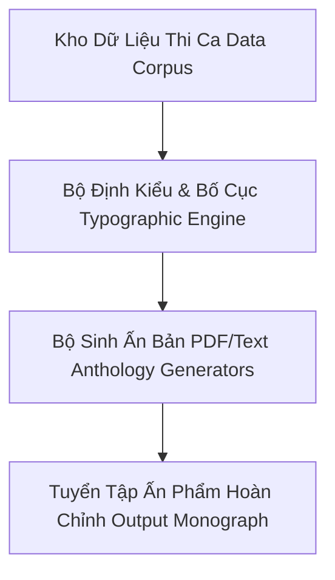

# 📜 Tuyển Tập & Hệ Thống Biên Soạn Thi Ca Kinh Điển Việt - Trung

Module chuyên khảo nghiên cứu, số hóa văn bản học và tự động hóa biên soạn tuyển tập thi ca cổ điển Đường - Tống, thơ Nôm trung đại và phong trào Thơ Mới Việt Nam.

---

## 🏛️ Kiến Trúc Hệ Thống Biên Soạn

Hệ thống được thiết kế theo kiến trúc module hóa phân tầng (Data - Engine - Orchestrator):

### 1. Phân Tầng Dữ Liệu (`poetry_builder/`)
- **`data_tang_song.py`**: Tuyển tập thi ca thời Đường - Tống (Lý Bạch, Đỗ Phủ, Bạch Cư Dị, Tô Đông Pha, Tào Thực) kèm phiên âm Hán Việt, dịch nghĩa và dịch thơ.
- **`data_nom_queens.py`**: Tinh hoa thơ Nôm trung đại của nữ sĩ Hồ Xuân Hương và Bà Huyện Thanh Quan.
- **`data_nguyen_du.py`**: Thi ca chữ Hán (Thanh Hiên thi tập, Nam trung tạp ngâm, Bắc hành tạp lục) và thi phẩm Đoạn Trường Tân Thanh của Đại thi hào Nguyễn Du.
- **`data_tho_moi.py`**: Đỉnh cao phong trào Thơ Mới 1932 - 1945 (Xuân Diệu, Bích Khê, Hàn Mặc Tử, Huy Cận, Chế Lan Viên).
- **`engine.py`**: Lõi typography chuyên nghiệp, căn chỉnh lề sách, xử lý font Unicode tiếng Việt và ngắt trang nghệ thuật.

### 2. Bộ Sinh Ấn Bản Chuyên Đề (`poetry_anthology/`)
Tập hợp 15 script độc lập biên tập và render từng tác giả / tác phẩm kinh điển:
- `ly_bach_generator.py`: Thi Tiên Lý Bạch.
- `do_phu_generator.py`: Thi Thánh Đỗ Phủ.
- `bach_cu_di_generator.py`: Thi Ma Bạch Cư Dị (Tỳ Bà Hành, Trường Hận Ca).
- `to_dong_pha_generator.py`: Tô Đông Pha thi tập.
- `tao_thuc_generator.py`: Kiến An thất tử - Tào Thực.
- `nguyen_trai_generator.py`: Quốc Âm Thi Tập của Ức Trai Nguyễn Trãi.
- `cpng_generator.py`: Chinh Phụ Ngâm Khúc (Đặng Trần Côn - Đoàn Thị Điểm).
- `ho_xuan_huong_generator.py`, `ba_huyen_thanh_quan_generator.py`: Nữ sĩ trung đại.
- `nguyen_du_han_generator.py`: Chữ Hán Nguyễn Du.
- `tho_moi_generator.py`: Tuyển tập Thơ Mới giai đoạn đỉnh cao.

### 3. Kịch Bản Biên Soạn & Phụ Lục
- **`build_all_poetry.py`**: Kịch bản điều phối biên soạn hàng loạt (Master Batch Compiler).
- **`compile_vn_classics.py`**: Biên soạn tổng hợp văn học kinh điển Việt Nam.
- **`build_dongchu_book.py`**: Xử lý và số hóa văn bản Đông Chu Liệt Quốc.
- **`render_song_da.py`**: Ấn phẩm chuyên khảo Người Lái Đò Sông Đà.
- **`render_vietnamese_supplement.py`**: Bộ kết xuất phụ lục bổ sung văn học.
- **`poetry_supplement.json` & `literature_supplement.json`**: Tập dữ liệu phụ lục văn bản học.

---

## 🔒 Kiểm Soát An Toàn Dữ Liệu
- Toàn bộ script tuân thủ mã hóa UTF-8 chuẩn.
- Loại trừ các file nháp tạm thời và file test render dung lượng lớn nhằm đảm bảo sự tinh gọn và tối ưu hóa cho Git repository.
